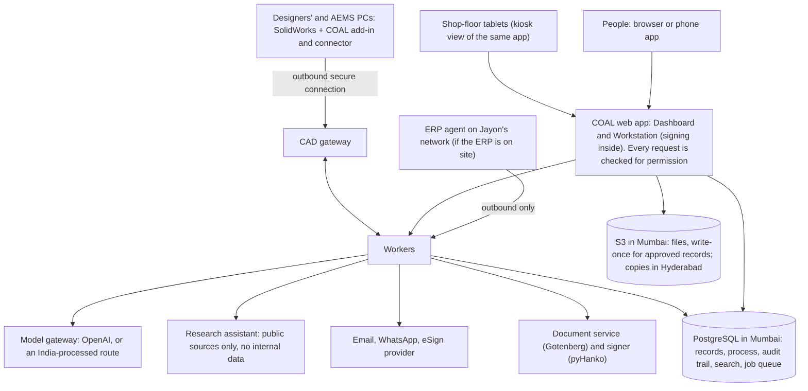
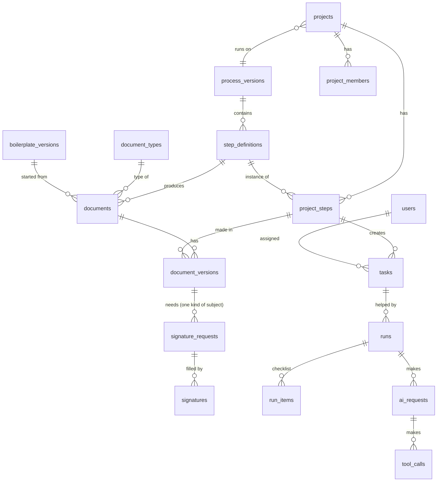

# COAL: the plan for automating Jayon's R&D

**Status:** Draft 2, 16 November 2026, revised after an independent review.
**Built from:** the R&D workflow page (revision 2, with the COAL meeting points: https://claude.ai/artifact/Vj6sUzdo4tEaL4uFpud55e) and the research done for this plan (Appendix A).
**Step numbers** follow the workflow page: C (the concept, where the VP starts), steps 1 to 23 and 25, and the three added at the meeting: 2a, 24a and 24b. That makes 27 numbered steps after the start. There is no step 24: the meeting split it into 24a (pre-transfer) and 24b (final transfer and training).

---

## How to read this plan

- **Part 1** is the whole plan on one page. If you read nothing else, read that.
- **Part 2** explains the words we use. Abbreviations are in Appendix B.
- **Parts 3 and 4** describe what people will see and how work moves from the VP's idea to the launch.
- **Parts 5 to 10** explain how COAL is built and what it costs. Even if you skip the detail, read 6.2 (who may see what), 7.1 and 7.4 (the legal points) and 10.2 (the monthly cost).
- **Part 11** is the build order, step by step. **Part 12** lists the risks. **Part 13** lists the decisions and the questions we need answered.
- Each Part opens with a short **In short** paragraph.

### Contents

1. [The plan on one page](#part-1--the-plan-on-one-page)
2. [Words we use](#part-2--words-we-use)
3. [What each person sees](#part-3--what-each-person-sees)
4. [How work moves through COAL](#part-4--how-work-moves-through-coal)
5. [How the AI helps](#part-5--how-the-ai-helps)
6. [Security clearance](#part-6--security-clearance)
7. [Signatures and compliance](#part-7--signatures-and-compliance)
8. [Technology choices](#part-8--technology-choices)
9. [The database](#part-9--the-database)
10. [Hosting and running cost](#part-10--hosting-and-running-cost)
11. [Build plan](#part-11--build-plan)
12. [Risks](#part-12--risks)
13. [Decisions and questions](#part-13--decisions-and-questions)
14. [Appendix A: Sources](#appendix-a--sources)
15. [Appendix B: Abbreviations](#appendix-b--abbreviations)
16. [Appendix C: What to collect for the machine, software and instrument lists](#appendix-c--what-to-collect-for-the-machine-software-and-instrument-lists)
17. [Appendix D: All the tables](#appendix-d--all-the-tables)

---

## Part 1 — The plan on one page

**What we are building.** COAL runs Jayon's R&D route, from the VP's idea to the product launch. When the VP says **Go**, COAL creates the project. Everyone involved sees it in their Workstation, and each person's **Docket** (our name for the to-do list) fills with their part as soon as it is their turn. When a task opens, the AI starts the groundwork straight away: it drafts the document from the company's boilerplate, pulls the data, runs the research, or works in SolidWorks through a connector. The person reviews, corrects and signs. Signing moves the work to the next person automatically.

**Each person has two pages.**

- **Dashboard:** what needs them now, what is coming next, and how their own work and their team's work is going.
- **Workstation:** an assistant like ChatGPT or Claude. It has a project space for every R&D project the person is part of, with chats inside each one. For each task it shows a checklist, works through it item by item like Claude Code, and ends with a finished piece of work for the person to review. Signing, settings and everything else sit inside these two pages (3.5).

**Five rules the whole design follows.**

1. **People decide; the AI prepares.** The AI never signs, approves, or sends anything outside the company. It sends nothing to a colleague either, unless the person it works for has seen and approved the exact text.
2. **Facts come from the system, not the model.** Numbers, dates, names and statuses are fetched through COAL's own APIs and shown with their source. The AI writes around the facts; it does not invent them.
3. **Need-to-know is enforced where the data lives.** The AI only reads what the person asking may read, and anything it writes for someone else is checked against that person's clearance. It cannot leak what it never received.
4. **Every signature counts.** Approvals use passkey signatures, confirmed with Face ID, a fingerprint, Windows Hello or the device PIN. They are built to FDA's Part 11 rule and ISO 13485 from day one, and validated before COAL holds official records. Where Indian law requires a signature, COAL adds a government-recognised Aadhaar eSign or DSC step for the document types Indian counsel names (Part 7).
5. **The process is data.** The 27 steps, who does them, who signs them, and where rework goes are stored as a versioned process map. When the process changes, as it just did at the meeting, an admin edits the map, and the change is tested and signed like any change to a validated system. Nobody rewrites code.

**Technology in one line.** A TypeScript web app (Next.js) on PostgreSQL, hosted in AWS Mumbai. The R&D route runs on COAL's own small process engine inside the database. The AI works through a provider-neutral layer: OpenAI first, with a route that keeps sensitive data in India. Small connectors link each designer's SolidWorks and, if needed, the ERP. Part 8 has the details.

**Running cost in one line.** Hosting production in India costs about **₹55,100 a month** (about US$585, before 18% GST). Licences for document generation, sealing, eSign and alerts add about ₹11,000 to ₹21,500 a month, so COAL costs about **₹66,000 to ₹77,000 a month before GST** to run. AI usage comes on top, and so do SOLIDWORKS PDM Professional licences if Jayon adopts them (about ₹5,900 a month per CAD editor, after a one-time purchase of about ₹38 lakh for 10 editors). While COAL is being built, the test environment and the licences needed from Phase 1 cost about ₹27,000 to ₹32,500 a month. Part 10 has the line items.

**Four findings that shape the plan.**

- **Indian law may want a stronger signature for some documents.** India's Medical Devices Rules say quality-system documents must be "approved, signed and dated". Under the IT Act, a signature the law demands may have to be a government-recognised one: a Digital Signature Certificate (DSC) or an Aadhaar eSign. An Indian lawyer's opinion will decide where that extra step is needed, and COAL can switch it on per document type (7.4).
- **Prototypes need a CDSCO test licence first.** Devices made for testing, evaluation or clinical trials need a test licence (Form MD-13, applied for on Form MD-12). COAL tracks the licence, its validity and the quantity made under it, and blocks prototype work that it does not cover (step 10).
- **The clinical trials at step 20 need approvals before the first patient.** Putting trial sets of an implant into patients before it is licensed in India can be a clinical investigation. That needs permission from CDSCO (India's device regulator), approval from a registered ethics committee at each hospital, and registration on CTRI (India's clinical trials register). Every study needs ethics approval and patient consent. Which route applies depends on the device, so QA confirms it for each project, and COAL will not open step 20 at a hospital until the approvals are recorded.
- **"Data in India" and AI need a policy.** OpenAI's option to keep data in India currently runs only one small model inside India. Other routes, such as Amazon Bedrock's India regions, can keep stronger models in India. Jayon decides which data may be processed outside India (5.8).

**Build order.** Phase 0, gather inputs and decide → Phase 1, the foundation (process, Docket, Dashboard with productivity, documents, signatures and sealing, audit trail) → Phase 2, the Workstation AI → Phase 3, the connectors (ERP, shop floor, QC) and the production environment → Phase 4, validation and a pilot project → Phase 5, rollout and improvements. The SolidWorks connector is built alongside, from Phase 2, as its own track. The first real project could start in COAL about 5 to 6 months after Phase 0 begins (Part 11).

---

## Part 2 — Words we use

**In short:** these are the terms the rest of the plan relies on. Abbreviations are in Appendix B.

| Word | What it means in this plan |
|---|---|
| **Project** | One product idea going through R&D, from the VP's Go to the launch. |
| **Project space** | The folder in a person's Workstation for one project: its brief and its chats. |
| **Step** | One of the steps on the R&D route: C, 1 to 23, 2a, 24a, 24b and 25. |
| **Checkpoint** | A go/no-go step: 4, 12, 18 and 23. Nothing after it starts until it is signed. |
| **Task** | One person's part of a step. A step with three people creates three tasks. Meeting action items, corrective actions, questions from colleagues and training are tasks too. |
| **Docket** | A person's list of tasks: what is on their plate now and what is coming (our proposed name for the to-do list; see 3.1). It is not a third page: it sits at the top of the Workstation's left column, and the Dashboard shows the same tasks under "Needs you now" and "Coming up". |
| **Sign-off** | A signature with a meaning (usually Prepared, Reviewed or Approved; QC inspectors sign as Verified, and receivers as Received and accepted) and, where the step allows, a decision: approve, send back for rework, or drop the project. |
| **Passkey signature** | COAL's own electronic signature. The signer confirms it with Face ID, a fingerprint, Windows Hello or the device PIN on their phone or laptop. Built to FDA's Part 11 rule. This is the everyday electronic signature for approvals: what the meeting called a digital signature. (In Indian law, "digital signature" means a DSC or an eSign; see 7.2.) |
| **Aadhaar eSign** | India's government-recognised online signature, confirmed with an Aadhaar one-time password or through a licensed Certifying Authority, at about ₹15 to 25 each. An extra step COAL can switch on for document types where Indian law demands it. A **DSC** (Digital Signature Certificate, usually on a USB token) is the other recognised form. |
| **Hash code** | A short code calculated from a file or record (COAL uses SHA-256). If even one character changes, the code changes, so tampering shows. |
| **Seal** | The company's certificate and a trusted timestamp applied to a final PDF, so anyone can check that it has not been changed. |
| **Boilerplate (BP)** | A standard template document that every new project starts from, such as the Action Plan or the FEA report. |
| **Run** | One piece of AI work on a task, such as "draft the Action Plan". It appears as a live checklist in the Workstation. |
| **Playbook** | The stored recipe for the AI's help at one step: the checklist items that must always be done, the data to fetch, the tools allowed, the boilerplates to fill, and where a person must approve. |
| **Connector** | A small program that links COAL to another system: SolidWorks, the ERP, the shop-floor tablets, the machines. |
| **Clearance** | What a person may see. COAL works it out from their role, their projects, their assigned steps, and how sensitive each piece of data is. |
| **Data label** | The sensitivity tag on every record, and on each section of a mixed document: a level (public, internal, confidential, restricted) plus compartments such as finance, Board, clinical or HR. Clearance and AI routing both use it. |
| **Process map** | The stored definition of the R&D route: steps, order, who does and signs each one, and the rework routes. |

---

## Part 3 — What each person sees

**In short:** everyone gets a Dashboard and a Workstation. The Dashboard shows what needs them and how work is going. The Workstation is a Claude-like assistant organised by project, where tasks arrive already started and end with a signature.

### 3.1 A better name for the to-do list

**Recommendation: Docket.** A docket is the list of matters waiting for someone's action. The word is short and already familiar in India. A name such as "Desk" would blur with "Workstation"; "Docket" does not.

| Option | Why it could work | Why it might not |
|---|---|---|
| **Docket** (recommended) | Means "matters waiting for your action". Formal enough for a medical-device company. | Also used for courier tracking numbers in India. |
| **Baton** | Captures the hand-off: you receive the work, do your part, and pass it on. | Playful; awkward in the plural ("you hold 3 batons"). |
| **Worklist** | Plain and impossible to misread. | Generic; says nothing about COAL. |
| **Bench** | Feels like a lab or a workshop: "what is on your bench". | Can sound like being "benched" (left out). |
| **Coalface** | Fits the COAL name: "work at the coalface" means the hands-on part of a job. | The idiom is British and not widely known. |

The rest of this plan uses **Docket**. The individual items are **tasks**.

### 3.2 The Dashboard

The Dashboard answers three questions in this order: *What needs me now? What is coming? How are we doing?* Every number on it comes straight from the database, never from the AI, and every panel is filtered for the person looking at it by the same permission check the rest of COAL uses (6.1).

**What every Dashboard has**

- **Needs you now:** tasks and sign-offs waiting for this person, oldest first, with due dates and a red marker when overdue.
- **Coming up:** tasks that will open when earlier steps finish, with the expected start date from the Action Plan.
- **Your projects:** each project's stage and health (on track, at risk, late), shown as a strip of the six stages. For people without budget access, health is worked out from dates only, so it never hints at budget problems.
- **Alerts:** missed dates, rework, failed tests, expiring licences, instruments due for calibration, but only about things the person may see.
- **How it is going:** the person's own measures and, for managers, the measures of everyone below them in the org chart.

Outside users (production, the Quality Control department, the company QA team, marketing) see only the items they must act on.

**What changes by role**

| Role | The main panels |
|---|---|
| **Board** | Projects waiting for a Board decision (steps 4 and 23). Portfolio by stage. Spend against budget across all projects. Launches this year. R&D's on-time rate and sign-off turnaround by department. |
| **VP** | The full pipeline, from ideas to launch. Sign-offs waiting on the VP (steps 1, 2, 3, 5, 19, 25). Projects at risk. Budget burn. A summary of deviation reasons. Market feedback highlights. |
| **R&D Head** | Every project by stage. Sign-offs waiting on the R&D Head. Overdue tasks by person. Bottlenecks: where work waits longest. Rework counts. Prototype costs. Test pass rate. Team workload. |
| **R&D Lead** (one per product line) | The line's projects. The status and lateness of every task on those projects, across design, AEMS, PME, Ops and DARD. Sign-offs waiting on the Lead (7, 8, 10, 11, 13, 14, 15). Each role's upcoming dates. Deviations. |
| **Design engineers** | My designs and revisions. Drawings waiting for sign-off. FEA requests linked to my parts. Due dates. Whether my SolidWorks connector is online. |
| **AEMS** (FEA and metallurgy) | The FEA queue. Material definitions waiting for input. Results waiting for review. |
| **PME** | Prototype jobs (run cards) and their status. Machine availability. Efficiency (OEE) by machine. Hours and scrap per prototype. (Prototype costs are shown to the Lead, R&D Ops and those above them, unless Jayon decides otherwise: question 24.) Trial set and master set builds. |
| **R&D Ops** | Purchases and outsourcing (from the ERP). Test lab work: request forms, test plans, results. Surveys out with surgeons. Trial logistics. Signatures Ops is handling. |
| **DARD** | Regulatory readiness for each body, as a percentage of required documents done. Test plans to check. Raw material tests. Audit documents. Open non-conformities. |
| **QC inspectors** | The inspection queue. Overdue inspections. Instruments due for calibration. |
| **Outside users** (production, the Quality Control department, the company QA team, marketing) | Only what they are asked to act on: transfer packages to acknowledge, survey forms to collect, licences and approvals to record. |

**How productivity is measured.** The meeting asked for the productivity of each person and of the people under them. COAL measures the *flow of work*, not activity. It does not track keystrokes or screen time. These measures are fair, easy to explain, and hard to game:

| Measure | What it means |
|---|---|
| On-time rate | Share of tasks finished by the date first given to them (the baseline), over the last 90 days. Moving a date later does not improve it. |
| Days per task, against plan | How long tasks take from when they open to when they finish, compared with the planned duration. |
| Sign-off turnaround | How long documents wait for this person's signature. |
| Rework rate | Share of this person's work sent back for rework. |
| Open load | Tasks open now, and how many are overdue. |
| Deviations | Late tasks with their recorded reason and cause (see 4.4). |

**Who sees whose numbers.** Each person sees their own. Managers see everyone below them in the org chart, with the reasons attached, so a late task caused by a vendor is not held against the engineer. A Lead also sees the status and lateness of every task on their line's projects. Who sees the *named* cause of a delay follows one rule, in 4.4. The Board sees its own measures and department summaries. These measures are calculated live from tasks, signatures and deviations, so they work from the first day.

### 3.3 The Workstation

The Workstation is a chat assistant with three areas.

```
┌──────────────────┬───────────────────────────────────────┬──────────────────────┐
│ DOCKET           │  Step 5 · Action Plan · SPN-2026-007  │  PREVIEW             │
│  ● Action Plan   │                                       │                      │
│    due 12 Jan    │  Assistant (started when step 5       │  Action Plan         │
│  ○ Review FEA    │  opened):                             │  Draft 3             │
│    opens ~3 Feb  │   ✓ Read the signed PID and proposal  │                      │
│                  │   ✓ Pulled the team and their load    │  1. Team             │
│ PROJECT SPACES   │   ✓ Pulled the Board-approved budget  │  2. Timeline         │
│  ▸ SPN-2026-007  │   ✓ Built the timeline from past      │  3. Raw material     │
│     Project brief│     projects' durations               │  4. Design inputs    │
│     Step 5 chat  │   ◐ Waiting: AEMS to confirm the      │  5. Risk plan        │
│     Questions    │     raw material grade                │  Budget annex        │
│  ▸ TRM-2026-003  │   ○ Check every role has dates        │                      │
│                  │                                       │  [ Sign as Prepared ]│
│ + New chat       │                                       │                      │
└──────────────────┴───────────────────────────────────────┴──────────────────────┘
```

- **Left: the Docket and the project spaces.** The Docket sits at the top. Below it is one project space for every R&D project the person belongs to, each holding its chats. COAL creates the project space in everyone's Workstation the moment the VP says Go. Until a person's part begins, their project space shows a short brief and a line such as "Your part starts after step 5, expected around 3 February".
- **Centre: the conversation.** People talk to the assistant as they would to ChatGPT or Claude. When a task opens, COAL starts a chat for it and the assistant **starts working straight away** from the step's playbook, as the person it works for. By the time the person opens the task, the checklist is mostly ticked and a draft is waiting. The assistant stops only when it needs a decision or input it cannot fetch. The person can change the checklist and run it again.
- **Right: the preview.** Whatever the run is producing: a document draft, a drawing, a table of test results. The Sign button lives here, so reviewing and signing happen in one place.

**A task, start to finish (example: the Action Plan, step 5).**

1. The Board approves the proposal at step 4 (the MD and the CEO both sign). COAL opens step 5 and puts a task on the Docket of the Lead and of the R&D Head, with a work message: *"Step 5 is open for SPN-2026-007. The PID, the proposal and the Board decision are linked. Due 12 January."*
2. The assistant starts at once from the step 5 playbook. It fetches the team list, the budget and the past durations through COAL's APIs and builds the draft.
3. It needs the AEMS expert to confirm the raw material grade, which it cannot know on its own. It drafts the question for AEMS's Docket, leaving out the budget, which AEMS may not see. The Lead sees the exact wording and sends it with one click.
4. When the Lead opens the task, the draft is in the preview, with every fetched number linked to its source. The Lead edits a few lines in the chat ("move the FEA start a week later"), and the assistant updates the draft.
5. The Lead and the R&D Head sign as **Prepared**. DARD reviews the plan, without the budget annex, and signs as **Reviewed**. The VP signs the plan and its budget annex as **Approved**. COAL then opens steps 6, 7, 8 and 9 for their people, and the per-role dates in the Action Plan become everyone's due dates.

**Asking questions.** Any chat can be used to ask about the projects: *"What did the FEA find on the 5.5 mm screw?"*, *"Which tests are still open?"*, *"When is my next task due?"*. The assistant answers only from data the person is cleared to see, and shows where each fact came from. Part 6 explains how that is enforced.

**Pictures and files.** Any chat or task accepts photos and files, including straight from a phone camera: a prototype on the bench, a QC measurement, a lab report. They are checked for viruses first, then stored with the project and the step, and the AI can read them. Clinical files from step 20 (X-rays, case forms) are the exception: they come in only through a special clinical form and are never shown to the AI (6.1).

**On the phone.** COAL is a web app that can be installed on a phone like an app. That is enough for reading the Docket, answering questions, taking photos, and signing with Face ID or a fingerprint.

### 3.4 Signing

Signing is the same everywhere:

1. **Review.** The document is shown exactly as it was rendered for signing, with its revision and a summary of what changed since the last revision. The final PDF later adds only the printed signature block and the seal.
2. **Decide.** Approve, send back for rework (with a reason, and the step to return to, chosen from the routes the process map allows), or drop the project (with a reason), where the step allows these. Where the workflow gives the rework call to someone else, the signer refers it to them: for example, a failed prototype at steps 10 and 11 goes to the R&D Head, although the Lead signs those steps.
3. **Confirm it is you.** Face ID, a fingerprint, Windows Hello or the device PIN through a passkey, or a company security key. This happens at every signature, not once per session.
4. **Recorded for good.** COAL records who signed, when, with what meaning and decision, the reason, the hash code of the exact document version and of the PDF shown, and the full passkey response. The name, date and meaning are printed on the document's signature rows. Nothing about the signature can be edited afterwards.
5. **The work moves.** COAL opens the next step or steps and notifies the people who now have work.

Part 7 explains why this design satisfies auditors.

### 3.5 Everything else lives inside the two pages

The owner asked for two pages per person. Everything else is placed inside them:

- **Signing** is a dialog in the Workstation's preview, also reached from "Needs you now" on the Dashboard.
- **Personal settings** (passkeys, notifications, delegation, the e-signature agreement and training) sit in the Workstation's profile menu.
- **Admin work** (the process map, boilerplates, clearance rules, impact reports) is an "Administration" project space in the admins' Workstation. Admins are the only people with extra screens.
- **Shop-floor tablets** show a kiosk view of the operator's run-card tasks only, with no Dashboard, chat or AI.
- **People outside Jayon** (test labs, surgeons, outside makers) get a single-task link or a minimal invited account that shows only what was shared with them (8.5).
- **In Phase 1**, the Workstation is built without the assistant: the Docket, project spaces, the document preview with Sign, and New idea as a form. Phase 2 adds the chat and the runs.

---

## Part 4 — How work moves through COAL

**In short:** the VP's Go creates the project and opens the first steps. Each step then follows the process map: COAL opens it when its inputs are signed, the AI prepares the work, people sign, and the next steps open. Dates, alerts, rework and process changes all follow written rules.

### 4.1 The moment the VP says Go

The VP starts with **New idea** in the Workstation and describes the idea in a chat. The assistant asks follow-up questions, finds similar products already on the market, and drafts the **Product Concept** from its boilerplate. It then shows the responsibility boxes: who does what in the first steps, and who signs. When the VP clicks **Go** (a signed decision), COAL does all of this within a few seconds:

1. **Creates the project** with a code (for example `SPN-2026-007`: product line, year, number) and fixes it to the current version of the process map.
2. **Creates every step** of the route for this project, all waiting except the first ones.
3. **Fills the roles.** It assigns the default person for each role: the Lead of the product line, the R&D Head, and the Ops, DARD and other team members suggested in the concept. AEMS's metallurgy expert is always on the team, as the workflow requires. Step 1 (the Project Initiation Document) confirms the final team later.
4. **Adds a project space to everyone's Workstation.** Each person's brief is written by a run that acts as that person, from data they may see.
5. **Opens steps 1, 2 and 2a.** It puts tasks on the right Dockets, and each person gets a work message written for their responsibilities and checked against their clearance.
6. **Starts the clocks.** Until the Action Plan (step 5) sets real dates, each step uses the default duration from the process map.
7. **Writes the audit trail.** Every action above is recorded, with the VP's signed Go as its cause.

### 4.2 The process map

The route is stored as data, not written into code. The map holds:

- **Steps:** the number, name, stage, kind (normal, checkpoint, or only-if-needed), the roles that do the work, the role that signs, the boilerplates the step produces, the default duration, and the AI playbook (5.1).
- **Links:** which steps must finish before another can start (for example, step 3 needs both 1 and 2), and which start together.
- **Conditions:** for example, step 15's study runs only if the R&D Head marked a pre-clinical study as needed at step 12; otherwise step 15 produces a signed justification.
- **Special starts:** a step can start when a milestone is recorded (step 10 when the material is in; step 21 after the trial surgeries) or when a count passes a threshold (step 24a after about 50 positive cases). Every milestone and counter the map uses is declared, with the step that sets it. Counters are computed from the records (for example, the number of trial cases recorded as positive), never typed in; only the threshold is a setting.
- **Tracks:** work that runs alongside the route for a long time, such as the one-year patient follow-up opened at step 20.
- **Rework routes:** where each step may send work back to, who proposes it and who decides (for example, 18 may return to any step from 7 to 17, decided by the R&D Head; 20 and 21 return to 10).
- **Versions:** every change creates a new version. Projects already running stay on the version they started with, unless someone deliberately moves them across (4.5).

The workflow page on claude.ai is the human-readable picture of version 1 of this map.

### 4.3 Step by step: what COAL does at each step

Each block says who does the step and who signs, when it starts (where that is not obvious), what the AI's checklist does, what the step produces, and what happens next. "Open" lines point to the questions in 13.2. The checklist is the run the assistant starts when the task opens; people can change it.

#### Stage 1: Idea and go-ahead

**C · The idea:** VP
- **Checklist:**
  1. Interview the VP about the need, the product line and the users.
  2. Search Jayon's catalogue and similar devices already on the market, with sources.
  3. Draft the Product Concept from its boilerplate.
  4. Propose the team and show each person's responsibilities as boxes.
- **Produces:** the Product Concept. The workflow sets no sign-off here; the Go is the VP's signed decision to open the project (7.2).
- **Next:** on Go, COAL creates the project (4.1) and opens steps 1, 2 and 2a together.

**1 · Project inception:** R&D Head with the Lead → **VP signs**
- **Checklist:** fill the Project Initiation Document (PID) boilerplate from the concept → suggest team members from the staff directory, showing whether each is available or busy → draft the objectives, scope and first risks → list what is still missing.
- **Produces:** the PID, which names the project team.
- **Next:** signing confirms the team (with AEMS's metallurgy expert always included), so COAL adds or removes people's access. Step 3 starts when steps 1 and 2 are both signed.

**2 · Market study:** R&D Ops → **VP signs**
- **Checklist:** research competitor products, sizes, prices, published clinical evidence and surgeon needs, with sources → pull Jayon's own sales history for related products from the ERP (shown only to roles cleared for it) → draft the Market Research Survey and the feasibility notes.
- **Produces:** the Market Research Survey.
- **Next:** feeds step 3.

**2a · Regulatory planning (new at the meeting):** Lead and DARD (to be confirmed)
- **Checklist:**
  1. Work out the device class and approval route in each target market: CDSCO in India, CE under the EU MDR, and FDA (usually a 510(k)).
  2. Check whether an equivalent device is already approved in India; this decides the clinical route at step 20.
  3. List the standards that will apply.
  4. Build the checklist of documents each body needs, and draft the Regulatory Plan.
- **Produces:** the Regulatory Plan. Its document checklist is what step 22 is measured against.
- **Next:** steps 13, 19 and 22 use it. Step 3 does not wait for it.
- **Open:** where exactly it sits, who does it and who signs it (question 1).

**3 · Project proposal:** R&D Head → **VP signs**
- **Checklist:** combine the signed PID and market study, and the Regulatory Plan if it is ready → estimate the budget and timeline from the actual costs and step durations of past projects → draft Project Planning and the Project Approval Form.
- **Produces:** the project proposal.
- **Next:** the VP takes it to the Board (step 4).

**4 · Board approval (checkpoint):** VP brings it → **Board signs** (the MD and the CEO, both)
- **Checklist:** build a one-page Board summary on top of the full proposal → send each Board member a signing request → collect the decisions, given at the meeting or online.
- **Produces:** the approved proposal, recorded as a Board business decision.
- **Next:** approve → step 5. The workflow does not say what happens if the Board does not approve. Proposal: back to step 3, on hold, or close the project, with the reason recorded (question 18). Whether this is a statutory Board resolution is question 17.

#### Stage 2: Plan, design and source

**5 · Action plan:** Lead and R&D Head → **VP signs**
- **Checklist:**
  1. Start from the Action Plan boilerplate (the standard document the meeting asked for).
  2. Copy the team from the PID, and put the approved budget in a separate budget annex.
  3. Build the timeline with each role's dates, using past durations.
  4. Draft the raw material definition for each implant and instrument from its intended use, the material standards and early analysis.
  5. List the design inputs (the requirements the product must meet), each with how it will be verified.
  6. Draft the risk management plan: scope, acceptability criteria, how risks will be verified, and how production and post-market information will be collected.
  7. Check that every role has dates and the budget adds up.
- **Produces:** the Action Plan (which also serves as the design and development plan auditors expect), its budget annex, the design inputs and the risk management plan. Once signed, its dates become the baseline for everyone's due dates (4.4).
- **Next:** a design input review is recorded at signing (7.7). Steps 6, 7, 8 and 9 start in parallel.
- **Open:** is the raw material definition updated after the FEA at steps 7 and 8 (question 2)?

**6 · Raw material:** Lead, R&D Ops and DARD → **R&D Head signs**
- **Checklist:**
  1. The Lead drafts the raw material requirement (grade, form and quantity) from the Action Plan.
  2. The R&D Head approves it with a signature. Nothing is bought before this.
  3. R&D Ops raises the requisition and orders from approved vendors in the ERP.
  4. When the material arrives, the AI reads the mill certificate and compares each value with the standard, flagging anything out of range. DARD takes part in the raw material test and verifies the results.
  5. Record the heat or lot numbers.
- **Produces:** the approved requirement, the order (in the ERP), the raw material test record, and the heat or lot numbers used for traceability.
- **Next:** "material in" is recorded as a milestone; prototypes (10 and 11) can then start.
- **Open:** what exactly DARD does here, and the audit procedure documents (question 3).

**7 · Implant design:** design engineers and AEMS → **Lead signs**
- **Checklist** (the SolidWorks connector version each item needs is in brackets; see 5.5):
  1. Read the model's properties and check they are complete: material, part number, revision (v1).
  2. Check that every drawing has its critical dimensions marked for QC (v1).
  3. Export PDF and STEP files to the project (v1).
  4. Read the FEA results into COAL and draft the FEA report from its boilerplate (v1). Set up and run the FEA study on every size from the AEMS template (v2).
  5. Add the FEA findings to the risk file.
  - Until a connector version is ready, engineers export and upload the files, and COAL reads them.
- **Produces:** the 3D model, the drawings with critical dimensions, the FEA report, and risk file entries. At signing, COAL records the hash codes of the native SolidWorks files and of the PDF and STEP copies, and the PDM version if PDM is used.
- **Next:** a design freeze review is recorded once steps 7 and 8 are signed. Signed drawings plus material in → step 10. If the FEA fails, the Lead sends the design back for rework within the step.

**8 · Instrument design:** the same as step 7, for the instruments → **Lead signs**. Next: step 11.

**9 · Outsourcing:** Lead, R&D Ops and DARD → **R&D Head signs**
- **Checklist:** sort each item into make in-house, buy as it is, or have made outside → for bought items, find the catalogue item and supplier → for custom items, prepare the request-for-quote pack with the signed drawing (a person sends it; COAL watermarks and logs it) → raise and track the orders in the ERP, once the budget is approved at step 5.
- **Produces:** the outsourcing list, the quote requests and the orders.
- **Next:** bought and outside-made items feed steps 10, 11 and 19.

#### Stage 3: Make the prototype

**10 · Implant prototype:** PME and QC inspectors → **Lead signs**
- **Starts when:** the drawings are signed, the material is in, and a valid CDSCO test licence is recorded.
  - Under the Medical Devices Rules (Rule 31), devices made for testing, evaluation or clinical investigation need a test licence granted on Form MD-13 (applied for on Form MD-12; CDSCO decides within about 30 days).
  - When steps 7 and 8 open, COAL puts the application on the company QA team's Docket (the company QA team, not NPD QA), so it is filed in time.
  - COAL blocks the run card unless the licence is granted, in date (it lasts three years), covers this device and the place named in it, and has quantity left. It keeps the ledger the Rules require: units made, tested and stocked, and how each was disposed of.
  - Where QA records that an instrument is Class A, non-sterile and non-measuring, the licence gate does not apply.
- **Checklist:**
  1. Create the prototype run card from the drawing and the process plan.
  2. Raise the Material Issue Slip in the ERP.
  3. Suggest slots on R&D's own machines. When a production or general-instruments machine is needed, the R&D Ops Assistant Manager requests it from the Chief Production Manager, who allocates it; R&D Ops records the allocation on the run card.
  4. While machining, operators log each operation on a shop-floor tablet: operator, start, finish, quantity.
  5. When the part is done, generate the QC inspection report from the drawing's critical dimensions. The inspector fills it in, and a second person verifies any readings typed by hand.
  6. A system job (not PME's own run) builds the prototype's cost sheet. R&D Ops checks it and the R&D Head approves it, and COAL then produces the costing document. Costs are visible to the Lead, R&D Ops and those above them; the rates behind them only to R&D Ops, the VP and the R&D Head.
  7. Draft the Prototype Approval Form.
- **Produces:** the run card (with the Material Issue Slip number, batch number, drawing number and revision, operations and machines), the Material Issue Slip, one QC inspection report per prototype, the costing document, and the Prototype Approval Form.
- **Next:** step 12. If a prototype fails, the R&D Head (not the Lead) takes the rework call and sends it back to step 7.
- **Open:** who approves the Material Issue Slip (question 4; a suggestion is in 5.6), and the details of the test licence rule (question 14).

**11 · Instrument prototype:** the same as step 10, for instruments. A failure goes back to step 8, on the R&D Head's call.

**12 · Review meeting (checkpoint):** Lead and project team → **R&D Head signs**
- **Checklist:**
  1. Prepare the agenda and a status pack for each attendee, built from what 6.2 lets them see: every step's status for everyone; FEA results for design, AEMS, DARD, the Lead and the R&D Head; QC reports; costs only for the Lead, the R&D Head and R&D Ops.
  2. Record and transcribe the meeting in English and Malayalam.
  3. Draft the minutes, with each section labelled by sensitivity. The Lead confirms the labels before the minutes go out, and attendees confirm the sections they can see.
  4. Turn each action item into a task on the right Docket. Each action item takes the label of its minutes section and is checked against the assignee's clearance first.
- **Produces:** the minutes, which are the formal design review record: the design baseline reviewed, who attended and in what role, the decision and the actions. The recording and the full transcript are kept only for the R&D Head and the note-taker, labelled at the highest level discussed, and deleted once the minutes are signed unless Jayon decides otherwise (question 23).
- **Decision:** the R&D Head approves (which opens step 13) or sends the work back to step 7 or 8, and records whether a pre-clinical study (step 15) is needed.

#### Stage 4: Test and gather feedback

**13 · Testing and validation:** R&D Ops, DARD, PME and design engineers, with an outside test lab → **Lead signs**
- **Checklist:**
  1. *Sub-work 1:* DARD identifies the tests the product needs (the standards and testing parameters, from the Regulatory Plan and the device type) and the fixtures the lab will need.
  2. *Sub-work 2:* identify the test labs: accreditation, scope, past turnaround times.
  3. Write both into the boilerplate report. The Lead decides whether to proceed.
  4. Fill in the lab's own test request form (TRF) from project data. The TRF is the lab's form, so COAL maps the fields onto it.
  5. DARD and R&D Ops check the lab's test plan against the company data together and record the check. R&D Ops tells the lab to proceed only once they have recorded that there is no discrepancy.
  6. When results arrive, a separate AI step with no tools reads the lab report into a fixed form; a person confirms the values; COAL compares them with the acceptance criteria.
  7. Compile the testing and validation document for CE and FDA.
  8. Send the final test report to the R&D Head for information. The Head acknowledges it but does not sign it off.
- **Who decides a failure:** R&D Ops, with DARD's help, takes the first decision, which is then presented to the Lead and the R&D Head. Who has the final say is question 19.
- **Produces:** the testing-parameters and test-labs report (a boilerplate), the TRF, the checked test plan, the test report, and the testing and validation document.
- **Next:** pass → step 14, and step 15. A confirmed failure → back to step 7.
- **Open:** which documents R&D Ops and the Lead each sign (question 5).

**14 · Market feedback:** R&D Ops and the Lead, with marketing and surgeons → **Lead signs**
- **Checklist:** R&D Ops turns the Lead's questions and doubts into the Market Research Survey with new questions about the prototype → marketing takes the form to key surgeons (KOLs), or each surgeon gets a single-use link that expires and shows only the approved questions → the answers pass through the no-tools reader (6.1) → the AI summarises them.
- **Produces:** the survey form and the surgeons' answers.
- **Next:** step 16.

**15 · Pre-clinical study (only if needed):** R&D Ops and DARD → **Lead signs**
- **If the R&D Head recorded at step 12 that no study is needed:** the step still opens as a short task. R&D Ops and DARD write the justification, and the Lead signs it (question 20).
- **If a study is needed:** draft the animal or cadaver study protocol → collect the report → the Lead signs.
- **Produces:** the study report, or the signed justification.
- **Next:** step 16.

**16 · Prototype case study:** Lead → **R&D Head signs**
- **Checklist:** pull the testing, feedback and any pre-clinical findings into the case study boilerplate → list the corrective actions and put each one on the right person's Docket.
- **Produces:** the prototype case study (a boilerplate) and the corrective actions.
- **Next:** step 17. Step 18 stays blocked until every corrective action record is closed.

**17 · Marketing tools:** Lead and R&D Ops → **R&D Head signs**
- **Checklist:**
  1. Draft the surgical technique, the catalogue pages and the instructions for use (IFU) from their boilerplates, using sizes and part numbers from the design data and images rendered from SolidWorks.
  2. Assign the device identifiers (UDI) the EU and FDA require: a Basic UDI-DI for the product and a UDI-DI for each size, and put the UDI on the labels.
  3. Draft the implant card and patient information where the EU MDR requires them (for example nails, anchors and cages; screws and plates are exempt), and the summary of safety and clinical performance for implants.
  4. Check the IFU and labels against each target market's labelling rules.
  5. DARD reviews the labelling before the R&D Head signs (a proposal; see 7.5).
- **Why the extra care:** FDA's software guidance treats software that produces labelling or IFU as high risk. Every line of the AI's draft is checked against its source, and we propose that nothing is released without DARD's review (7.5, 7.6).
- **Produces:** the surgical technique, catalogue pages, IFU, labels with UDI, implant card and the draft summary of safety and clinical performance.
- **Next:** step 18.

**18 · Prototype approval (checkpoint):** Lead brings it → **R&D Head signs** (final; the VP does not approve here)
- **Checklist:** compile the Prototype Approval Form → confirm that every corrective action from step 16 is closed.
- **Produces:** the signed Prototype Approval Form and a design review record.
- **Next:** approve → step 19. Not approved → back as far as step 7, depending on how serious the problem is. The R&D Head picks the step.

#### Stage 5: Clinical trials

**19 · Trial set planning:** R&D Head, Lead, R&D Ops and PME, with DARD and the company QA team for the clinical route → **VP signs**
- **Checklist:**
  1. DARD records the clinical route and the company QA team approves it: is the device investigational (no equivalent device approved in India, or a new use, material or major change to a licensed one)? Will the trial data also support CE or FDA?
  2. If the device is investigational, draft the CDSCO application (Form MD-22) and the ethics committee submission from boilerplates: the clinical investigation plan with its sample-size rationale, the investigator's brochure, case report forms, the consent form in English and the local language, investigator undertakings, the sponsor–investigator agreement, insurance, and the current test reports and risk management file. If the data will support CE or FDA, plan the study to ISO 14155 and FDA's rules for foreign data.
  3. Suggest surgeons and sites from Jayon's surgeon list, choosing hospitals whose ethics committee is registered with CDSCO.
  4. Work out the number of sets and cases, and draft the trial set planning document (its boilerplate is still to be designed).
  5. Give PME the build list. Trial sets are not made on prototype run cards: PME's builds are logged as trial-set jobs, so machine time and cost stay complete, and the test licence quantity is checked.
- **Produces:** the clinical route decision, the trial set planning document, and the application dossier when it is needed.
- **Next:** step 20.

**20 · Clinical trials:** Lead, R&D Ops and DARD, with surgeons → **R&D Head signs**
- **Starts when (for each hospital):** the approvals the clinical route needs are recorded.
  - *Clinical investigation:* CDSCO permission (Form MD-23), approval by an ethics committee registered with CDSCO, registration on CTRI, the approved consent form version, and insurance.
  - *Device already licensed in India for this use:* the licence record and a note that the data will not support a licence application replace the CDSCO permission. Ethics approval, the consent form and insurance are still required, and CTRI registration is recommended (ethics committees usually require it).
- **Checklist:**
  1. Track each surgery case: hospital, surgeon, and the units implanted, each linked to its run card and heat number.
  2. Record each patient's consent: the form version and the date.
  3. Schedule the one-year follow-ups and remind the doctors.
  4. Collect the scores. Patients are identified only by a code (9.1).
  5. Flag any serious adverse event at once and run its reporting clocks: to CDSCO, the sponsor and the ethics committee within 48 hours, with a detailed report within 14 days.
  - Clinical files (X-rays, case forms) come in only through the clinical form, which strips hidden data from the files, keeps them away from the AI, and shows them only to the trial roles.
- **Produces:** the surgery case records and the follow-up. Before CE marking, this follow-up is part of the clinical investigation; the EU's post-market follow-up (PMCF) applies only after CE marking.
- **Next:** step 21 starts when the trial surgeries are recorded as complete; the follow-up continues alongside. If design changes are needed, the work restarts from step 10.
- **Open:** how the follow-up procedure runs (question 6), and which clinical route applies to each device (question 13).

#### Stage 6: Release and launch

**21 · Design revision and master set:** Lead, R&D Ops and PME → **R&D Head signs**
- **Checklist:**
  1. List the changes the trials call for.
  2. Draft the Non-Conformity Investigation (the QA form).
  3. Record each design change in a design change record, with its effect on risk and on regulatory approvals.
  4. If design changes are needed, reopen step 10.
  5. Otherwise, prepare the controlled copies, process plan, QC documents and costing, and the run cards for PME's master set (logged as master-set jobs).
- **Produces:** the design revision record, controlled copies, the process plan, QC documents, costing, and the master set.
- **Next:** step 22.
- **Open:** does a change to the instrument design alone still go back to step 8 (question 7)?

**22 · Regulatory approval:** Lead and DARD, with the company QA team → **R&D Head signs**
- **Checklist:**
  1. Assemble each body's submission from the signed documents, using the checklist from step 2a. For CE this includes the clinical evaluation plan and report, the post-market surveillance plan and the PMCF plan.
  2. Draft the risk management report (ISO 14971) from the risk file, against the acceptability criteria in the risk management plan.
  3. Show what is missing.
  4. Register the devices in EUDAMED and GUDID where needed.
  5. Track the trade mark, the registrations and the QA approval.
- **Produces:** the submission set for each body, the risk management report, the registrations and the QA approval.
- **Next:** step 23.

**23 · Release approval (checkpoint):** VP and R&D Head → **Board signs** (the MD and the CEO)
- **Starts when:** the risk management report from step 22 is approved and concludes that the overall residual risk is acceptable.
- **Checklist:** build the release pack, a defined summary the Board may see: aggregate trial outcomes, a test summary and regulatory status (prepared by DARD), and a cost annex (prepared by R&D Ops); the R&D Head releases both to the Board → build the Transfer Approval Form → collect the Board's signatures.
- **Produces:** the Transfer Approval Form signed by the Board, as a business approval. The design review before release is recorded separately (7.7).
- **Next:** approve → step 24a, once the positive-case condition is met. The workflow does not say what happens if the Board does not approve (question 18).

**24a · Pre-transfer (new at the meeting):** Lead, project team and DARD, with production, the Quality Control department and the company QA team
- **Starts when:** step 23 is signed and positive feedback has been received on about 50 cases. COAL counts the project's trial cases recorded as positive; this plan assumes those are the cases meant, and which cases count can be changed until question 10 is answered. The threshold is a setting.
- **Checklist:** assemble the transfer document package → send each department its own documents (each sees only its own package, with no costing) → track the acknowledgements.
- **Produces:** the transfer package, acknowledged by each department.
- **Next:** step 24b.
- **Open:** the exact document list (question 8), and who signs this step (question 9).

**24b · Final transfer and training (new at the meeting):** Lead, project team and DARD, with production, the Quality Control department and the company QA team → **R&D Head signs**; the production head signs the handover checklist
- **Checklist:**
  1. Send the production documents to the Chief Manager, Production; the implant QC documents to the Sr. Manager, Quality Control; the instrument QC documents to the Asst. Manager, Quality Control; and QA's items to the company QA team.
  2. Each recipient acknowledges receipt.
  3. Produce the handover checklist of every item.
  4. Book the training, and record attendance and material.
  5. Collect the signatures.
- **Produces:** the signed handover checklist and the training records.
- **Next:** step 25.
- **Open:** whether the Quality Control managers also sign (question 11), and who gives and receives the training (question 12).

**25 · Product launch:** R&D Head and R&D Ops → **VP signs**
- **Checklist:** run the launch checklist → track the launch sets in the ERP → hand QA the post-market surveillance and PMCF plans, the PSUR calendar, and the complaint and vigilance routes → write up the lessons learned.
- **Produces:** the launch record and the lessons learned.
- **Next:** the R&D steps close. The project stays open until the one-year follow-up from step 20 is complete.

### 4.4 Deadlines, alerts and deviations

**Where dates come from.** Before step 5, each step uses its default duration from the process map. The VP-signed Action Plan (step 5) then gives every role its own dates, which become the due dates on people's Dockets. COAL keeps these dates as the **baseline** and records every later change.

**Reminders and escalation** (a proposal for the R&D Head to confirm; counted in working days):

| When | What happens |
|---|---|
| 2 days before the due date | A reminder to the person, in COAL and by email. |
| On the due date | A reminder to the person and to the step's owner (usually the Lead). The task turns red on the Dashboards, and the person is asked for a new expected date and the reason. |
| 2 days late | One level up: design, AEMS, PME, Ops, DARD and QC go to the Lead; the Lead goes to the R&D Head; the R&D Head goes to the VP. |
| 5 days late | The task joins the weekly exception list of the R&D Head and the VP. |
| Sign-offs | Reminders to the signer when the sign-off is due and every 2 working days after. VP and Board signers get the same reminders, but an overdue VP or Board sign-off is not escalated above them. Instead, the person who asked for the signature is told, so they can follow it up. |

Working days follow a company calendar of holidays and working Saturdays that an admin keeps. The timings are settings, not code, and can be changed per step. A check runs every five minutes, so nothing is missed even after a restart.

**Deviation records.** The meeting asked for the reason for any delay and who caused it. When a task finishes late, or its forecast moves past the plan, the person records:

- **The reason**, from a short list: waiting for another step, vendor delay, test lab delay, rework, person unavailable, scope change, other. Plus a sentence of explanation.
- **The cause:** a person, a department, or an outside party (a vendor, a lab, a surgeon).
- **The new expected date.**

The person's line manager confirms or corrects the record; a correction is a new record that points at the old one. A manager who is not on the project sees the late task only as "a project task", with its dates and reason and no project details. A task finished late cannot be closed until its deviation record is filled in.

**Who sees the named cause.** The cause is shown by name to the person named, the people above them in the org chart, the VP and the R&D Head. The person named sees their own task and the reason, and can add a comment, which keeps the record fair. Everyone else who may see the deviation, including a Lead the person does not report to, sees only the department.

### 4.5 Rework, dropping a project, and changing the process

**Sending work back.** There are two kinds.

- **Within a step.** The signer asks for changes, for example a wrong figure in a draft. The step goes back to its author; nothing else moves.
- **To an earlier step.** The role the workflow names takes the call and picks the step from the routes the map allows, with a reason. Usually that is the signer (the Lead at 7 and 8; the R&D Head at 12, 18, 20 and 21). At steps 10 and 11 the R&D Head takes the call although the Lead signs: the failure is raised at the step and COAL puts the decision on the R&D Head's Docket. At step 13, R&D Ops with DARD take the first decision, which is presented to the Lead and the R&D Head (question 19).

When work goes back to an earlier step, COAL reopens that step as a new *iteration* (iteration 2, 3 and so on) and resets every later step that depends on it.

- Earlier versions and signatures stay on record. The new iteration starts from the previous documents, so people revise rather than restart.
- Work that does not depend on the reopened step carries on. Rework on the implant design (7) does not stop the instrument design (8).
- The patient follow-up from step 20 is never reset, because patients already treated must still be followed.
- Open AI runs on the reset steps are cancelled.
- The Lead proposes new dates for the reset steps, and the delay is recorded as a deviation with the reason "rework". Whether the VP must re-approve the timeline when the end date moves is question 26.

*Example:* design changes after the clinical trials (20) restart step 10. Steps 10 and 12 to 20 get new iterations. Steps 6 to 9 and the instrument prototype (11) are untouched, unless the instrument also changes.

**Dropping a project.** A signer can drop the project at their sign-off, with a reason. Who may do this alone, and when the VP or the Board must confirm it, is question 15. COAL closes all open tasks, keeps every record, and tells everyone on the project that it has closed. The reason goes only to the roles cleared for Board decisions. Only the VP can reopen a dropped project.

**Changing the process.** An admin (the R&D Head or a delegate) edits a draft of the next map version: steps, roles, links, rework routes and playbooks.

- **Impact report.** Before publishing, COAL lists, for every running project, which steps were added, removed or changed, and whether each change falls behind, at or ahead of the project's current position.
- **Tested before use.** A new map version, or a change to permission rules, alert rules, playbooks, AI instructions or the AI model list, is a change to a validated system. COAL runs the automated route, signing and access tests against the draft and records a validation impact assessment. The version cannot be published without both.
- **Signed.** The R&D Head and QA sign the new version, as ISO 13485 change control requires.
- **Running projects.** New projects use the new version. Running projects stay on their own version unless someone deliberately moves them across with a mapping (for example, the old single transfer step maps to 24a and 24b), which COAL checks and records.

---

## Part 5 — How the AI helps

**In short:** the AI works through a fixed set of tools, each one a call to COAL's own APIs made as the person it works for. Every task follows the step's playbook, every draft is filled from company boilerplates and real data, and nothing leaves the AI's hands without a person approving it.

### 5.1 How a run works

Every piece of AI work follows the same four moves, so people always know what is happening.

1. **Start.** When a task opens, the run starts on its own, acting as the person the task belongs to. It loads the step's **playbook** from the process map (its checklist, the data to fetch and the tools allowed) and adjusts it to the project. By the time the person opens the task, the checklist is mostly ticked. They can change it and run it again. When several people share a step, the playbook names one drafting task (usually the first preparer's): its run builds the shared draft, and the other people's tasks open on that draft for review and for their own parts.
2. **Act.** Each item is one small job: fetch data through a tool, draft a section, ask a colleague, run a connector action. The items run in order, and each is ticked when done.
3. **Check.** Before handing over, the assistant checks its own work: every required field is filled, every number matches its source, every boilerplate section is present. For documents that will be signed, a second model reviews the draft against its sources and lists anything it doubts.
4. **Hand over.** The result appears in the preview with its sources. The person reviews, edits by talking to the assistant or directly in the document, and signs.

**Playbooks keep runs predictable.** Each step's playbook lists the checklist items that must always be done, the data to fetch, the tools the AI may use, the boilerplates to fill, and where a person must approve. Playbooks are approved together with each process-map version. The AI may add items to the checklist but cannot skip the mandatory ones. This also protects against instructions hidden in outside documents: if the AI tries a tool call that is not in the playbook, a person must approve it first.

**Safe retries.** Every tool call that changes something (a question on a colleague's Docket, an ERP draft, a SolidWorks export, a new document revision) carries a unique key, so a retry returns the earlier result instead of acting twice. Each checklist item runs as its own background job. A question to a person or an approval ends the job, and the answer starts a fresh one, so nothing waits for days in memory. Sending a step back for rework, dropping a project, or moving it to a new process version cancels the step's open runs.

**How it is built.** Runs use the Vercel AI SDK (version 7), an open-source toolkit that works with OpenAI and other providers and can pause a run for approval. Each run is a row in the database with a log of its events. A background worker carries it out, and the browser simply re-attaches to the event log, so a closed laptop or a dropped connection loses nothing. The live checklist streams to the browser with a regular heartbeat, and falls back to polling if streaming is blocked.

**Budgets.** Each run has a time and cost budget, and each person has a daily AI budget. If either runs out, the run stops and says so.

### 5.2 The AI's toolbox

The assistant can only act through tools. Each tool calls one of COAL's own APIs, as the person who started the run, so every call passes the same clearance checks a person would (Part 6).

| Tool group | Examples | What it may change |
|---|---|---|
| **Project data** | my tasks; project status; a document; search documents; test results; costs; who is on the project | Nothing (read only) |
| **Drafting** | fill a boilerplate; draft a section; compare two revisions; summarise a meeting | Creates drafts only |
| **People** | put a question on a colleague's Docket; send a work message inside COAL | Only to Jayon staff on the same project, only if the recipient is cleared for everything in the message, and only after the person the AI works for has approved the exact text |
| **Research** | web search; PubMed; FDA databases (510(k), adverse events, recalls); ClinicalTrials.gov; patents | Nothing; runs in the separate research assistant (5.4) |
| **Outside documents** | read a vendor PDF, a lab report, a mill certificate, a source someone added | Nothing; read by a separate AI step with no tools into a fixed form that a person confirms (6.1) |
| **ERP connector** | an item, its stock and last price; order status; prepare a Material Issue Slip | Writes to the ERP only after a person approves |
| **SolidWorks connector** | read model properties; check a drawing; list critical dimensions; export PDF and STEP; read FEA results | Changes a model only when asked, and only after the designer confirms inside SolidWorks (5.5) |
| **Shop floor** | a run card; machine availability | Nothing |

**What the AI can never do:** sign or approve anything; send anything outside Jayon; send anything to a colleague without the approval above; delete anything; change a signed document; or change anyone's access. Most of these actions have no tool at all, so no instruction, however it is worded, can make the AI do them.

### 5.3 Documents from boilerplates

The boilerplate library is the backbone of the document work. Each boilerplate has three parts:

- **The layout:** the company's own form, kept as a Word template, so the output looks exactly like the form auditors already know.
- **The fields:** values COAL fills from the database, such as the project code, part numbers, dates, team, budget, test results and measurements. These are never written by the AI.
- **The AI sections:** the parts that need writing, such as objectives, rationale, conclusions and summaries. Each section has instructions saying what to write and which sources to use.

Every boilerplate also carries its document type, which sets its signature rows (who prepares, reviews and approves), its numbering pattern, whether the Aadhaar eSign step applies, and its retention period. A boilerplate is itself a controlled document: a new version takes effect only after it is approved, and each project keeps the version it started with.

**From draft to approved document.** A run fills the boilerplate and saves draft version 1. Each saved edit is a new numbered draft; the revision letter (A, B, C) is given only when the document is approved. The preview shows what changed between drafts. When the last signature is in, COAL produces the final PDF with the signature block printed, records its hash code, and seals the file (7.2, item 6). Approved documents cannot be edited; a change means a new revision that goes through signing again. Until a document has a boilerplate, its author uploads a Word or PDF file, which goes through the same drafts, signatures and sealing.

**The boilerplate register.** Every document on the workflow page, with when its boilerplate is built:

| Document | Step | Kind | Built in |
|---|---|---|---|
| Product Concept | C | Boilerplate | Phase 1 |
| Project Initiation Document | 1 | Boilerplate | Phase 1 |
| Market Research Survey (with prototype questions at 14) | 2, 14 | Boilerplate | Phase 3 |
| Regulatory Plan | 2a | Boilerplate | Phase 3 |
| Project Planning and Project Approval Form | 3 | Boilerplates | Phase 1 |
| Board summary | 4 | Boilerplate | Phase 3 |
| Action Plan with budget annex, design inputs, risk management plan | 5 | Boilerplates | Phase 1 |
| Raw material requirement and test record | 6 | Boilerplates (to define with DARD) | Phase 3 |
| FEA report (BP), following FDA's reporting outline for such studies | 7, 8 | Boilerplate | Phase 1 |
| 3D models and drawings | 7, 8 | SolidWorks files, not boilerplates | — |
| Outsourcing list and request-for-quote pack | 9 | Boilerplates | Phase 3 |
| Run card and Material Issue Slip | 10, 11 | Data screens; the slip also lives in the ERP | Phase 3 |
| QC inspection report | 10, 11 | Boilerplate filled from the inspection plan | Phase 1 (fields typed until Phase 3) |
| Costing document | 10, 11, 21 | Boilerplate filled from the cost sheet | Phase 3 |
| Prototype Approval Form | 10, 11, 18 | Boilerplate | Phase 1 |
| Review meeting minutes | 12 | Boilerplate | Phase 3 |
| Testing-parameters and test-labs report (BP) | 13 | Boilerplate | Phase 1 |
| TRF | 13 | The lab's own form; COAL maps the fields onto it | Phase 2 |
| Testing and validation document for CE and FDA | 13 | Boilerplate | Phase 3 |
| Pre-clinical protocol, report or justification | 15 | Boilerplates | Phase 3 |
| Prototype case study (BP) | 16 | Boilerplate | Phase 1 |
| Surgical technique, catalogue, IFU, labels, implant card, safety and performance summary | 17 | Boilerplates | Phase 3 |
| Clinical route decision, trial set plan, clinical investigation plan, consent form, case report forms, MD-22 dossier | 19 | Boilerplates (to design) | Phase 5, before the pilot reaches step 19 |
| Surgery case and follow-up forms | 20 | Data screens | Phase 5, before the pilot reaches step 20 |
| Non-Conformity Investigation (QA's form), design change record, process plan, QC documents | 21 | Boilerplates | Phase 5 |
| Submission sets, clinical evaluation plan and report, post-market surveillance and PMCF plans | 22 | Boilerplates | Phase 5 |
| Risk management report | 22 | Boilerplate | Phase 5 |
| Release pack (with its cost annex), Transfer Approval Form | 23 | Boilerplates | Phase 1 (Transfer Approval Form); Phase 5 (release pack) |
| Transfer package, handover checklist, training record | 24a, 24b | Boilerplates | Phase 5 |
| Launch checklist | 25 | Boilerplate | Phase 5 |

**How the files are made.**

- The boilerplate stays the company's own Word file, with placeholders in it.
- COAL fills it with docxtemplater (an open-source library, with its paid Image and HTML modules for FEA plots, photos and formatted text) and converts it to PDF/A, the archival form of PDF, with Gotenberg.
- Changes between revisions are shown two ways: section by section on screen, and as a Word file with tracked changes for the record.
- People edit the fields in forms and the AI-written sections in a simple text editor, so nobody can break the controlled layout by accident. Full Word editing in the browser (ONLYOFFICE) can be added later if people need it.
- Each boilerplate gets a visual check: COAL's PDF is compared with a PDF exported from Word, so fonts and tables come out exactly as on the company form.
- A PDF is never regenerated after the first signature is embedded in it (7.2, item 6).

**Purchased standards stay out of the AI.** ISO and ASTM licences do not allow their text to be fed to an AI. COAL stores each standard's number and edition and the requirements people extract from it, not the text itself.

### 5.4 Research

Research tasks (the market study, regulatory planning, testing parameters, finding test labs) use tools that search public sources and return citations. Every claim in a research draft links to its source, and the sources are saved with the project.

**Structured sources first.** These are free and give exact, checkable records:

| Source | What it gives | Used at steps |
|---|---|---|
| openFDA (FDA's open data) | Cleared devices (510(k)), product codes and classes, adverse event reports, recalls, device identifiers | 2, 2a, 13, 22 |
| AccessGUDID | Competitors' device identifiers, sizes, MRI safety status | 2 |
| PubMed and Europe PMC | Published studies | 2, 7, 8, 15, 16, 20 |
| ClinicalTrials.gov | Device trials and follow-up study designs | 2, 15, 19, 20 |
| PatentsView and EPO (patents) | Patents to check before and during design | 2, 7, 8 |
| ISO Open Data and FDA's recognised standards database | Which standards exist, their current editions, and FDA recognition | 2a, 13 |
| CTRI, EUDAMED, CDSCO lists | Indian trials, EU devices and certificates, Indian approvals | 2, 2a, 22 (web pages only, so a person captures them) |
| General web search | Gaps the sources above do not cover | Only through the research assistant below |

These sources limit how often they can be asked. COAL registers its own keys for openFDA, PubMed, PatentsView and EPO, and each research tool has a rate limiter and keeps recent answers.

**A separate research assistant.** Web search runs in its own assistant. It can search the web but cannot see any of Jayon's internal data. Its search terms come from the playbook's templates of general terms (the device type, the standard), so research runs without waiting; a person approves only extra free-text searches. Its findings come back as material to review, not as facts.

**Sources people add.** Anyone working on a step can add a link or a file as a source. The no-tools reader (6.1) reads it, the AI cites it, and it stays with the project for everyone cleared to see it.

**Keeping R&D plans private.** Web searches go to an outside service, so a search phrase can reveal what Jayon is working on. The research tools therefore search with general terms, never the project name or unreleased details. The R&D Head can turn web research off for a sensitive project.

### 5.5 CAD: the SolidWorks connector

**What we learned.** SolidWorks has no cloud API. All automation goes through its Windows programming interface, on a PC where SolidWorks is installed and licensed. Its licence terms also forbid running it on cloud servers or as a hosted service. So COAL works with SolidWorks through a small **connector** on each design engineer's and AEMS engineer's own PC, driving their own licensed copy.

**How the connector works.**

- **Two small Windows programs**, written in C#: an add-in inside SolidWorks that does the work, and a background app that keeps a secure connection to COAL.
- **A CAD gateway in COAL's cloud** holds those connections and passes requests from AI runs to the right PC. It sends a request only to the connector of the person who asked, and each connector is enrolled with its own device certificate, bound to one person.
- **Only outbound traffic.** The connector connects outwards over HTTPS to one COAL address. IT only needs to allow that address and exclude it from any TLS inspection; nothing inbound is opened.
- **Project scope.** A path guard limits reads to the folders, or PDM vault paths, of projects the person belongs to. Results are tagged with their source project and rejected if they do not match the run's project.
- **The designer must be there.** Every request needs an unlocked Windows session with recent activity, or a local Allow click for the run. When the connector is offline, CAD items show as "waiting for the designer".
- **Numbers go straight to the database.** Dimensions, tolerances and FEA results read by the connector are written into COAL's records. The AI sees a summary and a record number; it never retypes numbers into documents.
- **Native files stay at Jayon.** Native SolidWorks files never leave the company's PCs or file server, and are never sent to the AI. PDF and STEP copies go to COAL's storage in India only when someone asks.
- **A kill switch.** COAL can switch off any tool or any connector at once.

**What it does, version by version.**

| Version | What it adds | Example request |
|---|---|---|
| **1: read and export** | Read properties, configurations, dimensions, materials and mass. Find rebuild errors. List a drawing's dimensions and critical characteristics, and check every required critical dimension is marked. Export PDF, STEP and images. Read an FEA study's set-up and results, and draft the FEA report from them. | "Check drawing D12 for critical dimensions that are not marked." |
| **2: FEA help** | Create a study from the AEMS template, run it on every size, find the worst case, export plots, and complete the FEA report in the outline FDA asks for. | "Run the bending study on all 12 screw sizes and draft the report." |
| **3: changes, with approval** | Change a dimension, add a size to a design table, create a size variant from a master model, create a drawing from the company template, mark critical dimensions. | "Add the 5.5 × 45 mm size." The designer sees the exact change inside SolidWorks and approves it there. |

**Linking approvals to the CAD files.** When the Lead signs a design step, the signature covers the PDM file version (if PDM is used) and the hash codes of the native file and of its PDF and STEP copies. In PDM, a file can move to "Released" only with a COAL approval reference, and a daily check compares PDM's released versions with COAL's approved hash codes. A mismatch raises an alert to QA and the Lead and, if it is confirmed, a non-conformity. Without PDM, approved native files are copied to a locked, write-once folder on Jayon's own file server and hashed there, by the connector or, before connector version 1, by a small signed hashing tool the engineer runs. COAL stores only the hash codes, so native files still never leave Jayon.

**What the AI must never do in CAD:**

- approve, release, check in, or change a revision;
- change a released file, a template or a master model, or delete anything;
- declare an FEA pass or fail, or change loads, fixtures, materials or acceptance criteria;
- choose a material grade, or change tolerances or critical flags without approval;
- run code it wrote, or send files outside the company;
- act on someone else's SolidWorks, or when the designer is away.

**What "AI in CAD" realistically means today.** Text-to-CAD tools can make simple blocks, but not implant-grade models with threads, drive recesses, locking holes and tolerances. Dassault's own AI assistant (AURA) is useful for help and questions, not yet for modelling. The real gains are size families from engineer-built master models, drawings from templates, automatic checks, FEA set-up and reporting, and documentation. We review this every year.

**Licences.** The Document Manager key, which lets the connector read files without SolidWorks running, is free with an active subscription. AEMS needs SolidWorks Simulation Professional or Premium. SOLIDWORKS Inspection (automatic ballooning) and PDM Professional (a CAD vault with an API) are optional. If Jayon later wants one PC that runs SolidWorks jobs unattended for everyone (for example, overnight runs on every size), it needs its own seat and written confirmation from the reseller or Dassault first, because the licence terms do not clearly allow it. Prices are in Part 10.

**Effort.** Version 1 takes about 3.5 to 5.5 person-months. Most of it is C# work on the PCs; the CAD gateway (about 3 to 4 weeks) is built by the TypeScript developers. All three versions take about 5 to 9 person-months. Each yearly SolidWorks release then needs about 2 to 4 person-weeks of upkeep.

### 5.6 The shop floor: run cards, machine logs, costing and QC

**Start manual, then automate machine by machine.**

| Stage | What we build | What it gives | Built in |
|---|---|---|---|
| A | A tablet screen for the run card, on 2 to 4 rugged tablets. Operators scan QR codes on the run card and the machine, enter their badge and a short PIN, then tap Start set-up, Start run, Pause (with a reason) and Finish (good and scrap counts). | A machine log for every job, including non-project work; labour and machine hours; traceability from material to part. | Phase 3 |
| B | Readings straight from digital instruments (USB or wireless links), imports of CMM reports, and a read-only ERP link. | Fewer typing errors; each measurement carries the ID of the instrument used. | Phase 3 |
| C | ERP write-back: an approved Material Issue Slip creates a draft in the ERP. | No double entry. | End of Phase 3 at the earliest, after two clean months of read-only links |
| D | Automatic machine states. A small PC on the shop network reads the CNC controls that allow it (Haas has MTConnect built in, FANUC often has FOCAS, Mitsubishi and Siemens need options). Older machines get a current-clamp kit (about ₹3,000 to 6,000) or a signal-tower input module (about ₹12,300). | Run, idle and alarm time without operator input, and efficiency (OEE) without operators reporting it. | Phase 5 |

Machine data never says which project the time belongs to, so the operator's tablet stays even after automation.

**Kiosk tablets that work offline.** The tablets are company-managed Android devices locked to the run-card screen; they show no Dashboard, chat or AI. Each operator identifies with badge plus a short PIN. Every tap is stored as an event with its own ID, the tablet's time and the time COAL received it; COAL ignores repeats, flags clocks that differ by more than five minutes, and never overwrites. No signatures are made on the kiosk tablets: QC verdicts, Material Issue Slip approvals and the second-person checks of typed quantities are signed on staff phones or computers with a passkey. The screen shows how many entries are waiting to send.

**Costing.** For each run card (one prototype lot):

```
Manpower     = operator hours (set-up + share of run time) × grade rate + QC hours × QC rate
Raw material = issued quantity × ERP unit cost − returns to stores
Machine      = machine hours × machine-hour rate
Overhead     = labour hours × the overhead rate Finance approves
Outsourcing  = vendor cost + freight + duties
Total        = the five lines added up
Cost per good prototype = Total ÷ good quantity
```

- **Machine-hour rates** come from Finance: depreciation, maintenance, tooling, floor space and insurance, divided by the machine's *normal* yearly hours (as Indian accounting standards require), plus power per running hour. R&D Ops enters Finance's figures as rate cards, and the R&D Head approves them as the finance data owner.
- **Labour rates** are averages per grade, never individual salaries. A grade with fewer than three people uses a pooled rate, so no one's pay can be worked out.
- **Each costing is frozen.** A system job (not the PME operator's run) builds a versioned cost sheet that keeps every input line. R&D Ops checks it and the R&D Head approves it, which produces the costing document automatically. The document shows line amounts; the rates behind them are shown only to roles with rate access. Recalculating creates a new version; an approved sheet is never edited. The AI may write the commentary, never the figures.
- The meeting listed four cost lines. Outsourcing is shown as a fifth; Finance decides whether to fold it into material or overhead. Whether trial sets and master sets are costed the same way is question 27.

**OEE** (how much of a machine's time makes good parts) = availability × performance × quality. Set-up counts as a stop, and prove-out runs are left out.

**QC inspection reports.** When a drawing is released, its critical dimensions become an inspection plan. The SolidWorks connector reads them; until connector version 1 is ready, they are typed in from the signed drawing and checked by a second person. For each prototype, COAL creates the report. The inspector enters or scans the readings, COAL compares them with the tolerances, and the inspector confirms and signs. An instrument past its calibration date cannot be used.

**What to ask Jayon for.** The machine, software and instrument lists are best collected as one spreadsheet with five sheets. The fields are in Appendix C.

**Who approves the Material Issue Slip (MIS) (question 4).** A suggestion to confirm: PME requests it; the Lead approves it within the budget; R&D Ops checks stock; the R&D Head also approves above a value limit or for implant-grade bar; stores issue it in the ERP.

### 5.7 Keeping the AI honest

These rules are built into the tools and the screens, not just the AI's instructions:

1. **Facts come from tools.** Numbers, dates, names, statuses and measurements in an answer must come from a tool result. The answer shows each one with a link to its source record.
2. **Tables and figures are shown straight from the data.** When the answer includes a table of test results or costs, the table is drawn from the stored tool result, not typed out by the AI, so it cannot be misquoted. A check blocks any number in the AI's text that does not match a source.
3. **"I don't know" is a valid answer.** If no tool returns the fact, the assistant says it cannot find it and suggests who might know. It does not guess.
4. **Clear refusals.** If the person may not see something, the assistant says so plainly and does not hint at the content (6.3).
5. **Drafts are labelled.** Every AI-drafted section is marked as AI-assisted until a person edits or approves it, and each field records where its value came from. The audit trail records which model and which instructions produced each draft.
6. **Tested like any other feature.** A fixed set of questions with known answers, for every role, runs on every change to the AI's instructions or model. A drop in accuracy blocks the release.

### 5.8 AI models and providers

- **OpenAI first, but not locked in.** COAL reaches models through one thin *model gateway*. Adding or swapping a provider is a configuration change, and the same test sets qualify each model before it is used.
- **Two sizes of model.** A small, cheap model for routine items (sorting, summarising, filling simple fields), and a stronger model for drafting, research and checking. A second model reviews drafts that will be signed.
- **OpenAI privacy settings.** Use OpenAI's Responses API with storage turned off, and keep all chats in COAL's own database. Apply to OpenAI for zero data retention. OpenAI does not train on API data by default. If OpenAI's Agents SDK is used instead of the Vercel toolkit, switch off its default upload of run traces to OpenAI.
- **Data in India.** At the time of the research, OpenAI's India data residency stores data in India but processes only one small model there, and its built-in tools (web search, file search) run in the US or EU. Amazon Bedrock's India regions run OpenAI and Anthropic models inside India through a compatible interface. COAL therefore routes each request by the data labels it contains. For example, public research may go anywhere, while costs, CAD numbers, Board papers and clinical data go only to models processed in India. Jayon sets this policy (13.1). Check these provider facts again before signing contracts; they change often.
- **Search follows the same rule.** Making documents searchable sends their text to an "embedding" model. Labelled text is embedded only by a model processed in India (for example one available on Amazon Bedrock in Mumbai, or a self-hosted one). Clinical and HR records are never embedded. Anything without a label is treated as the most restricted label until a person sets one.
- **Transcription follows the same rule.** Before using Sarvam (8.1) for meeting audio, confirm in its contract that audio and transcripts are processed and stored only in India and not kept afterwards; otherwise use an India-processed or self-hosted model.
- **Patient identifiers never go to any AI.**
- **Quotas.** New AI accounts start with low usage limits. Request higher limits from OpenAI and Bedrock early, together with the zero-retention application.
- **Cost control.** AI usage is not in this plan's cost figures. COAL records the tokens and cost of every AI call, gives each run and each person a budget, and sends the R&D Head a monthly usage report.

---

## Part 6 — Security clearance

**In short:** the AI only ever sees what the person asking may see, and anything it writes for someone else is checked against that recipient. This is enforced by COAL's code, by the database and by how files are served, never by instructions to the AI. Jayon confirms who may see what (6.2).

### 6.1 How it works

**The rule.** The AI only ever sees what the person asking may see, and anything it writes for someone else is checked against that recipient. Instructions to the AI cannot enforce this on their own, because a determined user, or a hidden instruction in a document, can talk an AI out of them. So COAL never relies on the AI to keep secrets: it only ever gives the AI data the person may see, and it checks every outgoing message.

**Four layers enforce the rule, all on COAL's servers.**

1. **One permission module.** A single piece of code decides who may see or do what. The screens, the APIs, the AI's tools, the Dashboards and the notifications all ask it the same question, so they cannot drift apart.
2. **The AI acts as a person.** Every AI run carries the identity of the person it works for, never a shared system account, and that person's access is re-checked at every tool call, so a run stops if their access is removed part-way through. Briefs and work messages that COAL sends on its own are generated by a run acting as the *recipient*, from data the recipient may see.
3. **The database double-checks.** PostgreSQL row-level security filters every query by the person's projects and data labels, as a backstop if the code has a bug. The person's identity is set inside each database transaction; the accounts the app and the AI use cannot bypass the filter; and the AI uses its own, narrower account. Scheduled system jobs (the five-minute check, costing, document generation) use a separate system account limited to the tables they need, and their audit events say they were done by the system. The permission module applies the finer rules, and tests check that the two agree.
4. **Files are served the same way.** The file store is private. Every download or preview uses a short-lived link issued only after the permission check. Previews and thumbnails carry the label of their source. A PDF, Word redline or preview of a mixed document carries the highest label of its sections and is served only to people cleared for all of them; others see their permitted sections on screen. The CDN caches only the app's static files, never data or documents. Every view of a restricted record, and every download, export and print of any record, is logged. Convenience copies for viewing and printing carry the viewer's name, the date and the words "Uncontrolled copy". Sealed originals are never altered: QA, DARD and whoever issues controlled copies download them unchanged, and that is logged too. A burst of downloads raises an alert.

**What decides access:** the person's role (the matrix in 6.2), the kind of record (its document type or table, which picks the matrix row), the projects they are on, the steps assigned to them, and the data label on every record and on each section of a mixed document. Exceptions are granted for a limited time by the data owner for that label, and logged. Proposed data owners (question 29): finance, the R&D Head; Board papers, the VP; clinical data, DARD; people data, each person's line manager.

**Where leaks usually hide, and how COAL closes each one:**

| Leak path | How COAL closes it |
|---|---|
| **Search** | The AI's document search filters by access, section by section, before anything reaches the AI. Within a project it filters first and then searches exactly; across projects it keeps scanning until it has enough permitted results; part, drawing and batch numbers also go through ordinary text search. So people with narrow access still get complete answers. Search indexes are treated as sensitive as the documents, because text can be recovered from them. |
| **Summaries and minutes** | Anything made from other records keeps the labels of its sources, section by section. Lowering a label needs the data owner's approval. |
| **Messages to colleagues** | An AI-written question or message is sent only after the person the AI works for approves the exact text, only to Jayon staff on the same project, and only if the recipient is cleared for every record it draws on. Otherwise the AI rewrites it without the restricted facts, or says it cannot be sent. |
| **Outside documents** | Vendor PDFs, lab reports, surgeon forms and web pages can carry hidden instructions. A separate AI step with no tools reads them into a fixed form, which a person confirms before the values are used. While raw outside text is in a conversation, the AI cannot send messages at all. Links and images in AI answers are not displayed. |
| **Old chats** | If someone loses access, their old chats are re-checked when reopened, and content they can no longer see is hidden. |
| **Notifications** | WhatsApp and phone push messages never include a project code, product, step, document title or person's name (for example: "You have 1 urgent item in COAL"); the link needs sign-in. Email may name the step and the document, but never its content. |
| **Dashboards** | Every figure is computed for the viewer, counting only records they may see. |
| **Small numbers** | Clinical figures about fewer than five patients are suppressed. Yes-or-no questions about restricted values ("Is project A over budget?") are refused like direct ones. |
| **Clinical files** | At step 20, X-rays, case forms and adverse-event reports come in only through a clinical form. It strips hidden data from photos and scans, asks the uploader to confirm no identifiers are visible, keeps the file out of search and away from the AI, and shows it only to the trial roles. Free-text clinical notes are checked for names and phone numbers before saving. |

**Privileged access.** The layers above cover people using COAL. These rules cover the people who run it:

- The AWS root account has a hardware security key and is locked away.
- Developers have no access to production data by default. Production database, backup and file access is possible only through an emergency ("break-glass") role that needs two people to approve, expires within hours, is logged, and is reported to QA.
- Database changes are made only by the deployment pipeline.
- COAL's admin role manages configuration but gets no data access from it. Permission rules change only through a new policy version, tested and signed by the R&D Head and QA like a process-map version (4.5). Changes to a person's roles and access grants need a second approver.

**Environments.** Development and staging hold made-up data only, and the security tests run in a made-up organisation. Restore drills go into a separate, locked-down account and are deleted the same day. The database, backups and file store are encrypted with keys that only production and the emergency role can use. Staging shares no load balancer, secrets or keys with production.

**People who leave, change role or lose a device.**

- COAL reads the company directory every day (or is told at once, if the directory supports it). A leaver's account is disabled within one working day: sessions, passkeys, push and WhatsApp alerts, the SolidWorks connector, queued AI runs, delegations and grants all end, and open tasks are reassigned.
- When the directory shows a change of department, manager or job, COAL flags the person's roles and project memberships for an admin to update within one working day. Access the new role does not justify ends, and open tasks, delegations and grants are reassigned or ended.
- A lost phone: one action revokes its passkey, its COAL sessions and its push alerts.
- The phone app keeps no documents offline (only the shop-floor tablets keep unsent entries), and data responses are marked not to be cached.

**Delegation.** When someone covers another person's sign-offs during leave, the delegation names the projects, steps and document types it covers and its dates. The delegate gets read access only to the documents waiting for those signatures and their inputs. Board signatures and clearance itself cannot be delegated, and the delegate cannot approve a document they prepared. The signature and the PDF read "Signed by X on behalf of Y", and the person who delegated is told of each action.

### 6.2 The draft clearance matrix

This draft is worked out from the workflow page: who does and who signs each step. Jayon must confirm it before go-live (13.3). The matrix sets **who may read what**. Editing comes only from being a doer of an active step, and signing only from a signature request; the matrix never grants either.

**Key:** ✓ all of it · R approved versions only · S a fixed summary (listed fields only, filled by template, never an AI summary of the whole) · own: only their own work · own line: their own product line only · team: everyone below them in the org chart (direct and indirect reports) · — none.
Head = R&D Head. Ops = R&D Ops.

| Data | Board | VP | Head | Lead | Design | AEMS | PME | Ops | DARD | QC |
|---|---|---|---|---|---|---|---|---|---|---|
| Project list, stage and dates | ✓ | ✓ | ✓ | own line | own | own | own | own | own | own |
| Concept, PID, market study, proposal (no figures) | ✓ | ✓ | ✓ | own line | S | S | — | ✓ | ✓ | — |
| Budget, costs, prices, sales history (incl. the budget annex, costing documents and the release pack's cost annex) | ✓ | ✓ | ✓ | own line | — | — | own hours only | ✓ | — | — |
| Labour and machine-hour rates | S | ✓ | ✓ | — | — | — | — | ✓ for costing | — | — |
| Board papers and decisions | ✓ | ✓ | ✓ | outcome only | — | — | — | — | — | — |
| Release pack (step 23 summary, without its cost annex) | ✓ | ✓ | ✓ | own line | — | — | — | — | ✓ | — |
| Action Plan (other sections), design inputs, risk management plan and report | S | ✓ | ✓ | own line | R | R | R | R | ✓ | R |
| Regulatory Plan and dossier (clinical parts follow the clinical row) | S | R | ✓ | own line | R | R | — | R | ✓ | — |
| 3D models | — | R | R | own line | ✓ | ✓ | R | — | R | — |
| Drawings | — | R | R | own line | ✓ | ✓ | R | R | R | R |
| FEA results and risk file | S | R | ✓ | own line | ✓ | ✓ | — | — | ✓ | — |
| Raw material tests and mill certificates | — | S | ✓ | own line | R | ✓ | R | ✓ | ✓ | R |
| Purchase and outsourcing status (no prices) | — | S | ✓ | own line | — | — | R | ✓ | ✓ | — |
| Test licences and their ledger | — | S | ✓ | own line | — | — | R | ✓ | ✓ | R |
| Machines, instruments and calibration | — | S | ✓ | ✓ | R | R | ✓ | ✓ | ✓ | ✓ |
| Material Issue Slips, run cards, machine logs (no costs) | — | S | ✓ | own line | — | — | ✓ | ✓ | ✓ | ✓ |
| QC inspection reports | — | S | ✓ | own line | R | R | R | R | ✓ | ✓ |
| Prototype Approval Form, pre-clinical report or justification | — | R | ✓ | own line | R | R | R | ✓ | ✓ | R |
| Test lab documents | — | S | ✓ | own line | R | R | R | ✓ | ✓ | R |
| Review minutes (by section) | S | ✓ | ✓ | own line | by section | by section | by section | by section | by section | by section |
| Case study and corrective actions | S | ✓ | ✓ | own line | R | R | R | ✓ | ✓ | R |
| Surgical technique, catalogue, IFU, labels | — | R | ✓ | own line | R | — | — | ✓ | ✓ | — |
| Surgeon feedback | S | ✓ | ✓ | own line | S | — | — | ✓ | R | — |
| Trial plans and approvals | S | R | ✓ | own line | — | — | R | ✓ | ✓ | — |
| Trial cases and follow-up (coded, no patient names) | S (totals only) | S | ✓ | own line | — | — | — | ✓ | ✓ | — |
| Non-conformities and design change records | — | R | ✓ | own line | R | R | R | R | ✓ | R |
| Transfer packages and training records | — | R | ✓ | own line | R | R | R | ✓ | ✓ | R |
| Launch record and lessons learned | S | ✓ | ✓ | own line | R | R | R | ✓ | ✓ | R |
| Boilerplates (the templates) | R | R | ✓ | R | R | R | R | R | ✓ | R |
| Productivity measures | own + department totals | own + team | own + team | own + team, plus task status on the line's projects | own + team | own + team | own + team | own + team | own + team | own |
| Deviation records (named causes as in 4.4) | — | ✓ | ✓ | own line | own + team | own + team | own + team | own + team | own + team | own |
| The full audit trail and AI log (a record's own history follows the record; see below) | — | — | — | — | — | — | — | — | — | — |

**People outside R&D** see only what they are given:

- **Outside makers:** only the drawings shared with them (watermarked, logged, with an expiry date).
- **Test labs:** their own requests.
- **Marketing:** the survey forms they carry.
- **Surgeons:** their own cases, through forms.
- **The company QA team:** the documents it reviews (finance sections excluded) and the process-map drafts it signs. It also records test licences, trial approvals and disposal decisions.
- **Production and the Quality Control department:** only their own transfer package (approved drawings, process plan, QC plan; no costing), from step 24a. Machine bookings are agreed with the Chief Production Manager outside COAL, and R&D Ops records them.
- **Auditors:** a named auditor role sees the audit trail's metadata. Seeing content needs a time-limited grant from the data owner for that label (6.4).

**Rules on top of the table**

- **Project membership.** Except for the Board, the VP and the R&D Head, people see only the projects they are part of, and Leads see only their own product line (question 22). For people outside a project, the project does not exist: COAL answers "not found".
- **Timing.** Draft documents are visible to their authors, reviewers and signers, and to anyone asked for input on a section, for that section and for a limited time. Everyone else sees a document once it is approved.
- **Summaries are fixed lists.** For example, the proposal summary (S) shows the title, objectives, scope, target markets and stage dates, never figures or sales data.
- **Signers see what they sign.** A reviewer or signer must be cleared for every section of the version they sign, unless the signature's meaning is limited to named sections (for example, attendees confirming the sections of the minutes they can see); that limit is part of the signed intent and is printed on the PDF. Otherwise the restricted part goes into an annex with its own signers, as with the Action Plan's budget annex and the release pack's cost annex.
- **Costs without rates.** Costing documents show line amounts; the rates behind them are shown only to roles with rate access.
- **History follows the record.** Anyone who may see a record may see its own history (who changed or signed it, and when), field by field, with earlier values shown only for fields they may see. The full audit trail and AI log are for the auditor role only (6.4).
- **Every kind of record has a row.** Each document type in the register (5.3) and each Dashboard data source maps to a row above; for example, Project Planning follows the proposal row and the costing document follows the budget row.
- **Anything not listed is denied.** AI chats are visible only to their owner. A test fails the build if any kind of record or data label has no rule for any role.

### 6.3 What the assistant says when the answer is off-limits

| Situation | The assistant says |
|---|---|
| The person should not even know the thing exists (a project they are not on, Board papers) | "I couldn't find that in the projects you can access." |
| The thing is known, but part of it is restricted (the budget annex of an Action Plan) | "That section is restricted to the Board, the VP, the R&D Head, the product line's Lead and R&D Ops. [Request access]" |
| There is no data yet | "There's no test report recorded yet. R&D Ops can add it." |
| The records cannot answer it | "I can't answer that from company records." It does not guess. |

The list of roles in a "restricted" message is generated from the permission rules, so it is always right.

### 6.4 Logging and testing

- **Everything is logged, but the log is not a second copy of the data.** Every question, AI call, tool call, record returned and refusal is written to an add-only log kept in India. The log stores references, not content: for each record returned, its type, ID, version, label and hash code. Question text and results are stored encrypted with a separate key.
- **Who reads the log.** A named auditor role (not the whole QA team) sees the metadata. Seeing content needs a time-limited grant from the data owner, and still respects the reader's own clearance. Reading the log is itself logged. In a document's history, earlier and later values are shown only for fields the viewer may see.
- **Red-team tests.** Before go-live, and after every change to the AI, a test suite plays each role in a made-up organisation and tries to extract what that role must not see. The roles include a design engineer, a PME operator, a Lead from another product line, an outside production user, and a former team member. The attacks include direct questions, false claims of authority ("I'm covering for the R&D Head today"), yes-or-no inference, asking in Malayalam or in code, hidden instructions in a PDF, AI-written messages to colleagues, and work briefs.
- **Canaries.** Restricted test records carry unique marker values. A test passes only if no marker ever reaches the AI's input, its output, or any message, for a role that is not cleared.
- **Not too cautious either.** The same tests check that legitimate questions still get answered, so the assistant stays useful.

---

## Part 7 — Signatures and compliance

**In short:** COAL's everyday approvals are passkey signatures (Face ID, fingerprint or device PIN), built to FDA's Part 11 rule and ISO 13485. Where Indian law requires a government-recognised signature, COAL adds an Aadhaar eSign or DSC step. Final PDFs are sealed. COAL itself is validated before it holds official records, and the workflow gains the records auditors expect.

### 7.1 What the rules require

| Rulebook | What it says | What it means for COAL |
|---|---|---|
| **USA:** FDA's 21 CFR Part 11, and the QMSR (FDA's quality system rule, in force since 2 February 2026 and built on ISO 13485) | Electronic signatures are accepted when each one is unique to one person, shows the printed name, date and time and meaning, is permanently linked to the record, and needs re-authentication. Records need secure, time-stamped audit trails. The company files a one-time letter with FDA. | The signing design in 7.2, documented as a two-part, non-biometric signature (FDA's Part 11, section 11.200(a)). The FDA letter before the first COAL signature on any project meant for the US. |
| **EU:** the MDR and ISO 13485:2016 | Documents must be controlled and approved. Records for implants are kept at least 15 years after the last device of a type is placed on the market. The Declaration of Conformity must give the place and date of issue and the signatory's name and function, and be signed; the MDR names no signing technology. | Long retention. Sign the Declaration of Conformity in wet ink or with an EU qualified e-signature, the safe choice; confirm with the notified body. |
| **India:** the Medical Devices Rules 2017 (Fifth Schedule) and the IT Act 2000 | Quality-system documents must be "approved, signed and dated". Records may be electronic if they can be printed for checking, critical data typed by hand is independently checked, changes are recorded, and change records state when a change takes effect. Under the IT Act, where a law requires a signature, only a DSC or an eSign (through Aadhaar or a licensed Certifying Authority) counts electronically. | Get an Indian legal opinion (13.1). Build the eSign step and switch it on per document type. Add printing, second-person checks and effective dates (7.2). |
| **CDSCO's portals** | Applications go through the national single-window portal (NSWS), which carries the test licence application (Form MD-12), or CDSCO's Medical Devices portal. On NSWS, the application form is signed with the authorised signatory's Class 3 DSC. | CDSCO filings stay with Jayon's authorised signatory; COAL supplies sealed PDFs. Whether other forms (such as MD-22) and the uploaded documents also need a DSC is question 28. |
| **FDA guidance on validating software** (Computer Software Assurance, February 2026) | Validation effort scales with risk, judged by each company for each function from its intended use. In FDA's own worked example, e-signatures and access control in a project tool are not high process risk. Software that produces labelling or IFU, decides whether product is acceptable without human review, or tracks data essential to safety is high process risk. | Risk-rated validation (7.6): light for most of COAL, heavier for labelling, regulatory gates, adverse-event clocks, calibration locks and traceability. |
| **India:** the DPDP Act 2023 (its main duties apply from about May 2027) | Protect personal data with reasonable safeguards; keep the logs needed to investigate misuse for a year; report breaches to the Data Protection Board and the people affected; give notice to people whose data is collected; handle access and erasure requests. Employees' data falls under the Act's employment purpose. The Act does not require data to stay in India. | Code patient data and keep it from the AI; tell surgeons and outside users what COAL holds about them; sign processing contracts with AWS, the AI providers, WhatsApp and the eSign provider; keep logs for a year; a breach procedure. Keeping data in India is Jayon's choice. |
| **India:** CERT-In Directions (2022) | Report cyber incidents to CERT-In within 6 hours; keep logs for 180 days in India; sync system clocks to Indian standard time sources (NIC or NPL); name a point of contact. | Logs kept a year in India (which covers both rules), a clock check against Indian time servers (8.6), an incident procedure (7.2). |

### 7.2 What we build on day one

1. **A fresh confirmation for every signature.** Face ID, a fingerprint, Windows Hello or the device PIN, through a passkey, or a company security key. Being signed in since the morning is not enough.
2. **The signature is bound to the exact document.** The passkey signs the hash code of the signing intent: the document and its version, the hash code of its content and of the PDF shown, the signer, the meaning, the decision, the reason, and a one-time number. COAL keeps the full passkey response, so any signature can be re-checked for the life of the record. If one character of the document changes later, the signature no longer matches.
3. **What the signature shows.** The name, job title, meaning, and date and time (IST) appear on screen and on the PDF, with "on behalf of" for a delegate.
4. **No edits afterwards.** Signature records and the audit trail can only be added to. The application's database accounts have no permission to change or delete them. Audit events are chained in the order they are committed, and each day a hash code of the whole audit trail is time-stamped and stored in write-once storage.
5. **Separation of duties.** For Reviewed and Approved signatures on controlled documents, from step 1 onwards, the person who prepared a document cannot also approve it. The VP's Go is a decision to open a project, not the approval of a controlled document, so the VP both writes the concept and gives the Go; the concept is then reviewed as an input to step 1.
6. **Sealed final PDFs.** When the last signature is in, COAL produces the PDF with the signature block printed and seals it with the company's certificate and a trusted timestamp, to a standard called PAdES (level B-LT).
   - The seal key stays with the certifying authority's hosted signing service (preferred) or on a secure hardware token in a small on-site signing box; COAL never holds the private key.
   - Timestamps come from a timestamp authority licensed in India. A scheduled job upgrades seals (to level B-LTA) and re-stamps them before certificates expire, so they stay checkable for the 15-year retention.
   - Order matters: COAL renders the final PDF with space reserved for signatures, adds any Aadhaar eSign or DSC signatures, and applies the company seal last. A PDF is never regenerated after its first embedded signature.
   - A seal from an Indian certifying authority may show as "validity unknown" in Adobe Acrobat abroad, so COAL also offers a verification page that shows each record's hash codes.
7. **Indian record rules** (Fifth Schedule clauses 4.2.1 and 4.2.3). Any record can be printed with its signatures, revision and audit history. Critical data typed by hand (QC readings, run-card quantities, raw material and test values) is checked by a second person, recorded as a Verified signature. Every document version carries an effective date.
8. **People and procedures.**
   - Each person's identity is checked when they register their passkey.
   - Each person signs a one-time e-signature agreement: their signature is binding, they never share a passkey or PIN, and only their own face or finger is enrolled on the device.
   - Signing stays blocked until they finish e-signature training.
   - Written procedures cover signatures, accounts, audit-trail review, backups, AI-assisted writing, and incident and breach response: cyber incidents to CERT-In within 6 hours; personal-data breaches to the Data Protection Board and the people affected; a named CERT-In point of contact.
9. **The FDA letter.** A one-time company letter of non-repudiation, on letterhead, signed by hand by an authorised officer and sent as FDA directs, before the first COAL signature on any project whose Regulatory Plan lists FDA; in practice, at go-live. Each signer's identity check and agreement stay on file, so Jayon can certify a specific signature if FDA asks.

**A note on words.** In Indian law, a "digital signature" means a DSC or an eSign. COAL's everyday sign-off is an electronic signature; the DSC or Aadhaar eSign is the extra step for documents that need it.

### 7.3 Face ID and fingerprint: now, not later

Passkeys are built into iPhones, Android phones, Macs and Windows laptops. Face ID or a fingerprint unlocks a private key kept in the device's secure storage and, for passkeys that sync, in the person's Apple or Google account. Jayon never receives the face or fingerprint, so there is no biometric data to protect (under the IT Act's rules on sensitive personal data, which treat biometrics as sensitive until the DPDP Act replaces them in 2027).

- **For FDA,** COAL documents the passkey signature as two parts: the person's unique COAL account, and a private key their device releases only after its own check (face, fingerprint or PIN). COAL does not claim it as a "biometric signature", which FDA's Part 11 treats more strictly.
- **No Face ID or fingerprint?** The device PIN works the same way, or a company-issued USB or NFC security key (US$29 to 98 each). A phone can also confirm a signature for a laptop by scanning a code. COAL keeps no passwords for staff sign-in or signing. (Shop-floor operators use a badge and a short PIN on the kiosk tablets, which cannot sign; the PINs are stored as protected hashes, locked after a few wrong attempts, and reset by a supervisor.)
- **The Board and release signers** use security keys, or Windows Hello tied to one company device, whose keys cannot be copied. COAL accepts only non-syncing credentials for these signers, checked at registration and at every signature.
- **Everyone else** may sign on their own phone or laptop, after the identity check and under the e-signature agreement. COAL records whether each passkey syncs across devices.
- **Lost phone?** One action revokes its passkey, its COAL sessions and its push alerts. The person registers again after a new identity check.

### 7.4 When a stronger signature is needed

| Document | How it is signed |
|---|---|
| Prepared, Reviewed and Approved on R&D documents | COAL's passkey signature. The Aadhaar eSign step is added for the document types counsel names. |
| Board approvals (steps 4 and 23) | Passkey signatures by both the MD and the CEO, with Aadhaar eSign recommended (about ₹15 to 25 per signature). Check with the company secretary whether these are statutory Board resolutions (question 17). |
| CDSCO applications, such as the test licence | Filed on CDSCO's portals by Jayon's authorised signatory with a Class 3 DSC. COAL supplies the sealed PDFs. |
| FDA 510(k) submissions (the eSTAR form) | Signed in the eSTAR form by the regulatory signer. |
| EU Declaration of Conformity | Wet ink, or an EU qualified electronic signature (confirm with the notified body). |
| Documents from outside parties (lab reports, surgeon forms) | Signed by them. COAL files them as controlled outside documents. |

### 7.5 Who signs what (a proposal to confirm)

The workflow page names who does each step and who signs it off. Each document also needs someone to review it before approval. This table proposes the reviewers (question 16).

| Step | Document | Prepared by | Reviewed by (proposal) | Approved by |
|---|---|---|---|---|
| C | Product Concept | VP | — | No sign-off in the workflow. The Go is the VP's signed decision to open the project (7.2, item 5). |
| 1 | Project Initiation Document | R&D Head, Lead | DARD | VP |
| 2 | Market Research Survey | R&D Ops | Lead | VP |
| 2a | Regulatory Plan | Lead, DARD | QA | Open (proposal: R&D Head) |
| 3 | Project Planning, Project Approval Form | R&D Head | — | VP |
| 4 | Board approval | VP presents | — | Board: the MD and the CEO, both |
| 5 | Action Plan | Lead, R&D Head | DARD (without the budget annex) | VP |
| 5 | Budget annex | Lead, R&D Head | — | VP |
| 5 | Risk management plan | Lead, DARD | QA | R&D Head |
| 7, 8 | 3D model, drawings, FEA report | Design engineers; AEMS for the FEA | AEMS or a peer engineer | Lead |
| 10, 11 | Run card, QC report, Prototype Approval Form | PME; QC inspectors | QC ("Verified") | Lead |
| 10, 11, 21 | Cost sheet and costing document | A system job, from the logged data | R&D Ops | R&D Head |
| — | Rate cards (machine-hour, labour-grade and overhead rates) | R&D Ops, from Finance's figures | — | R&D Head |
| 12 | Minutes of the review meeting | Lead or the note-taker | Attendees confirm their sections | R&D Head |
| 13 | Testing-parameters and test-labs report | DARD | R&D Ops | Lead |
| 13 | The lab's test plan (checked) | The lab | DARD and R&D Ops sign "Verified" | — |
| 13 | Test report summary, testing and validation document | R&D Ops | DARD | Lead (question 5) |
| 14 | Market Research Survey with prototype questions; surgeons' answers | R&D Ops (with the Lead's questions) | — | Lead |
| 15 | Pre-clinical report, or the justification | R&D Ops, DARD | — | Lead |
| 16 | Prototype case study | Lead | — | R&D Head |
| 17 | Surgical technique, catalogue, IFU, labels | Lead, R&D Ops | DARD (labelling) | R&D Head |
| 18 | Prototype Approval Form | Lead | — | R&D Head (final) |
| 19 | Clinical route decision | DARD | — | The company QA team |
| 19 | Trial set planning document | R&D Head, Lead, R&D Ops, PME | — | VP |
| 20 | Surgery case records and follow-up | Lead, R&D Ops, DARD | — | R&D Head |
| 21 | Design revision, controlled documents | Lead, R&D Ops, PME | QA | R&D Head |
| 22 | Submission set for each body | Lead, DARD | QA | R&D Head |
| 22 | Risk management report | Lead, DARD | QA | R&D Head |
| 23 | Release pack and its cost annex | DARD (the summary); R&D Ops (the cost annex) | — | The R&D Head releases both to the Board |
| 23 | Transfer Approval Form | VP, R&D Head | — | Board: the MD and the CEO |
| 24a | Pre-transfer documents | Lead, team, DARD | — | Open (question 9) |
| 24b | Handover checklist, training records | Lead, team, DARD | — | R&D Head; the production head signs "Received and accepted" |
| 25 | Launch | R&D Head, R&D Ops | — | VP |

Steps 6 and 9 follow the same pattern once their documents are defined; the workflow names none.

### 7.6 Validating COAL itself

ISO 13485 (clauses 4.1.6, 7.5.6 and 7.6) and FDA require software used in the quality system, in production and in inspection to be validated for its intended use, before first use. Following FDA's risk-based approach:

- **Rate each function's risk** from its intended use.
  - *Likely high:* labelling and IFU (step 17); the regulatory gates at steps 10, 19 and 20; the adverse-event reporting clocks; the calibration lock; the traceability chain; anything that decides pass or fail without a person.
  - *Not high:* the Docket, the Dashboards, the workflow, and AI drafting with a person's sign-off.
- **Test automatically.** The tests that run on every change are kept as validation evidence: access control, the signing steps including failure cases, audit-trail immutability, the full route with every rework path, and the offline shop-floor cases.
- **Test with people.** Real users run scenarios along a full project path, including rework and dropping a project.
- **Keep the record.** A matrix tracing each requirement to its tests, a validation summary for each release (signed in COAL), change control for every release, and a yearly review.
- **Configuration is change-controlled too.** New process-map versions, permission rules, alert rules, playbooks, AI instructions and the AI model list are tested and signed before they take effect (4.5).
- **Assess suppliers:** AWS, the AI providers, the eSign and certificate providers, WhatsApp (Meta), the transcription provider, and any error-tracking service.
- **Until the validation report is signed, paper stays official.** COAL's entries during the first weeks of the pilot are copies (Part 11, Phase 4).

**Effort:** about 2.5 to 4 person-months for the first validation of the R&D core (of which signatures and the audit trail are about 4 to 8 person-weeks), plus an outside reviewer at about US$5,000 to 10,000. Most of it happens alongside the build in Phases 1 to 3, by a validation engineer working about half time (Part 11, The team); Phase 4 finishes it. Each later release adds about 1 to 3 days. These are low-confidence estimates.

### 7.7 Records auditors will look for

Beyond signatures, the research found records that the workflow should hold, so that design controls can be shown to CDSCO, an EU notified body or FDA:

- **Design inputs** at step 5, each with how it will be verified, and a traceability matrix linking requirement → design output → test → risk control. When a design changes, the links that point at the old revision are flagged for re-checking.
- **Design reviews:** a design input review when the Action Plan is signed (step 5), a design freeze review after steps 7 and 8, and reviews at steps 12 and 18 and before the release at step 23. Each names the design revision reviewed and includes the functions concerned (R&D, DARD, QC, and production at release) plus an independent specialist. The Board decisions at steps 4 and 23 are business approvals, recorded separately.
- **A design change record** (ISO 13485 clause 7.3.9) with its effect on risk and on regulatory approvals, kept separately from the Non-Conformity Investigation form used at step 21.
- **Risk management** (ISO 14971): the risk management plan (step 5), the risk file linked to the FEA, tests, design changes and follow-up, and the risk management report, approved before the release at step 23.
- **The traceability chain** for implants: heat number → material lot → Material Issue Slip → run card → each part → QC report → test sample → implanted unit.
- **A standards register:** each standard's edition and FDA recognition, linked to every document that cites it, with an alert when a cited edition is replaced.
- **Regulatory gates** in the workflow: the test licence and its quantity ledger (step 10), the clinical route and per-hospital approvals (steps 19 and 20), and the adverse-event reporting clocks.
- **Device identifiers (UDI)** for every product and size, the implant card where required, and EUDAMED and GUDID registrations.
- **For CE marking:** the clinical evaluation plan and report, the post-market surveillance plan, the PMCF plan, and the PSUR calendar handed to QA at launch.
- **Retention:** keep records at least 15 years after the last implant of a type is placed on the EU market. COAL's default is to keep regulated records until QA approves disposal. Personal data that no law requires keeping is kept only for set periods (for example, meeting recordings until the minutes are signed).
- **The design and development file:** COAL builds the index of each product's design records automatically, so the file for a submission is assembled rather than hunted for (step 22).

---

## Part 8 — Technology choices

**In short:** mainstream, well-documented tools that AI coding assistants know well: Next.js and TypeScript, PostgreSQL, AWS in Mumbai. COAL runs its own small process engine rather than a heavy workflow product, and builds the R&D system itself rather than buying a quality system, with a buy option kept as a fallback.

### 8.1 The stack

| Layer | Choice | Why |
|---|---|---|
| **The app** | Next.js (App Router) with TypeScript, Tailwind and shadcn/ui. Installable on phones as a web app (PWA). | One language from screen to server; widely used. |
| **Database** | PostgreSQL 17 with pgvector, as Amazon RDS, encrypted. | One database for records, search, the job queue and the audit trail; row-level security. |
| **Files** | Amazon S3 in Mumbai, private, versioned, with write-once lock for approved records; copies in Hyderabad. | Cheap, durable, tamper-evident. |
| **Background work** | Worker containers using pg-boss, a job queue that lives inside PostgreSQL, scaled by the length of the queue. | No extra servers. Reminders, AI runs and documents all run here. |
| **Process engine** | COAL's own small engine (8.2). | Fits the route exactly and is easy to validate. |
| **AI** | Vercel AI SDK 7, OpenAI first, behind a model gateway that routes by data label (5.8). | Works with any provider, pauses for approvals, and streams the live checklist. Alternative: OpenAI's Agents SDK. |
| **Permissions** | One policy module plus PostgreSQL row-level security. | One source of truth. Cerbos (open source) is the upgrade path if the rules grow large. |
| **Documents** | docxtemplater (with its Image and HTML modules) on the company's Word templates; Gotenberg for PDF/A; Docxodus for tracked-change copies; TipTap as the text editor. | Keeps the controlled layouts. |
| **Signatures** | SimpleWebAuthn for passkeys; pyHanko for sealing PDFs, in its own small service; one Indian eSign provider, switchable per document type. | Open source and built to FDA's Part 11. |
| **Sign-in** | 8.5. | |
| **Notifications** | In-app, email (Amazon SES in Mumbai) and phone push; WhatsApp only for urgent, opt-in alerts with no project details (6.1). | Cheap; WhatsApp reaches people fast. |
| **Meeting notes** | Sarvam (handles Malayalam, mixed English and Malayalam, and who said what), compared with OpenAI on made-up or consented, non-confidential recordings first. | Malayalam support decides it. |
| **SolidWorks connector** | C#/.NET on Windows (an add-in plus a background app) and a CAD gateway in the cloud, using MCP over an outbound secure connection (5.5). | The only supported way to automate SolidWorks. |
| **ERP connector** | If the ERP runs on Jayon's own network, a small agent on that network that connects outwards only (the same pattern as the SolidWorks connector), or a site-to-site VPN. If the ERP is in the cloud, its API directly. | Never exposes the ERP to the internet (question 30). |
| **Shop floor** | The same web app in a locked kiosk mode on company-managed tablets with QR codes; later a small PC that reads the CNC controls (5.6). | Starts cheap; automates where each machine allows. |
| **Hosting** | AWS Mumbai, with disaster-recovery copies in AWS Hyderabad, built from scripts (infrastructure as code) so every environment is identical. | Part 10. |
| **Error tracking** | GlitchTip, a light open-source error tracker, self-hosted in Mumbai. Error reports are scrubbed before they are stored (no request bodies, local variables, prompts, tool results or user data), and application logs never contain document content, prompts or tool results. Only named operators can read GlitchTip and the logs; their access is logged and reviewed. | Error reports routinely contain data; this keeps them in India and away from people without clearance. |

### 8.2 The process engine: our own, not Camunda or Temporal

The R&D route is paced by people over months or years. Signers choose where rework goes, the Board has two signers, one step is conditional, step 21 starts when the trial surgeries are done, step 24a starts at about 50 positive cases, and a one-year follow-up must survive rework. The research compared the options:

- **Camunda 8** fits the job best on features. But production use needs an Enterprise licence with no public price, its cloud has no India region, and it is heavy to run for about 60 users.
- **Temporal, Inngest, Vercel Workflow and Restate** are excellent for automated jobs. But they tie each running workflow to the code version it started on, and they keep each workflow's history for a few days, 90 at most. The real state, signatures and audit trail would have to live in PostgreSQL anyway.
- **FDA's Part 11 and ISO 13485** want the step order enforced, authority checked and every change audited. That is easiest to prove when the engine's state and the audit record are written in the same database transaction.

So COAL runs the route on **a small engine of its own**. The process map is a versioned definition stored in PostgreSQL. Every action (submit, sign, send back, decide) runs as one database transaction: check permission, update the state, write the audit record, queue the follow-up jobs (notifications, AI briefs), and open whatever steps are now ready. The engine's core only works out the next state from the current state and the action, without touching anything else, so a test can run a whole project in seconds, including a rework from step 20 back to step 10.

**Effort:** about 4 to 6 developer-weeks for the engine core (an estimate). The screens, including the map editor, the impact report and the migration tool, are extra. Temporal Cloud (it has India regions and no minimum fee) stays an option for machine-to-machine integrations later.

### 8.3 How the pieces fit



**What runs where** (all in AWS Mumbai unless noted):

| Service | What it does | Size (Recommended tier) |
|---|---|---|
| Web app | Dashboard, Workstation, APIs, the live checklist stream | 2 small containers |
| Workers | The process engine's follow-up jobs, AI runs, reminders, ERP sync | 1 always-on container, more when the queue is long |
| Document service (Gotenberg) | Word to PDF/A, with the company's fonts | 1 container (1 vCPU, 2 GB) |
| Signer (pyHanko) | Seals final PDFs; the only service that can reach the signing service | 1 small container |
| CAD gateway | Holds the SolidWorks connectors' connections | 1 small container |
| Error tracking (GlitchTip) | Error reports, kept in India | 1 small container |
| PostgreSQL (RDS) | Everything except files | 2 vCPU, 8 GB |
| S3 | Files, with copies in Hyderabad | About 250 GB in year one |

### 8.4 Build or buy?

The research compared building COAL's quality-system core with buying a medical-device quality system (an "eQMS" such as Greenlight Guru, Qualio, MasterControl or Veeva) and building on top of it.

| Path | Rough 3-year cost of the quality-system core, about 60 users (low confidence) | Notes |
|---|---|---|
| Buy an eQMS and connect COAL's AI layer to its API | About $210,000 to 550,000 | Licences for about 40 signers dominate. The integration still has to be built and validated. No vendor confirmed India hosting during the research; ask in the trial. |
| Build the quality-system core | About $66,000 to 190,000 | Cheapest in cash. The risks are validation skills and dependence on a few people. |
| **Hybrid (recommended)** | About $115,000 to 215,000, including SOLIDWORKS PDM Professional | Build the R&D system of record in India: design controls, R&D documents, signatures, audit trail, training, prototype and QC records. Keep CAD revisions in PDM Professional. Connect to company QA's quality system, if one exists (question 21), for CAPA, complaints, audits and suppliers. |

These figures cover the quality-system core only. Every path also needs the AI layer (the Workstation, AI runs, research tools and connectors), which is not included: roughly 8 to 15 person-months (the SolidWorks connector's three versions, 5 to 9, from 5.5; the Workstation AI in Phase 2, about 3 to 5.5; plus the ERP link), about $20,000 to 60,000 at the research's assumed developer cost. That is this plan's own estimate; the research did not size the AI layer. The Build and Hybrid figures include about $3,600 to 10,800 of hosting over three years (this plan's production hosting comes to about $21,000 over three years). Labour is assumed at $2,500 to 4,000 per person-month and was not checked. Use the figures to compare paths, not as a budget.

**Recommendation: the hybrid,** provided Jayon can give validation an owner (someone in DARD or QA, with an outside reviewer). Before committing, run a two-to-four-week trial with two eQMS vendors as a benchmark. Switch to buying if nobody can own validation, if an audit of design files is less than 12 months away, or if QA wants one company-wide eQMS anyway.

### 8.5 Sign-in and identity

| Who | How they sign in |
|---|---|
| **Jayon staff** | Their company account (Microsoft or Google) through single sign-on (SSO), plus a passkey for signing. COAL reads the company directory daily, so leavers are switched off within one working day (6.1). |
| **People outside Jayon** (test labs, outside makers, surgeons who use COAL) | Invited accounts, each with a named Jayon sponsor, kept in an identity service hosted in India (for example Amazon Cognito in Mumbai, which costs little or nothing at this scale). They sign in with a passkey or a one-time code sent by email, see only what is shared with them, get no AI over project data, and expire after 90 days or when their step closes. Accounts are reviewed every quarter. Whether they get accounts at all is question 25. |
| **Surgeons answering a survey** | A single-use link that expires, shows only the approved questions without the project code, and sends answers to a holding area a staff member checks. |
| **Shop-floor operators** | A badge plus a short PIN on a company-managed tablet. Operators record work but cannot sign. |

### 8.6 Running it safely

**Monitoring.** Alarms go to the tech lead by email and WhatsApp when: the five-minute check has not run for 15 minutes; jobs pile up or fail; the daily audit-chain check fails; a seal or eSign fails; emails bounce; a connector stops reporting; AI errors or daily AI spending jump; or a worker stops responding to its health check.

**Backups and recovery.**

- The database keeps 14 days of point-in-time restore in Mumbai, and a copy goes to Hyderabad every day.
- Monthly and yearly snapshots go to a locked backup vault and are kept for the record retention period.
- The database and files are encrypted from day one, with keys in both regions.
- Recovery targets: within Mumbai, lose at most 5 minutes of data and recover in about an hour; if Mumbai is lost, lose at most a day and recover within a working day.
- A restore drill runs every year in Hyderabad (in an isolated account) and is recorded as validation evidence.

**Uploads.** Files arrive in a quarantine area with a size limit and a list of allowed file types. Each file is scanned for malware before it moves to the project and before anything reads it. Office macros are removed, and uploaded web pages or SVG images are never displayed directly.

**Time.** The containers and the database use AWS's own time service, which cannot be pointed at Indian servers. A scheduled check compares it with the Indian national time servers (NPL), raises an alarm if they drift apart beyond a set limit, and keeps the results as evidence for CERT-In (confirm with CERT-In's guidance that this is acceptable). Signatures use the database clock.

---

## Part 9 — The database

**In short:** one PostgreSQL database holds everything except large files. About 165 tables fall into thirteen areas; about 80 are needed for Phase 1. This part explains the ground rules and the core; Appendix D lists every table with its key columns.

### 9.1 Ground rules for the data

1. **Every table has the same basics:** an `id` (a UUID), an `org_id`, `created_at`, `updated_at` and `created_by`. The `org_id` costs nothing now and makes it possible to serve other companies later. No column is named after a reserved word such as `end` or `current_date`.
2. **Every record carries a data label**, unless its table has a fixed one: a level (`level`: 0 public to 3 restricted) and compartments (`compartments`, such as FIN, BOARD, CLIN, HR). Mixed documents carry a label per section. The permission layer, search and AI routing all filter by it. The labels themselves are defined in one table, with their owner and whether they must stay in India.
3. **Regulated records are never deleted or overwritten.** These are documents and their versions, signatures, decisions, deviations, run cards and operation logs, inspection and test records, material and clinical records, cost sheets, and the audit and AI logs. A change creates a new version or a new row that points at the old one (`supersedes_id`). Withdrawing a record needs a reason and a signature. Tables whose rows move through states (for example a clinical case going from follow-up to completed) record every change in the audit trail with its earlier and later values; the rest are insert-only, as marked in Appendix D.
4. **Everything important is recorded in the same transaction.** Every change and every signing and sign-in attempt (including failures) writes an audit event. Every download, export and print of any record, and every view of a restricted, clinical or audit record, writes to a separate access log. If either cannot be written, the action does not happen. Both are numbered in the order they are committed, and each entry stores the hash code of the one before it, so a deleted or altered entry breaks the chain. To keep that order, each transaction takes a lock on the chain as its last step, reads the latest entry and writes its own with the next number, so entries are added one at a time (fine at about 60 users). A test runs many actions at once and checks the chain.
5. **Approved files are locked.** Files go to private object storage. Approved documents and signed files use write-once object lock, and the database keeps each file's storage version, lock period and SHA-256 hash code.
6. **Times are stored in UTC** and shown in Indian time.
7. **Patients are never named.** Clinical records use a case code; the key that links a code to a patient stays with the hospital.
8. **Two kinds of step reference.** A column called `step_definition_id` points at a step in the process map; `project_step_id` points at one iteration of a step in one project. Documents belong to a step definition, and each document version records the iteration that produced it.

### 9.2 The core, in one picture



In words: a **project** runs on one version of the **process map**. Each step of the map becomes a **project step** (once per iteration), which creates **tasks** on people's Dockets. Steps produce **documents** of a **document type**, started from a **boilerplate**, with numbered **versions**. Anything that needs a signature (a document version, a Board decision, a new process map, a training record, a Material Issue Slip) gets **signature requests** (Prepared, Reviewed, Approved, Verified, Received…), which **signatures** fill. AI **runs** help with tasks; each run has checklist **items**, and every AI call and tool call is logged.

### 9.3 The thirteen areas

| Area | What it holds | Tables | Built in |
|---|---|---|---|
| A. People and access | Users, departments, roles, data labels, permission rules and their versions, grants, passkeys, kiosk PINs, identity checks, delegations, outside parties and what is shared with them, training | 21 | Phase 1 |
| B. The process map | Versions, steps, links, conditions, variables, rework routes, playbooks, the work calendar, alert rules | 10 | Phase 1 |
| C. Projects and work | Projects, members, project steps, milestones, tasks, baselines, deviations, decisions, rework, migrations, meetings, notifications, alerts, budgets | 18 | Phase 1 |
| D. The Workstation and the AI | Chats, messages, runs, run items and events, pauses, AI calls, tool calls, stored results, citations, sources, search chunks, prompts, the outside-document reader, the model list | 17 | Phase 2 |
| E. Documents, boilerplates and signatures | Document types, boilerplates and versions, documents, versions and sections, signature meanings, requests and signatures, seals, links, copies, outside documents, files, disposals | 16 | Phase 1 |
| F. The audit trail | Audit events, the access log, the daily anchors | 3 | Phase 1 |
| G. Design and engineering | Products, parts, CAD models, drawings, critical dimensions, FEA studies, requirements, trace links, risk management, design reviews, change control, standards, connectors | 21 | Phase 3 (some in Phase 1) |
| H. Materials, purchasing and outsourcing | Materials, requirements, lots, tests, purchase references, outsourcing, ERP links | 8 | Phase 3 |
| I. Prototypes, machines, costing and QC | Machines, software, instruments, calibration, bookings, licences and their ledger, Material Issue Slips, run cards, operation logs, part units, machine states, OEE, rates, cost sheets, inspection | 22 | Phase 3 (licences in Phase 1; machine data in Phase 5) |
| J. Testing and feedback | Test requirements, requests, samples, plans, results, surveys, pre-clinical studies, corrective actions | 9 | Phase 3 (corrective actions in Phase 1) |
| K. Clinical trials and follow-up | Clinical route, trial plans, sites and approvals, trial sets, cases, implants, follow-ups, adverse events and their reports | 11 | Phase 1 (route, plans, sites, approvals); the rest in Phase 5, before the pilot reaches step 19 |
| L. Regulatory and transfer | Regulatory plans and requirements, submissions, registrations, non-conformities, transfer packages and items | 7 | Phase 1 (regulatory plans); the rest in Phase 5 |
| M. Dashboards | Daily snapshots for trends | 1 | Phase 5 |

### 9.4 Which tables come first

| Phase | Tables | Why then |
|---|---|---|
| Phase 1 (foundation) | Areas A, B, C, E and F, plus from other areas: `products`, `requirements`, `trace_links`, `risk_management_plans`, `risk_management_reports`, `licences`, `licence_ledger`, `corrective_actions`, `clinical_routes`, `trial_plans`, `trial_sites`, `trial_approvals`, `regulatory_plans` and `regulatory_requirements` | Projects, the Docket, documents, signatures, the audit trail and the regulatory gates work without any AI. Links to tables that arrive later (for example a ledger line's run card) stay empty until then, and fields that will later come from Phase 3 tables (FEA results, inspection readings, test values, materials) are typed into forms. |
| Phase 2 (Workstation AI) | Area D | Chats, runs, checklists, AI logging and search. |
| Phase 3 (connectors) | The rest of areas G to J | Design-data tables (filled by upload until the SolidWorks connector arrives); materials and purchasing with the ERP; run cards and costing with the shop-floor tablets; testing and feedback as those steps go digital. |
| Phase 5 (rollout) | The rest of areas K and L, area M, and the automatic machine data in area I | Built before the pilot project reaches those steps; Dashboard history and automatic machine logs. The live productivity measures do not wait for area M. |

The full list of tables is in Appendix D. The detailed field lists behind them are in the research reports (Appendix A).

---

## Part 10 — Hosting and running cost

**In short:** host in AWS Mumbai, with disaster-recovery copies in Hyderabad. Production costs about ₹55,100 a month before GST; with licences for document generation, sealing, eSign and alerts, COAL costs about ₹66,000 to ₹77,000 a month to run, before GST and before AI usage. While it is being built, the test environment costs about ₹16,000 a month, plus about ₹11,000 to ₹16,500 for the licences needed from Phase 1.

### 10.1 Where to host

**Recommendation: AWS Mumbai (ap-south-1), with disaster-recovery copies in AWS Hyderabad (ap-south-2).** Both regions are in India. AWS gives managed backups with point-in-time restore, write-once storage for approved records, and logs kept in India for as long as CERT-In and the DPDP Rules require. Its components are the ones AI coding tools know best.

- **Azure Central India** costs about the same and suits a company that wants everything on its Microsoft bill. Its database service currently blocks new zone-redundant set-ups in Central India. Signing in with Microsoft accounts works the same from AWS, so using Microsoft 365 is not on its own a reason to choose Azure.
- **Vercel plus Supabase** is quick for prototypes. For a regulated production system it means more suppliers to qualify, some logs leaving India, and about $970 a month once a plan with a SOC 2 security report is needed.
- **A single small server** (about ₹5,700 a month) is fine for developers' own testing. It should never hold official signed records.

### 10.2 Monthly cost, excluding AI

November 2026 prices in US dollars, converted at ₹94.20 per dollar. GST at 18% is extra; Jayon can claim input credit with its GSTIN. Budget at ₹96 per dollar to absorb currency swings. The database and staging prices come from price aggregators, and a few small lines are estimates, so add a 10% buffer until the AWS calculator confirms them.

| Tier | When | Per month (USD) | Per month (₹) | With 18% GST (₹) |
|---|---|---|---|---|
| Build and test | Phases 1 to 3: a staging environment built from the same scripts as production, with made-up data only | about $170 | about ₹16,000 | about ₹18,900 |
| **Recommended production** | Built and qualified in Phase 3; holds real records from the Phase 4 pilot onwards | **about $585** | **about ₹55,100** | **about ₹65,000** |
| Recommended, with savings | Once sizing settles | about $447 | about ₹42,100 | about ₹49,700 |
| High availability | When the rule below says so | about $1,125 | about ₹1,06,000 | about ₹1,25,000 |

**What the Recommended tier pays for, per month:**

| Item | USD |
|---|---|
| Web app: 2 small containers (ECS Fargate) | 38 |
| Workers: 1 always-on container, plus about 400 hours of extra containers for AI runs and documents | 59 |
| Document service (Gotenberg, with the company's fonts): 1 vCPU, 2 GB | 38 |
| Signer (pyHanko) and CAD gateway: 2 small containers | 25 |
| Error tracking (GlitchTip), self-hosted in Mumbai | 20 |
| Database: RDS PostgreSQL, 2 vCPU and 8 GB, with 100 GB of storage, encrypted | 135 |
| Database backups: 14-day point-in-time restore, a daily copy in Hyderabad, and locked monthly and yearly snapshots | 30 |
| File storage: S3, 250 GB, plus a copy in Hyderabad | 12 |
| Malware scanning of uploads | 5 |
| Load balancer, and a CDN with firewall (CloudFront Pro) | 46 |
| Public IP addresses for the containers (cheaper than a NAT gateway) | 24 |
| Logs, monitoring and alarms, with logs kept a year in India | 18 |
| Email (SES), secrets, encryption keys, DNS, audit logging, data transfer, image registry | 20 |
| Staging and validation environment, always on, with its own load balancer | 115 |
| **Total** | **about 585** |

**Savings once sizing settles:** ARM-based containers (about −$42 a month, once the Mumbai price is confirmed), a smaller database in year one (about −$61), and pausing staging outside working hours (about −$35). Later, a one-year database reservation saves roughly 30% on the database (a US ratio, not yet confirmed for Mumbai).

**When to move up to high availability:** if unplanned downtime exceeds 4 working hours in a quarter, or if the Board, the shop floor or outside users need recovery in under 15 minutes. Until then, a tested restore that takes about an hour is acceptable, because no sign-off is time-critical within the hour. The high-availability tier runs everything across two data centres in Mumbai, with private networking and a support plan.

**Fixed outbound address.** If the signing service, the eSign provider or a cloud ERP accepts calls only from listed addresses, those calls go through one NAT gateway with a fixed address (about $41 a month plus data, an estimate) instead of the containers' changing addresses.

**Over time:** about ₹16,000 a month for hosting in roughly the first four to five months (about ₹27,000 to ₹32,500 with the document-generation and signing-certificate licences needed from Phase 1), then about ₹55,100 a month for hosting once production is set up in Phase 3.

### 10.3 One-time costs

| Item | Cost |
|---|---|
| Building and qualifying the production environment (scripts, deployment pipeline, installation and restore tests), in Phase 3 | About 10 to 20 person-days |
| Outside validation reviewer (7.6) | About US$5,000 to 10,000 (₹4.7 to 9.4 lakh) |
| Security test before go-live (VAPT) | Get a quote |
| Shop-floor tablets, scanners and a label printer (Phase 3) | About ₹0.6 to 1.5 lakh (estimate) |
| Security keys for the Board, release signers, and anyone without biometrics (about 10) | About US$300 to 980 |
| Machine connectivity (Phase 5) | About ₹3,000 to 6,000 per older machine (current-clamp kit) or about ₹12,300 (signal-tower input module), plus ₹25,000 to 60,000 for a shop-floor PC (estimate); some CNC options need quotes |
| SOLIDWORKS PDM Professional, if adopted | About US$2,742 per CAD editor licence, plus about US$9,000 for implementation and US$4,000 for training: about US$40,000 (₹38 lakh) for 10 editors. On top come a Windows server for the vault, on Jayon's premises because native files stay at Jayon (5.5), and a SQL Server licence; neither is priced yet. These are undated US reseller figures; another list gives US$1,274 per CAD editor a year on subscription instead. Get an Indian reseller quote that includes the server and SQL Server. |

### 10.4 Other running costs

**Services that come with COAL:**

| Item | Cost | About per month (₹) | Needed? |
|---|---|---|---|
| docxtemplater PRO (Image and HTML modules) | €1,250 a year | about 10,000 to 11,500 | Yes, from Phase 1 (FEA plots, photos, formatted AI text) |
| Company certificate and signing service for sealing PDFs | About ₹10,000 to 60,000 a year (get quotes) | 850 to 5,000 | Yes |
| Trusted timestamps for seals, from an authority licensed in India | Get a quote | a quote | Yes |
| Timestamps for the daily audit anchor | ₹0 with a free public authority, or the licensed one above | 0 | Yes |
| Aadhaar eSign | About ₹15 to 25 per signature | 80 to 170 (Board approvals only), or 2,500 to 4,200 (all final approvals) | Yes for the Board approvals; other documents if counsel advises |
| WhatsApp alerts | About ₹0.12 per message | about 350 (3,000 messages) | Optional |
| Meeting transcription (Sarvam) | About ₹35 per hour of audio, plus GST | about 425 (12 hours of meetings) | Optional |
| **Together** | | **about 11,000 to 21,500, plus the timestamp quote** | |

**Licences, if not already owned:**

| Item | Cost |
|---|---|
| SOLIDWORKS Simulation Professional or Premium, for AEMS | About US$4,654 to 7,154 per seat a year (US list; Indian reseller prices differ) |
| SOLIDWORKS PDM Professional, if adopted (hybrid path) | About US$746 per CAD editor a year after purchase (about ₹5,900 a month each), or about US$1,274 a year each on subscription, plus the running and upkeep of the vault server |
| SOLIDWORKS Inspection | About US$1,288 to 2,198 per seat a year (optional) |
| Code-signing certificate for the connector's installer | About US$10 to a few hundred a year (unverified) |

**Effort that recurs:** a yearly security test, restore drills, validation for each release (about 1 to 3 days), and SolidWorks connector upkeep for each yearly SolidWorks release (about 2 to 4 person-weeks).

**AI usage** (OpenAI and others, apart from meeting transcription) is not estimated in this plan.

**In short:** running COAL in production costs about **₹55,100 a month** for hosting, plus about ₹11,000 to 21,500 a month for the services above: about **₹66,000 to ₹77,000 a month before GST** (about ₹78,000 to ₹90,000 with GST), plus the timestamp quote. AI usage comes on top, and so does SOLIDWORKS PDM Professional if Jayon adopts it (about ₹5,900 a month per CAD editor, after the one-time purchase in 10.3).

---

## Part 11 — Build plan

**In short:** six phases, each ending with something people can use, plus a SolidWorks connector track that runs alongside. A real pilot project could start in COAL about 5 to 6 months after Phase 0 begins; the durations are estimates for a team of three to four developers working with AI coding tools, not promises.

### Phase 0 — Gather and decide (about 3 weeks)

**Collect from Jayon** (the list from the meeting, plus what the build needs):

| Item | From | Used for |
|---|---|---|
| The full machine list, the software used, and the inspection instruments (fields to collect: Appendix C) | Jayon | Machines, costing, QC |
| The Action Plan document and the data to build its boilerplate | Bharath | Step 5 |
| The documents required for the audit procedure (DARD's part in the raw material step) | Akhil | Step 6 |
| All manufacturing-related documents | Jayon | Steps 10, 11, 21, 24a |
| The NCP document, to check | Akhil | Step 21 |
| The testing and validation document for CE and FDA | Jayon | Step 13 |
| The prototype case study, to build its boilerplate | Jayon | Step 16 |
| The trial set planning document | Jayon | Step 19 |
| The FEA report, to build its boilerplate | Jayon | Steps 7 and 8 |
| The ERP version of the Material Issue Slip | Jayon | Steps 10 and 11 |
| A sample QC inspection report for a prototype | Jayon | Steps 10 and 11 |
| Every current form and template used in R&D | Each step's owner | The boilerplate register (5.3) |
| The org chart: who holds each role, who reports to whom, the product lines | R&D Head | Roles, Dashboards, clearance |
| IT details: email system (Microsoft 365 or Google), the ERP and where it runs, SolidWorks version and licences, number of CAD editors | Jayon IT | Sign-in and connectors |

**Get answers** to the questions in 13.2, including the regulatory path for step 20 and the test licence rule for step 10.

**Get advice:** an Indian legal opinion on electronic signatures, and the company secretary's view on whether the Board approvals are statutory resolutions (7.4).

**Agree** the items in 13.1 with Jayon: the Docket name, the cloud, the AI data-routing policy, and the pilot project. The two-to-four-week eQMS trial for build or buy (8.4) starts now and runs into early Phase 1; the build-or-buy decision is a dated milestone in week 2 of Phase 1. The process engine, the Docket and the Workstation do not depend on it.

**Set up:**

- The code repository, automatic testing on every change, and a staging environment in AWS Mumbai built from the same scripts that will later build production (made-up data only).
- Sign-in with company accounts.
- Keys for openFDA, PubMed, PatentsView and EPO.
- Applications to OpenAI for zero data retention (and India data residency, if chosen), and for higher usage limits at OpenAI and Amazon Bedrock. Approval takes time, so these start now.

**Done when:** every boilerplate has an owner and a real sample, the questions are answered or parked with a named owner, and the decisions are recorded.

### Phase 1 — The foundation, without AI (about 8 to 10 weeks)

- Sign-in with company accounts; passkey registration after an identity check; e-signature agreements and training, with signing blocked until a person is trained.
- People, roles, product lines, data labels, delegations and the clearance rules (Part 6), with PostgreSQL row-level security from the first table.
- Version 1 of the process map loaded, with a simple admin screen to edit a draft version.
- **New idea → Go** as a form, which creates the project, its steps and its tasks (4.1). Steps open as earlier ones are signed. Gates whose data arrives later (the test licence ledger, the clinical approvals, the risk management report, the positive-case count) are recorded by hand until then.
- The **Workstation page without the assistant:** the Docket, project spaces, the document preview with Sign.
- Work messages in COAL and by email.
- The Phase 1 boilerplates from the register (5.3): Product Concept, PID, Project Planning, Project Approval Form, Action Plan with budget annex, design inputs and risk management plan, FEA report, QC inspection report, Prototype Approval Form, the testing-parameters report, the prototype case study, and the Transfer Approval Form. Fields fill from the database (or are typed in until Phase 3), and COAL produces Word and PDF files.
- **Signatures** with signature requests for every kind of record, the three decisions (approve, rework, drop), and the full signing steps from 3.4.
- **Sealing** of final PDFs with the company certificate and a trusted timestamp, and the integration with one Indian eSign provider, switched off by default.
- The **audit trail** with its chain and daily check, and the access log.
- **The Dashboard**, including "How it is going" for each person and everyone under them, calculated live, and the role panels whose data exists in Phase 1 (Board, VP, R&D Head, Lead).
- Due dates, reminders, escalation and deviation records (4.4).
- The validation plan, with the automated tests kept as evidence from the first release (7.6).

**Done when:** a test project goes from idea to launch in staging, with every signature collected, final PDFs sealed, and every action in the audit trail.

### Phase 2 — The Workstation AI (about 6 to 8 weeks)

- Chats organised by project space, with history, file uploads (scanned for malware) and photos.
- **Runs** that start on their own when a task opens, with live checklists that keep going if the browser is closed, safe retries and budgets (5.1).
- The AI's toolbox (5.2): read tools for every area, each one checking clearance; drafting into boilerplates; research tools with citations, rate limits and their own keys; sources that people add.
- The checks on AI-written messages to colleagues, and briefs written as the recipient (6.1).
- The model gateway, routing each request and each search-index entry by its data labels (5.8), and the no-tools reader for outside documents.
- Clearance-aware search over documents, section by section.
- The TRF field maps for the test labs Jayon uses (5.3).
- A **red-team test set** for each role, including messages to colleagues and briefs. It must pass with zero leaks before go-live, and it runs again on every change.
- Meeting recording and minutes for step 12 (the transcription comparison uses made-up or consented, non-confidential recordings).

**Done when:** for the ten most common tasks, the run produces a draft that its reviewer accepts with only minor edits, and the red-team tests show no leaks.

### Phase 3 — The connectors and production (about 8 to 12 weeks, overlapping Phase 2)

- **ERP:** read-only first (items, stock, prices, orders, Material Issue Slips), through an agent on Jayon's network if the ERP runs there. Draft write-back with a person's approval follows after two clean months of read-only links, which may take it into Phase 5.
- **Shop floor:** the kiosk tablets for run cards, with offline working (5.6); the automatic costing document; efficiency (OEE) from the logged data.
- **QC:** inspection reports generated from the inspection plan (critical dimensions typed in from the signed drawing until the SolidWorks connector is ready), and readings taken straight from instruments where they allow it.
- The role panels that need Phase 3 data: the Board's spend against budget, the VP's budget burn and market feedback highlights, the R&D Head's prototype costs and test pass rate, PME's efficiency, R&D Ops's purchases, QC's calibration.
- The Phase 3 boilerplates from the register (5.3), starting with those the pilot needs first: the Market Research Survey, the Regulatory Plan, the Board summary and the review minutes.
- **WhatsApp** alerts, opt-in.
- **Production:** build and qualify the production environment and its staging (about 10 to 20 person-days, 10.3).

**Done when:** a prototype job runs on a digital run card (a real one in the qualified production environment, or a trial with test data in staging), its costing document is produced automatically, and its QC report is built from the inspection plan.

### The SolidWorks connector track (alongside Phases 2 to 5)

- **Version 1** (read and export) starts with Phase 2 and takes about 3.5 to 5.5 person-months, so it is ready about 6 to 8.5 months after Phase 0 begins: during or after Phase 4. The C# developer builds the PC side; the TypeScript developers build the CAD gateway (about 3 to 4 weeks).
- **Version 2** (FEA help) follows about 2 to 3 months after version 1, and **version 3** (approved changes) after that.
- Until each version is ready, engineers export and upload files, and the pilot's design steps (7 and 8) go ahead that way.

### Phase 4 — Validation and the pilot (about 4 to 6 weeks)

- **Validate COAL** for its intended use (7.6): the risk assessment, the test evidence, user scenario tests, and a signed validation report, before COAL holds official records.
- **Write the procedures** for using COAL: electronic signatures, accounts and training, backup and restore, AI-assisted writing, and incident and breach response.
- **Train** each role, and record the training in COAL.
- **Switch on** the Aadhaar eSign step for the Board approvals and any other document types counsel names, and file the FDA letter before the first COAL signature on any project meant for the US (7.2).
- **Run a pilot:** one real project in COAL from the VP's idea onwards. Until the validation report, the procedures and each pilot user's training are signed (and the FDA letter filed, if the project is meant for the US), the paper records are the official ones and COAL's entries are copies. Paper stops only after that.

**Done when:** the validation report is signed, and the pilot project has passed its Board approval (step 4) in COAL.

### Phase 5 — Rollout and improvements (ongoing)

- The pilot continues through stages 2 to 6. Its next stages take months: material, design, the CDSCO test licence (up to about 30 days), prototypes and the review meeting. The team checks in when it reaches step 12.
- The boilerplates and screens for steps 19 to 25 (clinical, regulatory, transfer, launch) are built before the pilot reaches them.
- All new projects on all product lines run in COAL.
- Automatic machine data from sensor kits or direct machine connections.
- SolidWorks connector versions 2 and 3.
- Dashboard history and trends.
- More boilerplates, and the playbooks tuned from real use.

**Overall:** the first real project could start in COAL about 5 to 6 months after Phase 0 begins. The SolidWorks connector's first version lands about 6 to 8.5 months in.

### The team

| Who | Time | Does |
|---|---|---|
| Tech lead (full-stack, TypeScript) | Full time | Architecture, process engine, signatures, reviews |
| One or two full-stack developers | Full time | Docket, Dashboard, Workstation, documents, connectors, the CAD gateway |
| A C#/.NET developer | Full time for about 5 months from Phase 2, then part time | The SolidWorks connector |
| A validation engineer | About half time from Phase 1 | The validation plan, test evidence and procedures; most of the 2.5 to 4 person-months of validation happens during Phases 1 to 3 (7.6) |
| A designer | Part time | The two pages (including the signing dialog and the tablet view) |
| Product owner at Jayon (a delegate of the R&D Head) | A few hours a week | Priorities, answers, acceptance |
| Validation owner at Jayon (from DARD or QA) | A few hours a week, more in Phase 4 | Validation plan and tests, procedures |
| A champion for each role | An hour a week | Tries each feature early and reports what is wrong |

---

## Part 12 — Risks

**In short:** the biggest risks are wrong AI drafts in regulated documents, leaks past someone's clearance, legal questions about signatures and clinical trials, and people not adopting COAL. Each has a concrete answer below.

| Risk | What we do about it |
|---|---|
| **The AI gets something wrong in a regulated document.** | People sign, not the AI. Facts are fetched, not generated, and every fact links to its source. Drafts are marked as AI-assisted section by section. Reviewers see what changed between drafts. Validation tests cover the drafting. |
| **Information leaks past someone's clearance.** | Permissions are enforced in the data layer, in search and in how files are served, not in the AI's instructions. AI-written messages are checked against the recipient. Red-team tests per role run on every change, and every AI call and tool call is logged with its permission result (Part 6). |
| **Instructions hidden in outside documents** (a vendor PDF, a lab report, a web page) try to steer the AI. | Outside text is read by a separate step with no tools, into a fixed form a person confirms. While outside text is in a conversation, the AI cannot send messages. The AI has no tool that can sign, approve or send anything outside Jayon. |
| **People see it as extra work and do not use it.** | The aim is less typing than today: the AI prepares work before people open their tasks. Each role has a champion who tries features early. The pilot keeps paper as the official record until COAL is validated. |
| **COAL holds official records before it is validated.** | Paper stays official until the validation report, procedures and training are signed (Phase 4). |
| **The process keeps changing.** | The process map is versioned data with an admin editor, and every change is tested and signed (4.5). Running projects are not disturbed. |
| **An auditor questions the electronic signatures.** | The passkey signature follows FDA's Part 11 and ISO 13485, and the Aadhaar eSign step covers the IT Act where counsel says it is needed (Part 7). COAL is validated, the procedures are written, and final PDFs are sealed. |
| **Indian law does not accept passkey signatures for some documents.** | An Indian legal opinion before go-live. The Aadhaar eSign step is built in Phase 1 and switched on per document type, starting with the Board approvals (7.4). |
| **Trial surgeries start before the clinical route is approved.** | DARD prepares the clinical route at step 19 and the company QA team approves it; step 20 cannot open at a hospital until the approvals that route needs are recorded (4.3, 7.7). |
| **Prototypes are made without a valid test licence, or beyond its quantity.** | Step 10 checks the licence's grant, validity, device, place and remaining quantity, and keeps the ledger the Rules require. |
| **SolidWorks automation hits limits or licence terms.** | The licence terms forbid running SolidWorks on cloud servers or as a hosted service. The connector drives each user's own licensed copy on their own PC, only while they are there. Version 1 is read-only. Any shared automation PC needs written confirmation from the reseller first (5.5). |
| **ERP access is slow to arrange, or the ERP has no usable API.** | Start with file import and export, then read access through an on-site agent, then draft write-back with approval. |
| **Someone with technical access reads everything.** | No production data access for developers by default; an emergency role with two approvers; logged and reported to QA (6.1). |
| **A departing employee downloads design files.** | Every download is logged, exports are watermarked, bursts raise alerts, and leavers are switched off within a working day (6.1). |
| **The AI tools change under us.** Providers retire APIs and models every few months. | COAL's own thin AI layer wraps every provider; versions are pinned; a test set qualifies each new model; a quarterly upgrade slot is planned. |
| **Lock-in to one AI provider.** | The model gateway is provider-neutral (5.8), and the test sets run against more than one model. |
| **Purchased standards are fed to the AI against their licence.** | Only the number, edition and extracted requirements are stored; the texts stay out of the AI (5.3). |
| **Patient data in the clinical follow-up.** | Cases are coded; no patient names in COAL; clinical files never reach the AI. Access is restricted (6.2). Consent and ethics approvals are recorded per hospital. |
| **The productivity measures feel like surveillance.** | Only flow measures (3.2). Everyone sees their own numbers. Reasons are attached to late work, and people named as a cause can comment. |
| **AI usage costs creep up.** | Each run and each person has a budget. Simple checklist items use cheaper models. A monthly usage report goes to the R&D Head. |
| **The internet or the cloud is down while the shop floor is working.** | The tablets keep entries on the device and send them when the connection returns. Backups run daily, copies go to Hyderabad, and restores are rehearsed. |
| **The build depends on one or two developers.** | Decisions are written down, the code has tests, and the repository and cloud accounts belong to the company. |

---

## Part 13 — Decisions and questions

**In short:** the decisions we recommend and need Jayon to confirm, the open questions for Jayon (the twelve from the workflow page plus eighteen the research raised), and the information we need to start.

### 13.1 Decisions to confirm with Jayon

| Decision | Our recommendation | Where it is explained |
|---|---|---|
| The name for the to-do list | Docket | 3.1 |
| Where to host | AWS Mumbai, with disaster-recovery copies in AWS Hyderabad | 10.1 |
| Build or buy | Hybrid: build the R&D system, keep CAD revisions in SOLIDWORKS PDM Professional, connect to QA's quality system; benchmark two eQMS vendors first | 8.4 |
| Which data the AI may process outside India | Public research may; costs, CAD numbers, Board papers and clinical data may not; patient identifiers never go to any AI; the same rule applies to the search index | 5.8 |
| AI provider route | OpenAI direct for data that may leave India; an India-processed route (Amazon Bedrock India, or OpenAI's India region) for the rest, including an India-processed embedding model. Re-check both before contracting | 5.8 |
| Whether passkey signatures are enough under Indian law, and whether the Fifth Schedule's "hard copy" sentence needs routine printouts or only the ability to print | Ask Indian counsel. Build the eSign step anyway and switch it on at least for the Board approvals | 7.1, 7.4 |
| Company devices or personal phones for signing | Security keys (or Windows Hello tied to one company device) for the Board and release signers; personal phones allowed for others under the e-signature agreement | 7.3 |
| WhatsApp for alerts | Yes, opt-in, for urgent alerts only, with no project details | 6.1 |
| SOLIDWORKS PDM Professional | Adopt it if CAD revisions are not already controlled in a vault | 5.5, 8.4 |
| SOLIDWORKS Inspection | Start without it; decide after seeing the sample QC report | 5.5, 5.6 |
| When to move to high availability | When unplanned downtime exceeds 4 working hours in a quarter, or someone needs recovery in under 15 minutes | 10.2 |
| The pilot project | A project that is about to start, on one product line, with a Lead who wants to try COAL | 11, Phase 4 |

### 13.2 Questions for Jayon

**Open on the workflow page:**

| # | Question | Step | Ask |
|---|---|---|---|
| 1 | Where exactly does regulatory planning sit at the top of the project, who does it, and who signs it? | 2a | Akhil |
| 2 | Is the raw material definition in the Action Plan updated after the FEA, or based on an earlier analysis? | 5 | R&D Head |
| 3 | What exactly does DARD do in the raw material step, and which audit procedure documents go with it? | 6 | Akhil |
| 4 | Who approves the Material Issue Slip? (A suggestion is in 5.6.) | 10, 11 | R&D Head |
| 5 | R&D Ops handles the signatures at testing and the Lead signs off the step: which documents does each of them sign? | 13 | R&D Head |
| 6 | How does the follow-up (PMCF) procedure run? | 20 | Akhil |
| 7 | Does a change to the instrument design alone, after the trials, go back to step 8 or restart at step 10? | 21 | R&D Head |
| 8 | Which documents make up the production transfer? | 24a, 24b | R&D Head and QA |
| 9 | Who signs off the pre-transfer? | 24a | R&D Head |
| 10 | Are the "about 50 cases" the trial surgery cases of step 20? Does the Board release (23) also wait for them? | 23, 24a | VP |
| 11 | Do the two Quality Control managers sign for the documents they receive, as the production head does? | 24b | Quality Control |
| 12 | Who gives the training at transfer, and who receives it? | 24b | R&D Head |

**New questions from the research and the review:**

| # | Question | Step | Ask |
|---|---|---|---|
| 13 | Is an equivalent device already approved in India for each new device? If not, step 20 is a clinical investigation (CDSCO Forms MD-22 and MD-23, a registered ethics committee, CTRI). If there is one, which route allows surgeries before the manufacturing licence, or must step 20 wait for the licence? If the device is licensed, is the study an academic study? | 19, 20 | QA and DARD |
| 14 | Do early prototypes made only for internal bench work need the test licence? Which instrument prototypes are Class A, non-sterile and non-measuring? When should the company QA team apply, and who records it in COAL? | 10, 11 | QA |
| 15 | Who may drop a project alone, and when must the VP or the Board confirm it? | All | VP |
| 16 | Who reviews each document type before approval (the proposal in 7.5)? | All | R&D Head and QA |
| 17 | Are the Board approvals at steps 4 and 23 statutory Board resolutions? Must both the MD and the CEO sign? | 4, 23 | Company secretary |
| 18 | When the Board does not approve at step 4 or 23, does the work go back (to 3 or 22), go on hold, or close? | 4, 23 | VP |
| 19 | At step 13, who has the final say on a failure: the Lead, the R&D Head, or both? | 13 | R&D Head |
| 20 | When no pre-clinical study is needed, must a written justification be signed, and by whom? | 15 | R&D Head |
| 21 | Does QA already run a quality system (an eQMS, or ISO 13485 certification), and which EU notified body is planned? | — | QA |
| 22 | Should Leads see only their own product line, or all three? Should people outside a project know it exists? | — | VP and R&D Head |
| 23 | Are review-meeting recordings kept after the minutes are signed, and do participants consent to recording? | 12 | R&D Head |
| 24 | May PME see prototype cost totals, or only hours? May the Board see named individuals' productivity? | 10, — | VP |
| 25 | Do vendors, labs and surgeons get COAL accounts, or do their documents arrive only through R&D Ops? | — | R&D Head |
| 26 | If rework moves the end date, must the VP re-approve the timeline? | — | VP |
| 27 | Are trial sets and master sets costed the same way as prototypes? | 19, 21 | Finance |
| 28 | Do CDSCO forms other than the NSWS application (for example MD-22), and the PDFs uploaded with them, need a DSC? | 10, 19, 22 | QA |
| 29 | Who is the data owner for each label (finance, Board, clinical, HR) who may grant exceptions? (Proposal in 6.1.) | — | VP |
| 30 | Is the ERP in the cloud or on Jayon's own network? How many CAD editors would use PDM? | — | IT |

### 13.3 Information we need from Jayon

- The 11 items from the meeting, plus every current R&D form (the table in Phase 0).
- The org chart: who holds each role, who reports to whom, and the three product lines.
- Confirmation of the clearance matrix in 6.2, including the access of the company QA team, production and the Quality Control department.
- The target markets and their order (India, CE, FDA), and which devices the next projects will be. The path differs sharply: plates, screws and anchors are the faster route, while cages are high-risk class in the EU and Class D in India.
- The company's regulatory status: CDSCO manufacturing licences held, ISO 13485 certificate, EU notified body, US agent.
- Whether data must stay in India, and for which data.
- IT details: the email system for sign-in, the ERP and where it runs, the SolidWorks version and licences (PDM, Simulation, Inspection), the number of CAD editors, the firewall rules for the connectors, and whether the signing, eSign and ERP providers need COAL to call from a fixed address.

---

## Appendix A — Sources

The full research behind this plan is saved in [docs/research](docs/research/), one report per topic, each with its findings, confidence levels, costs, risks, open questions and every source link. All sources were checked on 16 November 2026. Prices and provider details change often, so re-check them before signing contracts. The plan was then reviewed by eight independent reviewers (fidelity to the workflow, coverage of the request, technical soundness, regulatory accuracy, database, costs, readability and clearance), and their findings are included in this draft.

| Report | Covers |
|---|---|
| [process-engine.md](docs/research/process-engine.md) | Running the route: options compared, the data model, statuses, rework, escalation, process changes |
| [agent-ux.md](docs/research/agent-ux.md) | The Workstation: chat, live checklists, durable runs, documents from templates, research sources, notifications, meeting notes |
| [ai-security.md](docs/research/ai-security.md) | Clearance, permission-aware search, prompt injection, grounding, OpenAI settings, India data residency, red-team tests |
| [esign.md](docs/research/esign.md) | Signatures: FDA Part 11, QMSR, ISO 13485, the IT Act and CDSCO, passkeys, PDF sealing, validation, the exact record fields |
| [solidworks.md](docs/research/solidworks.md) | The SolidWorks connector: APIs, licensing, tools, security, realistic AI in CAD, costs and effort |
| [manufacturing.md](docs/research/manufacturing.md) | Run cards, machine logs, OEE, costing, ERP integration, QC inspection, the inventory fields |
| [med-device-domain.md](docs/research/med-device-domain.md) | Design controls, risk, CDSCO, EU MDR, FDA 510(k), test standards, traceability, patient data, records per step |
| [eqms-reference.md](docs/research/eqms-reference.md) | How commercial quality systems do the same jobs; build versus buy; what an ISO 13485 audit expects |
| [hosting.md](docs/research/hosting.md) | Hosting options and line-item costs on AWS, Azure and others |

**Key sources**

- FDA 21 CFR Part 11: https://www.law.cornell.edu/cfr/text/21/11.10 and https://www.law.cornell.edu/cfr/text/21/11.100
- FDA Quality Management System Regulation (QMSR): https://www.fda.gov/medical-devices/postmarket-requirements-devices/quality-management-system-regulation-qmsr
- FDA Computer Software Assurance guidance: https://www.fda.gov/regulatory-information/search-fda-guidance-documents/computer-software-assurance-production-and-quality-management-system-software
- FDA guidance on reporting computational modelling (FEA) studies: https://www.fda.gov/regulatory-information/search-fda-guidance-documents/reporting-computational-modeling-studies-medical-device-submissions
- India's Medical Devices Rules 2017 (CDSCO consolidated text): https://cdsco.gov.in/opencms/resources/UploadCDSCOWeb/2022/m_device/mdr,%202017%20(1).pdf
- CDSCO checklist for Form MD-22: https://cdsco.gov.in/opencms/export/sites/CDSCO_WEB/Pdf-documents/medical-device/ChecklisFormMD-22MD.pdf
- CERT-In Directions (28 April 2022): https://www.cert-in.org.in/PDF/CERT-In_Directions_70B_28.04.2022.pdf
- OWASP Top 10 for LLM Applications: https://genai.owasp.org/llm-top-10/
- UK NCSC on prompt injection: https://www.ncsc.gov.uk/blog-post/prompt-injection-is-not-sql-injection
- Meta's "Agents Rule of Two": https://ai.meta.com/blog/practical-ai-agent-security/
- PostgreSQL row-level security: https://www.postgresql.org/docs/current/ddl-rowsecurity.html
- OpenAI data controls: https://developers.openai.com/api/docs/guides/your-data
- OpenAI data residency: https://developers.openai.com/api/docs/guides/data-residency
- Amazon Bedrock India inference for OpenAI models: https://aws.amazon.com/blogs/machine-learning/introducing-india-cross-region-inference-for-openai-gpt-5-6-models-on-amazon-bedrock/
- Model Context Protocol specification: https://modelcontextprotocol.io/specification/latest
- pg-boss job queue: https://pgboss.io/
- Temporal pricing: https://temporal.io/pricing
- Camunda pricing: https://camunda.com/pricing/
- docxtemplater pricing: https://docxtemplater.com/pricing/
- openFDA: https://open.fda.gov/apis/authentication/
- FDA eSTAR: https://www.fda.gov/medical-devices/how-study-and-market-your-device/estar-program
- EUDAMED: https://health.ec.europa.eu/medical-devices-eudamed/overview_en
- Sarvam speech-to-text pricing: https://docs.sarvam.ai/api-reference-docs/pricing
- WhatsApp Business pricing: https://developers.facebook.com/docs/whatsapp/pricing
- SOLIDWORKS price list (October 2026): https://ohmycad.com/en/official-price-list-3dexperience-solidworks/
- ICAI notes on overheads and machine-hour rates: https://live.icai.org/bos/vcc-2nd-batch-recorded-lectures/pdf/Overheads.pdf

---

## Appendix B — Abbreviations

| Short | Stands for | In plain words |
|---|---|---|
| 21 CFR Part 11 | FDA's rule on electronic records and signatures | Written "FDA's Part 11" in this plan, so it is not confused with Part 11 of this plan |
| 510(k) | FDA premarket notification | The usual US clearance route for moderate-risk devices |
| AEMS | Advanced Engineering and Materials Science | Jayon's FEA and metallurgy experts |
| API | Application Programming Interface | A defined way for one program to ask another for data |
| ASTM, ISO | Standards organisations | Their standards set the tests and materials for implants |
| CA (in eSign) | Certifying Authority | A company licensed by the Government of India to issue digital signatures; not a Chartered Accountant |
| CAPA | Corrective and Preventive Action | Fixing a problem and stopping it from happening again |
| CDSCO | Central Drugs Standard Control Organisation | India's medical device regulator |
| CE | Conformité Européenne | The mark that allows sale in the EU, under the EU MDR |
| CERT-In | Indian Computer Emergency Response Team | India's cyber-security agency; its rules set log retention and incident reporting |
| CMM | Coordinate Measuring Machine | Measures a part in 3D |
| CTRI | Clinical Trials Registry – India | The public register where a trial must be listed before the first patient |
| DARD | Design Assurance and Regulatory Documentation | Jayon's design assurance and regulatory team |
| DPDP Act | Digital Personal Data Protection Act 2023 | India's personal-data law |
| DSC | Digital Signature Certificate | A government-recognised digital certificate in India, usually on a USB token |
| eQMS | Electronic quality management system | Commercial software for document control, CAPA, training and design records |
| ERP | Enterprise Resource Planning | Jayon's business system for items, stock and purchasing |
| eSTAR | FDA's electronic submission template | The form a 510(k) is filed on |
| FDA | US Food and Drug Administration | The US regulator |
| FEA | Finite Element Analysis | A computer stress analysis of a 3D model |
| GST | Goods and Services Tax | India's tax on goods and services (18% on cloud services) |
| IFU | Instructions for Use | The leaflet that goes with the product |
| IQ/OQ | Installation and Operational Qualification | Records that a machine or system is installed and works as specified |
| KOL | Key Opinion Leader | A leading surgeon whose feedback counts |
| MCP | Model Context Protocol | A standard way to give an AI tools that reach other systems |
| MD | Managing Director | Signs Board approvals with the CEO |
| MDR (EU) | Medical Device Regulation (EU 2017/745) | The EU's medical device law |
| MIS | Material Issue Slip | The record of material issued to a job |
| NABL | National Accreditation Board for Testing and Calibration Laboratories | India's accreditation body for labs |
| NCP | Not spelled out in the meeting notes; probably the non-conforming product procedure (confirm with Akhil) | Jayon's procedure for handling non-conformities |
| Notified body | — | An organisation the EU appoints to audit devices for the CE mark |
| NPD QA | Probably New Product Development QA, inside R&D (confirm with Jayon) | Not the company QA team, which applies for the test licence |
| NSWS | National Single Window System | The government portal where CDSCO applications such as the test licence are filed |
| OEE | Overall Equipment Effectiveness | How much of a machine's time produces good parts |
| PAdES | PDF Advanced Electronic Signatures | A standard way to seal a PDF so any change shows |
| PDM | Product Data Management | A vault that controls CAD files and their revisions |
| PID | Project Initiation Document | The document that starts a project (step 1) |
| PMCF | Post-Market Clinical Follow-up | The EU's required follow-up of a CE-marked device once it is on the market. The workflow also uses the term for the step 20 follow-up, which before CE marking is part of the clinical investigation |
| PME | Prototype Manufacturing and Engineering | Jayon's prototype makers |
| PSUR | Periodic Safety Update Report | A regular EU safety report for higher-class devices on the market |
| QA | Quality Assurance | The company QA team, outside R&D: test licence, approvals, document control |
| QC inspectors | Quality Control inspectors | Part of DARD, inside R&D; they inspect each prototype |
| Quality Control department | — | Outside R&D; receives the QC documents at transfer (24a, 24b) |
| QMS | Quality Management System | The company's documented quality system (whether it is certified to ISO 13485 is question 21) |
| SSO | Single Sign-On | Signing in with the company email account |
| STEP | A standard 3D CAD file format | Lets other software open a SolidWorks model |
| TRF | Test Request Form | The test lab's own request form |
| UDI | Unique Device Identification | The identifiers on device labels that the EU and FDA require |
| VAPT | Vulnerability Assessment and Penetration Testing | A security test by outside specialists |
| WebAuthn, passkey | Web Authentication | The standard behind Face ID, fingerprint and Windows Hello sign-in on websites |

---

## Appendix C — What to collect for the machine, software and instrument lists

Send this as one spreadsheet with five sheets. Include the production and general-instruments machines that R&D borrows (step 10).

1. **Machines** (one row each)
   - *Identity:* asset number and shop-floor name; type (Swiss-type lathe, CNC turning centre, VMC, 5-axis, grinder, wire EDM, laser marker…); make, model, serial number and year; location; owning department; whether R&D can book it, and through whom.
   - *Capability:* axes and spindles, maximum bar diameter and length, live tooling, bar feeder, coolant, spindle and connected power, typical materials (titanium alloy, 316L, CoCr, PEEK).
   - *Control and connection:* CNC make and model (for example FANUC 0i-TF, Mitsubishi M80, Siemens 828D, Haas NGC), software version, Ethernet port and whether it is cabled, options enabled (FOCAS, MTConnect, OPC UA, DNC), signal tower colours, part counter, how programs are loaded, distance to a network point, and any warranty limits on connecting.
   - *Cost inputs (from Finance):* capitalised cost and date, depreciation method and life, last year's maintenance and spares, tooling per year, floor area, own energy meter, shifts, insurance.
   - *Quality:* last accuracy check, validation (IQ/OQ) status, manuals available.
2. **Software** (one row each): name, vendor, edition and modules (for example SOLIDWORKS Standard, Professional or Premium; the Simulation tier; PDM; Inspection), version, licence type and seats, renewal date and cost, where it is installed, who uses it and at which steps, file formats, where files are stored, any API or automation, reseller contact, whether it is validated for quality use, and how it is backed up. Cover CAD, PDM, FEA, CAM, program management, CMM and vision software, inspection software, the ERP, document control, calibration tracking, office and email, e-signature tools, and any machine monitoring.
3. **Inspection instruments and gauges** (one row each): ID as marked, type, make, model and serial; range, resolution and accuracy; data output (none, Digimatic, USB, Bluetooth…); for CMM and vision machines, the software and export formats; location and custodian; calibration (in-house or external lab, NABL certificate, frequency, last and due dates, certificate number); status; the last gauge study.
4. **Rates and calendars** (Finance, HR, PME): labour grades with the average annual cost per grade (no names); working days, shifts and holidays; the electricity rate; rent-equivalent per square foot; R&D overhead items; the agreed overhead basis; R&D cost centres and stores in the ERP.
5. **Samples:** a current paper run card, an ERP Material Issue Slip, a QC inspection report, a Prototype Approval Form, a purchase order and a job-work challan, a calibration certificate, and a CMM report with its raw export file.

---

## Appendix D — All the tables

Every table also has the basics from 9.1 (`id`, `org_id`, `created_at`, `updated_at`, `created_by`) and, unless its label is fixed, a data label (`level`, `compartments`). Tables marked *insert-only* can never be changed or deleted by the application.

### A. People and access

| Table | What it holds | Key columns |
|---|---|---|
| `users` | Everyone who signs in, inside or outside Jayon | name, email, phone, department_id, job_title, manager_id, is_external, external_party_id, status |
| `user_labour_grades` | Each person's labour grade, for costing (finance label) | user_id, grade, valid_from |
| `departments` | Departments, for causes of delay and for reporting lines | code, name, head_user_id |
| `roles` | The roles in the workflow, plus admin, auditor and kiosk | code (board, vp, head, lead, design, aems, pme, ops, dard, qc, production, qc_department, qa, marketing, lab, surgeon, outside_maker, auditor, admin, kiosk_operator), name |
| `user_roles` | Who holds which role, for which product line | user_id, role_id, product_line_id, valid_from, valid_to |
| `product_lines` | Arthroscopy, Spine, Trauma | code, name, lead_user_id |
| `data_labels` | The levels and compartments, who owns each, and where each may be processed | code, name, kind (level or compartment), india_only, ai_allowed, owner_rule (a role, or the line manager of the person concerned) |
| `permission_rules` | The clearance matrix (6.2) stored as data, one row per cell | policy_version_id, role_id, resource_class (a document type or record table: the matrix row), level, compartments, action (read, summary), scope (all, own line, own projects, own work, team, own party, shared with party, outcome only), purpose, summary_fields |
| `policy_versions` | Versions of the permission rules and company-wide alert rules, tested and signed like process-map versions | version_no, status (draft, in review, published, retired), spec_sha256, impact_assessment, published_at |
| `user_access` | Each person's effective access, kept up to date automatically for the database's row-level security | user_id, project_id, max_level, compartments |
| `access_grants` | Time-limited exceptions, and requests for them | user_id, resource_class, level, compartments, project_id, record_type, record_id, status (requested, granted, refused, revoked), granted_by, reason, requested_at, expires_at, revoked_at |
| `passkeys` | Each person's registered devices and security keys | user_id, credential_id, public_key, alg, sign_count, aaguid, transports, backup_eligible, backup_state, device_name, registered_at, identity_verification_id, last_used_at, revoked_at, revoked_by, revoke_reason |
| `identity_verifications` | The identity check before someone can register a passkey | user_id, method, verified_by, verified_at, evidence_ref |
| `esig_agreements` | Each person's signed e-signature agreement | user_id, agreement_version, text_sha256, signed_at, method |
| `kiosk_credentials` | Shop-floor badges and PINs (no signing rights) | user_id, badge_id, pin_hash, failed_attempts, locked_until |
| `delegations` | Who covers whose sign-offs, and for what | from_user_id, to_user_id, scope (projects, step codes, document types), from_date, to_date, reason, approved_by, revoked_at, revoked_by |
| `external_parties` | Vendors, outside makers, test labs, hospitals, surgeons | kind, name, contact, accreditation, approval_status, re_evaluation_due, erp_code |
| `external_shares` | What was shared with an outside party, and until when | external_party_id, document_version_id or file_id, shared_by, approved_by, shared_at, expires_at, watermark_ref, revoked_at |
| `form_links` | Single-use links for surgeons' surveys | form_id, external_party_id, token_hash, expires_at, used_at |
| `training_requirements` | Which roles must be trained on which documents | role_id, document_type_id or document_id, method |
| `training_assignments` | Each person's training: on new revisions, on e-signatures, at transfer | user_id, source (document revision, e-signature, transfer), document_version_id, trainer_id, material_document_id, due_at, completed_at |

### B. The process map

| Table | What it holds | Key columns |
|---|---|---|
| `process_versions` | Each version of the R&D route | version_no, status (draft, in review, published, retired), spec_sha256, change_summary, change_control_ref, impact_assessment, published_at |
| `step_definitions` | The steps in a version | process_version_id, code ('13', '24a'), name, stage, kind (normal, checkpoint, only-if-needed, track), doer_role_ids, signer_role_id, default_duration_days, sets_variable_keys |
| `step_links` | What must happen before a step starts | from_step_definition_id, to_step_definition_id, link_type (finish-before-start, start-together, milestone, count threshold), milestone_key, variable_key, operator, threshold |
| `step_conditions` | When an only-if-needed step runs its main work | step_definition_id, rule |
| `process_variables` | Every variable the map uses, and which step sets it | process_version_id, key, type, source (manual, computed), set_at_step_definition_id, default_value, description |
| `rework_routes` | Where work may be sent back to, and who proposes and decides | route_key, from_step_definition_id, target_step_definition_ids, default_targets, proposed_by_role_ids, decided_by_role_ids, quorum, allow_exclusions, requires_record (none, NC investigation, change request) |
| `step_boilerplates` | Which boilerplates a step produces (the version is pinned per project) | step_definition_id, boilerplate_id, required |
| `playbooks` | The AI recipe for each step (5.1) | step_definition_id, version, mandatory_items, data_to_fetch, allowed_tools, search_term_templates, approval_points |
| `work_calendar` | Holidays and working Saturdays, for due dates | date, kind, note |
| `alert_rules` | Reminder and escalation timings (4.4) | step_definition_id, or policy_version_id for company-wide rules, offset_days, audience, channel |

### C. Projects and work

| Table | What it holds | Key columns |
|---|---|---|
| `projects` | One per product idea | code, name, product_line_id, kind (implant, instrument, both), process_version_id, stage, status (active, on hold, dropped, launched, closed), variables (checked against `process_variables`), web_research_allowed |
| `project_members` | Who is on the project, in which role | project_id, user_id, role_id, added_at, removed_at |
| `project_steps` | Each step of each project, once per iteration | project_id, step_definition_id, iteration, status (waiting, ready, in progress, in review, returned, awaiting signature, completed, not required, superseded, on hold, cancelled), outcome, planned_start, planned_end, actual_start, actual_end |
| `step_milestones` | Milestones reached, such as "material in" or "trial surgeries complete" | project_step_id, milestone_key, reached_at, recorded_by, evidence_ref |
| `tasks` | Every Docket item | project_id, project_step_id (optional), subject_type, subject_id, assignee_id, role_id, kind (work, review, sign-off, decision, question, acknowledgement, training, approval, re-plan, deviation confirmation, action item, corrective action), title, blocking, opened_at, started_at, baseline_due_at, current_due_at, status, done_at, delegated_from_user_id, created_by_run_id |
| `plan_baselines` | The signed timeline from the Action Plan, and later re-plans | project_id, baseline_no, step_definition_id, iteration, role_id or user_id, planned_start, planned_due |
| `deviations` *(insert-only)* | Late work, with the reason and the cause | task_id, kind (late completion, forecast slip, rework, re-baseline), planned_date, new_date, reason_code, reason_text, cause_type (person, department, outside party), cause_user_id, cause_department_id, cause_party_id, confirmed_by, confirmed_at, corrects_deviation_id |
| `deviation_comments` | Comments from the person named as the cause | deviation_id, user_id, comment |
| `decisions` *(insert-only)* | The outcome of each checkpoint or sign-off decision | project_step_id, decision (approve, rework, drop, no-go, hold), rework_event_id, reason |
| `rework_events` | Each send-back to an earlier step, and what it reset | route_key, decision_id, from_project_step_id, target_step_definition_ids, reset_project_step_ids, excluded (step and reason), proposed_by, decided_by, severity, non_conformity_id, change_request_id |
| `project_migrations` | Moves of a running project to a new process version | project_id, from_version, to_version, mapping, impact_report, status (previewed, approved, applied, abandoned), reason, applied_by, applied_at |
| `meetings` | Review meetings | project_step_id, held_at, attendees, recording_file_id, transcript_file_id, minutes_document_id, recording_delete_after, transcript_delete_after |
| `notifications` | Work messages and alerts sent | user_id, event_type, project_id, subject_type, subject_id, channel (in-app, email, WhatsApp, push), title, link, urgency, delivery_status, provider_message_id, error, sent_at, read_at |
| `notification_preferences` | How each person wants to be told | user_id, event_type, channels, quiet_hours, digest |
| `push_subscriptions` | Phones and browsers registered for push alerts | user_id, endpoint, keys, device, revoked_at |
| `whatsapp_optins` | People who agreed to WhatsApp alerts | user_id, phone_e164, opted_in_at, opted_out_at, template_ids |
| `alerts` | Each reminder or escalation raised, so none is sent twice | subject_type, subject_id, level, cycle, raised_at (unique on subject, level and cycle) |
| `project_budgets` | Approved budgets, for the Board and VP panels | project_id, version, category, amount, currency, source_document_version_id |

### D. The Workstation and the AI

| Table | What it holds | Key columns |
|---|---|---|
| `chats` | Each chat in a person's Workstation | user_id, project_id (empty for general chats), task_id, title |
| `messages` | Each message, as text blocks with citations and data blocks that point at stored results | chat_id, sender (person, assistant, tool), parts, run_id |
| `message_attachments` | Files added in a chat | message_id, file_id |
| `runs` | One piece of AI work on a task | chat_id, task_id, acting_user_id, kind (work brief, draft, research, minutes, CAD, review), playbook_id, playbook_version, checklist_changed_by, checklist_changed_at (empty when the playbook ran unchanged), status (queued, running, waiting for input, waiting for approval, done, failed, cancelled), budget_tokens, budget_cost, time_limit, tokens_in, tokens_out, cost, error, cancel_requested |
| `run_items` | The checklist items of a run | run_id, position, title, is_mandatory, added_by (playbook, AI, person), status, result_summary |
| `run_events` | The event log of each run, so the browser can replay it | run_id, seq, type, payload_ref (labelled like the records it describes) |
| `run_pauses` | Where a run waits for a person | run_id, run_item_id, tool_call_id, kind (approval, input, colleague question, search terms), assignee_user_id, task_id, proposed_effect, status, resolved_by, resolved_at |
| `ai_requests` *(insert-only)* | One row per AI model call | chat_id, message_id, run_id, run_item_id, user_id, purpose (answer, draft, review, extraction, research, embedding), provider, endpoint, processing_region, model, prompt_template_version, policy_version_id, max_level_in_context, compartments_in_context, untrusted_in_context, input_tokens, output_tokens, cost, outcome (answered, restricted, not found, error), grounding_status, prev_hash, row_hash |
| `tool_calls` *(insert-only)* | Every tool the AI called | ai_request_id, tool_name, input_hash and the record IDs involved (the full input is stored encrypted in `tool_results`), side_effect_class, decision (allow, deny, partial, not found), denial_reason, policy_rule_ids, records_returned (type, id, version, label), result_id, approval_id, idempotency_key, duration_ms, prev_hash, row_hash |
| `tool_results` *(insert-only)* | The inputs and results of the AI's tool calls, stored encrypted | result_id, input (encrypted), payload (encrypted), labels, retain_until (the record retention period) |
| `idempotency_keys` | So a retried action is not done twice | key, tool_name, result_ref |
| `citations` | The source of each fact in an answer or a document | message_id or document_version_id, section_key, source_id, locator, quote |
| `sources` | Sources found by research or added by people | project_id, added_by, kind, csl_json, url or file_id, snapshot_file_id, sha256, licence_flag |
| `knowledge_chunks` | Searchable pieces of documents | document_version_id or file_id, section_key, project_id, level, compartments, is_draft, text, embedding, embedding_model, embedding_version |
| `prompt_templates` | The versioned wording of each playbook's instructions | code, version, text |
| `quarantine_extractions` | Values read from outside documents by the no-tools step, waiting for a person to confirm | file_id, document_type, extracted_fields, confirmed_by, confirmed_at |
| `model_registry` | Which AI models may be used, for what and for which labels | provider, model, purpose (chat, embedding, transcription), region, processes_in_india, zero_retention, max_level, allowed_compartments, enabled |

### E. Documents, boilerplates and signatures

| Table | What it holds | Key columns |
|---|---|---|
| `document_types` | Each kind of document and its rules | code, name, numbering_pattern, signature_rows (meaning, role, order, quorum), esign_required, review_interval_months, retention_class, default_level, default_compartments, is_template |
| `boilerplates` | The template library | document_type_id, code, title, owner_role_id, current_version_id |
| `boilerplate_versions` | Each approved version of a template | boilerplate_id, version, template_file_id, template_sha256, fields, ai_sections, status (draft, effective, obsolete), effective_from, effective_to |
| `project_boilerplate_versions` | The boilerplate versions each project is pinned to, written at Go from the versions effective then | project_id, boilerplate_id, boilerplate_version_id, pinned_at |
| `documents` | Every controlled document, in a project or company-wide | scope (project, company), project_id, step_definition_id, document_type_id, boilerplate_version_id, doc_number, title, status, current_version_id |
| `document_versions` | Each draft and revision | document_id, project_step_id, version_no, rev_label (letter, given at approval), status (draft, in review, returned, approved, effective, superseded, obsolete), content_json (fields with their source; sections with author, run, label and citations), content_sha256, rendition_file_id, rendition_sha256, docx_file_id, redline_file_id, generated_by_run_id, change_summary, effective_from, supersedes_id |
| `document_sections` | The label of each section of a mixed document | document_version_id, section_key, level, compartments |
| `signature_meanings` | The meanings a signature can carry | code (AUTHORED, REVIEWED, APPROVED, VERIFIED, RECEIVED, ATTENDED, TRAINED, DECISION_GO, RETURNED, PROJECT_DROPPED), text |
| `signature_requests` | Every signature that is needed, on anything | subject_type (document version, decision, process version, boilerplate version, playbook version, prompt template, model change, project migration, training assignment, transfer item, cost sheet, Material Issue Slip, material requirement, rate card, plan baseline, record withdrawal, clinical route, run card, inspection report, material test, test plan check, policy version), subject_id, subject_version, content_sha256, meaning_code, required_role_id, assigned_user_id, quorum_group, order_index, requested_by, requested_at, due_at, status |
| `signatures` *(insert-only)* | Each signature | request_id, record_type, record_id, record_version, content_sha256, rendition_sha256, user_id, printed_name, title_snapshot, meaning_code, meaning_text, decision, reason, reason_sha256, signed_at, method (passkey, security key, Aadhaar eSign, CA eSign, DSC, wet-ink scan), intent_json, intent_sha256, challenge, authenticator_data, client_data_json, assertion_signature, flag_uv, flag_be, flag_bs, aaguid, credential_id, on_behalf_of_user_id, delegation_id, esign_provider, esign_txn_id, cert_serial, ip_address, device, server_app_version |
| `seals` | The company seal on each final PDF | document_version_id, sealed_pdf_file_id, sha256, pades_level, certificate_serial, timestamp_authority, sealed_at, ltv_updated_at |
| `document_links` | Links from documents to the records they rely on | document_version_id, linked_type, linked_id |
| `controlled_copies` | Who received which approved revision | document_version_id, recipient_id, issued_at, acknowledged_at |
| `external_documents` | Documents received from outside: lab reports, surgeon forms, mill certificates, approval letters | project_id, party_id, kind, file_id, received_at, confirmed_by |
| `files` | Every stored file | storage_key, s3_version_id, file_name, mime_type, size, sha256, uploaded_by, project_id, project_step_id, scan_status, scanned_at, scanner_version, object_lock_mode, retain_until, legal_hold |
| `disposal_approvals` | QA's approval before any record is disposed of | record_type, record_id, signature_request_id, disposed_at |

### F. The audit trail

| Table | What it holds | Key columns |
|---|---|---|
| `audit_events` *(insert-only)* | Every change, and every signing and sign-in attempt | seq (in commit order), at, actor_type (person, AI, system, connector), actor_id, on_behalf_of_user_id, action, entity_type, entity_id, object_version_id, project_id, before, after (labelled like the record), reason, result (success, denied, error), error_code, request_id, session_id, ai_provenance, hash_algorithm, canonicalisation_version, previous_hash, hash |
| `access_log` *(insert-only)* | Every download, export and print of any record, and every view of a restricted, clinical or audit record | seq, user_id, object_type, object_id, object_version_id, action (view, download, export, print), channel (screen, AI), at, request_id, previous_hash, hash |
| `audit_anchors` | The daily time-stamped hash code of the audit trail and the access log, also kept in write-once storage | date, root_hash, timestamp_token |

### G. Design and engineering

| Table | What it holds | Key columns |
|---|---|---|
| `products` | Each product family being developed | project_id, family, india_class, eu_class, fda_class, fda_product_code, basic_udi_di, last_eu_market_date |
| `parts` | Every implant, instrument and component | product_id, part_number, name, kind, material_id, udi_di |
| `project_parts` | Parts reused across projects | project_id, part_id |
| `cad_models` | SolidWorks files that COAL tracks | part_id, vault_path or file_id, pdm_document_id, pdm_version, revision, native_sha256, document_version_id, last_synced_at |
| `drawings` | Drawings and their revisions | part_id, drawing_number, revision, pdf_file_id, document_version_id, status |
| `critical_dimensions` | The inspection plan: what QC must check | drawing_id, balloon_no, characteristic, nominal, upper_tolerance, lower_tolerance, unit, method, instrument_type, sample_size |
| `fea_studies` | Each FEA run and its result | part_id, cad_model_id, model_revision, configuration, standard_id, load_case, material, software_version, mesh_settings, convergence_note, acceptance_criterion, max_stress, safety_factor, analyst_id, reviewed_by, decided_by, decided_at, report_document_id |
| `requirements` | Design inputs | project_id, req_code, type (user need, design input, regulatory, risk-derived), text, source, acceptance_criterion, verification_method, revision, status |
| `trace_links` | Requirement → design output → test → risk control | from_type, from_id, from_rev, to_type, to_id, to_rev, link_type, suspect, created_via (manual, AI suggested), accepted_by |
| `risk_management_plans` | The ISO 14971 plan for each project | project_id, document_version_id |
| `risk_items` | The risk file | project_id, hazard, hazardous_situation, harm, severity, probability, risk_level, controls, verification_link, residual_risk, status |
| `risk_management_reports` | The report before release | project_id, document_version_id, overall_residual_risk_acceptable |
| `design_reviews` | Each formal design review | project_id, gate, meeting_id, decision_id, baseline (part and drawing revisions), participants and roles, independent_reviewer_id, findings |
| `change_requests` | Proposed design changes (ISO 13485 clause 7.3.9) | project_id, description, reason, risk_impact, regulatory_impact, status, decided_by |
| `change_request_items` | What each change affects | change_request_id, item_type, item_id, from_rev |
| `change_orders` | Approved changes and when they take effect | change_request_id, effective_from |
| `standards` | The standards register | number, title, edition, fda_recognition, superseded_by, licence_note |
| `standard_citations` | Every place a standard is cited | standard_id, cited_by_type, cited_by_id, edition |
| `connectors` | Every SolidWorks connector, tablet, machine PC and ERP agent | kind, user_id or machine_id, device_name, certificate_fingerprint, app_version, protocol_version, status, paired_at, last_seen_at, revoked_at |
| `connector_tools` | Which connector tools are switched on, for whom (the kill switch) | connector_kind, tool_name, effect, enabled, allowed_role_ids |
| `cad_change_approvals` | Each change approved inside SolidWorks | tool_call_id, connector_id, file_path, file_revision, diff, decision, approved_by, approved_at, result_sha256 |

### H. Materials, purchasing and outsourcing

| Table | What it holds | Key columns |
|---|---|---|
| `materials` | Material grades | code, standard_id, form, erp_item_code |
| `material_requirements` | What each project needs (approved by the R&D Head) | project_id, material_id, quantity, purpose |
| `material_lots` | Each heat or lot received | material_id, heat_no, vendor_id, mill_certificate_document_id, received_at |
| `material_tests` *(insert-only)* | Raw material tests | lot_id, test_type, results, pass_fail, tested_by, verification_request_id |
| `purchase_refs` | Requisitions and orders, mirrored from the ERP | project_id, erp_doc_type, erp_number, amount, currency, committed_at, status, last_synced_at |
| `outsourcing_items` | Make, buy or outsource decisions and their costs | project_id, part_id, decision, vendor_id, rfq_document_id, purchase_ref_id, vendor_cost, freight, duties, currency, status |
| `erp_links` | Which COAL record matches which ERP document | entity, local_id, erp_document_no, last_synced_at, payload_hash |
| `erp_sync_jobs` | Each read from or write to the ERP | direction, status, error, approved_by, idempotency_key |

### I. Prototypes, machines, costing and QC

| Table | What it holds | Key columns |
|---|---|---|
| `machines` | The machine list (Appendix C) | asset_no, name, type, make_model, controller, location, owning_department_id, connection (manual, sensor kit, direct), status |
| `software_tools` | The software list | name, version, licence_count, holders |
| `instruments` | Inspection instruments | asset_no, type, make_model, range, resolution, calibration_due, certificate_file_id, status |
| `calibration_records` | Each calibration | instrument_id, calibrated_at, lab, certificate_no, result, next_due |
| `machine_bookings` | Machines borrowed from production or general instruments | machine_id, run_card_id, requested_by, agreed_by (recorded by R&D Ops), start_at, end_at, status |
| `licences` | CDSCO test licences and other licences | kind, form (MD-12, MD-13), number, product_id, devices_covered, place, quantity_limit, status, applied_at, granted_at, valid_to, verified_by, external_document_id |
| `licence_ledger` | Units made, tested, stocked and disposed of under a licence | licence_id, part_unit_id or lot, run_card_id, status, disposition |
| `material_issue_slips` | Material issued to a job | number, erp_ref, project_id, run_card_id, requested_by, status |
| `mis_lines` | Each line of a Material Issue Slip | mis_id, item_code, material_id, lot_id, qty_requested, qty_issued, unit, unit_cost, value, qty_returned |
| `run_cards` | Run cards for every kind of job | number, job_type (prototype, trial set, master set, non-project, production support, maintenance), project_id (optional), cost_centre, part_id, drawing_revision, quantity, status |
| `run_card_operations` | The planned operations | run_card_id, op_no, description, planned_machine_id, program_no, standard_setup_min, ideal_cycle_time |
| `operation_logs` *(insert-only)* | What actually happened, tap by tap | run_card_operation_id, machine_id, operator_id, activity (set-up, run, prove-out, rework, inspection), started_at, ended_at, qty_good, qty_scrap, qty_rework, attendance_share, downtime_reason_id, source (tablet, sensor, controller), client_event_id, device_time, server_received_at |
| `part_units` | Each prototype or lot, for traceability | run_card_id, part_id, drawing_revision, serial_or_lot_no, status, inspection_report_id, disposition |
| `machine_state_intervals` | Machine states over time | machine_id, started_at, ended_at, state (running, idle, alarm, off), downtime_reason_id, source, operation_log_id |
| `downtime_reasons` | Reasons operators pick, in English and Malayalam | code, label_en, label_ml, oee_category |
| `shift_calendars` | Planned time per machine | machine_id, date, planned_minutes |
| `oee_daily` | Daily efficiency per machine | machine_id, date, availability, performance, quality, oee |
| `rate_cards` | Machine-hour, labour-grade and overhead rates (restricted) | rate_type, applies_to, financial_year, components, rate |
| `cost_sheets` | The frozen, versioned cost of each job | run_card_id, version, labour, material, machine, overhead, outsourcing, total, rate_card_ids, status, document_id |
| `cost_sheet_lines` *(insert-only)* | Every input to a cost sheet | cost_sheet_id, bucket, source_type, source_id, quantity, rate, amount, labour_grade_snapshot |
| `inspection_reports` | One per prototype | run_card_id, part_unit_id, inspector_id, started_at, ended_at, result, document_id |
| `inspection_measurements` *(insert-only)* | Each measured value | report_id, critical_dimension_id, instrument_id, measured_value, pass_fail, verification_request_id (for hand-typed values) |

### J. Testing and feedback

| Table | What it holds | Key columns |
|---|---|---|
| `test_requirements` | The tests the product needs | project_id, standard_id, test_name, parameters, acceptance_criteria, sample_size |
| `test_requests` | Requests to labs (the TRF) | project_id, lab_id, status, sent_at, document_id |
| `test_samples` | Which parts were tested | test_request_id, part_unit_id, sample_code |
| `test_plans` | The lab's test plan and the check by DARD and R&D Ops | test_request_id, file_id, discrepancies, checked_by, cleared_at |
| `test_results` *(insert-only)* | Results against the criteria | test_requirement_id, test_request_id, values, pass_fail, report_external_document_id, first_decision_by, confirmed_by |
| `surveys` | The survey for a project | project_id, document_version_id, status |
| `survey_responses` | Each surgeon's answers | survey_id, surgeon_id, answers, collected_by, form_link_id |
| `preclinical_studies` | Animal or cadaver studies, or the justification | project_id, kind (animal, cadaver, justification), protocol_document_id, report_document_id |
| `corrective_actions` | Fixes from the case study and from non-conformities | project_id, source, description, owner_id, task_id, due_at, status, verified_by |

### K. Clinical trials and follow-up

| Table | What it holds | Key columns |
|---|---|---|
| `clinical_routes` | The signed decision on the clinical route | project_id, investigational, indian_predicate, data_for_ce_or_fda |
| `trial_plans` | The trial plan | project_id, document_id, sets_planned, cases_planned |
| `trial_sites` | Hospitals and surgeons in the trial | project_id, trial_plan_id, hospital_id, surgeon_id, ethics_committee_registration_no, status |
| `trial_approvals` | The approvals that must exist before step 20 opens at a hospital | trial_site_id, kind (CDSCO permission, ethics approval, CTRI number, consent form version, insurance, licensed-device determination, academic study), reference, valid_from, valid_to, external_document_id, verified_by, verified_at |
| `trial_sets` | Each trial set | trial_plan_id, set_no, location, status |
| `trial_set_items` | What is in each set, and where each unit went | trial_set_id, part_unit_id, quantity, status (shipped, implanted, returned, scrapped) |
| `clinical_cases` | Each surgery case, coded | case_code, site_id, surgeon_id, surgery_date, consent_form_version, consented_at, outcome_class (positive, neutral, negative, pending), status (in follow-up, completed, lost, withdrawn), design_iteration |
| `clinical_case_implants` | Which units went into which case | case_id, part_unit_id, design_revision |
| `followups` | Scheduled and completed follow-ups | case_id, due_date, done_date, score_type, score, notes (checked for identifiers) |
| `adverse_events` | Problems found in follow-up | case_id, description, onset_at, awareness_at, serious, seriousness_criteria, related_to_device, related_to_procedure, expected, device_deficiency |
| `adverse_event_reports` | Each report and its deadline | adverse_event_id, recipient (CDSCO, ethics committee, sponsor, head of institution, notified body), report_kind (initial, detailed, follow-up), due_at, sent_at, reference, external_document_id |

### L. Regulatory and transfer

| Table | What it holds | Key columns |
|---|---|---|
| `regulatory_plans` | One per approving body | project_id, body (CDSCO, EU notified body, FDA), device_class, route, status |
| `regulatory_requirements` | The documents each body needs | plan_id, document_type_id, document_id, status |
| `submissions` | What was sent and when | plan_id, submitted_at, reference_no, status |
| `registrations` | Trade marks, registrations, EUDAMED and GUDID entries | product_id, body, kind, number, status, granted_at, expires_at |
| `non_conformities` | Non-Conformity Investigation records | project_id, description, investigation, disposition, corrective_action_id, change_request_id |
| `transfer_packages` | Pre-transfer and final transfer (24a, 24b) | project_id, kind (pre, final), recipient_department_id, status |
| `transfer_items` | Each item handed over | package_id, item, document_id, recipient_user_id |

### M. Dashboards

| Table | What it holds | Key columns |
|---|---|---|
| `metric_snapshots` | Daily figures kept for trends (the live measures are calculated directly) | date, scope (person, team, project), scope_id, metric, value, level, compartments |
