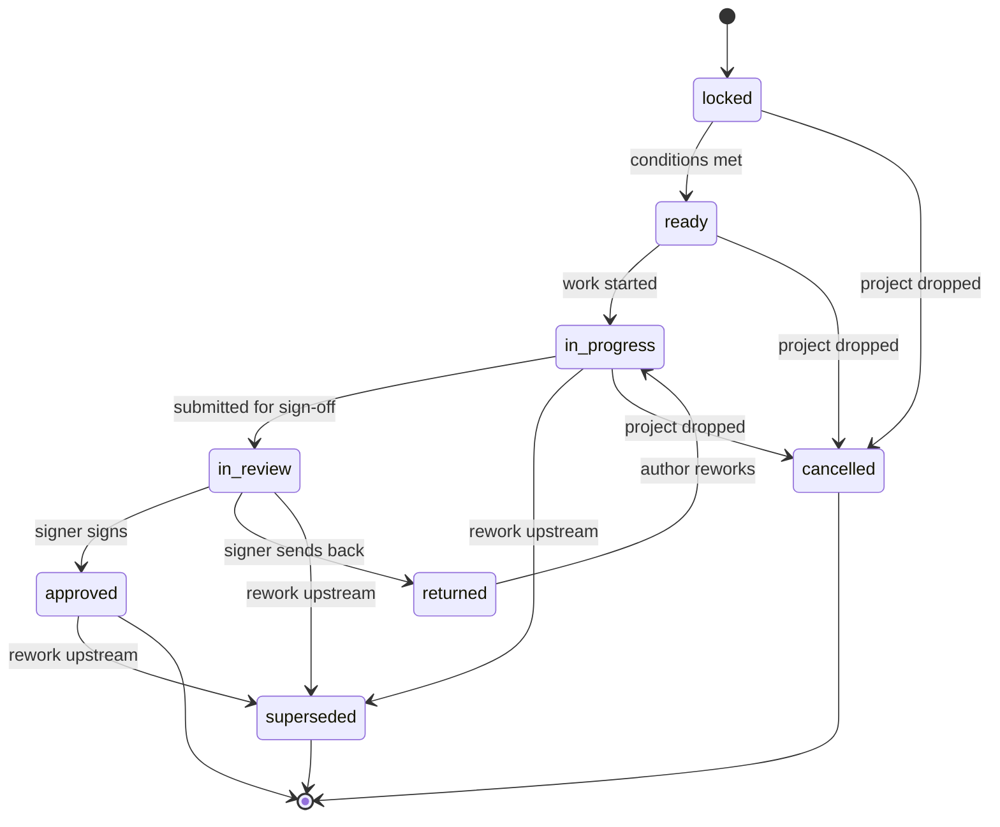
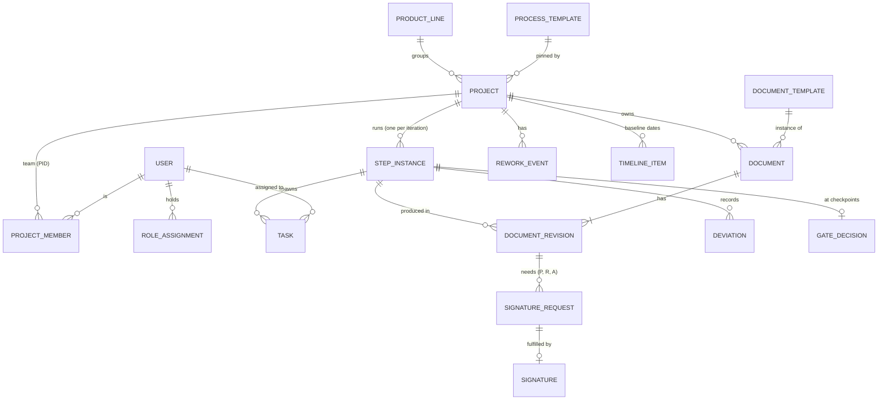
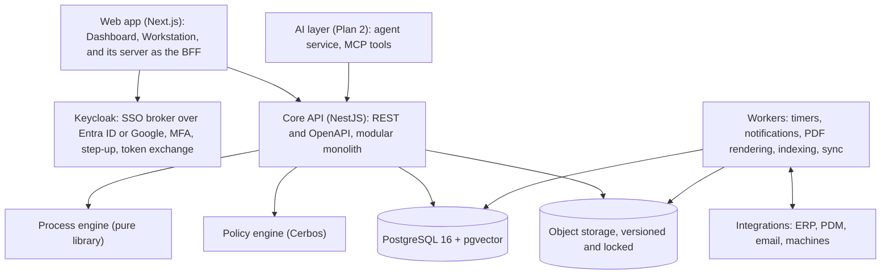

# COAL · Plan 1 — Base Layer
## Workflow engine, role dashboards, data model and APIs for Jayon R&D

| | |
|---|---|
| **Status** | Draft for review |
| **Date** | 16 November 2026 |
| **Built from** | *Jayon R&D Workflow*, revision 2 (COAL meeting points applied), 16 Nov 2026 |
| **Companion** | [Plan 2 — AI Layer](./02-ai-layer-plan.md) |
| **Working name** | COAL (the platform) |

---

## 1. Summary

COAL gives every Jayon employee one place to see and do their R&D work. It has two pages, switched by a toggle in the top bar:

1. **Dashboard** — role-based widgets: tasks, signatures, projects, delays and department metrics. Each widget is a compact card that expands into a detailed view.
2. **Workstation** — an AI chat where people do their work: ask questions, understand documents, draft documents from Jayon's templates and delegate work. It is specified in Plan 2.

This plan covers the **base layer** under both pages: the process engine that runs the route, the data, permissions, documents and e-signatures, notifications, the dashboard and the APIs. **The AI layer has no private access to data.** It calls the same APIs, with the same permission checks, as the person it works for.

### Key decisions

| # | Decision | Why |
|---|---|---|
| D1 | The workflow is **configuration, not code**. Rev 2 is stored as a versioned process definition, and each project stays on the version it started with. | The route changed between rev 1 and rev 2 and still has open questions. Future changes become config edits, not rewrites. |
| D2 | A **generic step workspace** serves all 27 steps from day one: tasks, documents, signatures, decisions, comments, pictures and sources. Structured step modules (run cards, QC measurements, PMCF and others) are added in Phase 2. | The whole route works end to end early, and the detailed modules come where they pay off. |
| D3 | Every sign-off is an **e-signature bound to one document revision**, on three rows (Prepared, Reviewed, Approved), and the signer re-authenticates. Steps with no named document get a generated **Step Completion Record** to sign. | It matches the rule that every document is signed online on three rows, and it builds an auditable design history file. |
| D4 | **Permissions = role × scope × classification**, enforced in the API by a policy engine. Lists, search and AI retrieval are *filtered*, not just checked. | The same rules apply to the UI, the API and the AI, so nothing leaks through search or chat. |
| D5 | Every endpoint that changes state supports a **dry-run**, which returns the effects without saving anything. Actions can also be wrapped in a **proposal** that a human confirms. | The UI and the AI can show what will happen (the VP's "boxes"), and the server can enforce human confirmation. |
| D6 | **Event-driven.** Every change emits a domain event, which feeds notifications, live widget refresh, AI triggers and the audit trail. | One mechanism covers everything that reacts to change. |
| D7 | **The process engine decides routing, not the AI.** The AI interprets requests, drafts and explains. | Routing stays deterministic, testable and auditable, which a regulated process requires. |
| D8 | Proposed stack: a TypeScript monorepo with Next.js, NestJS, PostgreSQL (with pgvector), S3-compatible storage, Keycloak and Cerbos (§12). | One language end to end, and every part can be self-hosted. To be confirmed. |

**The MVP:** a pilot project runs from the idea (C) to launch (25) entirely in COAL. Every step has its tasks, documents and signatures. The VP, R&D Head and Leads see live status and delays on their dashboards. In the Workstation, the AI can turn the VP's idea into a project, answer questions, delegate work and draft the early-stage documents (Plan 2).

---

## 2. Scope

| | MVP | Later | Out of scope for now |
|---|---|---|---|
| Process | All 27 steps of rev 2 plus the start (C, 1–23, 2a, 24a, 24b, 25): parallel starts, 4 checkpoints, rework loops, conditional step 15 | Visual process editor; moving in-flight projects between process versions | Processes of other departments |
| People | All workflow roles; limited accounts for company QA, Quality Control, Production and Marketing | External portal for labs, vendors and surgeons | — |
| Documents | Template registry, form-based, authored and uploaded documents, revisions, PDF rendering, 3-row e-signatures | Controlled-copy distribution; PDM sync | Replacing Jayon's QMS for non-R&D documents |
| Data | Projects, tasks, timeline and deviations, budget lines (manual entry) | Step modules: sourcing, design and FEA, prototypes and run cards, QC, machines and OEE, testing, surveys, trials and PMCF, regulatory, risk file, transfer | Replacing the ERP |
| Dashboard | Widgets W1–W13 (§7.3) | Widgets W14–W26 | — |
| Integrations | SSO, email | ERP, SolidWorks PDM, machine log, mailbox ingestion, Teams or WhatsApp | — |
| Devices | Responsive web for desktop and tablet, including the shop floor | Native mobile app | — |

---

## 3. Roles and people

### 3.1 Workflow roles

Taken from the rev-2 workflow. Of the 27 steps, 25 have a sign-off: the R&D Head signs 10, the Lead 7, the VP 6 and the Board 2. Steps 2a and 24a have none yet (open questions), and neither does the start (C).

| Key | Role | Who | Does the work at | Signs off at |
|---|---|---|---|---|
| `board` | Board | The MD and the CEO, signing together as the Board | — | 4, 23 |
| `vp` | VP | Product strategy and global business development | C; brings 4 and 23 | 1, 2, 3, 5, 19, 25 |
| `rd_head` | R&D Head | Head of R&D | 1, 3, 5, 19, 23, 25 | 6, 9, 12, 16, 17, 18, 20, 21, 22, 24b |
| `rd_lead` | R&D Lead | Lead of one product line: Arthroscopy, Spine or Trauma | 1, 2a, 5, 6, 9, 12, 14, 16–22, 24a, 24b | 7, 8, 10, 11, 13, 14, 15 |
| `design_engineer` | Design engineers | 3D models and drawings in SolidWorks | 7, 8, 13 | — |
| `aems` | AEMS | The FEA and metallurgy experts. The metallurgy expert is added to every project team. | 7, 8 | — |
| `pme` | PME | Makes the prototypes, the trial sets and the master set | 10, 11, 13, 19, 21 | — |
| `rd_ops` | R&D Ops | R&D Operations, including the R&D Ops Assistant Manager | 2, 6, 9, 13, 14, 15, 17, 19, 20, 21, 25 | — |
| `dard` | DARD | Design Assurance and Regulatory Documentation | 2a, 6, 9, 13, 15, 20, 22, 24a, 24b | — |
| `qc_inspector` | QC inspectors | Part of DARD; inspect each prototype | 10, 11 | — |
| *(relation)* | Project team | The people named in the PID (step 1) | 12, 24a, 24b | — |

### 3.2 People outside R&D (limited accounts)

| Key | Who | Where they come in |
|---|---|---|
| `company_qa` | The company QA team (not NPD QA) | Applies for the CDSCO manufacturing test licence before steps 10 and 11. Receives the regulatory submission (22). Takes part in the transfer (24a, 24b). |
| `quality_control` | The Quality Control department: Sr. Manager QC (implants) and Asst. Manager QC (instruments) | Receive the QC documents at transfer (24a, 24b). |
| `production` | The Chief Production Manager and the Chief Manager, Production | Allocate production and general-instrument machines (10, 11). Receive the production documents and sign the handover checklist (24b). Help PME with large trial-set quantities (19). |
| `marketing` | Marketing | Take the survey forms to KOLs and bring them back (14). |

### 3.3 External parties (no login in the MVP)

Vendors (6), outside makers (9), test labs (13), surgeons, KOLs and hospitals (14, 19, 20) and regulatory bodies (22). R&D Ops or DARD upload what these parties send, and it is tagged as **external**, which matters for AI safety (Plan 2 §7.6). An external portal is planned for Phase 3.

### 3.4 Platform roles

- `admin`: manages users, roles and configuration. Has no access to business data by default.
- `process_owner`: maintains the process definitions and templates, under change control.
- `auditor`: time-limited, read-only access to records and the audit trail.

### 3.5 How access is granted

- **Role assignment** is a role plus a scope: the whole organisation, one product line or one project. A person can hold several roles, for example a Lead who also works as a design engineer. A qualifier handles splits such as Quality Control *implant* versus *instrument*.
- **Project membership** comes from the PID (step 1) and the action plan (step 5). Every change is logged.
- **Assignment** gives access only to the specific items routed to someone. For example, Production sees the transfer package sent to them and nothing else.

---

## 4. The process model

### 4.1 Step catalogue (rev 2)

This is the encoding the engine runs. "Starts when" lists the hard conditions. ⚠ marks an assumption that depends on an open question (§17).

| Step | Name | Stage | Does the work (outside parties) | Signs | Type | Starts when | Produces |
|---|---|---|---|---|---|---|---|
| C | The idea | 1 | VP | — | start | — | Product concept |
| 1 | Project inception | 1 | R&D Head, Lead | VP | | C complete | Project Initiation Document (names the team) |
| 2 | Market study | 1 | R&D Ops | VP | | C complete | Market Research Survey, with sources |
| 2a | Regulatory planning | 1 | Lead, DARD | none ⚠ | new | C complete ⚠ | Regulatory plan: the bodies that must approve (e.g. CE, FDA, CDSCO) and the documents each needs |
| 3 | Project proposal | 1 | R&D Head | VP | | 1 and 2 approved | Project Planning; Project Approval Form |
| 4 | Board approval | 1 | VP brings it | Board | **checkpoint** | 3 approved | Approved proposal |
| 5 | Action plan | 2 | Lead, R&D Head | VP | | 4 approved; 2a complete ⚠ | Action Plan: team, per-role timeline, budget, raw-material definition |
| 6 | Raw material | 2 | Lead, R&D Ops, DARD (vendors) | R&D Head | parallel | 5 approved | Requirement, purchase orders, raw-material test (no named document) |
| 7 | Implant design | 2 | Designers, AEMS | Lead | parallel | 5 approved | 3D model, FEA report, drawings with critical dimensions marked for QC |
| 8 | Instrument design | 2 | Designers, AEMS | Lead | parallel | 5 approved | Same as step 7, for the instruments |
| 9 | Outsourcing | 2 | Lead, R&D Ops, DARD (outside makers) | R&D Head | parallel | 5 approved; a custom item also waits for its drawing | Make-or-buy list and orders (no named document) |
| 10 | Implant prototype | 3 | PME, QC inspectors | Lead | | 7 approved, material received, CDSCO test licence granted ⚠ (Q19) | Prototype; Material Issue Slip; run card; QC inspection report; Prototype Approval Form; costing |
| 11 | Instrument prototype | 3 | PME, QC inspectors | Lead | | 8 approved, material received, licence granted ⚠ | Same as step 10 |
| 12 | Review meeting | 3 | Lead, project team | R&D Head | **checkpoint** | 10 and 11 approved | Minutes; decisions: are the prototypes OK, and is a pre-clinical study needed? |
| 13 | Testing and validation | 4 | R&D Ops, DARD, PME, designers (test lab) | Lead | | 12 approved | BP report on test parameters and labs, then the Lead's go-ahead; TRF; test plan and discrepancy check; test report (sent to the R&D Head for information, without a signature); testing and validation document for CE and FDA |
| 14 | Market feedback | 4 | R&D Ops, Lead (marketing, surgeons) | Lead | parallel | 13 approved | Survey form with prototype questions; the surgeons' answers |
| 15 | Pre-clinical study | 4 | R&D Ops, DARD | Lead | conditional | 13 approved. Study path if the Head said "needed" at step 12, otherwise justification path. | Animal or cadaver report, or a justification |
| 16 | Prototype case study | 4 | Lead | R&D Head | | 14 and 15 approved | Case study (BP): feedback and corrective actions |
| 17 | Marketing tools | 4 | Lead, R&D Ops | R&D Head | | 16 approved | Surgical technique, catalogue, IFU |
| 18 | Prototype approval | 4 | Lead brings it | R&D Head (final) | **checkpoint** | 17 approved and every corrective action from 16 closed | Prototype Approval Form |
| 19 | Trial set planning | 5 | R&D Head, Lead, R&D Ops, PME | VP | | 18 approved | Trial set planning document; trial sets, made by PME |
| 20 | Clinical trials | 5 | Lead, R&D Ops, DARD (surgeons) | R&D Head | milestones | 19 approved and trial sets ready | Surgery cases; PMCF follow-up (each patient scored, for one year) |
| 21 | Design revision and master set | 6 | Lead, R&D Ops, PME | R&D Head | | "Trial surgeries done" milestone in step 20 (does not wait for the follow-up) | Design revision on the NCI form; controlled copies; process plan; QC documents; costing; master set |
| 22 | Regulatory approval | 6 | Lead, DARD (company QA) | R&D Head | | 21 approved | Submission to QA for each body; trade mark; registrations; QA approval |
| 23 | Release approval | 6 | VP and R&D Head bring it | Board | **checkpoint** | 22 approved | Transfer Approval Form |
| 24a | Pre-transfer | 6 | Lead, team, DARD (Production, QC, QA) | none ⚠ | new | 23 approved and about 50 positive trial cases ⚠ | Transfer documents sent to Production, Quality Control and QA |
| 24b | Final transfer and training | 6 | Lead, team, DARD (Production, QC, QA) | R&D Head, plus the production head signs the checklist | new | 24a complete | Transfer forms, master set, signed handover checklist, training |
| 25 | Product launch | 6 | R&D Head, R&D Ops | VP | end | 24b approved | Launch sets sent to the market |

### 4.2 The route

Hexagons are checkpoints. Dotted lines are conditions on individual items, or assumptions.

```mermaid
flowchart LR
  C(["C · Idea (VP)"])
  S1["1 · Project inception"]
  S2["2 · Market study"]
  S2a["2a · Regulatory planning"]
  S3["3 · Project proposal"]
  G4{{"4 · Board approval"}}
  S5["5 · Action plan"]
  S6["6 · Raw material"]
  S7["7 · Implant design"]
  S8["8 · Instrument design"]
  S9["9 · Outsourcing"]
  LIC["CDSCO test licence (company QA)"]
  S10["10 · Implant prototype"]
  S11["11 · Instrument prototype"]
  G12{{"12 · Review meeting"}}
  S13["13 · Testing and validation"]
  S14["14 · Market feedback"]
  S15["15 · Pre-clinical (study or justification)"]
  S16["16 · Prototype case study"]
  S17["17 · Marketing tools"]
  G18{{"18 · Prototype approval"}}
  S19["19 · Trial set planning"]
  S20["20 · Clinical trials + 1-year PMCF"]
  S21["21 · Design revision and master set"]
  S22["22 · Regulatory approval"]
  G23{{"23 · Release approval"}}
  S24a["24a · Pre-transfer"]
  S24b["24b · Final transfer and training"]
  S25(["25 · Product launch"])

  C --> S1 & S2 & S2a
  S1 & S2 --> S3
  S3 --> G4 --> S5
  S2a -.->|"before 5 (assumed)"| S5
  S5 --> S6 & S7 & S8 & S9
  S7 --> S10
  S8 --> S11
  S6 -.->|"material in"| S10 & S11
  LIC -.-> S10 & S11
  S7 & S8 -.->|"drawings for custom items"| S9
  S10 & S11 --> G12 --> S13
  S13 --> S14 & S15
  S14 & S15 --> S16
  S16 --> S17 --> G18 --> S19 --> S20
  S20 -->|"surgeries done"| S21
  S21 --> S22 --> G23 --> S24a
  S20 -.->|"about 50 positive cases"| S24a
  S24a --> S24b --> S25
```



### 4.3 Step lifecycle



- There is one **step instance** per step *per iteration*. A rework loop never edits history. It moves every affected instance to `superseded`, whatever its state (the step that failed included), cancels their open tasks and signature requests, and opens iteration n+1 of the target step. The diagram shows the common cases.
- Steps with no sign-off (C, 2a and 24a until decided) go straight from `in_progress` to `approved` when a performer submits them (`POST …/submit`).
- In conditions and events, `completed` means approved for a signed step, or marked done for an unsigned one.
- **On hold** is set at project level. It pauses timers and alerts on every step without changing step states.

### 4.4 Project lifecycle

- `draft`: the idea is captured but not yet confirmed.
- `active`: the stage (1–6) is taken from the furthest open step.
- `released`: step 23 is approved.
- `launched`: step 25 is approved.
- `closed`: the PMCF period has ended.

A project can also be `on_hold`, or `dropped`. Dropping needs a reason, cancels the open tasks and keeps all records.

### 4.5 Sign-offs, checkpoints and the Step Completion Record

- A step can be **submitted** once its required outputs exist and their Prepared and Reviewed rows are signed.
- The signer then signs the **Step Completion Record (SCR)**. The SCR is a generated PDF listing the step, the iteration, every output (document number, revision and hash), decisions, deviations and dates. If the signer is also the Approved row on the step's main document, one action with one re-authentication signs both.
- At the **checkpoints** (4, 12, 18 and 23) the SCR records the decision: **Go**, **Rework** (back to a target step), **Hold** or **Drop**. Nothing downstream starts until the decision is Go.
- **Return for rework**: the signer sends the step back with comments. It returns to `in_progress`, and its documents get a new revision.
- **The Board** (4 and 23): both the MD and the CEO sign ⚠ (Q8).

### 4.6 Failure and rework rules

| From | Trigger | Who decides | Goes back to |
|---|---|---|---|
| 7, 8 | FEA fails | R&D Lead | The same step, as the next design iteration |
| 10 | Implant prototype fails | R&D Head | 7 |
| 11 | Instrument prototype fails | R&D Head | 8 |
| 12 | Prototypes not OK at the review | R&D Head | 7 or 8 |
| 13 | Lab test fails | R&D Ops with DARD make the first call and present it to the Lead and the R&D Head. The R&D Head confirms the loop-back ⚠ (Q14). | 7. Does an instrument failure go to 8? ⚠ (Q14) |
| 18 | Prototype not approved | R&D Head | Any step from 7 to 17, depending on severity |
| 20, 21 | The trials call for design changes | R&D Head ⚠ | 10. Does an instrument revision go to 8 or 10? ⚠ (Q16) |
| Any sign-off | The work is not acceptable | The signer | The same step; the author reworks |
| Any | Project dropped | VP or Board ⚠ (Q9) | — |

**How a loop-back works**

1. The decider triggers the rework with a reason and evidence, such as the QC report or the lab report. A **dry-run** first shows the impact: which completed steps downstream of the target would have to be redone.
2. The decider confirms, and can mark affected steps as **carried over** (no redo needed) with a reason ⚠ (Q10).
3. The engine opens iteration n+1 of the target step. Affected downstream steps, including the one that failed, are superseded, and their next iteration starts locked. Documents keep their numbers: the latest revision of each is carried forward as a new draft revision in the new iteration.
4. A **rework event** is logged and counted on the timeline as a deviation of category *rework*.

### 4.7 The conditional step, milestones and item-level conditions

- **Step 15** always exists. At step 12 the R&D Head records whether a pre-clinical study is needed. If yes, step 15 follows the study path (an animal or cadaver report). If no, it follows the justification path (a short justification document). Either way, the Lead signs.
- **Step 20** has three milestones:
  - `surgeries_complete` unlocks step 21.
  - `positive_cases` is a running count. The threshold of about 50 gates step 24a ⚠.
  - `follow_up_complete` is reached one year after the last case and is needed before step 20 is signed off ⚠ (Q15).
- **Item-level conditions** are checked for each item, not for the whole step:
  - A custom outsourced item that needs a drawing waits until that drawing is approved (step 9).
  - A prototype needs its drawing approved, its material received and the CDSCO manufacturing test licence (steps 10 and 11). Granted, or only applied for? ⚠ (Q19)
  - Step 18 cannot be submitted while any corrective action from step 16 is open.
- Conditions are **named predicates** written in code and referenced from the process definition: `step_completed`, `milestone_reached`, `materials_received`, `licence_granted`, `count_at_least`, `all_closed` and `decision_equals`.

### 4.8 From steps to tasks

When a step becomes `ready`, the engine creates tasks:

| Task type | Created for | Example |
|---|---|---|
| `work` | Each performer role on the step | "Prepare the PID for SPN-26-004, with the Spine Lead" |
| `review`, `approve` | Each signature row, when a document is submitted | "Review the FEA report, rev B" |
| `decision` | Checkpoint signers, failure deciders, and the Head at step 12 (pre-clinical) | "Decide: are the prototypes OK?" |
| `external` | The internal owner of an exchange with an outside party | "Get the test plan from the lab" |
| `request` | Anyone asking someone else for something, outside the reporting line | "Can you send the mill certificate?" |
| `ad_hoc` | Created for yourself, or assigned by a manager in the UI or the Workstation | "Update drawing to rev C by Friday" |

**Signatures are tasks too.** Every signature request creates a `review` or `approve` task, so it appears in My tasks (W1). Awaiting my signature (W2) is a dedicated view of the same items, built for signing quickly.

**Who gets the task**, in this order:

1. The person named for that role in the project team.
2. Whoever holds that role for the project's product line.
3. The role's **queue**. Any holder of the role can claim it, and the Head or the Lead can assign it.

The dry-run returns a warning whenever a task would land in a queue.

**Assigning work to someone else**: managers can assign down their reporting line. Anything else becomes a request that the other person accepts or declines (§6.4).

**Task states**: `open`, then `in_progress`, then `done`. A task can also be `waiting` (on someone or something, with a reason), `cancelled` or `declined`.

### 4.9 Timeline, alerts and deviations

- **Baseline.** The action plan (step 5) gives every remaining step, and every role on it, its own planned dates. These are stored as structured data, not only in the document. Steps 1 to 4 use dates set when the project is created: the VP's, or the defaults from the definition.
- **Forecast.** A critical-path calculation over the rest of the route, using planned durations and actual progress. It is recalculated on every event and every night. The project's forecast is the forecast for step 25.
- **Alerts** (all thresholds can be configured):
  - Due within 2 working days: the assignee.
  - Overdue: the assignee and the step's signer.
  - More than 5 working days overdue, or any overdue checkpoint: the R&D Head, and the VP for checkpoints.
  - A signature waiting more than 3 working days: the signer, then the R&D Head.
- **Deviation.** Every missed date or changed plan date needs a record with:
  - the reason;
  - the category: vendor, lab, internal resource, approval wait, rework, regulatory or other;
  - **who or what caused it**: a person, a role or an outside party;
  - the new date.

  Until the record is filled in, the deviation shows *reason pending* and a task stays open for the step owner.
- **Re-baselining** after the action plan is signed needs approval: from the R&D Head, and from the VP if the launch date moves ⚠ (Q13).
- **Working calendar.** Jayon's working days and holidays. All dates are shown in IST.

### 4.10 Process definition format

The definition is kept as YAML in the repo (`shared/process/rnd_npd.v2.yaml`). It is checked against a JSON schema and loaded into `process_templates.definition` on deploy. An excerpt:

```yaml
process: rnd_npd
version: 2                       # rev 2: COAL meeting points, 16 Nov 2026
stages:
  - { no: 1, name: Idea and go-ahead }
  - { no: 2, name: Plan, design and source }
  # ...
steps:
  - key: "1"
    name: Project inception
    stage: 1
    performers: [rd_head, rd_lead]          # the first listed prepares
    signer: vp
    starts_after: [{ step: "C", when: completed }]
    outputs:
      - { doc: PID, required: true }
    on_return: same_step

  - key: "10"
    name: Implant prototype
    stage: 3
    performers: [pme, qc_inspector]
    signer: rd_lead
    starts_after: [{ step: "7", when: completed }]
    preconditions:
      - { materials_received: { for: implant } }
      - { licence_granted: cdsco_mfg_test_licence }
    outputs:
      - { doc: MATERIAL_ISSUE_SLIP, required: true }
      - { doc: RUN_CARD, required: true }
      - { doc: QC_INSPECTION_REPORT, required: true, per: prototype }
      - { doc: PROTOTYPE_APPROVAL_FORM, required: true }
      - { doc: PROTOTYPE_COSTING, required: false }
    failures:
      - { trigger: prototype_failed, decided_by: rd_head, go_to: "7" }

  - key: "15"
    name: Pre-clinical study
    stage: 4
    performers: [rd_ops, dard]
    signer: rd_lead
    starts_after: [{ step: "13", when: completed }]
    branch:
      decision: preclinical_needed        # recorded by rd_head at step 12
      when_true:  { outputs: [{ doc: PRECLINICAL_REPORT, required: true }] }
      when_false: { outputs: [{ doc: PRECLINICAL_JUSTIFICATION, required: true }] }

  - key: "21"
    name: Design revision and master set
    stage: 6
    performers: [rd_lead, rd_ops, pme]
    signer: rd_head
    starts_after: [{ step: "20", when: "milestone:surgeries_complete" }]
    failures:
      - { trigger: design_change_required, decided_by: rd_head, go_to: "10" }
```

### 4.11 Engine design

- The engine is a **pure library** (`shared/process`): it takes the definition, the project's state and an event, and returns the new state and its effects. Effects are commands: create or cancel tasks, request signatures, send notifications, emit events. The same function runs real transitions and dry-runs.
- Table-driven tests cover every step, condition and rework path in the definition.
- State lives in PostgreSQL. Timers (due dates, PMCF follow-ups, escalations) run on a job queue backed by Postgres.
- A new process version applies to new projects only. Moving an in-flight project to a new version is an admin operation with a step mapping (Phase 3).

---

## 5. Documents and e-signatures

### 5.1 Three kinds of document

| Kind | Examples | How it is made | Stored as |
|---|---|---|---|
| **Form** | PID, Project Approval Form, Action Plan, Material Issue Slip, run card, QC inspection report, Prototype Approval Form, NCI form, Transfer Approval Form, handover checklist | Fields filled in COAL, rendered to PDF on Jayon's template | Field data (JSON) and a PDF |
| **Authored** | Market Research Survey report, regulatory plan, BP reports (test parameters and labs, FEA report, case study), testing and validation document for CE and FDA, surgical technique, catalogue, IFU, trial set plan, minutes | A rich-text editor on top of the boilerplate. AI drafting is in Plan 2. | Structured sections, a DOCX and a PDF |
| **External file** | SolidWorks models and drawings; the lab's TRF, test plan and report; animal or cadaver reports; vendor certificates; pictures | Uploaded. Later, synced from PDM, the ERP or a mailbox. | The original file and a PDF or preview copy |

### 5.2 Document register

The Approved row is the step's signer unless stated otherwise. Until Jayon confirms each template (Q11), the other two rows default as follows:

- **Prepared**: the person who submits the document.
- **Reviewed**: set per template. By default, the other performer on the step; failing that, DARD for technical documents.

| Document | Step | Kind | Classification |
|---|---|---|---|
| Product concept | C | Form | Internal |
| Project Initiation Document | 1 | Form | Internal |
| Market Research Survey, with sources | 2 | Authored | Internal |
| Regulatory plan | 2a | Authored, with a matrix | Internal |
| Project Planning | 3 | Authored | Confidential |
| Project Approval Form | 3, 4 | Form | Confidential |
| Action Plan (team, per-role timeline, budget, raw-material definition) | 5 | Form and authored | Confidential |
| Raw-material requirement and test record | 6 | Form | Internal |
| 3D model; drawings with critical dimensions | 7, 8 | File, plus a critical-dimension table | Internal |
| FEA report (BP); risk assessment from the FEA | 7, 8 | Authored | Internal |
| Make-or-buy list and outsourcing orders | 9 | Form | Confidential (prices) |
| Material Issue Slip (ERP version) | 10, 11 | Form | Internal |
| Prototype run card | 10, 11 | Form | Internal |
| QC inspection report (one per prototype) | 10, 11 | Form | Internal |
| Prototype Approval Form | 10, 11, 18 | Form | Internal |
| Prototype costing | 10, 11 | Generated | Confidential |
| Review meeting minutes | 12 | Authored | Internal |
| BP report on test parameters and test labs | 13 | Authored | Internal |
| TRF; lab test plan; discrepancy check; test report | 13 | External, plus a check record | Internal |
| Testing and validation document for CE and FDA | 13 | Authored | Internal |
| Survey form with prototype questions, and the answers | 14 | Form | Internal |
| Pre-clinical report, or justification | 15 | External or authored | Internal |
| Prototype case study (BP), with corrective actions | 16 | Authored | Internal |
| Surgical technique; catalogue; IFU | 17 | Authored | Internal |
| Trial set planning document (form still to be defined) | 19 | Authored | Internal |
| Surgery case records; PMCF follow-ups | 20 | Form records | **Restricted** |
| Non-Conformity Investigation form (the design revision) | 21 | Form (QA's template) | Internal |
| Controlled copies; process plan; QC documents; costing | 21 | Authored or file | Internal; costing Confidential |
| Regulatory submission pack for each body; trade mark; registrations; QA approval | 22 | Compiled pack or external | Internal |
| Transfer Approval Form | 23 | Form | Confidential |
| Pre-transfer document set | 24a | Package | Internal |
| Transfer forms; handover checklist (signed by the production head); training record | 24b | Form | Internal |
| Launch set dispatch record | 25 | Form | Internal |
| Step Completion Record | every step | Generated | Same as the step |
| Deviation record | any | Form | Internal; the cause is people-sensitive |
| CDSCO manufacturing test licence | before 10 and 11 | External (company QA) | Internal |

### 5.3 Lifecycle and revisions

A document moves from `draft` to `in_review` to `approved` (locked), and later to `superseded` or `obsolete`.

- Every submitted revision is immutable and is stored with a SHA-256 hash. Any edit after approval creates a new revision.
- Approved PDFs carry a signature manifest page and a watermark with the document number, the revision and, where it applies, "Controlled copy".
- Revisions can be compared: field by field for forms, and as a text diff for authored documents.
- Jayon's document numbering and revision convention can be set per template (Q21).

### 5.4 E-signatures

- **Three rows**, signed in order: Prepared, then Reviewed, then Approved. A signer at any row can return the document to its author with comments.
- **Re-authentication** at every signature: password plus OTP, or a step-up through SSO.
- **What each signature records**: the signer, the meaning (the row), the time (stored in UTC, shown in IST) and the revision hash. A signature cannot be edited or deleted. The manifest prints the name, date and time, and meaning.
- **Rows with several signers** can be "all of" (for example the MD and the CEO at steps 4 and 23) or "any of".
- **Separation of duties**: one person cannot sign both Prepared and Approved on the same revision, unless the template allows it.
- **Delegation of signing authority** when a signer is away: time-limited, recorded, and shown on the manifest. Only if Jayon allows it (Q12).
- The design is built to meet **21 CFR Part 11** expectations, in case COAL becomes the record for FDA submissions (§13.2).

### 5.5 Templates

- The **template registry** keeps, for each template: its code, name, revision and kind; the field schema (for forms); the DOCX with placeholders; the signature rows; the default classification; and the steps that use it.
- Templates are controlled. A new template revision needs the process owner's approval, and QA's too if Jayon requires it.
- **Preparation work** (Phase 1): convert each boilerplate into a DOCX with mapped placeholders, plus a JSON schema for the forms.

### 5.6 Pictures and sources (planned across every step)

- **Pictures** can be attached to any step, task, document, prototype or test, including from a phone or tablet on the shop floor. They have captions and a gallery view.
- **Sources** can be added to any document or step: a URL, a file or a citation, with a note. They appear in a Sources section and, where the template asks for it, in the PDF.

---

## 6. Visibility and permissions

### 6.1 The model

- **Who**: role assignments (role plus scope), project membership and assignments.
- **What**: every record carries `project_id`, `product_line_id`, `classification`, its owner and its step.
- **Classification**:
  - *Internal*: anyone who can read the project.
  - *Confidential*: budgets, costs, prices and the financial content of Board papers.
  - *Restricted*: clinical and patient data, pseudonymised.
  - *People-sensitive*: who caused a deviation, and workload per person.
- **Two layers of visibility.** *Status* is visible more widely than *content*. Status means the project's code and name, stage, step states, owners and assignees, planned and forecast dates, health, and the category of any blocker or deviation. Everyone on a project can see that a step is late and who owns it, without seeing its budget. This also lets the AI explain delays without leaking content (Plan 2 §2.2).
- **Enforcement.** A policy engine (Cerbos) is called by the API for every action. List endpoints ask it for a query plan, which becomes a SQL filter. Files are served through short-lived signed URLs, issued after a check. Search and AI retrieval use the same filter.

### 6.2 Who sees what (defaults, to confirm: Q5)

Key: **All** = every R&D project · **Line** = own product line · **Proj** = projects the person is a member of · **Assigned** = only items routed to them · **Sum** = aggregated summaries only · **—** = none

| Role | Status | Technical content | Commercial | Clinical (pseudonymised) | People-sensitive | Board papers | Machines and OEE |
|---|---|---|---|---|---|---|---|
| Board | All | Sum, plus checkpoint packs | All | Sum | — | All | Sum |
| VP | All | All | All | Sum | All | All | Sum |
| R&D Head | All | All | All | All | All | All | All |
| R&D Lead | All | Line | Line | Line | Own line's team | Line | Sum |
| Design engineer | Proj | Proj | — | — | Self | — | Sum |
| AEMS | Proj | Proj | — | — | Self | — | Sum |
| PME | Proj | Proj | — | — | Self | — | All |
| R&D Ops | All | Proj | Proj (procurement, budget) | Proj | Self | — | All |
| DARD | All | All | — | Proj | Self | — | Sum |
| QC inspector | Assigned | Assigned (drawings, critical dimensions, own reports) | — | — | Self | — | — |
| Other project member | Proj | Proj | — | — | Self | — | — |
| Company QA, Quality Control, Production, Marketing | Assigned | Assigned | — | — | Self | — | Assigned (machine requests) |
| Auditor | All | All | All | All (pseudonymised) | All | All | All |
| Admin | — (emergency access only, audited) | — | — | — | — | — | — |

### 6.3 Who can do what

| Action | Who |
|---|---|
| Create a project from an idea (C) | VP. Can the R&D Head too? (Q9) |
| Edit a step's records and documents | That step's performers, while the step is open |
| Submit a step for sign-off | A performer; by default the first one listed |
| Sign Prepared, Reviewed or Approved | Whoever the template's signature rows name |
| Sign off a step | The step's signer (§4.1) |
| Checkpoint decision | The Board (4, 23); the R&D Head (12, 18) |
| Rework decision | As in §4.6 |
| Decide whether a pre-clinical study is needed | The R&D Head, at step 12 |
| Put a project on hold, or drop it | The VP, or the Board ⚠ (Q9) |
| Record a deviation | Step performers, the Lead, the R&D Head |
| Change the baseline after step 5 | The Lead or the Head proposes and the R&D Head approves; the VP approves if the launch date moves ⚠ (Q13) |
| Approve the raw-material purchase | The R&D Head (step 6) |
| Add comments, pictures and sources | Any project member |
| Manage users and roles | Admin |
| Change the process definition or a template | The process owner, with approval (change control) |

### 6.4 Assigning work to others

| From | Can **assign** to | Otherwise |
|---|---|---|
| Board | The VP | — |
| VP | The R&D Head, the Leads and anyone in R&D | A request, for other departments |
| R&D Head | Anyone in R&D | A request, for other departments |
| R&D Lead | Members of their product line's projects | A request, for anyone else |
| Everyone else | Themselves | A request to anyone, which they accept or decline |

These rules follow the reporting lines in the org chart (Q4). An assigned task shows who assigned it and whether it came from the Workstation.

### 6.5 Where permissions are enforced

1. An API guard on every endpoint checks the user, the action and the resource against policy.
2. Every list, search and widget query is filtered, using the policy query plan as a SQL `WHERE`.
3. Files are only reachable through signed URLs issued after a check.
4. The signature endpoint requires a fresh step-up token.
5. AI requests carry a delegated token. The same checks apply, plus the agent ceiling (Plan 2 §7.2). Confirming proposals, signing and decisions accept only calls from the web app's own session (§10.1).
6. In the database, the application roles have no superuser rights. Restricted tables, such as patient identities, sit in a separate schema that only one service can reach.

---

## 7. Dashboard

### 7.1 App shell

```
┌───────────────────────────────────────────────────────────────────────────────┐
│ COAL   [ Dashboard | Workstation ]    Line: All ▾   Project: All ▾    🔍   🔔   👤 │
├───────────────────────────────────────────────────────────────────────────────┤
│ ┌ My tasks ─────────────┐ ┌ Awaiting my signature ─┐ ┌ R&D pipeline ──────────┐ │
│ │ 3 overdue · 7 this wk │ │ 4 waiting · oldest 3 d │ │ Idea 2 · Design 3 · …  │ │
│ │ • Prepare PID    Fri  │ │ • PID SPN-26-004 rev A │ │ ▇▇▇▅▃▂                  │ │
│ └───────────────────────┘ └────────────────────────┘ └────────────────────────┘ │
│ ┌ Delays and risks ──────────────────────────────┐ ┌ Upcoming checkpoints ─────┐ │
│ │ 5 overdue · 3 at risk · worst TRM-26-002 +18 d │ │ 12 · SPN-26-001 · 80% ready│ │
│ └────────────────────────────────────────────────┘ └───────────────────────────┘ │
└───────────────────────────────────────────────────────────────────────────────┘
```

- The toggle switches between the two pages. The global filters (product line, project) apply to every widget that supports them.
- Search (Cmd/Ctrl-K) finds projects, documents, tasks and people, filtered by permission.

### 7.2 Widget framework

- **Compact view**: a card with counts and a short list of the top items.
- **Expanded view**: clicking a card opens a large overlay over the dashboard with tabs, filters, a table or chart, and actions. It doesn't resize the card in place, because that makes the grid jump. Each expanded view has its own link (`/dashboard?w=my-tasks&tab=completed`), and Esc closes it.
- **Drill-down**: rows open the project page, the step panel, the document viewer or the task (§7.5).
- **Ask AI**: every widget has a button that opens the Workstation with that widget's context (Plan 2).
- **Live updates**: when a relevant event happens, the server tells the browser over SSE to refresh that widget. Polling is the fallback.
- **Personal layouts**: users add, remove and reorder the widgets they are allowed to see, and can reset to their role's default. A person with several roles gets the combined defaults of all of them.

The widget contract:

```ts
interface WidgetDefinition {
  key: string;                          // 'my-tasks'
  title: string;
  permission: string;                   // e.g. 'widget:delays:view'
  defaultFor: RoleKey[];
  sizes: Array<'S' | 'M' | 'L'>;
  compact:  { endpoint: string; refreshOn: DomainEventType[] };
  expanded: { endpoint: string; tabs: TabDef[]; filters: FilterDef[]; actions: ActionKey[] };
  aiContext: (state: WidgetState) => AiContext;    // what "Ask AI" passes to the Workstation
}
```

Widget data comes from `GET /api/v1/widgets/{key}?view=compact|expanded&tab=…&filter[…]`. Each widget has its own query handler, and the results are always filtered by permission.

### 7.3 Widget catalogue

| # | Widget | Shown by default to | Compact card | Expanded view | Phase |
|---|---|---|---|---|---|
| W1 | **My tasks** | Everyone | Counts of overdue, due this week and in progress; the top 5 by urgency | Tabs: To do, In progress, Waiting on others, Completed. Filters: project, step, type, due date. Actions: start, mark done, comment, ask for more time, reassign (if allowed), open in Workstation. | MVP |
| W2 | **Awaiting my signature** | Everyone who signs: VP, Head, Lead, Board, reviewers, production head | Number waiting, the oldest (in days), the next 3 | List by project and step, with the row (Prepared, Reviewed or Approved); the document alongside; Sign (re-authenticate) or Return with comments; what changed since the last revision | MVP |
| W3 | **My projects** | Project members, Leads, Head, VP | A card per project: stage, current steps, health, next due date | Table; opens the project page with the route view | MVP |
| W4 | **R&D pipeline** | VP, Head, Board; Lead (own line) | Projects per stage, by product line; counts by health | Board by stage. Table: project, line, stage, current steps, owner, days in stage, health, forecast launch. | MVP |
| W5 | **Delays and risks** | VP, Head, Lead | Overdue steps, at-risk steps, the 3 worst slips in days | Full list: project, step, owner, planned vs forecast, days late, reason, who or what caused it (managers only), blockers; trend | MVP |
| W6 | **Upcoming checkpoints** | VP, Head, Board, Lead | The next checkpoints (4, 12, 18, 23), with date and % ready | For each checkpoint: a readiness checklist (documents ready and signed), attendees and papers | MVP |
| W7 | **Board decisions** | Board | Items waiting for a Board decision | The Board pack: proposal or transfer form, summary, budget and risks; MD and CEO sign | MVP |
| W8 | **Work messages and activity** | Everyone | The latest 5 messages for me | The full feed, with filters and mark-as-read | MVP |
| W9 | **My calendar** | Everyone | My due dates, meetings and follow-ups in the next 7 days | Month view and a Gantt of my timeline items | MVP |
| W10 | **Deviation log** | Head, VP, Lead | Deviations this month, by category | The full log: reasons, who caused them, step, days late; export | MVP |
| W11 | **Team workload** | Head, Lead | Open and overdue tasks per person | A person-by-week heatmap; reassign | MVP |
| W12 | **My documents** | Everyone | Drafts, documents returned for rework, recently approved | Document library with filters; open a document or compare revisions | MVP |
| W13 | **Budget and cost** | VP, Head, Board (summary), Lead (own line), R&D Ops | Budget vs recorded spend, per project | Breakdown by category, prototype costing, individual entries | MVP with manual entry; Phase 2 adds ERP data |
| W14 | **Procurement and outsourcing** | R&D Ops, Lead, Head, DARD | Requests by status: awaiting approval, ordered, received, tested | Items, vendors, expected dates, raw-material test results, items waiting for a drawing | P2 |
| W15 | **Design and FEA** | Designers, AEMS, Lead | Items in design, FEA passes and fails, items awaiting the Lead's sign-off | For each design item: model revision, drawing revision, critical dimensions, FEA iterations | P2 |
| W16 | **Prototypes** | PME, QC, Lead, Head | In manufacture, awaiting QC, passed, failed | For each prototype: Material Issue Slip, run-card progress, inspection, costing | P2 |
| W17 | **QC inspection queue** | QC inspectors, DARD | Prototypes waiting for inspection | Inspection form with the critical dimensions and tolerances; results | P2 |
| W18 | **Machines and OEE** | PME, R&D Ops, Head | Utilisation today; OEE per machine; job queue | Machine log (project and non-project jobs), downtime, machine requests to Production | P2 |
| W19 | **Testing and validation** | R&D Ops, DARD, Lead, Head | Tests by status: TRF, plan, check, testing, report, decision | For each test: lab, parameters, discrepancy check, results, decision | P2 |
| W20 | **Regulatory readiness** | DARD, Lead, Head, company QA | % of documents ready for each body; licence status | Matrix of bodies × documents; submission status; trade mark and registrations | P2 |
| W21 | **KOL and market feedback** | R&D Ops, Lead, VP | Surveys sent and returned | Responses, themes and follow-ups | P2 |
| W22 | **Clinical trials and PMCF** | Lead, R&D Ops, DARD, Head | Cases done vs planned; positive cases toward the ~50; follow-ups due or overdue | Cases (pseudonymised), follow-up schedule and scores, where the sets are | P2 |
| W23 | **Transfer readiness** | Lead, DARD, Head, Production, Quality Control, QA | % of the checklist complete | Items by recipient, signatures, training | P2 |
| W24 | **Risk file** | DARD, AEMS, Lead, Head | Open risks by level, per project | Risk register, linked to FEA and test evidence; residual risk | P2 |
| W25 | **Cycle time and bottlenecks** | VP, Head | Average days per stage vs plan; signature waiting times | Charts by stage, step and line; rework counts by cause | P2 |
| W26 | **Launches** | VP, Board, Head | Upcoming launches and dates | Launch sets and markets | P2 |

### 7.4 Default layouts by role

The MVP shows only W1–W13. Phase 2 widgets join the defaults as they are built.

| Role | Default widgets, in order |
|---|---|
| Board | W7 Board decisions · W4 Pipeline · W5 Delays (summary) · W13 Budget (summary) · W26 Launches |
| VP | W2 Awaiting my signature · W4 Pipeline · W5 Delays · W6 Checkpoints · W1 My tasks · W13 Budget · W10 Deviations · W25 Cycle time · W8 Activity |
| R&D Head | W2 · W1 · W5 · W4 · W6 · W11 Team workload · W10 · W13 · W19 · W20 |
| R&D Lead | W1 · W2 · W3 · W5 · W15 · W16 · W19 · W11 · W14 · W22 · W23 |
| Design engineer | W1 · W15 · W12 · W9 · W8 |
| AEMS | W1 · W15 · W24 · W14 (raw-material tests) · W8 |
| PME | W1 · W16 · W18 · W9 · W8 |
| QC inspector | W17 · W1 · W16 |
| R&D Ops | W1 · W14 · W19 · W21 · W18 (machine requests) · W22 · W9 · W8 |
| DARD | W1 · W2 · W20 · W19 · W24 · W22 · W23 · W12 |
| Company QA, Quality Control, Production, Marketing | W1 · W2 (if they sign) · W23 (their items) · W8 |
| Admin | Admin console: users, roles, templates, process versions, audit, integrations |

### 7.5 Drill-down views

- **Project page.**
  - Header: name, code, line, stage, health, forecast launch, Lead and sponsor.
  - **Route view**: the six-stage route, as on the workflow page, in live colours: locked, ready, in progress, in review, approved, returned, a ring when overdue, skipped or justification, and an iteration badge such as "×2".
  - Tabs: Documents, Timeline (a Gantt of baseline vs forecast, with deviations), Team, Budget and cost, Risks, Activity.
- **Step panel.** What the step is (from the definition); who does it and who signs, by name; the required outputs and their signature status; tasks; dates (planned, forecast, actual); deviations; comments, pictures and sources; decisions; and earlier iterations.
- **Document viewer.** The PDF or preview, the fields, revisions and compare, the signature rows with their status, and comments. Sign and Return buttons appear for the current signer.
- **Task detail.** The description; links to the project, step and documents; status, comments and history; and "Open in Workstation".

### 7.6 Metrics

| Metric | Definition | For |
|---|---|---|
| Active projects | Projects not dropped or closed, by stage and product line | VP, Head, Board |
| On-time steps | Steps approved on or before their planned end ÷ all steps approved in the period | VP, Head, Lead |
| Schedule slip | Forecast launch date minus baseline launch date, in days, per project | VP, Board |
| Overdue steps | Steps past their planned end and not yet approved | VP, Head, Lead |
| Signature wait | Time from a signature request to the signature; median and maximum per signer | VP, Head |
| Cycle time per stage | Actual days per stage vs planned | VP, Head |
| Rework rate | Rework loops per project, by cause: FEA, prototype, test, approval, trials | Head, Lead |
| Prototype first-pass yield | Prototypes that pass QC at the first inspection ÷ prototypes inspected | Head, Lead, PME |
| Budget use | Recorded spend ÷ approved budget | VP, Head, Board |
| Cost per prototype | Manpower + material + machine + overhead | Head, Lead, R&D Ops |
| OEE | Availability × performance × quality (the definition for R&D machines is still to be agreed, Q24) | PME, Head |
| Regulatory readiness | Documents ready ÷ documents required, per body | DARD, Head |
| PMCF on time | Follow-ups done on time ÷ follow-ups due | DARD, Head |
| Workload | Open and overdue tasks per person | Head, Lead |

### 7.7 Health rules (configurable)

- **Step**: *overdue* means past its planned end and not approved. *At risk* means any of these:
  - the forecast end is after the planned end;
  - it is due within 2 working days and not started;
  - a signature has been waiting longer than the threshold.
- **Project**:
  - 🔴 if a checkpoint is overdue, the forecast launch has slipped by more than 30 days, or any step is more than 10 working days overdue;
  - 🟠 if any step is at risk or overdue;
  - 🟢 otherwise.

---

## 8. Notifications and work messages

| Event | Who is told | Channel |
|---|---|---|
| A task or request is assigned to me | The assignee | In-app and email |
| A step is ready (my part starts) | The performers | In-app (as a work message) and email |
| A signature is requested | The signer | In-app and email |
| Returned for rework | The author and the performers | In-app and email |
| Due within 2 working days | The assignee | In-app |
| Overdue | The assignee and the step's signer | In-app and email |
| Escalation (§4.9) | The R&D Head; the VP for checkpoints | In-app and email |
| Checkpoint decided | The project team and the VP | In-app |
| Project put on hold or dropped | The project team | In-app and email |
| Deviation recorded | The Lead and the R&D Head | In-app |
| Mention | The person mentioned | In-app |
| Daily digest | Everyone (can opt out) | Email, each morning (IST) |

- **Work messages** ("each person gets work messages written for their own responsibilities"). In the base layer they are generated from templates in the process definition, for example: "Your part on SPN-26-004: step 1, the Project Initiation Document, with the Spine Lead. The VP signs. Due 27 Nov. Input: the concept." Plan 2 replaces these with AI-written messages tailored to each person and project.
- WhatsApp and Teams come in Phase 3 (Q26). Each user chooses their channels and quiet hours.

---

## 9. Data model

### 9.1 Storage

- **PostgreSQL 16** holds all records, using relational tables plus JSONB for form fields. It also hosts the job queue, full-text search and **pgvector** for the AI index (Plan 2).
- **Object storage** (S3-compatible) holds files and rendered PDFs, with versioning. Approved records are under object lock, so they cannot be overwritten.

### 9.2 Conventions

- UUIDv7 primary keys, plus human-readable codes for projects (`SPN-26-004`) and documents (Jayon's numbering).
- `org_id` on top-level tables: one company now, with multi-company possible later (Q1).
- `created_at`/`created_by` and `updated_at`/`updated_by` on every table. Times are stored in UTC and shown in IST.
- Records are never hard-deleted. Drafts can be discarded; approved items are immutable.
- Every write produces an audit entry (§13.3) and a domain event.

### 9.3 Core entities



### 9.4 Tables by module

**A. Organisation and identity (MVP)**

| Table | Purpose | Key columns |
|---|---|---|
| `orgs` | Top-level company record (tenant root) | name |
| `users` | People | employee_code, name, email, phone, designation, department_id, manager_id, status, locale, idp_subject |
| `departments` | R&D, Production, Quality Control, QA, Marketing, Management | name |
| `product_lines` | Arthroscopy, Spine, Trauma | code, name |
| `roles` | Role catalogue | key, name, description |
| `role_assignments` | A user's role and its scope | user_id, role_key, scope_type (org, product_line, project), scope_id, qualifier (e.g. implant or instrument), valid_from, valid_to |
| `signature_delegations` | Temporary authority to sign for someone else | from_user, to_user, role_keys, step_keys, valid_from, valid_to, reason, approved_by |
| `external_parties` | Vendors, outside makers, labs, surgeons and KOLs, hospitals, regulatory bodies | type, name, contacts (JSONB), approved flag, status |
| `user_preferences` | Language, notification channels, digest time | user_id, prefs (JSONB) |

**B. Process definition (MVP)**

| Table | Purpose | Key columns |
|---|---|---|
| `process_templates` | Versioned process definitions | key, version, status, definition (JSONB), effective_from, approved_by |
| `v_step_definitions` | Read-only views of the definition, for queries | step_key, stage, performers, signer, type, outputs |

**C. Projects and workflow runtime (MVP)**

| Table | Purpose | Key columns |
|---|---|---|
| `projects` | One per product idea | code, name, product_line_id, process_template_id, status, stage, concept (JSONB), origin (market or VP requirement), sponsor_user_id, lead_user_id, priority, baseline_launch, forecast_launch, health, hold_reason, drop_reason |
| `project_members` | The project team | project_id, user_id, role_key, named_in_pid, from, to |
| `step_instances` | One per step per iteration | project_id, step_key, iteration, status, ready_at, started_at, submitted_at, completed_at, planned_start, planned_end, forecast_end, decisions (JSONB), superseded_by |
| `step_milestones` | Milestones such as surgeries_complete | step_instance_id, key, value, reached_at, by |
| `gate_decisions` | Checkpoint outcomes | step_instance_id, decision (go, rework, hold, drop), target_step_key, reason, signature_ids |
| `rework_events` | Loop-backs | project_id, from_step_instance_id, trigger, decided_by, target_step_key, carried_over (JSONB), reason, evidence_document_id |
| `tasks` | All work items | project_id, step_instance_id, type, title, body, assignee_user_id, queue_role_key, kind (assigned or request), created_by, created_via (engine, user or agent), on_behalf_of, status, priority, due_at, started_at, completed_at, waiting_reason, parent_task_id |
| `task_events` | Task history | task_id, from_status, to_status, by, at, note |
| `comments` | Comments on tasks, steps, documents or revisions | target_type, target_id, author, body, mentions |
| `timeline_baselines` | Versions of the plan | project_id, version, source_document_id, approved_by, approved_at |
| `timeline_items` | Per-role planned dates | baseline_id, step_key, role_key, user_id, planned_start, planned_end |
| `deviations` | Missed or changed dates | project_id, step_instance_id, task_id, kind (missed_date, replan, rework), planned_date, new_date, days, reason, category, caused_by_user_id, caused_by_role, caused_by_party_id, recorded_by, status (reason_pending or recorded) |
| `calendars` | Working days and holidays | date, is_working_day, note |

**D. Documents and signatures (MVP)**

| Table | Purpose | Key columns |
|---|---|---|
| `document_templates` | The boilerplate registry | code, name, revision, kind, field_schema (JSON Schema), docx_file_key, placeholder_map, signature_rows (JSONB), default_classification, step_keys, status |
| `documents` | Document instances, stable across iterations | project_id, step_key, template_id, doc_number, title, classification, status, owner_user_id, current_revision_id, origin (internal or external), external_party_id |
| `document_revisions` | Immutable revisions | document_id, step_instance_id (the iteration it was made in), rev_label, content (JSONB), source_file_key, pdf_file_key, sha256, change_summary, created_by, created_via (user or agent), ai_generation_id |
| `signature_requests` | Rows to be signed | revision_id, row (prepared, reviewed, approved), sequence, required_role_key, assignee_user_id, policy (any or all), status, requested_at |
| `signatures` | Signatures (immutable) | request_id, signer_user_id, meaning, signed_at, auth_method, revision_sha256, delegation_id, comment |
| `step_completion_records` | The generated record signed at each sign-off | step_instance_id, document_id |
| `attachments` | Pictures and files on any record | target_type, target_id, file_key, mime, kind (picture, file or CAD), caption, uploaded_by, taken_at |
| `sources` | Research sources | target_type, target_id, kind (url, file or citation), title, url, file_key, note, added_by, added_via |
| `files` | The file registry | key, size, mime, sha256, scan_status, retention_until |

**E. Step records (Phase 2, except budgets)**

| Area | Tables (key columns) |
|---|---|
| Market and regulatory (2, 2a, 22) | `market_studies` (project_id, summary, findings, document_id) · `regulatory_plans` (project_id, bodies, device class per body, pathway, document_id) · `regulatory_requirements` (plan_id, body, requirement, required_document, source_step_key, status, document_id) · `regulatory_submissions` (project_id, body, submitted_at, status, reference_no) · `licences_registrations` (project_id, type: CDSCO test licence, registration, trade mark or QA approval; number, status, applied_at, granted_at, valid_until) |
| Budget and cost (5; MVP in a light form) | `budgets` (project_id, version, approved_by) · `budget_lines` (budget_id, category, planned_amount) · `cost_entries` (project_id, category, amount, date, source: manual, ERP or costing; ref) · `cost_rates` (versioned labour, machine and overhead rates, owned by Finance) |
| Sourcing (6, 9) | `material_specs` (project_id, design_item_id, use, grade, standard, basis: research or FEA) · `purchase_requests` (project_id, kind: raw material, custom outsourced or bought as is; item, qty, vendor_id, waits_for_drawing_id, status, erp_po_no, expected_at, received_at) · `material_batches` (purchase_request_id, batch_no, heat_no, certificate_file_key, received_at) · `raw_material_tests` (batch_id, performed_by, result, report_document_id) |
| Design (7, 8) | `design_items` (project_id, kind: implant or instrument; name, part_no) · `cad_models` (design_item_id, rev, file_key, pdm_ref, status) · `drawings` (design_item_id, drawing_no, rev, file_key, status) · `critical_dimensions` (drawing_id, ref, characteristic, nominal, tol_plus, tol_minus, unit, inspection_method) · `fea_analyses` (design_item_id, model_rev, iteration, load_case, software, result, safety_factor, report_document_id) |
| Risk file (across steps) | `risk_items` (project_id, hazard, hazardous_situation, harm, cause, severity, probability, level, controls, verification_ref, residual_level, status, owner) |
| Prototypes and machines (10, 11, 19, 21) | `prototypes` (project_id, design_item_id, drawing_id, drawing_rev, purpose: prototype, trial set, master set or launch set; serial_or_lot, qty, status) · `material_issue_slips` (mis_no, erp_ref, batch_id, qty, issued_by, approved_by) · `run_cards` (prototype_id, mis_id, material_batch_no, drawing_no, drawing_rev, status) · `run_card_operations` (run_card_id, seq, operation, machine_id, operator_id, start_at, finish_at, qty_finished, qty_rejected) · `qc_inspections` (prototype_id, inspector_id, inspected_at, result, report_document_id) · `qc_measurements` (inspection_id, critical_dimension_id, value, instrument_id, in_tolerance) · `inspection_instruments` (name, id_no, calibration_due) · `machines` (code, name, type, owner: R&D, production or general instruments; hourly_rate, ideal_cycle_times) · `machine_jobs` (machine_id, project_id or non-project category, run_card_operation_id, operator_id, start_at, end_at, good_qty, reject_qty, downtime_min, downtime_reason) · `machine_requests` (machine or type, project_id, requested_by, approver, window, status) · `prototype_costings` (prototype_id, manpower, material, machine, overhead, total, rates_version, document_id) |
| Review and testing (12–16) | `meetings` (project_id, step_instance_id, scheduled_at, mode: room or online; languages, recording_file_key, status) · `meeting_attendees` · `meeting_decisions` (meeting_id, type, decision, decided_by) · `test_programs` (project_id, bp_document_id, lead_decision, decided_at) · `test_parameters` (program_id, standard, test, sample_size, acceptance, fixture) · `test_requests` (program_id, lab_id, trf_document_id, test_plan_document_id, plan_check: pending, discrepancy or ok; checked_by, report_document_id, first_decision, final_decision, cost) · `surveys` (project_id, kind, questions, questions_by, prepared_by, document_id) · `survey_distributions` (survey_id, surgeon_id, via_user_id, sent_at, returned_at) · `survey_responses` (distribution_id, answers, scan_file_key) · `preclinical_studies` (project_id, needed, type, site, report_document_id, justification_document_id) · `corrective_actions` (project_id, source, finding, action, owner, due, status, verified_by) |
| Marketing, trials, transfer, launch (17–25) | `marketing_assets` (project_id, kind: surgical technique, catalogue or IFU; document_id, status) · `trial_plans` (project_id, document_id, sets_planned, cases_planned) · `trial_sites` (plan_id, surgeon_id, hospital_id, sets_allocated) · `trial_sets` (plan_id, set_no, contents, made_by, location, status) · `surgery_cases` (project_id, trial_set_id, surgeon_id, hospital_id, surgery_date, patient_ref, outcome, positive) · `pmcf_followups` (case_id, due_at, done_at, scale, score, notes) · `patient_identities` (restricted vault: patient_ref, identifiers if any are kept, consent; never exposed to general APIs or to the AI) · `design_revisions` (project_id, nci_document_id, reason, affected_items, restart_step_key, status) · `master_sets` (project_id, contents, made_by, status) · `transfer_packages` (project_id, phase: pre or final; status) · `transfer_items` (package_id, item, recipient_department, recipient_user_id, sent_at, accepted_signature_id) · `trainings` (project_id, trainer_id, trainees, held_at, material_document_id) · `launch_sets` (project_id, market, qty, dispatched_at) |

**F. Collaboration and dashboards (MVP)**

| Table | Purpose | Key columns |
|---|---|---|
| `notifications` | In-app and outgoing notifications | user_id, type, title, body, link, channels, sent_at, read_at |
| `work_messages` | Briefs written for a person's responsibilities | user_id, task_id, project_id, body, generated_by (template or ai) |
| `subscriptions` | Following a project, step or document | user_id, target_type, target_id |
| `dashboard_layouts` | Personal and role-default layouts | user_id or role_key, layout (JSONB) |
| `saved_filters` | Saved widget filters | user_id, widget_key, filter (JSONB) |

**G. Platform and audit (MVP)**

| Table | Purpose | Key columns |
|---|---|---|
| `audit_log` | Append-only and hash-chained | at, actor_user_id, actor_type (user, agent, engine or integration), on_behalf_of, agent_session_id, action, resource_type, resource_id, before, after, request_id, ip, prev_hash, hash |
| `domain_events` | The outbox | type, payload, occurred_at, published_at |
| `action_proposals` | Dry-run actions waiting for a human to confirm them (§10.3) | for_user_id (the only person who can confirm it), agent_session_id, version, actions (JSONB), effects (JSONB), status (pending, confirmed, rejected, expired, executed, failed), confirmed_by, confirmed_at, executed_at, result, expires_at |
| `idempotency_keys` | Safe retries | key, user_id, request_hash, response, created_at |
| `integration_connections`, `sync_runs` | Integration health | type, config_ref, status, last_sync_at, errors |

Plan 2 §15 lists the AI layer's own tables.

---

## 10. APIs

### 10.1 Conventions

- REST and JSON over HTTPS, under `/api/v1`. The **OpenAPI 3.1** spec is the contract: the web app's client and the AI tools are generated from it.
- **Auth**: OIDC. The browser holds no tokens. The Next.js server acts as a backend-for-frontend (BFF): it keeps the session in an HTTP-only cookie and calls the API with tokens issued to the web client (`coal-web`). The AI layer calls the API with delegated tokens issued to the `coal-agent` client (Plan 2 §7.1). The endpoints that confirm proposals, sign or record decisions accept only `coal-web` tokens, so nothing the AI layer holds can reach them.
- **Every endpoint declares** two extensions:
  - `x-permission`: the policy action it checks.
  - `x-agent-tier`: what an AI agent may do with it — `read`, `auto`, `confirm` or `human_only` (Plan 2 §7.3).
- **Lists** use cursor pagination, `filter[...]`, `sort` and `fields`. Results are always filtered by permission.
- **Writes**:
  - `Idempotency-Key` on POST, so retries are safe.
  - `If-Match` (ETag) on PATCH and PUT, so concurrent edits by people and the AI don't overwrite each other.
- **Dry-run**: `?dryRun=true` on workflow endpoints returns the effects without saving anything (§10.3).
- **Errors** follow RFC 9457 (problem+json) with machine-readable codes, for example `STEP_LOCKED`, `REAUTH_REQUIRED`, `OUT_OF_SCOPE`, `SOD_VIOLATION`.
- **Files** use pre-signed upload and download URLs, and are virus-scanned before use.

### 10.2 Endpoints

Each domain module (§9.4 E) also follows the standard resource pattern: `GET` (list), `POST` (create), `GET /{id}` and `PATCH /{id}`.

| Area | Endpoint | Purpose | Agent tier |
|---|---|---|---|
| Me | `GET /me` | Profile, roles, scopes, a summary of what I can do | read |
| | `GET /me/permissions?resource=…` | The actions I can take (used by the UI and by the AI's tool list) | read |
| | `GET/PUT /me/dashboard` | My layout | read / auto |
| | `POST /me/delegations` | Delegate signing authority while away | human_only |
| Org | `GET /users`, `GET /users/{id}`, `GET /org-chart` | Directory and reporting lines | read |
| | `POST/DELETE /role-assignments` | Grant or revoke roles (admin) | human_only |
| Process | `GET /process-templates/active`, `GET /process-templates/{id}/steps/{key}` | Who does what at each step | read |
| | `POST /process-templates`, `POST /process-templates/{id}/activate` | New version (process owner) | human_only |
| Projects | `POST /projects` (supports dryRun) | Create a project from a concept: completes C and unlocks 1, 2 and 2a | confirm |
| | `GET /projects`, `GET /projects/{id}`, `PATCH /projects/{id}` | Read and edit details | read / confirm |
| | `POST /projects/{id}/hold`, `/resume`, `/drop` | Change project status | human_only |
| | `GET /projects/{id}/route` | Step states for the route view | read |
| | `GET/PUT /projects/{id}/members` | The project team | read / confirm |
| | `GET /projects/{id}/timeline`, `PUT /projects/{id}/timeline` (supports dryRun), `GET /projects/{id}/forecast` | Baseline and forecast | read / confirm |
| | `GET /projects/{id}/activity` | Activity feed and audit for the project | read |
| Steps | `GET /projects/{id}/steps/{key}` | The current iteration and its history | read |
| | `POST …/steps/{key}/start` | Start work | confirm |
| | `POST …/steps/{key}/submit` (supports dryRun) | Submit for sign-off | confirm |
| | `POST …/steps/{key}/decisions` | Checkpoint and branch decisions (e.g. pre-clinical needed) | human_only |
| | `POST …/steps/{key}/rework` (dryRun shows the impact) | Trigger a loop-back | human_only |
| | `POST …/steps/{key}/milestones/{key}` | Record a milestone | confirm |
| | `GET …/steps/{key}/completion-record` | The SCR | read |
| Tasks | `GET /tasks?assignee=me&status=…` | My tasks and others' (within scope) | read |
| | `POST /tasks` | Create a task for myself (auto), or assign or request someone else (confirm) | auto / confirm |
| | `PATCH /tasks/{id}` | Update status, due date or notes. Auto for my own tasks, confirm otherwise. | auto / confirm |
| | `POST /tasks/{id}/accept`, `/decline`, `/reassign`, `/comments` | Task actions | confirm / auto |
| Documents | `GET /document-templates`, `GET /document-templates/{id}` | Template registry | read |
| | `POST /documents` | Create from a template, or by upload | auto (a draft I own) |
| | `GET /documents`, `GET /documents/{id}` | Search and read | read |
| | `POST /documents/{id}/revisions` | Save a new draft revision (fields, content or file) | auto for own drafts; confirm for drafts owned by others |
| | `GET /documents/{id}/revisions/{rev}`, `…/pdf`, `…/download` | Content and renderings | read |
| | `GET /documents/{id}/compare?from=&to=` | Compare revisions | read |
| | `POST /documents/{id}/submit` (supports dryRun) | Start the signature rows | confirm |
| Signatures | `GET /signature-requests?assignee=me` | What waits for my signature | read |
| | `POST /signature-requests/{id}/sign` | Sign (needs a fresh step-up token) | human_only |
| | `POST /signature-requests/{id}/return` | Return with comments | human_only |
| Files | `POST /files/upload-url`, `POST /attachments`, `GET /attachments`, `POST /sources`, `GET /sources` | Pictures, files and sources | auto / read |
| Timeline | `POST /deviations`, `GET /deviations`, `PATCH /deviations/{id}` | Deviations | confirm / read |
| Dashboard | `GET /widgets` | The widgets I can use | read |
| | `GET /widgets/{key}?view=…` | Widget data | read |
| | `GET /analytics/portfolio`, `/delays`, `/cycle-times`, `/signature-wait`, `/workload`, `/budget` | Metrics (§7.6) | read |
| Search | `GET /search?q=` | Projects, documents, tasks and people, filtered by permission | read |
| Notifications | `GET /notifications`, `POST /notifications/{id}/read`, `GET /stream` (SSE) | In-app notifications and live updates | read / auto |
| Proposals | `POST /proposals` | Wrap one or more actions, with dry-run effects, for confirmation | auto |
| | `GET /proposals?status=pending`, `GET /proposals/{id}` | Pending confirmations | read |
| | `PATCH /proposals/{id}` | Edit a pending proposal (assignee, dates, wording). Re-runs the dry-run and creates a new version. | auto |
| | `POST /proposals/{id}/confirm`, `/reject` | Execute or discard. Only the user the proposal was prepared for, from the web app's session (`coal-web`), never with an agent token. Carries the version the user saw. | human_only |
| Audit | `GET /audit?resource=…` | Audit trail (auditor, R&D Head) | read (if permitted) |
| Admin | Users, roles, templates, calendars, thresholds, integrations | Configuration | human_only |
| Inbound | `POST /webhooks/erp`, `POST /webhooks/mail-in` | Integrations (Phase 3) | — |

### 10.3 Dry-run and proposals

These are the mechanism behind the VP's "boxes" and behind every confirmation the AI asks for.

1. **Dry-run.** Any workflow call with `?dryRun=true` runs the engine without saving and returns:
   - what would be created or changed: projects, steps unlocked, tasks with their resolved assignees, signature requests;
   - who would be notified;
   - warnings, for example *no DARD user is assigned to Spine, so the task would go to the DARD queue*;
   - any permission problems.
2. **Proposal.** `POST /proposals` stores one or more actions together with their dry-run effects, as version 1. The proposal expires after a set time.
3. **Edit.** `PATCH /proposals/{id}` changes a pending proposal (for example the assignee or a date) and re-runs the dry-run. Each edit creates a new version, and older versions can no longer be confirmed.
4. **Confirm.** `POST /proposals/{id}/confirm` is accepted only from the web app's session of the user the proposal was prepared for, never with an agent token. It carries the version the user saw (`If-Match`). The API checks permissions again as that person and re-runs the dry-run. If the material effects have changed (steps, assignees, documents or recipients; timestamps are ignored), it stops and shows the new effects instead. Otherwise it executes every action in one transaction. A proposal executes at most once. The audit log records both the person and the agent session that prepared it.

The UI can also use proposals for bulk actions, for example reassigning 12 tasks at once.

### 10.4 Domain events

Each event carries the project, step, actor (user, agent, engine or integration), time and a payload. They are published from the outbox to: notifications, the widgets' live refresh, the AI triggers (Plan 2 §13), the search and AI indexer, and analytics.

| Group | Events |
|---|---|
| Project | `project.created`, `project.held`, `project.resumed`, `project.dropped`, `project.released`, `project.launched` |
| Step | `step.ready`, `step.started`, `step.submitted`, `step.returned`, `step.completed`, `step.superseded`, `gate.decided`, `rework.triggered`, `milestone.reached` |
| Task | `task.created`, `task.assigned`, `task.updated`, `task.completed`, `task.due_soon`, `task.overdue`, `request.declined` |
| Document | `document.created`, `document.revision_created`, `document.submitted`, `document.approved`, `signature.requested`, `signature.signed`, `signature.returned` |
| Timeline | `deviation.required`, `deviation.recorded`, `timeline.rebaselined`, `forecast.slipped` |
| Domain (Phase 2) | `purchase.received`, `rm_test.completed`, `qc.failed`, `test.report_received`, `test.failed`, `followup.due`, `licence.granted`, `transfer.accepted` |
| Collaboration | `comment.added`, `mention.created`, `attachment.added` |

### 10.5 Realtime

One SSE stream per signed-in user (`GET /stream`). It carries notifications, "refresh widget X" hints and proposal status changes. Chat streaming in the Workstation uses SSE as well (Plan 2).

---

## 11. Data sources and integrations

| Source | What COAL needs from it | MVP approach | Later |
|---|---|---|---|
| Company directory (Microsoft 365 or Google) | People, emails, managers | SSO login; roles set in COAL | Directory sync (SCIM) |
| ERP (product not yet known) | Material Issue Slip numbers, POs and goods receipts, item master, costs | People enter the reference numbers in COAL | API or database sync (Q22) |
| SolidWorks, and PDM if used | Models, drawings, revisions, BOMs | Upload files; capture drawing number and revision | PDM integration; SolidWorks add-in (Plan 2 AI-3) |
| Machines | Job log, run times, counts, downtime | Operators log run-card operations on a tablet | Machine connectivity (MTConnect or OPC UA) where the machines support it (Q24) |
| Email with labs, vendors and KOLs | TRFs, test plans, reports, quotes, certificates | R&D Ops or DARD upload them | Mailbox ingestion (Plan 2 AI-2) |
| Meetings | Recordings for the minutes | Upload a recording | Teams or Meet integration; room recorder (Plan 2) |
| CDSCO, trade-mark registry | Licence and registration status | Recorded by hand | — |
| Existing documents | Boilerplate templates; sample filled documents; documents of projects already under way | One-time import | — |
| Finance | Cost rates (labour, machine, overhead); budget categories | Configuration table | From the ERP |
| Master data | Product lines, machines, inspection instruments, vendors, labs, KOLs, materials | CSV import at setup | Sync from the ERP |

---

## 12. Architecture and stack

### 12.1 Components



The core is a **modular monolith**: one deployable API, with clear modules for identity, process, projects, tasks, documents, signatures, timeline, dashboard and each step module. This is simpler to run and validate than microservices. Modules can be split out later if they need to be.

### 12.2 Proposed stack (to confirm)

| Layer | Choice | Why | Alternative |
|---|---|---|---|
| Web | Next.js, React, TypeScript, Tailwind with shadcn/ui, TanStack Query, react-grid-layout, ECharts, TipTap editor, pdf.js | Quick to build dashboards and chat; widely known. Its server is the backend-for-frontend, so the browser never holds tokens. | Vite with a React SPA, plus a separate BFF |
| API | NestJS (TypeScript), OpenAPI 3.1 | Guards and interceptors make it easy to apply authorisation and audit to every route | Fastify; Python FastAPI |
| Database | PostgreSQL 16 with pgvector | Relational integrity, JSONB for forms, and vectors for the AI in one place | — |
| ORM and migrations | Drizzle | SQL-first and typed | Prisma |
| Jobs and timers | pg-boss (backed by Postgres) | No extra infrastructure | BullMQ with Redis; Temporal if orchestration grows |
| Authorisation | Cerbos (self-hosted) | Policies as code that QA can read; query plans for filtering lists; decision logs | OpenFGA; a policy module inside the app |
| Identity | Keycloak as a broker in front of Entra ID or Google | SSO, MFA, step-up for signing, and RFC 8693 token exchange for the AI | Entra ID directly, using its on-behalf-of flow |
| Files | S3-compatible storage (AWS S3 in Mumbai, Azure Blob, or MinIO on-premises), with versioning and object lock | Durable; approved records cannot be overwritten | — |
| Documents | docxtemplater to fill DOCX templates; Gotenberg to convert DOCX to PDF; pdf-lib for manifests and watermarks; Apache Tika, with OCR, to extract text | Proven and self-hostable | — |
| Realtime | Server-Sent Events | Simple one-way updates, and chat streaming | WebSockets |
| Observability | OpenTelemetry; Grafana stack or Datadog; Sentry | Standard tooling | — |
| Infrastructure | Docker, Terraform, GitHub Actions; AWS ap-south-1 or Azure Central India | Keeps the data in India | On-premises Kubernetes or Docker Compose (Q2) |

### 12.3 Repository layout

One repository with four top-level folders, one per thing that is built and deployed, plus the code they share:

```
coal/
  web/               The website (Next.js): Dashboard and Workstation, design system and widget framework
  app/               The mobile app (iOS and Android)
  backend/
    api/             NestJS: the base-layer REST API
    worker/          Jobs: timers, notifications, rendering, indexing, sync
    agent/           AI layer: orchestrator, model gateway (Plan 2)
    mcp/             MCP tool server over the API (Plan 2)
    db/              Drizzle schema, migrations, seed data
    authz/           Cerbos policies, and the role × action test matrix
    doc-templates/   Boilerplate templates and their field maps
  shared/            Used by web, app and backend
    contracts/       OpenAPI spec, generated API client and types, zod schemas
    process/         Process definition YAML, the pure engine, and its tests
    rules/           Logic all three need, e.g. tolerance checks and permission hints
    i18n/            Translations (English, Malayalam) and design tokens
  infra/             Terraform; docker-compose for local development
  docs/              These plans and the architecture decision records
```

`web/` and `app/` never import from each other or from `backend/`. Anything two of them need goes in `shared/`.

### 12.4 Environments

- `dev`, `test` (validation) and `prod`, with production-like data only in `prod`.
- Daily backups with point-in-time recovery; restores are tested.
- Hosting is cloud in an India region by default, or an on-premises variant with the same containers (Q2).

---

## 13. Security, compliance and quality

### 13.1 Security controls

- SSO with MFA; step-up authentication for every signature; session timeouts.
- TLS everywhere. Encryption at rest for the database, object storage and backups. Secrets kept in a vault.
- Each service gets the least privilege it needs. Patient identities sit in a separate schema behind a single service.
- Uploads are virus-scanned and limited to an allow-list of file types.
- Rate limiting. Admin actions are audited. Emergency (break-glass) access raises alerts.
- An OWASP ASVS level 2 checklist, dependency and container scanning, and a penetration test before go-live.

### 13.2 Regulatory alignment

This mapping shows that COAL supports Jayon's quality system. It is not a regulatory opinion: Jayon's QA and regulatory team should confirm it.

| Requirement | Where COAL supports it |
|---|---|
| ISO 13485 §7.3.2 Design and development planning | Action plan (5) and regulatory plan (2a); timeline baseline |
| §7.3.3 Design inputs | Concept (C), PID (1), market study (2), regulatory requirements (2a), raw-material definition (5) |
| §7.3.4 Design outputs | Models, drawings and critical dimensions (7, 8); process plan and QC documents (21) |
| §7.3.5 Design review | Review meeting (12) and prototype approval (18); management checkpoints (4, 23) |
| §7.3.6 Design verification | Testing and validation (13); prototype QC inspection (10, 11) |
| §7.3.7 Design validation | Market and usability feedback (14), pre-clinical study (15), clinical trials (20) |
| §7.3.8 Design transfer | Pre-transfer and final transfer (24a, 24b) |
| §7.3.9 Design changes | Design revision on the NCI form (21); rework loops with records |
| §7.3.10 Design and development file | Each project's records in COAL, with an exportable index |
| §4.2.4, §4.2.5 Control of documents and records | Template control, revisions, signatures, retention, audit trail |
| ISO 14971 risk management | Risk file (7, 8, 13, 16, 22) |
| IEC 62366-1 usability | Step 14, which the process table calls the "Usability Study Plan" |
| EU MDR PMCF | Step 20 follow-ups |
| CDSCO Medical Devices Rules 2017 | Test licence before 10 and 11; registration (22) |
| 21 CFR Part 11 and FDA QMSR (if FDA is a target) | E-signatures with re-authentication and signature meaning; audit trail; record integrity |
| India DPDP Act 2023 | Pseudonymised patient data, consent records, access logging (20) |
| ISO 13485 §4.1.6, software validation | If COAL holds regulated records, it needs a validation pack: requirements, risk assessment, test evidence (Q6) |

### 13.3 Audit trail

- `audit_log` is append-only and hash-chained: each entry includes the hash of the one before. A single append function, holding a database lock, writes every entry, so the chain stays linear. A daily anchor hash is written to locked storage.
- It records who (a user, or the AI agent with the user it acted for and its session, or the engine, or an integration), what, when, the before and after values, and the reason where one is required.
- It is visible on each record's Activity tab, and searchable by auditors.

### 13.4 Testing

- **Engine**: table-driven tests generated from the process definition, covering every step, condition, checkpoint, rework path and branch.
- **Permissions**: a role × action × scope matrix of allow-and-deny tests generated from §6. It runs in CI, and every policy change must keep it green. The same tests protect the AI layer.
- **API contract** tests from the OpenAPI spec.
- **End to end** (Playwright), covering:
  - idea, then project, then PID signed, through to checkpoint 4;
  - signing with re-authentication;
  - a return for rework;
  - rework from step 13 back to step 7;
  - the dashboard for each role.
- **Load**: dashboards at the expected number of users, and PDF rendering throughput.
- **Validation** (if Q6 is yes): requirements traced to tests, with the evidence kept as a validation pack.

---

## 14. Delivery plan

The phases are listed in order of dependency. Plan 2's AI phases run alongside them: AI-0 with Phase 0, AI-1 with Phase 1, and so on.

**Phase 0 — Foundations**
- Monorepo, CI/CD, environments, infrastructure as code.
- SSO through Keycloak; users, role assignments and project membership; basic admin console.
- Policy engine with the role matrix (§6) and its tests.
- Audit log, domain events (outbox), job queue, file storage.
- App shell with the Dashboard and Workstation toggle, and the design system.
- Seed data: product lines, roles, people, templates.

**Phase 1 — Workflow core (MVP)**
- Rev-2 process definition and the engine: conditions, checkpoints, the step-15 branch, step-20 milestones, rework and dry-run.
- Projects, teams, the step workspace, and tasks (workflow, ad hoc and requests).
- Documents: template registry; forms, authored documents and uploads; revisions; PDF rendering; three-row e-signatures with re-authentication; Step Completion Records.
- Timeline baseline from the action plan, forecast, alerts and deviations.
- Notifications (in-app and email), template work messages, daily digest.
- Widgets W1–W13; the project page with the route view; the step panel; the document viewer; search.
- The proposals API, which Plan 2 needs.
- **Exit criteria**:
  - in the validation environment, a test project is walked from C to 25, through every rework path and both branches of step 15;
  - the live pilot project starts in COAL at step C;
  - every role's dashboard shows live data.
- **If Phase 1 has to shrink**: keep the engine, tasks, documents, e-signatures and widgets W1–W8. Show planned against actual dates instead of the forecast, and move W9–W13 and search to the start of Phase 2.

**Phase 2 — Step modules**

Build first whatever the pilot project will reach next on the route:
- Sourcing (6, 9); design, FEA and critical dimensions (7, 8); the risk file.
- Prototypes: Material Issue Slip, run cards, QC inspections and measurements, machines and job log, OEE, costing (10, 11, 19, 21).
- Testing (13), surveys (2, 14), pre-clinical (15), corrective actions (16), marketing assets (17).
- Trials and PMCF (19, 20), with the patient-data vault.
- The regulatory plan, readiness tracking and submission (2a, 22); licences.
- Transfer and training (24a, 24b); launch sets (25); actual budget and cost figures.
- Widgets W14–W26.

**Phase 3 — Integrations and scale**
- ERP, SolidWorks PDM, machine connectivity, mailbox ingestion, Teams and WhatsApp.
- External portal for labs, vendors and surgeons.
- Process editor UI; moving projects between process versions; advanced analytics.
- Software validation pack, if COAL is the system of record (Q6).

---

## 15. Coverage of the workflow's "Planned" items

| Planned in the workflow | Covered by |
|---|---|
| C: the VP describes the idea in a chat; responsibilities shown as boxes; the VP approves; agents carry the jobs; work messages | Dry-run and proposals (§10.3), tasks (§4.8), work messages (§8), and Plan 2 §11.1 |
| 2: add the sources behind research | Sources (§5.6) |
| 5: each role gets its own dates; alerts; deviations with the reason and who caused them | Timeline, alerts and deviations (§4.9) |
| 7, 8: link with SolidWorks; risk assessment from the FEA; drawings with critical dimensions; AI in CAD | Integrations (§11), risk file and critical dimensions (§9.4 E), Plan 2 (AI-2, AI-3) |
| 10, 11: Material Issue Slip and run card with every prototype; OEE defined; every machine job logged, including non-project work; machine log connected; costing split into manpower, material, machine and overhead, saved as a document | Prototypes and machines module (§9.4 E), W16–W18, costing document (§5.2) |
| 12: automatic note-taker, in the room or online, in English and Malayalam | Meetings (§9.4 E) and Plan 2 §11.5 |
| 17: a faster way to make the catalogue and other material | Marketing assets, and Plan 2's marketing-tools skill |
| Across the route: online signatures on three rows | §5.4 |
| Across the route: pictures at any step | §5.6 |
| Across the route: the risk file | Risk file (§9.4 E, W24) |
| Across the route: costing from the machine log | §9.4 E, W13, W18 |

---

## 16. Assumptions

These hold until Jayon says otherwise.

| # | Assumption |
|---|---|
| A1 | The MVP covers the R&D department, the rev-2 route (27 steps plus the start), all three product lines, and several projects running at once. |
| A2 | COAL becomes the system of record for R&D workflow, tasks, documents and e-signatures. The ERP and PDM keep their own data. |
| A3 | Company QA, Quality Control, Production and Marketing get limited accounts. External parties don't log in during the MVP. |
| A4 | The Board signs as the MD **and** the CEO, both required, at steps 4 and 23. |
| A5 | Step 2a: done by the Lead and DARD; starts with steps 1 and 2; no sign-off; must be complete before step 5. |
| A6 | Step 24a has no sign-off. Step 24b is signed by the R&D Head, and the production head signs the checklist. |
| A7 | Step 21 starts at the "trial surgeries done" milestone. Step 20 is signed off once the one-year follow-up is complete. |
| A8 | A lab-test failure goes back to step 7 by default. The decider can choose step 8 for an instrument. |
| A9 | The templates exist as DOCX files and we add the placeholders. Signature rows follow the default rule (§5.2) until Jayon confirms each one. |
| A10 | Cloud hosting in an India region is acceptable (otherwise, the on-premises variant). |
| A11 | SSO is available through Microsoft 365 or Google Workspace. |
| A12 | The UI is in English. Malayalam is needed for meetings (Plan 2). |
| A13 | One deployment for Jayon only, but the schema carries `org_id` so it can serve several companies later. |
| A14 | Reporting line: Board, then VP, then R&D Head, then the Leads, then designers, AEMS, PME, R&D Ops, DARD and QC. Some of these may report to the Head directly. |

---

## 17. Open questions

"Needed by" is the phase that cannot finish without the answer. Phases can start on the assumptions above.

**Product and platform**

| # | Question | Needed by |
|---|---|---|
| Q1 | Is COAL built only for Jayon, or as a product for several companies? This affects tenancy, configuration and branding. | Phase 0 |
| Q2 | Hosting: cloud (which provider, in an India region) or on-premises? Who in Jayon's IT will own operations? | Phase 0 |
| Q3 | Identity: Microsoft 365 or Google Workspace? Do shop-floor staff (PME operators, QC inspectors) have company accounts and email, or do they share tablets? | Phase 0 |
| Q4 | The org chart and reporting lines; how many people hold each role; who holds which role in each product line; whether a line can have more than one Lead. | Phase 1 |
| Q5 | Please confirm the visibility defaults in §6.2, especially: budget and costing; who caused a deviation; whether people can see other product lines; how deep the Board goes; whether designers see every project. | Phase 1 |
| Q6 | Will COAL be the system of record for signed R&D documents (the design history file)? If so, Part 11 controls and software validation are needed before go-live. | Phase 1 |

**Process**

| # | Question | Needed by |
|---|---|---|
| Q7 | Step 2a: where exactly does it sit, who does it and who signs it off (to confirm with Akhil)? Must it finish before step 5? | Phase 1 |
| Q8 | Board: must both the MD and the CEO sign, or is either enough? | Phase 1 |
| Q9 | Who can start a project (only the VP, or the R&D Head too)? Who can put one on hold or drop it, and at which points? | Phase 1 |
| Q10 | Rework scope: when work loops back (for example 18 to 7, 13 to 7, or 20 to 10), which completed downstream steps must be redone and which carry over? Who decides? | Phase 1 |
| Q11 | For each document: who signs Prepared, who signs Reviewed and who signs Approved? | Phase 1 |
| Q12 | Can a signer delegate signing authority while away? If so, to whom, and how is it recorded? | Phase 1 |
| Q13 | Dates: who sets the dates for steps 1 to 4? Who approves a change to the baseline? What alert thresholds should we use? Please share the holiday calendar. | Phase 1 |
| Q14 | Step 13: which documents does R&D Ops sign, and which does the Lead sign? After a failed test, who confirms the loop-back: the Lead or the R&D Head? Does an instrument test failure go back to step 7 or step 8? | Phase 1 |
| Q15 | Step 20: does the Head sign off after the surgeries, or after the one-year follow-up? How does PMCF run, and which scoring scales are used (to confirm with Akhil)? | Phase 2 |
| Q16 | Step 21: does an instrument revision go back to step 8 or step 10? When trials require a design change, where are the drawings revised before the loop back to step 10? | Phase 1 |
| Q17 | Steps 24a and 24b: exactly which documents make up the transfer? Who signs the pre-transfer? Are the ~50 cases the step-20 cases? Does step 23 also wait for the positive feedback? Do the Quality Control managers sign? Who gives the training, and who receives it? | Phase 2 |
| Q18 | Step 5: is the raw material defined before or after the FEA? Step 6: what is DARD's part in the raw-material test, and which audit documents go with it (Akhil)? Steps 10 and 11: who approves the Material Issue Slip? Trial sets and the master set aren't made on prototype run cards, so what record do they use? | Phase 2 |
| Q19 | CDSCO test licence: must it be granted before prototypes are made, or only applied for? What should trigger company QA to apply? Is it one licence per project? Will QA use COAL for it? | Phase 1 |
| Q20 | What does "BP" mean in "BP document" or "BP report"? Is it a specific template? | Phase 1 |
| Q21 | What are Jayon's document numbering and revision conventions, and how long must records be kept? | Phase 1 |

**Data and integrations**

| # | Question | Needed by |
|---|---|---|
| Q22 | Which ERP (product and version) does Jayon use, and does it have APIs? Which records do we need from it: POs, goods receipts, Material Issue Slips, item master, costs? | Phase 3 (entered by hand in the MVP) |
| Q23 | Which SolidWorks version? Is PDM used, or shared folders? Is a 3D view in the browser needed? | Phase 2 |
| Q24 | Machines: the list; which belong to R&D and which to production; any connectivity. Who provides the cost rates (labour, machine, overhead)? How should OEE be defined for R&D machines? | Phase 2 |
| Q25 | Where are the existing documents kept? Which projects are already under way, how many, and at which steps? | Phase 1 |
| Q26 | Which email system? Should notifications also go to WhatsApp or Teams? | Phase 1 |
| Q27 | How do lab and vendor documents arrive today? Would labs, vendors or surgeons use a portal later? | Phase 3 |
| Q28 | PMCF patient data: which identifiers are kept, how is consent handled, and who may see it? | Phase 2 |
| Q29 | Shop floor: will PME and QC use tablets, and is there network coverage? | Phase 2 |
| Q30 | Which metrics matter most to the VP and the Board, and how often do they review them? | Phase 1 |

---

## 18. Inputs needed from Jayon

From the workflow's "Still needed from Jayon" list, plus what this plan needs:

- [ ] Every boilerplate template as DOCX, with the signature rows for each (Q11)
- [ ] Sample filled documents from past projects. They are needed for testing and for the AI's examples (Plan 2).
- [ ] The Action Plan document, with the data for the BP (Bharath)
- [ ] The FEA report (BP); the prototype case study BP document; the testing and validation document for CE and FDA
- [ ] The trial set planning document. Its form is still to be defined.
- [ ] The ERP version of the Material Issue Slip; a sample QC inspection report; all manufacturing documents
- [ ] The audit procedure documents and the NCP document (Akhil)
- [ ] The full machine list, the software used, and the inspection instruments
- [ ] The org chart, the user list with roles and product lines, and the reporting lines
- [ ] Master data: vendors, test labs, KOLs and hospitals, materials, machines and their cost rates
- [ ] The holiday calendar
- [ ] The projects already under way, with their current documents
