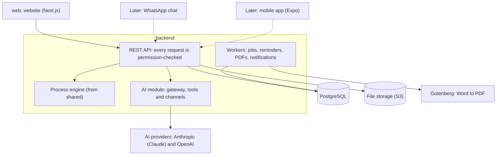

# Architecture

**Read this when** you set up the code, add a module or a department, work on the process engine, events, the AI module, files, sign-in or hosting.
**Related:** [api.md](./api.md) for the endpoints, [data-model.md](./data-model.md) for the tables, [decisions.md](./decisions.md) for why things were chosen.

---

## The parts

COAL is four parts in one repository. The backend is separate, so every client uses the same API: the website now, and later the WhatsApp chat and the mobile app.



| Part | Folder | What it does |
|---|---|---|
| Backend | `backend/` | The REST API, the process engine's database side, the AI module, background workers, document generation and the audit trail. **All rules live here.** |
| Website | `web/` | The Dashboard and Workstation in the browser. |
| Mobile app | `app/` | **A later phase** (web first). The same features as the website, on iOS and Android, with push notifications and Face ID or fingerprint signing. |
| Shared code | `shared/` | Used by the backend and the website, and later the app: API schemas and types, route definitions and the pure engine, widget definitions, and shared rules. |

**Import rules**

- `web/` and `app/` import only from `shared/`, and talk to `backend/` only through the API.
- `backend/` imports from `shared/`.
- `shared/` imports from none of them.
- Anything two parts need goes in `shared/`.

## Stack

| Layer | Choice | Why |
|---|---|---|
| Language | TypeScript everywhere; pnpm workspaces | One language, and shared types between the API and the clients |
| Backend | Node.js with Fastify | Light and fast, with good support for schemas and OpenAPI |
| Schemas | zod in `shared/`; the OpenAPI spec is generated from them | One definition gives validation, types for the clients, and the API document |
| Database | PostgreSQL, with Drizzle for queries and migrations | Relational data, JSON fields for document content, full-text search, and the job queue in one place |
| Jobs | pg-boss, a job queue inside PostgreSQL | No extra server to run |
| Website | Next.js (React), Tailwind, shadcn/ui, TanStack Query; next-intl for the text | Widely known; quick to build dashboards and chat; every piece of text ready for translation |
| Mobile app | Later: React Native with Expo; TanStack Query | Shares TypeScript and logic with the website; one codebase for iOS and Android |
| AI | Vercel AI SDK, with the Anthropic and OpenAI providers | One interface for both providers, tool calling and streaming |
| Passkeys | SimpleWebAuthn on the backend and website; later, a React Native passkey library in the app | Standard WebAuthn passkeys |
| Documents | docxtemplater (fills Word templates) and Gotenberg (Word to PDF) | Keeps Jayon's own layouts |
| Files | S3-compatible storage (MinIO for local development) | Cheap and durable |
| Live updates | Server-Sent Events | Simple one-way updates, and AI streaming |
| Push | Later, with the app: Expo push notifications | Covers iOS and Android |
| Tests | Vitest, against a real PostgreSQL: each test file gets its own copy of a migrated template database | Fast, and tests see the real triggers and constraints |
| Lint and format | ESLint with typescript-eslint (type-aware), COAL's own rules in `eslint-plugin-coal.mjs`, Prettier | Catches bugs and keeps the parts apart |
| CI | GitHub Actions: lint, type checks, formatting, tests and the website build on every push and pull request | Every change is checked |
| Hosting | Local for now; simple hosting for demos; production decided later (AWS Mumbai proposed) | Simple while testing; AWS Mumbai keeps data in India |

**Sized for all of Jayon.** This stack comfortably serves about 800 employees with one backend service (several copies when needed) and one PostgreSQL database. See the next section.

## Growing to all of Jayon

COAL starts with R&D (about 60 people) and will grow to the whole company (about 800 employees). No microservices, Kubernetes, Kafka or Redis are needed for that. What matters is that adding a department doesn't mean rebuilding the base:

- **Departments, roles and processes are data.** Departments and roles are tables ([data-model.md](./data-model.md#people-and-sessions)). Each department's processes are route files run by the same engine; the R&D route is the first.
- **Platform and department modules.** The platform modules serve everyone: people, processes, tasks, documents, templates, signing, notifications, AI, audit and files. Each department gets its own module for its own records and rules. R&D's holds projects, project teams and its task routing. A lint rule (`coal/module-tables`) stops modules reaching into each other's tables: only a module's own files, other `tables.ts` files (for foreign keys) and tests may import its `tables.ts`.
- **Departments plug in.** A department's module adds its own widgets, AI tools, templates and notification rules. The platform doesn't change.
- **Ready for translation.** All website text lives in message files from the start. English first.
- **Several backend copies** share live updates through the database ([below](#events-and-live-updates)).
- **Before other departments join:**
  - real company sign-in, including a way in for employees without a company email;
  - the org chart;
  - an admin role ([roadmap.md](./roadmap.md#after-the-first-release)).

**When the stack would change**

| If… | Then |
|---|---|
| One department's work or team grows very large | Its module becomes a separate service, behind the same API |
| Permission rules outgrow code | A policy engine such as Cerbos |
| Background jobs outgrow PostgreSQL | A managed queue (AWS SQS) behind the same job interface |
| Search needs to match meaning, not just words | pgvector in the same database; a search server only if that isn't enough |

## Repository layout

```
coal/
  backend/
    src/
      core/           Plumbing every module uses: config, the database client, change() (one
                      transaction with its audit entries and events), the endpoint layer
                      (session, AI tier and permission checks, problem responses, Idempotency-Key)
      modules/        Platform modules: auth, users, org (departments and roles), permissions,
                      audit, events (the outbox), files; later process, tasks, documents,
                      templates, signatures, dashboard, notifications, ai
                      Department modules: rnd (product lines; later projects, teams, task
                      routing); others later
                      Each module has tables.ts, service.ts and routes.ts
      jobs/           Background jobs (pg-boss) and the worker
      server.ts       The API. worker.ts: the worker. dev.ts: both, for local work
    test/             Integration tests and their helpers
    prompts/          The AI's instructions, versioned (with the AI module)
    migrations/       Database migrations, generated from the tables.ts files
  web/
    messages/         All website text, one file per language (en.json first)
    src/app/          Pages: sign-in and sign-up; Dashboard, Workstation and profile
    src/components/   Shared pieces; ui/ holds the shadcn/ui components
  app/                The mobile app (a later phase)
  shared/
    src/
      api/            The endpoint contract, the list of every endpoint, problem codes, the typed client
      schemas/        zod schemas and endpoint contracts, by area
      process/        Route definitions (YAML, one per process and version) and the pure engine, with tests (block 2)
      widgets/        Dashboard widget definitions (block 4)
      rules/          Small rules both clients and the backend use (names, upload limits)
  docs/               This plan
  private/            Jayon's files on this computer, such as templates. Git-ignored: never committed
  docker-compose.yml  The local services
  eslint-plugin-coal.mjs  COAL's lint rules: part boundaries and module tables
  AGENTS.md           Rules and commands for AI coding agents (CLAUDE.md imports it)
```

Each backend module owns its tables, its services and its routes. Modules call each other through their services, not each other's tables.

## The process engine

COAL runs its processes, starting with the R&D route, on its own small engine, not a workflow product. The route is paced by people over months, its rules are specific (milestones, conditional steps, rework that resets only dependent steps), and the engine's state and the audit trail must be written together.

- **Routes are files.** Each process's route lives in `shared/src/process/` as a YAML file per version (for example `rnd-route.v2.yaml`) and is checked against a schema. On deploy it's loaded into the database as a process version. Each run (for R&D, each project) stays on the version it started with.
- **A pure engine.** The engine is one function: given the route, the run's current state and an action (submit, sign, return, decide, record a milestone, send back), it returns the new state and a list of **effects**: open steps, create or cancel tasks, request signatures, notify people, emit events. It touches nothing else, so it's easy to test.
- **One transaction per action.** Each action runs in one database transaction:
  1. check permission;
  2. run the engine;
  3. save the new state;
  4. write the audit entries;
  5. write the events (see below).
- **Previews.** The same function runs without saving. This powers the action cards and the "what would reset" preview for rework.
- **Conditions are named rules** written in code and used by name in the route file: `step_approved`, `step_done`, `milestone_reached`, `decision_equals`, `no_open_corrective_actions`.
- **Tests.** Table-driven tests walk whole projects through the route in seconds, including every rework path, both paths of step 15, and the milestones.

```yaml
process: rnd-route
version: 2                     # Jayon's workflow page, revision 2 (16 Nov 2026)
steps:
  - key: "10"
    name: Implant prototype
    stage: 3
    doers: [pme, qc_inspector]
    signer: rd_lead
    default_days: 20                     # placeholder until Jayon gives typical durations
    starts_when:
      - { step_approved: "7" }
      - { milestone_reached: material_received_implant }
      - { milestone_reached: test_licence_recorded }
    outputs: [prototype_documents]       # uploads until the templates exist
    send_back:
      - { to: ["7"], decided_by: rd_head }
  - key: "15"
    name: Pre-clinical study
    stage: 4
    doers: [rd_ops, dard]
    signer: rd_lead
    starts_when: [{ step_approved: "13" }]
    paths:
      decided_at: { step: "12", decision: preclinical_needed }
      yes: { outputs: [preclinical_report] }
      no:  { outputs: [preclinical_justification] }
```

The full step list is in [workflow.md](./workflow.md). When the route changes, update the YAML, its tests and `workflow.md` together.

## API

REST and JSON under `/api/v1`. The details and the endpoint list are in [api.md](./api.md). In short:

- **The contract.** Each endpoint is defined once in `shared/` with `defineEndpoint`: its path, schemas, whether it needs a session, its permission and its AI tier. The backend implements it, the website calls it through the typed client built from the same definition, and the OpenAPI spec is generated from it (`/api/v1/openapi.json`, with `x-permission` and `x-ai-tier` on each operation).
- **AI tier.** Every endpoint declares its permission and its AI tier ([workstation-and-ai.md](./workstation-and-ai.md#what-the-ai-may-do)). Before validating the input, the backend checks, in order: the session, the AI tier for "via AI" calls, then the permission.
- **Kept complete.** The backend refuses to start if an endpoint in `shared/` has no implementation, and the type check fails if a permission has no rule.
- **Sessions.** The website sends the user's session token in a cookie. The backend already accepts it as a bearer token too, for the app later.

## Events and live updates

- **The outbox.** Every change writes **events** (for example `step.ready`, `task.assigned`, `signature.requested`) to an outbox table, in the same transaction.
- **Delivery.** A worker reads the outbox and passes each event to its subscribers (`backend/src/modules/events/subscriptions.ts`), in the same transaction that marks it delivered. A failed delivery is retried later, with growing gaps. Subscribers come with their blocks:
  - the notification sender;
  - live updates to open clients;
  - recalculating the forecast;
  - updating search.
- **Live updates.** Each signed-in client keeps one Server-Sent Events stream (`GET /api/v1/stream`). It carries "this widget changed" hints and new notifications. The mobile app, when it comes, uses the stream while open and push notifications otherwise.
- **Several backend copies.** A trigger sends `NOTIFY coal_outbox` when events are written, so the workers wake at once, and each also polls as a fallback. Workers claim events with `SKIP LOCKED`, so each event is delivered once. Live updates, which every copy needs, will be passed on to all copies through PostgreSQL's LISTEN/NOTIFY too, so no extra server is needed.
- **The event list** is in [api.md](./api.md#events).

## AI module

The AI lives inside the backend (`backend/src/modules/ai/`) for now. It can be split out later without changing the API.

- **Gateway.** One function picks the provider and model for each purpose from configuration, and calls it through the Vercel AI SDK. Anthropic and OpenAI are both wired up ([workstation-and-ai.md](./workstation-and-ai.md#ai-providers)).
- **Tools** are thin wrappers over the backend's own services.
  - Each call carries the user's identity and a "via AI" mark, and goes through the same permission module.
  - `confirm`-tier services accept "via AI" calls only to create proposals.
  - `never`-tier services refuse them outright.
- **Chats** are kept in the database. Replies stream to the client over Server-Sent Events.
- **Channels.** The chat is channel-neutral. A channel passes in messages and gets back text, citations and action cards, which it shows in its own way. The website is the first channel; WhatsApp and the app come later ([workstation-and-ai.md](./workstation-and-ai.md#channels)).
- **Templates.** Drafting always loads the active template from the template library ([documents-and-signing.md](./documents-and-signing.md#the-template-library)).
- **Search.** The AI finds documents with PostgreSQL full-text search, filtered by permission before ranking. Vector search comes later.
- **Logged.** Every AI call and tool call is recorded: who, which model, tokens, cost, the tools used and the records returned.

## Sign-in and sessions

- **Name-only sign-in, for now.** A placeholder module ([roles-and-access.md](./roles-and-access.md#accounts-for-now)) creates accounts and signs people in by name. It issues an opaque session token; the database keeps only its SHA-256 hash. Sessions last 14 days (a setting), and sign-up and sign-in are rate-limited.
  - the website keeps it in an HTTP-only, SameSite=Lax cookie (`coal_session`);
  - later, the app keeps it in the device's secure storage and sends it as a bearer token.

  Replacing this module with real sign-in later doesn't change the rest of the backend.
- **Passkeys** are registered and used only for signing ([documents-and-signing.md](./documents-and-signing.md#signing-with-face-id-or-fingerprint)). They're tied to COAL's web address. They work on `localhost` while testing, and passkeys made on a demo host are registered again once the final domain is set; the domain is decided at the end. When the mobile app comes, it must be linked to that domain (Associated Domains on iOS, Digital Asset Links on Android) to use the same passkeys.

## Background jobs

pg-boss runs:

- reminders and escalations, checked every few minutes;
- the nightly forecast recalculation;
- document rendering;
- virus scanning of uploads;
- sending notifications;
- the daily audit-chain check (02:30 Indian time);
- removing stored Idempotency-Key responses after a day.

The audit-chain check and the clean-up run now; the others come with their blocks.

Jobs are written so that running one twice does no harm.

## Security basics

- **Encryption.** TLS everywhere, and storage and database encryption.
- **Secrets** live in a secrets manager, never in the code.
- **Database accounts.** The backend's database account can't change or delete audit entries or signatures.
- **Uploads** are virus-scanned and limited by type and size. Clients upload to a staging area; COAL checks the bytes and copies them to where they're served from, so a file's recorded hash always matches what's served. Files are served only through short-lived links. In production, a storage rule removes staged uploads left unfinished after a day.
- **Rate limits** on sign-in and the AI endpoints, counted per address. The backend believes `X-Forwarded-For` only from the reverse proxies named in `TRUST_PROXY`, and only a proxy that overwrites that header with the connecting address may be named. The website's own rewrite passes a browser's header through, so it's never trusted: locally, and until demo hosting puts such a proxy in front of `/api/v1`, everyone shares one counter.
- **Logs** never contain document content, prompts or AI results. Error reports are scrubbed before they're stored.

## Environments and hosting

| Environment | What | Data |
|---|---|---|
| Local | Docker Compose: PostgreSQL 18, Gotenberg, and MinIO (the `pgsty/minio` community build, since MinIO stopped publishing images); the backend creates its bucket | Made-up |
| Demo, when needed | Simple hosting to show COAL to employees: for example, one small server running the same Docker Compose setup, behind a shared password ⚠ | Made-up |
| Production | Decided at the end (AWS Mumbai proposed), with daily backups and point-in-time restore | Real Jayon data, **only once real sign-in exists** |

When the mobile app comes, it's tested through Expo's internal distribution or TestFlight first.

Madhav's hosting research and monthly cost estimates are in [archive/PLAN.md, Part 10](./archive/PLAN.md#part-10--hosting-and-running-cost). Re-check them before quoting.
