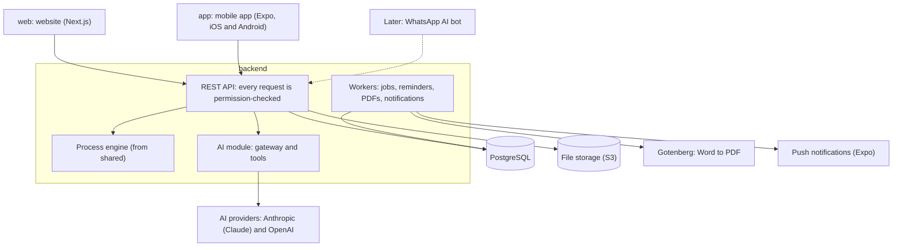

# Architecture

**Read this when** you set up the code, add a module, work on the process engine, events, the AI module, files, sign-in or hosting.
**Related:** [api.md](./api.md) for the endpoints, [data-model.md](./data-model.md) for the tables, [decisions.md](./decisions.md) for why things were chosen.

---

## The parts

COAL is four parts in one repository. The backend is separate, so every client uses the same API: the website, the mobile app, and later a WhatsApp AI bot.



| Part | Folder | What it does |
|---|---|---|
| Backend | `backend/` | The REST API, the process engine's database side, the AI module, background workers, document generation and the audit trail. **All rules live here.** |
| Website | `web/` | The Dashboard and Workstation in the browser. |
| Mobile app | `app/` | The same features as the website, on iOS and Android, with push notifications and Face ID or fingerprint signing. |
| Shared code | `shared/` | Used by all three: API schemas and types, the R&D route definition and the pure engine, widget definitions, and shared rules. |

**Import rules**

- `web/` and `app/` import only from `shared/`, and talk to `backend/` only through the API.
- `backend/` imports from `shared/`.
- `shared/` imports from none of them.
- Anything two parts need goes in `shared/`.

## Stack

| Layer | Choice | Why |
|---|---|---|
| Language | TypeScript everywhere; pnpm workspaces | One language, and shared types between the API and the clients |
| Backend | Node.js with Fastify | Light and fast, with good support for schemas and OpenAPI |
| Schemas | zod in `shared/`; the OpenAPI spec is generated from them | One definition gives validation, types for the clients, and the API document |
| Database | PostgreSQL, with Drizzle for queries and migrations | Relational data, JSON fields for document content, full-text search, and the job queue in one place |
| Jobs | pg-boss, a job queue inside PostgreSQL | No extra server to run |
| Website | Next.js (React), Tailwind, shadcn/ui, TanStack Query | Widely known; quick to build dashboards and chat |
| Mobile app | React Native with Expo; TanStack Query | Shares TypeScript and logic with the website; one codebase for iOS and Android |
| AI | Vercel AI SDK, with the Anthropic and OpenAI providers | One interface for both providers, tool calling and streaming |
| Passkeys | SimpleWebAuthn on the backend and website; a React Native passkey library in the app | Standard WebAuthn passkeys |
| Documents | docxtemplater (fills Word templates) and Gotenberg (Word to PDF) | Keeps Jayon's own layouts |
| Files | S3-compatible storage (MinIO for local development) | Cheap and durable |
| Live updates | Server-Sent Events | Simple one-way updates, and AI streaming |
| Push | Expo push notifications | Covers iOS and Android |
| Hosting | AWS Mumbai | Keeps data in India; widely used |

## Repository layout

```
coal/
  backend/
    src/
      modules/        One folder per area: auth, users, projects, process, tasks, documents,
                      signatures, dashboard, notifications, files, audit, ai
      jobs/           Background jobs
    templates/        Word boilerplates and their specifications
    prompts/          The AI's instructions, versioned
    migrations/       Database migrations
  web/                The website
  app/                The mobile app
  shared/
    src/
      schemas/        zod schemas: API requests and responses, shared types
      process/        The R&D route definition (YAML) and the pure engine, with its tests
      widgets/        Dashboard widget definitions
      rules/          Small rules both clients and the backend use
  docs/               This plan
  AGENTS.md           Rules for AI coding agents (CLAUDE.md imports it)
```

Each backend module owns its tables, its services and its routes. Modules call each other through their services, not each other's tables.

## The process engine

COAL runs the R&D route on its own small engine, not a workflow product. The route is paced by people over months, its rules are specific (milestones, conditional steps, rework that resets only dependent steps), and the engine's state and the audit trail must be written together.

- **The route is a file.** It lives in `shared/src/process/` as a YAML file per version (for example `rnd-route.v2.yaml`) and is checked against a schema. On deploy it's loaded into the database as a process version. Each project stays on the version it started with.
- **A pure engine.** The engine is one function: given the route, the project's current state and an action (submit, sign, return, decide, record a milestone, send back), it returns the new state and a list of **effects**: open steps, create or cancel tasks, request signatures, notify people, emit events. It touches nothing else, so it's easy to test.
- **One transaction per action.** Each action runs in one database transaction:
  1. check permission;
  2. run the engine;
  3. save the new state;
  4. write the audit entries;
  5. write the events (see below).
- **Previews.** The same function runs without saving. This powers the action cards and the "what would reset" preview for rework.
- **Conditions are named rules** written in code and used by name in the route file: `step_approved`, `step_done`, `milestone_reached`, `decision_equals`, `no_open_corrective_actions`.
- **Tests.** Table-driven tests walk whole projects through the route in seconds, including every rework path, both paths of step 15, and the milestones.

```yaml
process: rnd-route
version: 2                     # Jayon's workflow page, revision 2 (16 Nov 2026)
steps:
  - key: "10"
    name: Implant prototype
    stage: 3
    doers: [pme, qc_inspector]
    signer: rd_lead
    default_days: 20                     # placeholder until Jayon gives typical durations
    starts_when:
      - { step_approved: "7" }
      - { milestone_reached: material_received_implant }
      - { milestone_reached: test_licence_recorded }
    outputs: [prototype_documents]       # uploads until the templates exist
    send_back:
      - { to: ["7"], decided_by: rd_head }
  - key: "15"
    name: Pre-clinical study
    stage: 4
    doers: [rd_ops, dard]
    signer: rd_lead
    starts_when: [{ step_approved: "13" }]
    paths:
      decided_at: { step: "12", decision: preclinical_needed }
      yes: { outputs: [preclinical_report] }
      no:  { outputs: [preclinical_justification] }
```

The full step list is in [workflow.md](./workflow.md). When the route changes, update the YAML, its tests and `workflow.md` together.

## API

REST and JSON under `/api/v1`. The details and the endpoint list are in [api.md](./api.md). In short:

- **The contract.** The OpenAPI spec is generated from the zod schemas in `shared/`. The website and the app use typed clients built from the same schemas.
- **AI tier.** Every endpoint declares its permission and its AI tier ([workstation-and-ai.md](./workstation-and-ai.md#what-the-ai-may-do)).
- **Sessions.** The website and the app send the user's session token.

## Events and live updates

- **The outbox.** Every change writes **events** (for example `step.ready`, `task.assigned`, `signature.requested`) to an outbox table, in the same transaction.
- **Delivery.** A worker reads the outbox and passes each event to:
  - the notification sender;
  - live updates to open clients;
  - recalculating the forecast;
  - updating search.
- **Live updates.** Each signed-in client keeps one Server-Sent Events stream (`GET /api/v1/stream`). It carries "this widget changed" hints and new notifications. The mobile app uses the stream while open, and push notifications otherwise.
- **The event list** is in [api.md](./api.md#events).

## AI module

The AI lives inside the backend (`backend/src/modules/ai/`) for now. It can be split out later without changing the API.

- **Gateway.** One function picks the provider and model for each purpose from configuration, and calls it through the Vercel AI SDK. Anthropic and OpenAI are both wired up ([workstation-and-ai.md](./workstation-and-ai.md#ai-providers)).
- **Tools** are thin wrappers over the backend's own services.
  - Each call carries the user's identity and a "via AI" mark, and goes through the same permission module.
  - `confirm`-tier services accept "via AI" calls only to create proposals.
  - `never`-tier services refuse them outright.
- **Chats** are kept in the database. Replies stream to the client over Server-Sent Events.
- **Search.** The AI finds documents with PostgreSQL full-text search, filtered by permission before ranking. Vector search comes later.
- **Logged.** Every AI call and tool call is recorded: who, which model, tokens, cost, the tools used and the records returned.

## Sign-in and sessions

- **Name-only sign-in, for now.** A placeholder module ([roles-and-access.md](./roles-and-access.md#accounts-for-now)) creates accounts and signs people in by name. It issues an opaque session token stored in the database:
  - the website keeps it in an HTTP-only cookie;
  - the app keeps it in the device's secure storage.

  Replacing this module with real sign-in later doesn't change the rest of the backend.
- **Passkeys** are registered and used only for signing ([documents-and-signing.md](./documents-and-signing.md#signing-with-face-id-or-fingerprint)). For the app to use the same passkeys as the website, the app must be linked to COAL's web domain: Associated Domains on iOS and Digital Asset Links on Android. The domain must be decided before passkeys are built.

## Background jobs

pg-boss runs:

- reminders and escalations, checked every few minutes;
- the nightly forecast recalculation;
- document rendering;
- virus scanning of uploads;
- sending notifications;
- the daily audit-chain check.

Jobs are written so that running one twice does no harm.

## Security basics

- **Encryption.** TLS everywhere, and storage and database encryption.
- **Secrets** live in a secrets manager, never in the code.
- **Database accounts.** The app's database account can't change or delete audit entries or signatures.
- **Uploads** are virus-scanned and limited by type and size. Files are served only through short-lived links.
- **Rate limits** on sign-in and the AI endpoints.
- **Logs** never contain document content, prompts or AI results. Error reports are scrubbed before they're stored.

## Environments and hosting

| Environment | What | Data |
|---|---|---|
| Local | Docker Compose: PostgreSQL, Gotenberg, MinIO | Made-up |
| Staging | AWS Mumbai: the backend and website in containers, RDS PostgreSQL, S3 | Made-up |
| Production | AWS Mumbai, with daily backups and point-in-time restore | Real Jayon data, **only once real sign-in exists** |

The mobile app is distributed for testing through Expo's internal distribution or TestFlight first.

Madhav's hosting research and monthly cost estimates are in [archive/PLAN.md, Part 10](./archive/PLAN.md#part-10--hosting-and-running-cost). Re-check them before quoting.
