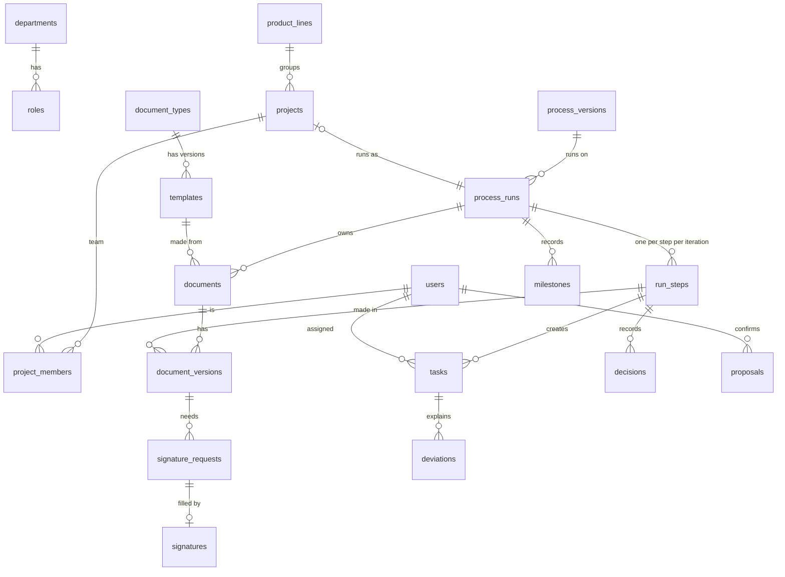

# Data model

**Read this when** you add or change a table, write a migration, or need to know where something is stored.
**Related:** [architecture.md](./architecture.md) for the stack (PostgreSQL with Drizzle), [workflow.md](./workflow.md) for what the process tables represent, [api.md](./api.md) for how data is exposed.

This is the **first-release core** only: about 40 tables. Step-specific and regulatory data is deliberately not modelled yet (see the end of this doc).

---

## Conventions

- **Keys and timestamps.** Every table has an `id` (UUIDv7), `created_at` and `updated_at`, and `created_by` where a person creates rows. Insert-only tables have no `updated_at`.
- **Where tables are defined.** Each backend module defines its own tables in its `tables.ts` (Drizzle). Migrations in `backend/migrations/` are generated from them; triggers and other SQL Drizzle can't express go in hand-written migrations there.
- **`org_id`.** Every table carries an `org_id`, with one value for now. It keeps the door open to serving other companies without a painful migration later. The permission module adds it to every query.
- **Platform and department tables.** COAL will grow from R&D to all of Jayon ([architecture.md](./architecture.md#growing-to-all-of-jayon)).
  - *Platform tables* serve every department: people, processes, tasks, documents, templates, signatures, AI, notifications and audit.
  - *Department tables* hold one department's own records. R&D's are `product_lines`, `projects` and `project_members`.
  - Department tables may point at platform tables, never the other way round. The one exception is `users.product_line_id`, a Lead's product line, until the org chart replaces it ([A4](./open-questions.md#people-and-access)).
- **Processes in general.** A **process run** is one run of a process's route. For R&D, each project has exactly one run. Steps, tasks, decisions, milestones and documents point at the run, so other departments' processes reuse them unchanged.
- **Times.** Stored in UTC, shown in Indian time.
- **Nothing important is overwritten.** Documents, signatures, decisions and deviations are versioned or insert-only. A correction is a new row pointing at the old one. Tables marked *insert-only* can't be changed or deleted: a trigger (`coal_refuse_change`) refuses every `UPDATE`, `DELETE` and `TRUNCATE`, and in production the backend's database account will also lack those privileges.
- **Audit and events in the same transaction.** Every change writes its audit entry and its events in the same transaction as the change itself ([architecture.md](./architecture.md#events-and-live-updates)).
- **JSON for variable content.** Document content (fields and written sections), route definitions, template specifications, and proposal actions and previews are JSON columns, checked against zod schemas in `shared/`.
- **A run's state is its rows.** There is no separate state blob. The engine's state is loaded from `run_steps` (the current iteration of each step), `decisions` and `milestones`, and each action locks the run's row (`FOR UPDATE`), so two actions on one project happen one after the other. Tasks link to what they belong to with `subject_type` and `subject_id` (for R&D, a project), not a foreign key, so the platform's task table doesn't depend on any department's tables.
- **Two kinds of step reference.** `step_key` (for example `"13"` or `"24a"`) points at a step in the route definition. `run_step_id` points at one iteration of that step in one run.

## The core

In words:

- A **process run** is one run of a process's **route** (`process_versions`). For R&D, each **project** has one run.
- Each step becomes a **run step**, once per iteration, and run steps create **tasks**.
- Runs produce **documents**. A document is made from a **template** version of its type, or uploaded, and has numbered **versions**.
- Anything that needs a signature gets **signature requests**, which **signatures** fill. That includes a document version, a step sign-off record, or a decision.
- **Proposals** hold actions waiting for a person to confirm them.

## Tables

### People and sessions

| Table | Holds | Key columns |
|---|---|---|
| `departments` | Jayon's departments: R&D first, and the ones R&D works with (Quality Assurance, Quality Control, Production, Marketing) | code, name, sort_order |
| `roles` | Every role ([roles-and-access.md](./roles-and-access.md#roles)) | key, name, department_id (empty for the Board and the VP, who sit above departments), reports_to_key (the role ladder until there's an org chart), needs_product_line (the R&D Lead), sort_order |
| `users` | Everyone with an account | name (unique, case-insensitive), role_key (must be a role), product_line_id (Leads), status |
| `sessions` | Sign-in sessions | user_id, token_hash (SHA-256 of the token), device, expires_at, revoked_at |

Departments, roles and product lines are reference data. Their rows are listed in `backend/src/modules/org/catalogue.ts` and `backend/src/modules/rnd/catalogue.ts`, and loaded into the tables by `db:migrate` on every deploy.
| `passkeys` | Devices registered for signing | user_id, credential_id, public_key, sign_count, transports, device_name, backed_up, last_used_at, revoked_at |

### Processes and the calendar

| Table | Holds | Key columns |
|---|---|---|
| `process_versions` | Each version of each process's route, loaded from `shared/` on deploy. A loaded version never changes; a changed file is refused until it is a new version. The R&D route is the first | key, version, department_code, definition (JSON), sha256, loaded_at |
| `process_runs` | Each run of a process. For R&D, one per project | process_version_id, status (active, on hold, dropped, completed, closed), stage, hold_reason, drop_reason, started_at, completed_at. *Health and planned and forecast ends come with the Dashboard* |
| `run_steps` | Each step of each run, once per iteration. A send-back marks the closed iteration `reset` and adds the next; a step has one current row | run_id, step_key, iteration, status (locked, ready, in progress, in review, returned, approved, done, reset, cancelled), path (step 15), signers and approved_by (who must sign, and who has, where several must), opened_at, submitted_at, completed_at, reset_by_send_back_id. *Planned dates come with the Dashboard* |
| `work_calendar` | Holidays and working Saturdays | date, is_working_day, note |

### R&D

| Table | Holds | Key columns |
|---|---|---|
| `product_lines` | Arthroscopy, Spine, Trauma | code, name |
| `projects` | One per product idea. Its status and stage are its run's (for R&D, a completed run means launched) | code (`SPN-26-004`: product line, year, then the next number for that line and year), name, description, product_line_id, process_run_id, created_by |
| `project_members` | The project team. A removed member keeps their row, with `removed_at` set | project_id, user_id, role_key (their role when added), added_by, added_at, removed_at |

### Work

| Table | Holds | Key columns |
|---|---|---|
| `milestones` *(insert-only)* | Milestones recorded, such as material received | run_id, milestone, step_key and iteration (where it counts), note, evidence_file_id, recorded_by, recorded_at |
| `decisions` *(insert-only)* | Go, checkpoint and step decisions, and hold, resume and drop | run_id, run_step_id, step_key, iteration, decision (go, checkpoint, prototypes_ok, preclinical_needed, hold, resume, drop), value, reason, decided_by. *The signature link comes with signing* |
| `send_backs` *(insert-only)* | Each time work is sent back to an earlier step | run_id, from_run_step_id, from_step_key, to_step_key, reason, evidence_file_id, decided_by, reset_run_step_ids. *The signature link comes with signing* |
| `tasks` | Every task and request | run_id, run_step_id and step_key (empty for work outside a process), task_key (names a task a step makes beyond one per doer role), kind (work, review, sign, decision, corrective action, request, own), title, body, role_key, assignee_id, queue_role (set while the task waits in a queue), assigned_by, via_ai, status (open, in progress, waiting, done, declined, cancelled), keep_on_reset (a send-back never cancels it: the step-20 follow-up), subject_type, subject_id and subject_label (the project, for links), done_at. *Due dates, requests and waiting reasons come with the Dashboard and Tasks work* |
| `timeline_items` | Planned dates per step and role: defaults first, then each baseline from the Action Plan | run_id, baseline_no, step_key, role, user_id, planned_start, planned_end |
| `deviations` *(insert-only)* | Late work, with the reason and the cause | run_id, task_id, run_step_id, kind (late, forecast slip, rework), planned_date, new_date, reason_code, reason_text, cause_type (person, role, outside party), cause_user_id, cause_role, cause_party, recorded_by, reviewed_by, corrects_id |
| `deviation_comments` | Comments from the person named as the cause | deviation_id, user_id, body |
| `comments` | Comments on any record | target_type, target_id, author_id, body, mentions |

### Documents, templates, signatures and files

| Table | Holds | Key columns |
|---|---|---|
| `document_types` | Each kind of document and its rules | code, name, department_id, step_keys, numbering_pattern, signature_rows (JSON: meaning, who, order) |
| `templates` | The template library: every version of every document type's template ([documents-and-signing.md](./documents-and-signing.md#the-template-library)). At most one active version per type | document_type_id, version, docx_file_id, spec (JSON), placeholders (JSON, read from the Word file), sample_pdf_file_id, status (draft, active, retired), added_by, activated_by, activated_at |
| `documents` | Every document | run_id, step_key, document_type_id, template_id (the version it was made from), number, title, status, current_version_id, origin (internal, outside) |
| `document_versions` | Each draft and approved revision | document_id, run_step_id, version_no, rev_label, status (draft, in review, returned, approved, superseded), content (JSON), content_sha256, pdf_file_id, pdf_sha256, search_text (full-text), created_by, via_ai, ai_request_id |
| `signature_requests` | Every signature needed | subject_type (document version, decision), subject_id, subject_version, meaning (prepared, reviewed, approved, received, decision), assignee_id, order_index, status, requested_at, due_at |
| `signatures` *(insert-only)* | Each signature | request_id, subject_type, subject_id, subject_version, content_sha256, pdf_sha256, user_id, printed_name, role_snapshot, meaning, decision, reason, intent (JSON), intent_sha256, passkey_id, authenticator_data, client_data_json, assertion_signature, signed_at |
| `files` | Every stored file | storage_key, name, mime_type (from the file extension), size, sha256 (recorded when the upload completes), status (pending, uploaded), uploaded_by, scan_status (not scanned, clean, infected), origin (internal, outside) |
| `attachments` | Files and pictures on any record | target_type, target_id, file_id, caption |
| `sources` | Sources added to a step or document | target_type, target_id, kind (link, file, citation), title, url, file_id, note, added_by |

The step sign-off record is a document of type `STEP_SIGNOFF`, so it needs no table of its own.

### AI and proposals

| Table | Holds | Key columns |
|---|---|---|
| `ai_chats` | Each chat in someone's Workstation | user_id, run_id, channel (website; later WhatsApp and the app), context (JSON: step, document, task or widget), title |
| `ai_messages` | Each message | chat_id, sender (user, assistant, tool), parts (JSON: text with citations, and data blocks) |
| `ai_requests` *(insert-only)* | Each call to a model | chat_id, user_id, provider, model, purpose, prompt_version, input_tokens, output_tokens, cost, outcome, duration_ms |
| `ai_tool_calls` *(insert-only)* | Each tool the AI used | ai_request_id, tool, tier, allowed, denial_reason, records_returned (type, id, version), proposal_id |
| `proposals` | Actions waiting for confirmation | for_user_id, chat_id, version, actions (JSON), preview (JSON), status (pending, confirmed, rejected, expired, failed), expires_at, confirmed_at, result |
| `ai_feedback` | Thumbs up or down | message_id, user_id, rating, comment |

### Notifications and platform

| Table | Holds | Key columns |
|---|---|---|
| `notifications` | Work messages and alerts | user_id, kind, event_type, title, body, link, channels, sent_at, read_at |
| `alerts` | Reminders and escalations raised, so none is sent twice | subject_type, subject_id, level, raised_at |
| `audit_events` *(insert-only)* | Every change, signature, decision and sign-in | seq, at, actor_type (user, user via AI, system), actor_id, action, record_type, record_id, before, after, reason, request_id, prev_hash, hash. `hash` is the SHA-256 of the entry's fields, including `prev_hash` |
| `outbox_events` | Events waiting to be delivered | type, actor_type, actor_id, project_id, step_key, payload, created_at, available_at, attempts, last_error, delivered_at |
| `idempotency_keys` | Safe retries | key, user_id, request_hash, response_status (empty while the first request is still running), response, created_at |

## Not modelled yet, on purpose

These need real Jayon documents and answers before they can be designed well. Guessing now would create tables we'd have to undo. Until each one is designed, its step works with tasks, uploads, milestones and step sign-off records.

| Area | Steps | Examples of what will be needed |
|---|---|---|
| Materials and purchasing | 6, 9 | Material requirements, lots and heat numbers, raw material tests, orders, outsourced items |
| Design and engineering | 7, 8 | Parts, CAD models and drawings, critical dimensions, FEA studies |
| Prototypes and the shop floor | 10, 11, 19, 21 | Material Issue Slips, run cards and operations, machines, OEE, costing, QC inspections and measurements |
| Testing and feedback | 13 to 16 | Test requirements, requests, plans, results, surveys, pre-clinical studies, corrective-action details |
| Clinical trials | 19, 20 | Trial plans, sites, approvals, cases, follow-ups, adverse events |
| Regulatory, transfer and launch | 2a, 22 to 25 | Regulatory plans and requirements, licences, submissions, transfer packages, launch sets |
| Money | 5, 10, 21 | Budgets, costs, rates |
| Organisation | — | Org chart, outside parties, data labels |
| Other departments | — | Their own records, routes and roles, designed with each department when it joins |

When one of these is designed:

1. Start from the real Jayon documents.
2. Use the archived drafts as a starting point:
   - Madhav's table list in [archive/PLAN.md, Appendix D](./archive/PLAN.md#appendix-d--all-the-tables);
   - Sharath's in [archive/01-base-layer-plan.md, §9.4](./archive/01-base-layer-plan.md#94-tables-by-module).
3. Update this doc, [workflow.md](./workflow.md) and [roadmap.md](./roadmap.md).
