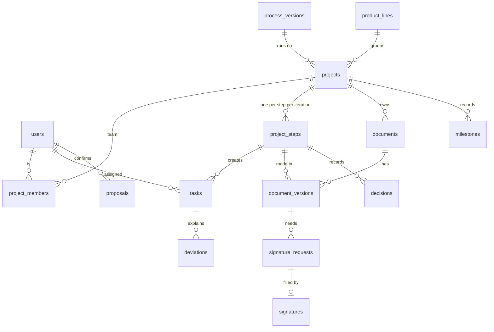

# Data model

**Read this when** you add or change a table, write a migration, or need to know where something is stored.
**Related:** [architecture.md](./architecture.md) for the stack (PostgreSQL with Drizzle), [workflow.md](./workflow.md) for what the process tables represent, [api.md](./api.md) for how data is exposed.

This is the **first-release core** only: about 40 tables. Step-specific and regulatory data is deliberately not modelled yet (see the end of this doc).

---

## Conventions

- **Keys and timestamps.** Every table has an `id` (UUIDv7), `created_at` and `updated_at`, and `created_by` where a person creates rows.
- **`org_id`.** Every table carries an `org_id`, with one value for now. It keeps the door open to serving other companies without a painful migration later. The permission module adds it to every query.
- **Times.** Stored in UTC, shown in Indian time.
- **Nothing important is overwritten.** Documents, signatures, decisions and deviations are versioned or insert-only. A correction is a new row pointing at the old one. Tables marked *insert-only* can't be changed or deleted by the app's database account.
- **Audit and events in the same transaction.** Every change writes its audit entry and its events in the same transaction as the change itself ([architecture.md](./architecture.md#events-and-live-updates)).
- **JSON for variable content.** Document content (fields and written sections), the route definition, and proposal actions and previews are JSON columns, checked against zod schemas in `shared/`.
- **Two kinds of step reference.** `step_key` (for example `"13"` or `"24a"`) points at a step in the route definition. `project_step_id` points at one iteration of that step in one project.

## The core

In words:

- A **project** runs on one version of the **route** (`process_versions`).
- Each step becomes a **project step**, once per iteration, and project steps create **tasks**.
- Steps produce **documents**, which have numbered **versions**.
- Anything that needs a signature gets **signature requests**, which **signatures** fill. That includes a document version, a step sign-off record, or a decision.
- **Proposals** hold actions waiting for a person to confirm them.

## Tables

### People and sessions

| Table | Holds | Key columns |
|---|---|---|
| `users` | Everyone with an account | name (unique, case-insensitive), role, product_line_id (Leads), status |
| `product_lines` | Arthroscopy, Spine, Trauma | code, name |
| `sessions` | Sign-in sessions | user_id, token_hash, device, expires_at, revoked_at |
| `passkeys` | Devices registered for signing | user_id, credential_id, public_key, sign_count, transports, device_name, backed_up, last_used_at, revoked_at |
| `push_tokens` | Phones registered for push | user_id, token, platform, revoked_at |

### The route and the calendar

| Table | Holds | Key columns |
|---|---|---|
| `process_versions` | Each version of the R&D route, loaded from `shared/` on deploy | key, version, definition (JSON), sha256, loaded_at |
| `work_calendar` | Holidays and working Saturdays | date, is_working_day, note |

### Projects and work

| Table | Holds | Key columns |
|---|---|---|
| `projects` | One per product idea | code (e.g. `SPN-26-004`), name, product_line_id, process_version_id, status (active, on hold, dropped, launched, closed), stage, health, planned_launch, forecast_launch, hold_reason, drop_reason |
| `project_members` | The project team | project_id, user_id, role, added_by, added_at, removed_at |
| `project_steps` | Each step of each project, once per iteration | project_id, step_key, iteration, status (locked, ready, in progress, in review, returned, approved, done, reset, cancelled), path (step 15), opened_at, submitted_at, completed_at, planned_start, planned_end, forecast_end, reset_by_send_back_id |
| `milestones` *(insert-only)* | Milestones recorded, such as material received | project_id, key, value, evidence_file_id, note, recorded_by, recorded_at |
| `decisions` *(insert-only)* | Go, checkpoint and step decisions | project_id, project_step_id, kind (go, checkpoint, prototypes_ok, preclinical_needed, hold, resume, drop), value, reason, decided_by, signature_id |
| `send_backs` *(insert-only)* | Each time work is sent back to an earlier step | project_id, from_project_step_id, to_step_key, reason, evidence_file_id, decided_by, signature_id, reset_project_step_ids |
| `tasks` | Every task and request | project_id, project_step_id, kind (work, review, sign, decision, corrective action, request, own), title, body, assignee_id, queue_role, assigned_by, requested_by, via_ai, status (open, in progress, waiting, done, declined, cancelled), waiting_reason, baseline_due, due, done_at |
| `timeline_items` | Planned dates per step and role: defaults first, then each baseline from the Action Plan | project_id, baseline_no, step_key, role, user_id, planned_start, planned_end |
| `deviations` *(insert-only)* | Late work, with the reason and the cause | project_id, task_id, project_step_id, kind (late, forecast slip, rework), planned_date, new_date, reason_code, reason_text, cause_type (person, role, outside party), cause_user_id, cause_role, cause_party, recorded_by, reviewed_by, corrects_id |
| `deviation_comments` | Comments from the person named as the cause | deviation_id, user_id, body |
| `comments` | Comments on any record | target_type, target_id, author_id, body, mentions |

### Documents, signatures and files

| Table | Holds | Key columns |
|---|---|---|
| `document_types` | Each kind of document and its rules | code, name, numbering_pattern, signature_rows (JSON: meaning, who, order) |
| `templates` | Boilerplate versions | document_type_id, version, docx_file_id, spec (JSON), status |
| `documents` | Every document | project_id, step_key, document_type_id, template_id, number, title, status, current_version_id, origin (internal, outside) |
| `document_versions` | Each draft and approved revision | document_id, project_step_id, version_no, rev_label, status (draft, in review, returned, approved, superseded), content (JSON), content_sha256, pdf_file_id, pdf_sha256, search_text (full-text), created_by, via_ai, ai_request_id |
| `signature_requests` | Every signature needed | subject_type (document version, decision), subject_id, subject_version, meaning (prepared, reviewed, approved, received, decision), assignee_id, order_index, status, requested_at, due_at |
| `signatures` *(insert-only)* | Each signature | request_id, subject_type, subject_id, subject_version, content_sha256, pdf_sha256, user_id, printed_name, role_snapshot, meaning, decision, reason, intent (JSON), intent_sha256, passkey_id, authenticator_data, client_data_json, assertion_signature, signed_at |
| `files` | Every stored file | storage_key, name, mime_type, size, sha256, uploaded_by, scan_status, origin (internal, outside) |
| `attachments` | Files and pictures on any record | target_type, target_id, file_id, caption |
| `sources` | Sources added to a step or document | target_type, target_id, kind (link, file, citation), title, url, file_id, note, added_by |

The step sign-off record is a document of type `STEP_SIGNOFF`, so it needs no table of its own.

### AI and proposals

| Table | Holds | Key columns |
|---|---|---|
| `ai_chats` | Each chat in someone's Workstation | user_id, project_id, context (JSON: step, document, task or widget), title |
| `ai_messages` | Each message | chat_id, sender (user, assistant, tool), parts (JSON: text with citations, and data blocks) |
| `ai_requests` *(insert-only)* | Each call to a model | chat_id, user_id, provider, model, purpose, prompt_version, input_tokens, output_tokens, cost, outcome, duration_ms |
| `ai_tool_calls` *(insert-only)* | Each tool the AI used | ai_request_id, tool, tier, allowed, denial_reason, records_returned (type, id, version), proposal_id |
| `proposals` | Actions waiting for confirmation | for_user_id, chat_id, version, actions (JSON), preview (JSON), status (pending, confirmed, rejected, expired, failed), expires_at, confirmed_at, result |
| `ai_feedback` | Thumbs up or down | message_id, user_id, rating, comment |

### Notifications and platform

| Table | Holds | Key columns |
|---|---|---|
| `notifications` | Work messages and alerts | user_id, kind, event_type, title, body, link, channels, sent_at, read_at |
| `alerts` | Reminders and escalations raised, so none is sent twice | subject_type, subject_id, level, raised_at |
| `audit_events` *(insert-only)* | Every change, signature, decision and sign-in | seq, at, actor_type (user, user via AI, system), actor_id, action, record_type, record_id, before, after, reason, request_id, prev_hash, hash |
| `outbox_events` | Events waiting to be delivered | type, payload, created_at, delivered_at |
| `idempotency_keys` | Safe retries | key, user_id, request_hash, response, created_at |

## Not modelled yet, on purpose

These need real Jayon documents and answers before they can be designed well. Guessing now would create tables we'd have to undo. Until each one is designed, its step works with tasks, uploads, milestones and step sign-off records.

| Area | Steps | Examples of what will be needed |
|---|---|---|
| Materials and purchasing | 6, 9 | Material requirements, lots and heat numbers, raw material tests, orders, outsourced items |
| Design and engineering | 7, 8 | Parts, CAD models and drawings, critical dimensions, FEA studies |
| Prototypes and the shop floor | 10, 11, 19, 21 | Material Issue Slips, run cards and operations, machines, OEE, costing, QC inspections and measurements |
| Testing and feedback | 13 to 16 | Test requirements, requests, plans, results, surveys, pre-clinical studies, corrective-action details |
| Clinical trials | 19, 20 | Trial plans, sites, approvals, cases, follow-ups, adverse events |
| Regulatory, transfer and launch | 2a, 22 to 25 | Regulatory plans and requirements, licences, submissions, transfer packages, launch sets |
| Money | 5, 10, 21 | Budgets, costs, rates |
| Organisation | — | Org chart, outside parties, data labels |

When one of these is designed:

1. Start from the real Jayon documents.
2. Use the archived drafts as a starting point:
   - Madhav's table list in [archive/PLAN.md, Appendix D](./archive/PLAN.md#appendix-d--all-the-tables);
   - Sharath's in [archive/01-base-layer-plan.md, §9.4](./archive/01-base-layer-plan.md#94-tables-by-module).
3. Update this doc, [workflow.md](./workflow.md) and [roadmap.md](./roadmap.md).
