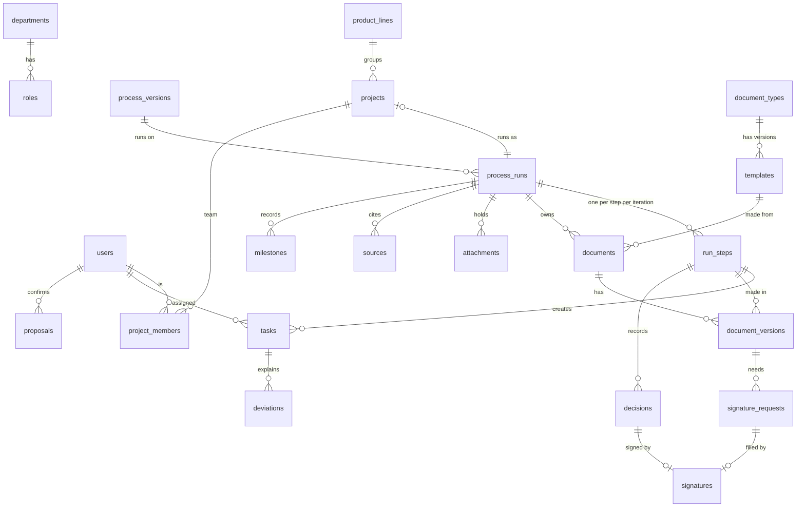

# Data model

**Read this when** you add or change a table, write a migration, or need to know where something is stored.
**Related:** [architecture.md](./architecture.md) for the stack (PostgreSQL with Drizzle), [workflow.md](./workflow.md) for what the process tables represent, [api.md](./api.md) for how data is exposed.

This is the **first-release core** only: about 40 tables. Step-specific and regulatory data is deliberately not modelled yet (see the end of this doc).

---

## Conventions

- **Keys and timestamps.** Every table has an `id` (UUIDv7), `created_at` and `updated_at`, and `created_by` where a person creates rows. Insert-only tables have no `updated_at`.
- **Where tables are defined.** Each backend module defines its own tables in its `tables.ts` (Drizzle). Migrations in `backend/migrations/` are generated from them; triggers and other SQL Drizzle can't express go in hand-written migrations there.
- **`org_id`.** Every table carries an `org_id`, with one value for now. It keeps the door open to serving other companies without a painful migration later. The permission module adds it to every query.
- **Platform and department tables.** COAL will grow from R&D to all of Jayon ([architecture.md](./architecture.md#growing-to-all-of-jayon)).
  - *Platform tables* serve every department: people, processes, tasks, documents, templates, signatures, AI, notifications and audit.
  - *Department tables* hold one department's own records. R&D's are `product_lines`, `projects` and `project_members`.
  - Department tables may point at platform tables, never the other way round. The one exception is `users.product_line_id`, the product line of a Lead or a design engineer, until the org chart replaces it ([A4](./open-questions.md#people-and-access)).
- **Processes in general.** A **process run** is one run of a process's route. For R&D, each project has exactly one run. Steps, tasks, decisions, milestones and documents point at the run, so other departments' processes reuse them unchanged.
- **Times.** Stored in UTC, shown in Indian time.
- **Nothing important is overwritten.** Documents, signatures, decisions and deviations are versioned or insert-only. A correction is a new row pointing at the old one. Tables marked *insert-only* can't be changed or deleted: a trigger (`coal_refuse_change`) refuses every `UPDATE`, `DELETE` and `TRUNCATE`, and in production the backend's database account will also lack those privileges.
- **Audit and events in the same transaction.** Every change writes its audit entry and its events in the same transaction as the change itself ([architecture.md](./architecture.md#events-and-live-updates)).
- **JSON for variable content.** Document content (fields and written sections), route definitions, template specifications, and proposal actions and previews are JSON columns, checked against zod schemas in `shared/`.
- **A run's state is its rows.** There is no separate state blob. The engine's state is loaded from `run_steps` (the current iteration of each step), `decisions` and `milestones`, and each action locks the run's row (`FOR UPDATE`), so two actions on one project happen one after the other. Tasks link to what they belong to with `subject_type` and `subject_id` (for R&D, a project), not a foreign key, so the platform's task table doesn't depend on any department's tables.
- **Two kinds of step reference.** `step_key` (for example `"13"` or `"24a"`) points at a step in the route definition. `run_step_id` points at one iteration of that step in one run.

## The core

In words:

- A **process run** is one run of a process's **route** (`process_versions`). For R&D, each **project** has one run.
- Each step becomes a **run step**, once per iteration, and run steps create **tasks**.
- Runs produce **documents**. A document is made from a **template** version of its type, or uploaded, and has numbered **versions**.
- A document version that needs signing gets **signature requests**, one for each row, which **signatures** fill. A step sign-off record is a document, so it works the same way. A decision is signed directly: its signature points at the decision.
- **Attachments** hang off a run and a step, document or task; **sources** too, or, with none of them, the whole project.
- **Proposals** hold actions waiting for a person to confirm them.

## Tables

### People and sessions

| Table | Holds | Key columns |
|---|---|---|
| `departments` | Jayon's departments: R&D first, and the ones R&D works with (Quality Assurance, Quality Control, Production, Marketing) | code, name, sort_order |
| `roles` | Every role: what a person may do on the route ([roles-and-access.md](./roles-and-access.md#roles)) | key, name, department_id (empty for the Board and the VP, who sit above departments), sort_order |
| `positions` | The boxes of Jayon's org chart ([roles-and-access.md](./roles-and-access.md#the-org-chart)) | key, title, role_key (the role it holds), reports_to_key (the position above it), per_product_line (seats are counted for each line), seats (empty: no limit), self_service (false for the demo admin), sort_order |
| `users` | Everyone with an account | name (unique, case-insensitive), role_key (the role of their position), position_key (their box on the chart; empty only for an account made before positions, until the loader places it), product_line_id (Leads and design engineers), status |
| `sessions` | Sign-in sessions | user_id, token_hash (SHA-256 of the token), device, expires_at, revoked_at, switched_by_id (the demo admin who started it by switching, [P113](./decisions.md); temporary) |

Departments, roles, positions and product lines are reference data. Their rows are listed in `backend/src/modules/org/catalogue.ts` and `backend/src/modules/rnd/catalogue.ts`, and loaded into the tables by `db:migrate` on every deploy, which also places accounts made before positions in the first position of their role that has a seat.
| `passkeys` | Devices registered for signing | user_id, credential_id, public_key, sign_count, transports, device_name, backed_up, last_used_at, revoked_at |

### Processes and the calendar

| Table | Holds | Key columns |
|---|---|---|
| `process_versions` | Each version of each process's route, loaded from `shared/` on deploy. A loaded version never changes; a changed file is refused until it is a new version. The R&D route is the first | key, version, department_code, definition (JSON), sha256, loaded_at |
| `process_runs` | Each run of a process. For R&D, one per project | process_version_id, status (active, on hold, dropped, completed, closed), stage, hold_reason, drop_reason, started_at, completed_at, planned_launch (set at Go from the default lengths, then the baseline's), forecast_launch, health (green, amber, red) and health_reasons, baseline_no (0 until the Action Plan is signed), scheduled_on (the day the dates were last worked out) |
| `run_steps` | Each step of each run, once per iteration. A send-back marks the closed iteration `reset` and adds the next; a step has one current row | run_id, step_key, iteration, status (locked, ready, in progress, in review, returned, approved, done, reset, cancelled), path (step 15), signers and approved_by (who must sign, and who has, where several must), opened_at, submitted_at, completed_at, reset_by_send_back_id, planned_start, planned_end, forecast_start, forecast_end and health (ok, at risk, overdue) |
| `work_calendar` | Holidays and working Saturdays | org_id, date, is_working_day, note |
| `settings` | Thresholds and timings, one JSON value per key. `schedule` holds the Dashboard's (health, reminders, escalation); missing values take the defaults in `shared/` | org_id, key, value, updated_by, updated_at |

### R&D

| Table | Holds | Key columns |
|---|---|---|
| `product_lines` | Arthroscopy, Spine, Trauma | code, name |
| `projects` | One per product idea. Its status and stage are its run's (for R&D, a completed run means launched) | code (`SPN-26-004`: product line, year, then the next number for that line and year), name, description, product_line_id, process_run_id, created_by |
| `project_members` | The project team. A removed member keeps their row, with `removed_at` set | project_id, user_id, role_key (their role when added), added_by, added_at, removed_at |

### Work

| Table | Holds | Key columns |
|---|---|---|
| `milestones` *(insert-only)* | Milestones recorded, such as material received | run_id, milestone, step_key and iteration (where it counts), note, evidence_file_id, recorded_by, recorded_at |
| `decisions` *(insert-only)* | Go, checkpoint and step decisions, and hold, resume and drop | run_id, run_step_id, step_key, iteration, decision (go, checkpoint, prototypes_ok, preclinical_needed, hold, resume, drop), value, reason, decided_by. *Each decision is signed: the signature points at the decision* |
| `send_backs` *(insert-only)* | Each time work is sent back to an earlier step | run_id, from_run_step_id, from_step_key, to_step_key, reason, evidence_file_id, decided_by, reset_run_step_ids. *A send-back isn't signed; its reason is kept in the record and the audit trail* |
| `tasks` | Every task and request | run_id, run_step_id and step_key (empty for work outside a process), task_key (names a task a step makes beyond one per doer role), kind (work, review, sign, decision, corrective action, request, own), title, body, role_key, assignee_id, queue_role (set while the task waits in a queue), assigned_by, via_ai, status (open, in progress, waiting, done, declined, cancelled), keep_on_reset (a send-back never cancels it: the step-20 follow-up), subject_type, subject_id and subject_label (the project, for links), done_at, handed_in_at (when the doers handed the step in: the task waits for its signer from then, and the measures stop the clock here), due_on (when it is due now: a person's new date from a deviation moves it) and first_due_on (the first due date, which never moves: the on-time rate counts it), accepted_at and decline_reason (a request's answer). Work given by hand (`POST /tasks`: own tasks, assignments and requests) has no run step, so no step closes or resets it |
| `timeline_items` | Planned dates per step and role. A `draft` is the plan being written at step 5 (replaced on each save); the VP's sign-off turns it into the `baseline` rows. Later changes are `change` rows. Baseline and change rows can't be changed or deleted (a trigger refuses it); the newest row for a step and role is the plan. The plan of a step is the earliest start and latest end across its roles | run_id, kind (draft, baseline, change), baseline_no, step_key, role_key, planned_start, planned_end, reason, recorded_by, created_at |
| `deviations` *(insert-only)* | Late work, with the reason and the cause. A correction is a new row pointing at the old one | run_id, run_step_id, step_key, task_id, kind (late, forecast slip, rework), planned_date, new_date, reason_code, reason_text, cause_type (person, role, outside party), cause_user_id, cause_role, cause_party, recorded_by, corrects_id |
| `deviation_reviews` *(insert-only)* | The next role up confirms or corrects a deviation, once | deviation_id, reviewer_id, outcome (confirmed, corrected), corrected_by_id (the new deviation), note |
| `deviation_comments` *(insert-only)* | Comments from the person or role named as the cause | deviation_id, user_id, body |
| `comments` | Comments on any record | target_type, target_id, author_id, body, mentions |

### Documents, templates, signatures and files

| Table | Holds | Key columns |
|---|---|---|
| `document_types` | Each kind of document and its rules ([documents-and-signing.md](./documents-and-signing.md#document-types)). Loaded from `catalogue.ts` on deploy | code, name, department_code, kind (template, upload, record), sensitivity (normal, budget), step_keys (empty: any step), numbering_pattern, signature_plan (JSON: rows, reviewed_by, approved_by) |
| `templates` | The template library: every version of every document type's template ([documents-and-signing.md](./documents-and-signing.md#the-template-library)). At most one active version per type (a partial unique index) | document_type_id, version, status (draft, active, retired), name, spec (JSON; **null for a plain Word form**, which is what a template is while filling templates in COAL is parked), placeholders (JSON, the tags read from the Word file; empty for a plain form), docx_file_id, form_file_id (the blank form people download: the Word file with any placeholders emptied, or the file itself), sample_pdf_file_id, notes, added_by (empty for templates COAL loaded itself), activated_by, activated_at, retired_at |
| `documents` | Every document, on a run and a step | run_id, step_key, document_type_id, template_id (the version it was made from; empty for an upload), number (unique), title, signature_plan (JSON, fixed when it was made), created_by |
| `document_versions` | Each draft and approved revision. **Its content never changes** (a trigger refuses it; see below) | document_id, run_step_id and iteration (the step iteration it was made in), version_no, rev_label (given at approval), status (draft, in review, returned, approved, superseded), content (JSON: fields and written sections), content_sha256, file_id (an uploaded file), pdf_file_id, pdf_sha256, search_text (the title, fields and sections as plain text, with a full-text index for search), note, created_by, via_ai, ai_request_id (the assistant's reply that wrote it), ai_sections (the written sections it wrote that no person has changed since), carried_from_version_id |
| `signature_requests` | Each signature a version needs, in order | version_id, meaning (prepared, reviewed, approved), role_keys (anyone with one of these may sign), assignee_id (when one person is named, such as each Board member), order_index, status (waiting, pending, signed, returned, cancelled), requested_at, completed_at, returned_by, return_comment |
| `signatures` *(insert-only)* | Each signature, on a document version or a decision | request_id (empty for a decision), subject_type (document_version, decision), subject_id, content_sha256, pdf_sha256, user_id, printed_name, role_key, role_name, meaning (prepared, reviewed, approved, decision), decision, reason, method (`click` until passkeys), signed_at. *The passkey columns (intent, authenticator data, client data, assertion) come with passkeys* |
| `files` | Every stored file | storage_key, name, mime_type (from the file extension), size, sha256 (recorded when the upload completes), status (pending, uploaded), uploaded_by (empty for a file COAL made with no person behind it), scan_status (not scanned, clean, infected), origin (internal, outside), derived_from (the file it was made from: a built template's Word file points at its sample, and its sample PDF at the Word file) |
| `attachments` | Files and pictures on a step, document or task | run_id, step_key, document_id, task_id (exactly one of the last three), file_id, caption, added_by |
| `sources` | Sources added to a step, document or task, or to the whole project (none of the three) | run_id, step_key, document_id, task_id (at most one of the last three), kind (link, file, citation), title, url, file_id, note, research_result_id (kept from a research run), added_by |

**Guards in the database** (migration 0005): `signatures` is insert-only. `document_versions` rows can't be deleted, and an update may change only a version's status and revision letter, forwards: content, files, hashes, step iteration, author and the assistant's marks (`via_ai`, `ai_request_id`, `ai_sections`; migration 0012) never change, an approved version can only become superseded, and a revision letter once given stays.

The step sign-off record is a document of type `STEP_SIGNOFF`, so it needs no table of its own.

### AI and proposals

| Table | Holds | Key columns |
|---|---|---|
| `ai_chats` | Each chat in someone's Workstation. Private to its owner | user_id, run_id (the run of the project it is about), channel (website; later WhatsApp and the app), context (JSON: project, step, document, task or widget), title, has_outside_text (a file from outside was attached: from then on the assistant only prepares action cards) |
| `ai_messages` | Each message the person sent and each reply | chat_id, sender (user, assistant), parts (JSON: text with its citations, what the AI looked at, action cards by proposal id), request_id (the request that wrote a reply), stopped. Tool calls are not messages: they are in `ai_tool_calls` |
| `ai_requests` *(insert-only)* | One for each reply the AI wrote, and one for the title of a new chat | chat_id, user_id, provider, model, purpose (chat, title, template, research), prompt_version, model_calls, tool_calls, input_tokens, output_tokens, cost_usd (worked out from the tokens: an estimate that sets the budget), outcome (completed, stopped, error), error_code, duration_ms |
| `ai_tool_calls` *(insert-only)* | Each tool the AI used, and each search a research run sent (endpoint `outside:<kind>`, tier `outside`) | request_id, tool, endpoint, tier, allowed, denial_reason, input (what it asked for, cut short), records_returned (type, id, version), proposal_id, duration_ms |
| `proposals` | Actions waiting for confirmation ([api.md](./api.md#proposals-and-action-cards)) | for_user_id, chat_id (the AI chat that prepared it), prepared_by_ai, version, title, actions (JSON: endpoint calls), preview (JSON: each action's summary, effects and who is told), status (pending, confirmed, rejected, expired, failed), expires_at, confirmed_at, result (what each action returned) |
| `ai_feedback` | Thumbs up or down; one per person and message, which a later rating replaces | message_id, user_id, rating, comment |

### Research

Research in public sources ([workstation-and-ai.md](./workstation-and-ai.md#researching-what-already-exists)), in the platform module `research`.

| Table | Holds | Key columns |
|---|---|---|
| `research_sources` | The source library: the places COAL may search. The defaults are reference data, loaded by a seed key that never adds one twice or undoes a change | seed_key (empty for those added on the page), name (unique), kind (pubmed, europepmc, clinicaltrials, openfda, journal, website, link), settings (JSON, by kind: openFDA parts, ISSN, websites, a search address), note (when to use it), enabled, added_by |
| `research_runs` | One run: what was asked, the confirmed terms and the brief. Private to its owner | user_id, question, terms (JSON: the only words that left COAL), source_ids, since, project_id and step_key (where results are meant to be kept), proposal_id and chat_id (the card that started it), status (queued, running, done, failed, stopped), stop_asked, brief, searches (JSON: each query sent, its source, how many found, when), error, request_id (the `ai_requests` row), started_at, finished_at |
| `research_results` | What a run found, one row per result | run_id, ref (`R1`, unique in the run), source_id, kind (article, trial, clearance, classification, adverse_event, recall, device, web), external_id (the source's own id, unique per source in the run), title, detail, year, url (built by COAL), snippet, kept_at |

### Notifications and platform

| Table | Holds | Key columns |
|---|---|---|
| `notifications` | Work messages and alerts, in-app for now. A unique key per person stops the same message being sent twice | user_id, kind (work message, reminder, escalation, alert), event_type, title, body, link, project_id, step_key, channels, dedupe_key, sent_at, read_at |
| `alerts` | *Not a table: reminders and escalations are notifications with a dedupe key (P63)* | |
| `audit_events` *(insert-only)* | Every change, signature, decision and sign-in | seq, at, actor_type (user, user via AI, system), actor_id, action, record_type, record_id, before, after, reason, request_id, prev_hash, hash. `hash` is the SHA-256 of the entry's fields, including `prev_hash` |
| `outbox_events` | Events waiting to be delivered | type, actor_type, actor_id, project_id, step_key, payload, created_at, available_at, attempts, last_error, delivered_at |
| `idempotency_keys` | Safe retries | key, user_id, request_hash, response_status (empty while the first request is still running), response, created_at |

## Not modelled yet, on purpose

These need real Jayon documents and answers before they can be designed well. Guessing now would create tables we'd have to undo. Until each one is designed, its step works with tasks, uploads, milestones and step sign-off records.

| Area | Steps | Examples of what will be needed |
|---|---|---|
| Materials and purchasing | 6, 9 | Material requirements, lots and heat numbers, raw material tests, orders, outsourced items |
| Design and engineering | 7, 8 | Parts, CAD models and drawings, critical dimensions, FEA studies |
| Prototypes and the shop floor | 10, 11, 19, 21 | Material Issue Slips, run cards and operations, machines, OEE, costing, QC inspections and measurements |
| Testing and feedback | 13 to 16 | Test requirements, requests, plans, results, surveys, pre-clinical studies, corrective-action details |
| Clinical trials | 19, 20 | Trial plans, sites, approvals, cases, follow-ups, adverse events |
| Regulatory, transfer and launch | 2a, 22 to 25 | Regulatory plans and requirements, licences, submissions, transfer packages, launch sets |
| Money | 5, 10, 21 | Budgets, costs, rates |
| Organisation | — | Org chart, outside parties, data labels |
| Other departments | — | Their own records, routes and roles, designed with each department when it joins |

When one of these is designed:

1. Start from the real Jayon documents.
2. Use the archived drafts as a starting point:
   - Madhav's table list in [archive/PLAN.md, Appendix D](./archive/PLAN.md#appendix-d--all-the-tables);
   - Sharath's in [archive/01-base-layer-plan.md, §9.4](./archive/01-base-layer-plan.md#94-tables-by-module).
3. Update this doc, [workflow.md](./workflow.md) and [roadmap.md](./roadmap.md).
