# Workflow: Jayon's R&D route

**Read this when** you work on the process engine, steps, tasks, gates, rework, or anything that depends on who does or signs a step.
**Source:** Jayon's workflow page, revision 2 with the COAL meeting points, 16 November 2026. A copy is in [source/jayon-rnd-workflow-rev2.html](./source/jayon-rnd-workflow-rev2.html). Where this doc and the page differ, the page wins; fix this doc.
**Related:** [roles-and-access.md](./roles-and-access.md) for the roles, [documents-and-signing.md](./documents-and-signing.md) for signatures, [architecture.md](./architecture.md#the-process-engine) for the engine.

⚠ marks an assumption we use until Jayon answers. Each links to [open-questions.md](./open-questions.md).

---

## The route in brief

A product goes from the VP's idea (step **C**) to launch (step **25**) through **28 steps** in **6 stages**:

- **Numbering.** Steps 1 to 25 keep Jayon's own numbers. The COAL meeting added 2a and split step 24 into 24a and 24b, so there is no step 24.
- **Checkpoints.** Four steps (4, 12, 18 and 23) are go or no-go points. Nothing after a checkpoint starts until it is signed.
- **Sign-offs.** 25 steps have a sign-off: the R&D Head signs 10, the R&D Lead 7, the VP 6 and the Board 2. C, 2a and 24a have none.
- **Parallel steps.** Some steps start together (1, 2 and 2a; 6 to 9; 10 and 11; 14 and 15).

**The route is data, not code.** It is stored as a versioned definition (see [architecture.md](./architecture.md#the-process-engine)). Each project stays on the version it started with. To change the route, edit the definition and this doc together.

## The steps

**Key:** Head = R&D Head · Lead = R&D Lead of the product line · Designers = design engineers · Ops = R&D Ops · QC = QC inspectors (part of DARD) · Team = the project team named in the PID (step 1) · *(italics)* = people outside R&D.
**Starts when:** "N approved" means step N's sign-off is done. "Done" is used for steps with no sign-off, which a doer marks complete.

| Step | Name | Stage | Does the work | Signs | Starts when | Produces |
|---|---|---|---|---|---|---|
| **C** | The idea | 1 | VP | — (Go is the VP's signed decision) | — | Product concept |
| **1** | Project inception | 1 | Head, Lead | VP | Go | Project Initiation Document (PID), naming the team |
| **2** | Market study | 1 | Ops | VP | Go | Market Research Survey, with sources |
| **2a** | Regulatory planning (new) | 1 | Lead, DARD ⚠ | none ⚠ | Go ⚠ | Regulatory plan: the bodies that must approve and the documents each needs |
| **3** | Project proposal | 1 | Head | VP | 1 and 2 approved | Project Planning and the Project Approval Form |
| **4** | Board approval ◆ | 1 | VP brings it | Board (MD and CEO ⚠) | 3 approved | The approved proposal |
| **5** | Action plan | 2 | Lead, Head | VP | 4 approved | Action Plan: team, dates for each role, budget, raw material definition |
| **6** | Raw material | 2 | Lead, Ops, DARD *(vendors)* | Head | 5 approved | Requirement, purchase, raw material test. Records the "material received" milestone |
| **7** | Implant design | 2 | Designers, AEMS | Lead | 5 approved | 3D model, FEA report, drawings with critical dimensions marked for QC |
| **8** | Instrument design | 2 | Designers, AEMS | Lead | 5 approved | The same as step 7, for the instruments |
| **9** | Outsourcing | 2 | Lead, Ops, DARD *(outside makers)* | Head | 5 approved | List of items made outside or bought, and the orders |
| **10** | Implant prototype | 3 | PME, QC | Lead | 7 approved, material received, test licence recorded ⚠ | Prototype with its Material Issue Slip and run card, a QC inspection report per prototype, Prototype Approval Form |
| **11** | Instrument prototype | 3 | PME, QC | Lead | 8 approved, material received, test licence recorded ⚠ | The same as step 10, for the instruments |
| **12** | Review meeting ◆ | 3 | Lead, Team | Head | 10 and 11 approved | Minutes, plus the Head's decisions: are the prototypes OK, and is a pre-clinical study needed? |
| **13** | Testing and validation | 4 | Ops, DARD, PME, Designers *(test lab)* | Lead | 12 approved | Testing parameters and test labs report (BP), TRF, checked test plan, test report, testing and validation document for CE and FDA |
| **14** | Market feedback | 4 | Ops, Lead *(marketing, surgeons)* | Lead | 13 approved | Market Research Survey form with new questions about the prototype, and the surgeons' answers |
| **15** | Pre-clinical study | 4 | Ops, DARD | Lead | 13 approved | Animal or cadaver study report, or a justification if no study is needed |
| **16** | Prototype case study | 4 | Lead | Head | 14 and 15 approved | Case study (BP) with corrective actions |
| **17** | Marketing tools | 4 | Lead, Ops | Head | 16 approved | Surgical technique, catalogue, instructions for use (IFU) |
| **18** | Prototype approval ◆ | 4 | Lead brings it | Head (final; not the VP) | 17 approved and every corrective action from step 16 closed | Prototype Approval Form |
| **19** | Trial set planning | 5 | Head, Lead, Ops, PME | VP | 18 approved | Trial set planning document (its form is still to be defined); trial sets made by PME |
| **20** | Clinical trials | 5 | Lead, Ops, DARD *(surgeons)* | Head | 19 approved | Surgery cases, and each patient's follow-up and scores for one year |
| **21** | Design revision and master set | 6 | Lead, Ops, PME | Head | "Trial surgeries complete" milestone in step 20 | Design revision on the Non-Conformity Investigation form, controlled copies, process plan, QC documents, costing, master set (made by PME) |
| **22** | Regulatory approval | 6 | Lead, DARD *(company QA team)* | Head | 21 approved (and 2a done ⚠) | Submission to QA for each body, trade mark, registrations, QA approval |
| **23** | Release approval ◆ | 6 | VP and Head bring it | Board (MD and CEO ⚠) | 22 approved | Transfer Approval Form |
| **24a** | Pre-transfer (new) | 6 | Lead, Team, DARD *(production, Quality Control dept., company QA team)* | none ⚠ | 23 approved, and positive feedback on about 50 cases ⚠ | The transfer documents, sent to each receiving department |
| **24b** | Final transfer and training (new) | 6 | Lead, Team, DARD *(the same three)* | Head; the production head also signs the handover checklist | 24a done | Transfer forms, master set, signed handover checklist, training |
| **25** | Product launch | 6 | Head, Ops | VP | 24b approved | Launch sets sent to the market |

◆ = checkpoint.

## The route as a diagram

```mermaid
flowchart LR
  C(["C Idea"]) --> S1["1 Inception"] & S2["2 Market study"] & S2a["2a Regulatory plan"]
  S1 & S2 --> S3["3 Proposal"]
  S3 --> G4{{"4 Board"}} --> S5["5 Action plan"]
  S5 --> S6["6 Raw material"] & S7["7 Implant design"] & S8["8 Instrument design"] & S9["9 Outsourcing"]
  S7 --> S10["10 Implant prototype"]
  S8 --> S11["11 Instrument prototype"]
  S6 -.->|"material received"| S10 & S11
  S10 & S11 --> G12{{"12 Review"}} --> S13["13 Testing"]
  S13 --> S14["14 Market feedback"] & S15["15 Pre-clinical"]
  S14 & S15 --> S16["16 Case study"] --> S17["17 Marketing tools"] --> G18{{"18 Prototype approval"}}
  G18 --> S19["19 Trial planning"] --> S20["20 Clinical trials"]
  S20 -->|"surgeries complete"| S21["21 Revision and master set"]
  S21 --> S22["22 Regulatory approval"] --> G23{{"23 Release"}} --> S24a["24a Pre-transfer"]
  S24a --> S24b["24b Transfer and training"] --> S25(["25 Launch"])
  S2a -.-> S22
```

## Rules the engine follows

### Sign-offs

- **The signer's choices.** At a sign-off the signer either approves, or returns the work to its authors with comments (rework within the same step).
- **Checkpoints and failure points** also allow sending the work back to an earlier step (see "Failure and rework" below).
- **Signed online.** Every sign-off is signed online with Face ID or fingerprint, and produces a sign-off record ([documents-and-signing.md](./documents-and-signing.md#step-sign-off-records)).
- **The Board.** The MD and the CEO sign only as the Board, at steps 4 and 23. We assume both must sign ⚠.
- **Steps without a sign-off.** C, 2a and 24a are complete when a doer marks them done. C is completed by the VP's signed Go.

### Starting steps

- **When a step opens.** It opens (becomes *ready*) when everything in its "Starts when" column is true.
- **Tasks.** The engine then creates tasks for its doers ([roles-and-access.md](./roles-and-access.md#who-gets-a-task)).
- **Milestones** are facts recorded by a person, with a note or a file as evidence:

  | Milestone | Recorded at | Opens |
  |---|---|---|
  | Material received (implant, instrument) | Step 6, by Ops | Steps 10 and 11 |
  | Test licence recorded ⚠ | Before 10 and 11, by DARD for the company QA team | Steps 10 and 11 |
  | Trial surgeries complete | Step 20, by the Lead or Ops | Step 21 |
  | Positive feedback threshold reached (about 50 cases) ⚠ | Step 20, by the Lead | Step 24a, together with step 23 |
  | Follow-up complete | Step 20, by the Lead or Ops | Step 20 can be signed off ⚠ |

  Until the step modules exist, milestones are recorded by hand. Later, some of them will be worked out from records (see [roadmap.md](./roadmap.md)).
- **Item-level rules.** Some rules apply to individual items, not whole steps. For example, a custom outsourced item at step 9 waits for its approved drawing. These are followed by people, and the engine will enforce them once the item records exist ([roadmap.md](./roadmap.md)).

### Decisions recorded at steps

| Step | Decision | By | Effect |
|---|---|---|---|
| C | Go | VP (signed) | Creates the project and opens 1, 2 and 2a |
| 4, 23 | Approve, send back, or drop | Board | Approve opens the next step. Where the work goes back to is an open question ⚠ |
| 12 | Are the prototypes OK? | Head | Yes opens 13. No sends the work back to 7 or 8 |
| 12 | Is a pre-clinical study needed? | Head | Sets the path of step 15 |
| 18 | Approve, or send back | Head | Approve opens 19. Otherwise back to a step between 7 and 17, depending on severity |

### Step 15 has two paths

Step 15 always opens after step 13. If the Head decided at step 12 that a study is needed, it produces the animal or cadaver report. If not, it produces a short justification. Either way, the Lead signs.

### Step 16 to 18: corrective actions

The case study at step 16 lists corrective actions. Each becomes a task of kind *corrective action*. Step 18 can't be submitted while any of them is open.

### Failure and rework

| Where | What fails | Who decides | Work goes back to |
|---|---|---|---|
| 7, 8 | The FEA | Lead | The same step (the design is reworked) |
| 10 | An implant prototype | Head | 7 |
| 11 | An instrument prototype | Head | 8 |
| 12 | The prototypes at the review | Head | 7 or 8 |
| 13 | A lab test | Ops with DARD make the first call; it is presented to the Lead and the Head. The Head confirms ⚠ | 7 (8 for an instrument-only failure ⚠) |
| 18 | The prototype is not approved | Head | Any step from 7 to 17, by severity |
| 20, 21 | The trials call for design changes | Head ⚠ | 10 (instrument-only changes: 8 or 10? ⚠) |
| Any sign-off | The work isn't acceptable | The signer | The same step, back to its authors |

**What happens when work goes back to an earlier step**

1. **Preview first.** The decider sees which steps would be reset before confirming. Then they give the reason and any evidence, such as a QC or lab report.
2. **Reopen.** The earlier step reopens as a new **iteration** (iteration 2, 3 and so on). History is never edited: earlier versions and signatures stay on record.
3. **Reset what depends on it.** Every later step that depends on the reopened one, directly or indirectly, is reset to a new iteration that waits for its inputs. This includes the step where the failure happened. Steps that don't depend on it carry on: for example, rework on the implant design (7) doesn't touch the instrument design (8) or the instrument prototype (11).
4. **Clean up.** Open tasks on the reset steps are cancelled.
5. **Carry the documents forward.** The latest version of each document becomes a new draft in the new iteration, so people revise rather than start again.
6. **Never reset the follow-up.** The step-20 patient follow-up is never reset, because patients already treated must still be followed.
7. **Record the delay.** The delay is recorded as a deviation with the reason "rework" ([dashboard.md](./dashboard.md#deadlines-alerts-and-deviations)).

### Hold and drop ⚠

- **The VP** can put a project on hold, resume it, or drop it, always with a reason.
- **The Board** can drop it at steps 4 and 23.
- **Hold** pauses dates and alerts.
- **Drop** cancels open tasks and keeps every record.

Who else may do this is an open question.

## Notes on specific steps

These are details from the workflow page that matter for tasks and documents. Step modules for them come later ([roadmap.md](./roadmap.md)).

- **Steps 7 and 8.** The FEA runs at the start of the design. The metallurgy expert in AEMS covers the material work through to the FEA, and is part of every project team. Drawings mark the critical dimensions for QC inspection.
- **Steps 10 and 11.**
  - *The test licence.* The company QA team (not NPD QA) applies to CDSCO for the manufacturing test licence before prototypes are made.
  - *The run card.* It records the Material Issue Slip number, the material batch number, and the drawing number and revision. For each operation it records the machine, operator, start and finish times, and quantity finished.
  - *QC.* QC inspectors check each prototype and write a separate inspection report for it.
  - *Borrowed machines.* When a production or general-instruments machine is needed, the R&D Ops Assistant Manager asks the Chief Production Manager, who allocates it.
  - *Approval form.* The Prototype Approval Form is used here and at step 18.
- **Step 12.** The meeting is held in a room or online, in English and Malayalam.
- **Step 13.**
  - *Planning.* The step opens with two pieces of sub-work: identify the testing parameters, and identify the test labs. These are written up as a BP report, and the Lead decides from it whether to proceed.
  - *Tests and fixtures.* DARD works out which tests are needed and the fixtures the lab will need.
  - *The lab exchange.* The lab sends its test request form (TRF), which is filled in and returned. The lab then sends a test plan, which DARD and Ops check together: it must not differ from the company's own data. Only then does the lab test.
  - *Signatures.* Ops handles all the signatures, and the Lead signs off the step.
  - *The report.* The final test report goes to the Head for information. The Head doesn't sign it.
- **Step 14.** Marketing takes the form to key surgeons (KOLs) and brings it back to Ops.
- **Step 20.** After each surgery the patient is followed up and scored for one year. Step 21 doesn't wait for the follow-up.
- **Step 21.** The design revision is recorded on QA's Non-Conformity Investigation form.
- **Step 24b.**
  - *Who receives what.* The production documents go to the Chief Manager, Production. The QC documents go to the Quality Control department: implant documents to the Sr. Manager, QC, and instrument documents to the Asst. Manager, QC. The company QA team takes part too.
  - *Acceptance.* The production head accepts the transfer by signing a checklist of every item.
  - *Training.* The transfer ends with training.

## Assumptions in use ⚠

| Assumption | Question |
|---|---|
| Step 2a: done by the Lead and DARD, starts at Go, no sign-off. Only step 22 waits for it | [W1](./open-questions.md#workflow) |
| The Board signs as the MD and the CEO, both required | [W2](./open-questions.md#workflow) |
| Steps 10 and 11 need a test licence recorded (applied for or granted is open) | [W3](./open-questions.md#workflow) |
| Step 13: the Head confirms a failure; an instrument-only failure may go back to 8 | [W4](./open-questions.md#workflow) |
| Step 20 is signed off when the follow-up is complete; step 21 starts at "surgeries complete" | [W5](./open-questions.md#workflow) |
| Step 24a: no sign-off; the threshold is the positive step-20 cases, recorded by hand | [W6](./open-questions.md#workflow) |
| Hold and drop: the VP at any time, the Board at 4 and 23 | [W7](./open-questions.md#workflow) |
| Design changes after the trials restart at 10; instrument-only changes are open | [W8](./open-questions.md#workflow) |

Possible regulatory additions to this route, such as design reviews, risk management, clinical approvals and UDI, are reference only for now: see [regulatory-notes.md](./regulatory-notes.md). They are not part of the route until we have the full picture and Jayon agrees.
