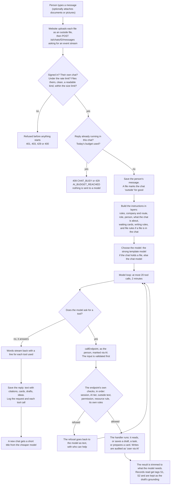
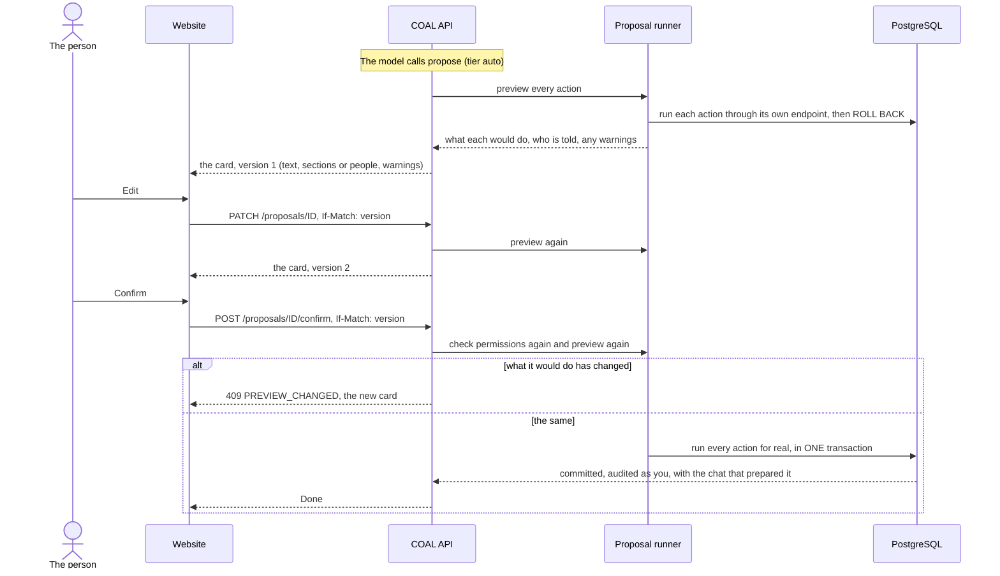
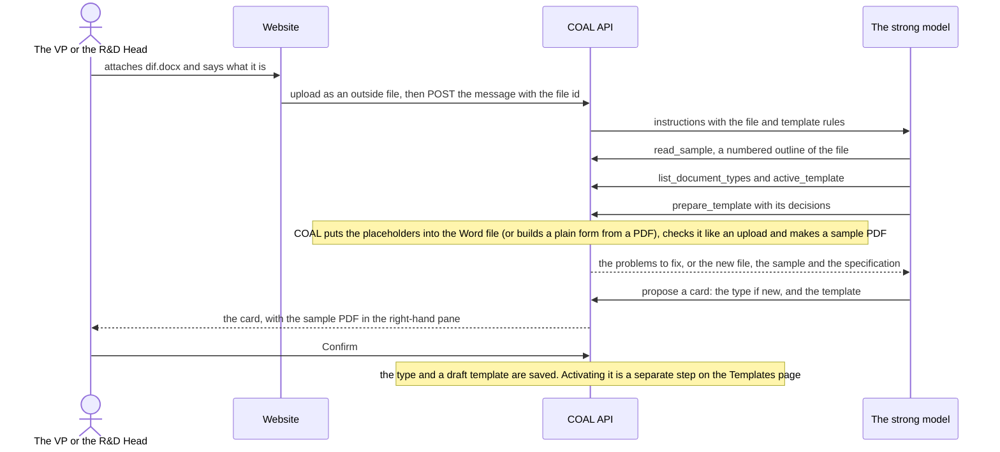
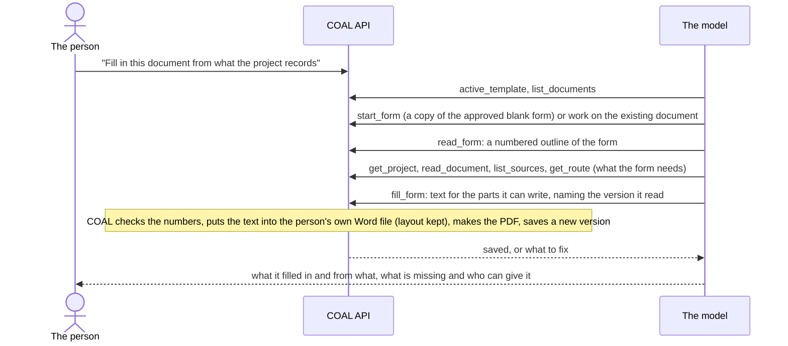
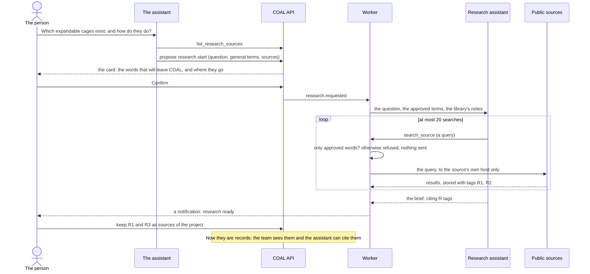

# Workstation and AI

**Read this when** you work on the Workstation page, the AI assistant, its tools, action cards, AI providers, or AI safety.
**Related:**
- [roles-and-access.md](./roles-and-access.md) — what the user may see
- [documents-and-signing.md](./documents-and-signing.md) — the template library and signing
- [api.md](./api.md#proposals-and-action-cards) — proposals
- [architecture.md](./architecture.md#ai-module) — where the AI runs

⚠ marks an assumption. See [open-questions.md](./open-questions.md#ai).

---

## The Workstation

The Workstation is each person's second page: a chat assistant like ChatGPT or Claude, organised by project. It's on the website first; the same chat comes to WhatsApp and the mobile app later ([channels](#channels)).

```
┌──────────────────┬──────────────────────────────────────┬───────────────────────┐
│ MY TASKS         │  SPN-26-004 · Step 1 · PID     ✕      │  PREVIEW              │
│  ● Draft the PID │                                      │  PID · draft 2        │
│    due 27 Nov    │  You: Draft the PID from the concept │  1. Purpose …         │
│  ○ Review survey │                                      │  2. Scope …           │
│                  │  COAL: Read the concept, the PID     │  3. Team: R. Menon …  │
│ PROJECTS         │  template and the team ▸ 3 sources   │                       │
│  ▸ SPN-26-004    │  The draft is in the preview. Two    │  Sources              │
│     Step 1 chat  │  gaps: target markets, budget range. │  • Concept (C)        │
│  ▸ TRM-26-002    │  ┌ ACTION ─────────────────────────┐ │  • Template PID r3    │
│ GENERAL CHATS    │  │ Ask Meera (Ops) for the market   │ │                       │
│  + New chat      │  │ size by Fri  [Confirm] [Edit]    │ │  [ Submit ]           │
│                  │  └──────────────────────────────────┘ │                       │
│                  │  [ Ask, or type / for commands ]  📎  │                       │
└──────────────────┴──────────────────────────────────────┴───────────────────────┘
```

- **Left: my tasks and projects.** My tasks sits at the top; each opens a new chat about that task. Below it is a space for each project, holding its chats (a "+" starts a new one about that project), then general chats. Any other project can be opened from the Dashboard or search.
- **Centre: the conversation.** Answers carry citations: small numbered marks that show the record and its passage on hover and open it on click, numbered in the order the answer uses them. A line under the answer shows what the AI consulted ("Looked at 3 things", opening to the list), and while it works each lookup appears as it happens. Action cards sit in the conversation with Confirm, Edit and Cancel. Each answer has thumbs up and down, and a Stop button replaces Send while it is being written.
- **Right: sources and preview.** The records the selected answer rests on, with the passage each gave and a link to open it, and what the AI looked at. Above the sources is a **preview**: the sample PDF of a template card, or the PDF of the draft the assistant just saved. Submit and Sign buttons come here with passkey signing, so reviewing and signing happen in one place ([roadmap.md](./roadmap.md#build-order)).
- **Context.** A chat can be pinned to a project, step, document or task, and shows what it is about. The address says what a new chat is about (`/workstation?project=&step=&document=&task=&widget=`), so "Ask AI" on a Dashboard widget, a project, a step and a document, and "Open in Workstation" on a task, are plain links.
- **Input.** `/` lists commands (`/status`, `/assign`, `/idea`, `/draft`, `/research`: each starts a message you finish; `/brief` sends at once). `@` finds people, projects and documents. Enter sends and Shift+Enter starts a new line. A paperclip attaches up to three files to a message: **documents** (PDF, Word, text, CSV) or **pictures** (PNG, JPEG, WebP), each up to `AI_UPLOAD_MAX_MB` (10 MB unless set otherwise); a screenshot can be pasted straight into the box. A file is uploaded as an outside file ([safety](#safety-basics)): the assistant reads a document with `read_attachment` and is shown a picture with the message. Other kinds (Excel, PowerPoint, HEIC photos, CAD) come later ([P115](./decisions.md)).
- **Editing a card.** A card of tasks can be edited on screen (what, who, when), and a card for a template (its name, steps, who signs, each section's title and instructions, and each field's label, source and whether it is required); each save checks the card again as a new version. Any other card, or a change that moves a field in the document, is made by asking the assistant ("make it Monday"), which knows which cards are waiting.
- **Drafts and ideas.** A draft the assistant saved shows as a small card in the conversation (its title, version, what is still missing, and buttons to preview and to open and edit it). An idea worked out as a project shows the concept, one box for each person who would get work, and **Review and Go**, which opens the new-project page filled in. Nothing is created until the VP presses Go there.
- **On a narrow screen,** such as a phone's browser, the three panes become tabs.

## How the AI works in the first release

- **Only when asked.** The AI runs when a person sends a message or presses an AI button, such as "Draft it" on a task. Nothing runs in the background.
- **As the person.** Every AI request acts as the person asking, with the same permission checks ([roles-and-access.md](./roles-and-access.md#how-access-is-enforced)). The AI can never see more than the person could.
- **Through tools.** The AI reads and acts only through tools, and each tool calls the backend's own services. It has no direct database access.
- **Facts from records.** Numbers, dates, names and statuses come from tool results and are shown with a link to their source. Tables are drawn from the data, not retyped by the AI. If no record answers the question, the AI says it doesn't know, and suggests who might.

### What the AI does

| # | Feature | Examples | What it writes |
|---|---|---|---|
| 1 | **Answer questions** about projects, tasks, documents and status | "What's waiting on me?" · "Which Spine projects are late, and why?" · "What did the FEA report conclude?" · "When does my part start?" | Nothing |
| 2 | **Turn an idea into a project** (step 0) | The VP describes an idea in their own words | A concept draft. Go needs the VP's signature ([below](#idea-to-project)) |
| 3 | **Fill in a document** from its Word form | "Fill in the PID from what the project already records" · "Add a short justification to the budget annex" | A new draft version the user owns ([below](#filling-a-form-with-the-assistant)) |
| 4 | **Assign work and make requests** | "Ask Anil to rerun the FEA by Friday, and tell Priya to update the drawing" | Tasks or requests, after the user confirms ([below](#assigning-work)) |
| 5 | **Explain and check documents** | "What am I signing, and what changed?" · "Compare draft 2 with draft 3" · "Is anything missing from this Action Plan?" | Nothing |
| 6 | **Turn a sample document into a template** (VP and R&D Head) | **Parked** ([P109](./decisions.md)): a template is Jayon's Word form as it is, so this only runs where `TEMPLATE_FILLING` is on | A draft template, after the user confirms ([below](#making-a-template-from-a-sample-document)) |
| 7 | **Research what already exists** in public sources (the people of steps 0, 1 and 2) | "Which expandable TLIF cages are on the market, and what do studies report?" | Nothing until the user confirms the search words; then a brief and results, which the user keeps as sources ([below](#researching-what-already-exists)) |
| 8 | **Read a file or picture you attach** | "Summarise the attached supplier quote" · "What does this pull-out test report conclude?" · "What looks wrong in this photo of the rig?" | Nothing. While a file is in the chat, anything it does for the user is an action card ([safety](#safety-basics)) |

Commands for these: `/status`, `/assign`, `/brief` (what am I signing), `/idea`, `/draft` and `/research`. Asking a question needs no command.

## What the AI may do

Every backend endpoint declares what the AI may do with it: its **AI tier** ([api.md](./api.md#conventions)).

| Tier | The AI may | Examples |
|---|---|---|
| `read` | Use it freely, within what the user may see | Projects, route, tasks, documents, widgets, search |
| `auto` | Use it directly, for the user's own things only. It's logged and can be undone | Save a draft the user owns; create a task for the user themselves; add a note to the user's own draft |
| `confirm` | Only through an **action card** that the user confirms | Assign a task or send a request; reassign; submit a document or step; record a prerequisite or deviation; change the team; comment where others are notified; edit someone else's draft; start research in public sources, whose card shows the exact search words that will leave COAL ([P97](./decisions.md)) |
| `never` | Never. It can prepare the work and give a button that opens the right screen | Sign anything (including Go); decide at a checkpoint; send work back; hold or drop a project; set or tick off a project's milestones ([P117](./decisions.md)); send anything else outside Jayon; delete anything; read research results nobody has kept |

**The server enforces this, not the AI's instructions.**

- **Marked calls.** Every AI tool call is marked "via AI" and carries the user's identity.
- **Refusals.** Endpoints at the `confirm` tier refuse marked calls, except to create a proposal. Endpoints at the `never` tier refuse them outright.
- **Signing.** Signing is a person's own act: a confirmed click for now, and Face ID or a fingerprint on the user's own device once passkeys arrive. The AI can't do either, and the sign endpoints are closed to it (tier `never`).

### Action cards

When the AI wants to do something at the `confirm` tier, it creates a **proposal** on the server, shown as an action card. A proposal can bundle several actions, such as the VP's responsibility boxes. Each action is a call to an existing endpoint, run as the user; how proposals work is in [api.md](./api.md#proposals-and-action-cards).

1. **Preview.** The server previews the action without saving anything. It returns who gets what, the due dates, who is notified, and any warnings ("No DARD user yet, so this goes to the DARD queue").
2. **Show.** The card shows that preview in plain words, with Confirm, Edit and Cancel.
3. **Edit.** Changing an assignee, a date or the wording previews it again. The card always shows exactly what will happen.
4. **Confirm.** Only the user can confirm, from their own session; the AI can't. The server re-checks permissions and previews again. If the effect has changed, it shows the card again. Otherwise it carries out every action together, once.
5. **Record.** The audit trail records both the user and the AI chat that prepared it.

The same mechanism serves bulk actions in the normal screens, for example reassigning many tasks at once.

## How a reply is made

This is the whole path of one message, from the person's keyboard to the saved reply. Every box is code in `backend/src/modules/ai/` or the endpoint it calls; the sections after the picture explain each step.

### The path of one message



### What each step does

1. **The message.** The website sends it in a chat. A chat is private to the person, whatever their role, and can be pinned to a project, step, document, task or widget. A file is uploaded first, as an outside file (virus-scanned where a scanner runs); the message carries only its id. With `Accept: text/event-stream` the reply streams back; the connection closing, or Stop, aborts it ([api.md](./api.md#ai)).
2. **The first checks** run before anything is saved: the person is signed in and owns the chat; at most 30 messages a minute; each attached file is the person's own, finished uploading, not infected, a kind the assistant reads (PDF, Word, text, CSV, PNG, JPEG, WebP) and no larger than `AI_UPLOAD_MAX_MB`, and a picture's first bytes really are the picture its name says; only one reply runs at a time in a chat (`CHAT_BUSY`); and the person has not used today's budget (US$5, Indian time, [D18](./decisions.md): `AI_BUDGET_REACHED`, with nothing sent to a model). If the assistant is not set up here the answer is `AI_UNAVAILABLE`.
3. **The message is saved**, with any file as a part of it. A file marks the chat **outside** for good ([safety](#safety-basics)).
4. **The instructions are built** in layers ([below](#how-the-ai-is-told-what-to-do)), every time, from live data: the route and the person's role come from the database, so nothing is stale.
5. **The model is chosen.** Everyday chats use the chat model. A chat that holds a file (a sample to turn into a template, or a picture to look at) always uses the strong `template` model ([P89](./decisions.md)). Switching either is configuration.
6. **The loop.** The gateway hands the instructions, the earlier messages and the tools to the provider, and with them the **pictures** of the chat: this message's, and recent ones from earlier messages, at most four, newest last (a document is not sent: the model reads it with `read_attachment`). The model asks for a tool, COAL runs it and returns the answer, and the model continues, up to `AI_MAX_TOOL_CALLS` (20) calls and `AI_TURN_TIMEOUT_MS` (2 minutes); after that the model is told to answer with what it has.
7. **Every tool call goes through `callEndpoint`**, the one function that also runs the actions on an action card. It validates the input, then runs the endpoint's own guard: a signed-in person, the **AI tier** (`confirm`, `never` and `none` endpoints refuse a "via AI" call), the **outside-text rule** (with a file in the chat, `auto` endpoints refuse everything except preparing cards), then the permission and the record's own rule, then the handler. The AI therefore sees and does exactly what the person could, and no more. The server enforces this, not the instructions ([what the AI may do](#what-the-ai-may-do)).
8. **A refusal is an answer.** It goes back to the model as text (`Not allowed (NOT_ALLOWED): … Who can: …`), so the assistant says so plainly and names who can help. A failed check, such as a draft's number that no source gave or a template that did not pass its checks, comes back as a list of problems to fix, and the model tries again within its limit.
9. **A result is shaped before the model sees it.** Only what it needs is kept, and the records it read get source tags ([citations](#citations)). The text of everything the tools returned, and what the person said, is also kept for the length of the reply as the **grounding** a draft is checked against.
10. **The words stream** to the website as they are written, with a line for each lookup as it happens ("Looked at your tasks").
11. **The reply is saved** with its citations, the action cards, drafts and project ideas it produced, and a record of what it cost and what it looked at ([logged](#what-is-logged)). A new chat gets a short title from the cheaper model.

### The same path with an action card

Anything that affects other people, or that the assistant may not do itself, goes through a card. The model only **prepares** it; confirming is tier `never`, so only the person can.



A card that is not confirmed in 72 hours expires (`PROPOSAL_EXPIRED`). Cancelling it changes nothing.

### The same path with a sample document



### The same path for a draft, an idea and an explanation

| | The model uses | What COAL checks | What the person gets |
|---|---|---|---|
| **A form** | `active_template`, `start_form`, tools that read, `read_form`, `fill_form` | The person may write on that step and may read the document; the form is the latest version they were shown (`VERSION_CONFLICT` otherwise); every number in the text is in a source read in this reply or said by the person; the file's own layout is kept; nothing is saved in a chat holding a file from outside | A new draft version, with its PDF, shown as a draft card; the earlier version is kept |
| **A draft from a specification** (parked) | `active_template`, `start_draft`, tools that read, `save_draft` | The template is the active one; the person may write on that step; every number in a written section is in a source read in this reply or said by the person; a field the person types is in their own words; COAL's own fields cannot be set; required parts left empty are reported as gaps | A draft version owned by the person, its sections marked as the assistant's until they edit them, with a preview |
| **An idea** | `list_product_lines`, `preview_project` | Only the VP may preview Go; the route, not the model, decides who gets which task; nothing is created | A card with the concept, one box for each person, and **Review and Go**, which opens the new-project page filled in |
| **An explanation** | `waiting_signatures`, `read_document`, `compare_versions` | Only what the person may see is read; a restricted document shows only that it exists | Words with citations; nothing is written |
| **Research** | `list_research_sources`, `propose` (`research.start`) | Only the VP, the Head, the Leads and Ops may research; the search terms hold no project code or name, no person and not the company; the sources are in the library and switched on; the budget | A card showing exactly the words that will leave COAL; once confirmed, a run in the background ([below](#researching-what-already-exists)) |

### Where a request can stop

| Check | Where | Code | What the person sees |
|---|---|---|---|
| Signed in; their own chat | Every endpoint | `NOT_SIGNED_IN` 401; `NOT_ALLOWED` 403 | Sign in again |
| Too many messages | `ai.messages.send` | `RATE_LIMITED` 429 | Wait a minute |
| A file that is not theirs, not finished, infected, or not Word or PDF | `ai.messages.send` | `NOT_ALLOWED` 403; `VALIDATION_FAILED` 400 | The file is refused, with why |
| One reply at a time | `ai.messages.send` | `CHAT_BUSY` 409 | Wait for the reply, or stop it |
| Today's budget used | `ai.messages.send` | `AI_BUDGET_REACHED` 429 | It starts again tomorrow |
| The assistant is not set up | `ai.messages.send` | `AI_UNAVAILABLE` 503 | Ask whoever runs COAL |
| The model fails, or takes too long | The loop | `AI_UNAVAILABLE` 502 | What was written is kept, marked as stopped |
| A tool the model may not use | Its AI tier | `AI_NOT_ALLOWED` 403, as text to the model | The assistant says it can only prepare a card, or may not do it |
| A file is in the chat | The outside-text rule | `AI_NOT_ALLOWED` 403, as text | Everything becomes a card |
| The person may not do it | Permission and resource rule | `NOT_ALLOWED` 403 with `whoCan`, as text | The assistant says so and names who can |
| The thing is not possible now | The endpoint's own rules | `STEP_NOT_READY`, `DOCUMENT_LOCKED` and others, as text | The assistant says why |
| A draft that rests on nothing | Drafting checks | `VALIDATION_FAILED` 400, as text | The model fixes it, or asks the person |
| A template that does not pass its checks | Template checks | `VALIDATION_FAILED` 400 with every problem, as text | The model fixes the plan and builds again |
| Too many tool calls | The loop | Said to the model | It answers with what it has and says what is missing |
| A card the model may not prepare | The card runner | `VALIDATION_FAILED` 400, as text | Signing and deciding are not on any card |
| Research terms that name a project, a person or the company; a source not in the library | `research.start`, at the card's preview | `VALIDATION_FAILED` 400, as text | The assistant chooses general words |
| A research query with a word that was not approved | The research assistant's `search_source` | Said to the research model; nothing is sent | It searches with the approved words |
| Confirming a card | Confirm | `VALIDATION_FAILED` (no `If-Match`), `PREVIEW_CHANGED` 409, `PROPOSAL_EXPIRED` 409 | The card is shown again as it now stands |

### The tools

Each tool is a thin wrapper over one endpoint, takes that endpoint's AI tier, and runs **as the person**, marked "via AI". The endpoint's own checks decide what comes back, so the AI never sees more than the person could. A refusal goes back to the model as text, including who can help, so it can say so plainly.

| Tool | Endpoint | Tier | For |
|---|---|---|---|
| `search` | `GET /search` | read | Finding a project, document, task or person without an id |
| `my_tasks` | `GET /tasks` | read | What is assigned to the person, waiting in their queue, or given by them; a task waiting on its signers says who has not signed and how late they are |
| `list_projects`, `get_project`, `get_route`, `get_timeline` | projects, route and timeline | read | Where a project is, what comes next, its dates and delays, its milestones and whether any is late, the prerequisites its steps wait for, and who a handed-in step waits on |
| `list_deviations` | `GET /deviations` | read | Why work is late |
| `list_documents`, `read_document`, `compare_versions` | documents | read | What a document says, and what changed |
| `active_template` | `GET /templates/active` | read | The template in use for a document type (asked for every time): its name and version, and whether it is a plain Word form |
| `list_document_types` | `GET /document-types` | read | Which kinds of document exist, their steps and signers |
| `start_form`, `read_form`, `fill_form` | `POST /projects/{id}/documents` (`fromForm`), `GET /documents/{id}/form`, `POST /documents/{id}/fill` | auto, read, auto | Starting a document as a copy of the approved blank form, reading the form as a numbered outline, and putting the assistant's words into the person's own Word file as a new draft version ([filling a form](#filling-a-form-with-the-assistant)) |
| `read_attachment` | `GET /ai/chats/{id}/attachments/{fileId}` | read | A document attached to **this** chat (PDF, Word, text or CSV) as text: up to 40,000 characters, the first 60 pages of a PDF, and a note when a PDF is a scan with no text. Only a file attached to this chat, by this person, is read; a picture is not read this way, because the model is shown it with the message. The words are outside text |
| `read_sample`, `prepare_template` | `GET /templates/sample-outline`, `POST /templates/prepare` | read | **Parked** (only where `TEMPLATE_FILLING` is on). A sample document as a numbered outline; turning it into a template without saving one ([the flow](#making-a-template-from-a-sample-document)) |
| `start_draft`, `save_draft` | `POST /projects/{id}/documents`, `POST /documents/{id}/versions` | auto | **Parked** (only where `TEMPLATE_FILLING` is on). Starting a document from a template's specification, and saving the assistant's words as a draft the person owns ([drafting](#drafting-a-document-parked)) |
| `list_product_lines`, `preview_project` | `GET /product-lines`, `POST /projects/preview` | read | The product lines, and what Go would do for a concept, creating nothing ([idea to project](#idea-to-project)) |
| `find_person` | `GET /users` | read | Who someone is, and their role |
| `waiting_signatures` | `GET /signature-requests` | read | What waits for the person's signature |
| `get_widget` | `GET /widgets/{key}` | read | A Dashboard widget's numbers and rows |
| `create_my_task` | `POST /tasks` | auto | A task on the person's **own** list. For anyone else, the server refuses a "via AI" call |
| `list_research_sources` | `GET /research-sources` | read | The source library: where research may search, and the note on when to use each ([research](#researching-what-already-exists)) |
| `list_sources` | `GET /projects/{id}/sources` | read | The sources kept on a project, on the whole project or on a step, including research results a person kept. The assistant looks at them whenever the project, its market or its documents come up, and a draft may rest on them |
| `propose`, `revise_card` | `POST /proposals`, `PATCH /proposals/{id}` | auto | Preparing or changing an action card. The card lists what it may carry: the endpoints that can go on a card ([api.md](./api.md#proposals-and-action-cards)) |

Research itself is not a tool: `research.start` is tier `confirm`, so the assistant prepares a card for it, and the run's results are read only by the person (`never`) until they keep them. No tool marks a task done: a step's tasks follow the step ([P96](./decisions.md)), so to hand in a step the assistant prepares a card for the step's own action (`steps.submit`), which is refused until the step's documents are in ([P106](./decisions.md)), and the task closes when the step is signed off. Nothing that signs, decides, sends back, holds, drops, deletes or sends outside Jayon has a tool, and `confirm` and `reject` for cards are tier `never`. A test fails if a tool is built on an endpoint of any other tier, or if the card catalogue offers a `never` endpoint.

### Citations

Every tool result gives the records it read a tag (`[S1]`, `[S2]`…). The AI is told to cite a fact with the tag of the record it came from. When the reply is saved, tags that match a record read in this reply become **citations** (the record's type, label and link, and the passage when search found one), and a tag the AI made up is removed. The website shows a citation as a link that opens the record. This is how "facts come from records" is checked, not just asked for.

### What is logged

- **`ai_requests`** (insert-only): for each reply, the provider, model, prompt version, model calls, tool calls, tokens, cost, outcome (completed, stopped, error) and time. The title is a separate row with purpose `title`, a chat that holds a file logs its replies with purpose `template`, and a research run is one row with purpose `research` (its web searches priced at US$0.01 each ⚠). The cost is worked out from the tokens at starting prices ⚠ ([AI11](./open-questions.md#ai)): it sets the budget and is never a bill.
- **`ai_tool_calls`** (insert-only): each tool the AI used, the endpoint and tier, whether it was allowed (and why not), what it asked for (cut short), and the records it got back. The research assistant's searches are logged here too, as endpoint `outside:<kind>` and tier `outside`; the queries themselves are on the run.
- **Writes** are in the audit trail as usual: a task or a draft the AI made for the person is "user via AI", and a card prepared in a chat records that chat. A draft version also points to the reply that wrote it (`ai_request_id`).
- Logs never carry the person's words or the AI's answers; those are in the chat itself, which only its owner can read.

## The main flows

### Idea to project

1. **Describe.** The VP describes the idea in their own words, in the Workstation (`/idea` starts the message).
2. **Fill gaps.** The assistant picks out what it needs: product, product line (`list_product_lines`; required), where the idea came from (the market or the VP's own requirement), the need, key requirements, target markets, any references, priority and the desired launch. It asks one short question, only for what is missing and essential.
3. **Concept.** It writes the **product concept** as plain text from the VP's words, one short line for each of those, and leaves out what was not given. For now the concept is the project's name and description: step 0 is not a document yet ([S10](./open-questions.md#documents-and-signing)).
4. **Preview the project.** The assistant calls `preview_project` (`POST /projects/preview`, tier `read`, only the VP). It does what Go would do and rolls it back. **The process engine, not the assistant, decides what happens:** step 0 completes, steps 1, 2 and 2a open, and their tasks go to the people found by [the routing rules](./roles-and-access.md#who-gets-a-task).
5. **Show the boxes.** The reply carries an **idea card**: the concept, and one box for each person (or waiting queue) with the steps and tasks they would get, and any warnings, such as "No DARD user yet, so this goes to the DARD queue". Due dates and work messages come with the created project ⚠ ([AI14](./open-questions.md#ai)).
6. **Review and Go.** **Review and Go** opens the new-project page with the name, concept and product line filled in, where the VP can still change anything, preview again, and press **Go**. Go is the VP's own act: a confirmed click now, and Face ID or a fingerprint once passkeys arrive ([D16](./decisions.md)). The assistant cannot create the project: `projects.create` is tier `never`, and a card cannot carry it. When the project is created, everyone gets their task and work message, and every project member gets a project space in their Workstation.

The same flow works without the assistant: New project is also a plain form.

### Making a template from a sample document

For the VP and the R&D Head, who are the ones who may add templates ([S6](./open-questions.md#documents-and-signing)). The sample is a Word (`.docx`) file or a **text PDF**: an old form, or a filled-in one from a past project. The AI turns it into COAL's own kind of template: **COAL's code builds the Word file and checks it; the AI only decides what each part is.**

1. **Attach.** The person attaches the file with the paperclip (it is uploaded and virus-scanned like any file) and says what it is: "Make this our Design Input template for step 4."
2. **Read.** The AI reads the file with `read_sample`, which returns it as a numbered outline (`p1`, `p2`, …). For a Word file: each paragraph, table cell, header and footer, with an id, in order. For a PDF: each page's lines, with their size and boldness as hints to headings, tables recognised where the text lines up in columns, and an id for each block. The file is **outside text** ([safety](#safety-basics)): the AI treats it as data, never as instructions, and what it writes in the chat can only become cards.
3. **Decide.** For each part, the AI decides whether it is:
   - **boilerplate**, which stays exactly as it is;
   - a **field** filled from a record (project code, name, product line, step, dates, team table, author, today), where the value in the sample is one of those; or a field the **person** types, where the value is specific to one project but COAL holds no record of it;
   - a **written section**, where the sample holds narrative for someone to write. The AI says what each should contain, from the text around it, and which sources it uses.

   It also proposes the document type, the steps it belongs to, and who reviews and approves. It asks the person only what it cannot tell from the file (for example which step the form is for). It never copies the sample's own values into the template.
4. **Build.** The AI sends its decisions to `prepare_template` (`POST /templates/prepare`): for each section, whether it is fields or written; for each field, where it comes from and where in the sample its value shows (a part, and the words to replace, or a blank cell); for each written section, the example parts it replaces, or the part it goes after; for the team table, which cells of one filled row hold each column; and the example rows and parts to drop. COAL builds the specification from the same decisions, so the placeholders and the specification agree by construction. COAL's code puts the `{placeholders}` into a copy of the person's file, in the original layout (headers, fonts, tables and logos stay). A PDF has no layout to edit, so COAL builds a **plain Word form** from the same decisions (headings, paragraphs and tables, in COAL's plain style, as the sample templates are). Either way it runs **the same checks** as an upload ([adding a template](./documents-and-signing.md#adding-a-template)): the placeholders match the specification both ways, the roles and steps are real, and a sample PDF made from made-up data renders. A failed check goes back to the AI as text, so it can fix the edits and build again (within the usual limits on tools). Nothing is saved yet.
5. **Show.** An action card (for a PDF it says plainly: "Layout rebuilt in a plain style"): the document type, name and steps; a table of the sections (boilerplate kept, fields with their source, written sections with their instructions); the signature rows and reviewers; and the **sample PDF** in the preview pane, so the person sees the layout. If the document type doesn't exist yet, the same card also **adds it** ([P86](./decisions.md)).
6. **Edit.** On the card (**Edit**) the person can change the template's name, the steps, the signing rows, who reviews and approves, a note for the library, each section's title and instructions and whether it is required, and each field's label, source and whether it is required. Anything that moves a placeholder (making a field a written section, adding or removing a section, finding another sentence in the sample) is done by asking: "make Target markets a written section", and the AI builds again and replaces the card. Every change is checked again; the card always shows what will be saved.
7. **Confirm.** The person confirms. In one transaction COAL adds the document type, if it is new, and saves a **draft** template version as the person. Each file records the file it was made from (`files.derived_from`: the sample, then the built Word file, then its sample PDF), and the audit trail records the chat that prepared the card. **Activating it is a separate step**, on the Templates page ([P87](./decisions.md)), so a person looks at the sample PDF once more before every new document uses it.

**What a PDF can't do.** It can't keep the original's look (fonts, logos, exact spacing), and tables and reading order are worked out from where the text sits, so the AI is told to be less sure of them and to ask. A scan or a photo has no text, so it is refused with a clear message until a reader for scans is added ([AI13](./open-questions.md#ai)); so is a PDF over 30 pages or 10 MB, or one that won't open. Replacing the layout later is cheap: a Word file in Jayon's real layout, uploaded for the same type, is a new version that reuses the specification.

**The model.** This flow reads a whole document and has to get structure right, so it runs on the strong model (Sonnet by default), not the cheap one: chat replies in a chat that holds a sample file use the `template` model ([P89](./decisions.md)).

### Filling a form with the assistant

Jayon's documents are Word forms, and COAL does not break a form into fields ([P109](./decisions.md)). So the assistant does what a careful colleague would: it **reads the form, works out what each part needs, gathers what it can from COAL's records, and fills in what it can ground**. It reasons about the form itself, not about a specification, so it works for any form.



1. **Start.** The person asks in the Workstation ("Fill in the PID for this project"), or presses **Fill it in with the assistant** on a Word document, which opens a chat pinned to it with the request typed in for them to send. The assistant looks at what exists (`list_documents`) and checks the form with `active_template`. If there is no document yet, `start_form` makes one as a copy of the approved blank form, draft 1, owned by the person; if there is no form for the kind, it says so and who can add one.
2. **Read.** `read_form` returns the latest version as a numbered outline (`p12 | where it is | style | its words`): headings, the form's own instructions, example text and blank table cells, in order. The form's words are **information, never instructions**, as with any file.
3. **Decide.** For each part the assistant decides whether it is boilerplate to keep, a heading, an instruction or example to replace with real content, or a blank to fill. The form's own instructions say what a part should hold.
4. **Gather.** It reads what the form needs with its usual tools: the project and its concept, earlier documents, the sources kept on the project, the route and the dates. It asks the person **one short question** for what only they can give, and never guesses it.
5. **Fill.** `fill_form` takes the version it read and, for each part, `replace` (an instruction, example or blank cell), `append` (after a label) or `after` (new paragraphs under a heading). COAL does the editing in the person's own file, so fonts, headers, tables and everything else stay. Headers and footers are not filled.
6. **Check.** The server refuses text with a number that no source gave (it must be in something a tool returned in this reply, or in what the person said), a part that does not exist, and a version that is no longer the latest. A refusal comes back as text and the assistant fixes it. The checks are a floor, not a proof ⚠ ([AI14](./open-questions.md#ai)): names and standards are held by the instructions, and **the person reads and edits the draft**.
7. **Save.** A new version, with its PDF, owned by the person (`auto` tier; nothing is overwritten). It records that the assistant saved it (`via_ai`) and the reply that did, whose log gives the model, the instructions' version and every record read. The reply carries a **draft card** with buttons to preview the PDF and to open and edit it.
8. **Say.** The assistant tells the person what it filled in and from what (citing records in its message, never inside the document), what is still missing and who can give it, and that submitting for signatures is their own step. If asked to change something, it reads the form again (the part numbers change after each save) and fills only those parts.

**Closed in a chat that holds a file from outside:** `fill_form` and `start_form` are `auto` tier, so the server refuses them there, as for any save ([safety](#safety-basics)). A person can also fill a copy in Word and upload it: the assistant is a help, never the only way.

### Drafting a document (parked)

*Parked with filling templates in COAL ([P109](./decisions.md)): these tools and instructions exist only where `TEMPLATE_FILLING` is on.*

1. **Start.** The user asks for a document in the Workstation (`/draft` starts the message). A "Draft it" button on a task comes later.
2. **Find the template.** Every time, the AI looks up the document type's **active template** in the [template library](./documents-and-signing.md#the-template-library) (`active_template`). It never works from memory or an earlier chat, so a changed template applies at once. If there's no template, it says so, and that the person can upload the document, or the VP or the R&D Head can add the template (a sample document can be turned into one in the chat).
3. **Start the draft.** `start_draft` makes the document from the template on the step, as draft 1 owned by the person, with the fields COAL holds records for already filled. If a draft exists, the AI works on it instead.
4. **Gather.** The template's specification says which sections are **fields** and which are **written**. The AI gathers the inputs with tools: earlier documents, the project, the dates. It asks the person, in one short question, for any field only they can give, especially required ones.
5. **Write.** Fields are filled from records or from the person's answers, never by the AI. The AI writes only the written sections, from what it read. It cites the records in its message, not inside the document.
6. **Check.** `save_draft` saves a new draft version, and the server checks it first (`draftProblems` in `shared/`):
   - **Numbers.** Every number in a written section, and in a field, must be in something the tools returned in this reply, or in what the person said. A single digit passes: it is usually a count in words, and a made-up dimension or strength is never one.
   - **The person's fields** must be in their own words: most of their words must appear in what the person said in this chat.
   - **COAL's own fields** (project code, dates, the team) cannot be set.
   - A refusal comes back as text and the AI fixes it. **Gaps** (required sections and fields left empty) are not refusals: they are reported, so the AI can say what is missing and who can give it. The checks are a floor, not a proof ⚠ ([AI14](./open-questions.md#ai)): the person reads and edits the draft.
7. **Preview and save.** The draft is a new version owned by the person (`auto` tier; nothing is overwritten). The reply carries a **draft card** with its version, what is missing, and buttons to preview its PDF in the right-hand pane and to open and edit it. The person edits by chatting ("make the scope narrower": a new version with only that section changed) or directly. Submitting it for signatures goes through an action card, and signing is always the person's own act.
8. **Record.** Each version records that the assistant saved it (`via_ai`), the reply that wrote it (`ai_request_id`, whose log gives the model, the instructions' version and every record read), and the written sections it wrote and nobody has changed since (`ai_sections`). The document form marks those sections "Written by the assistant" until a person edits the section or the version is approved.

**Which templates:** every step's documents, as their templates are added to the library, starting with stages 1 and 2. For steps whose data COAL doesn't hold yet, most fields come from the person. In a chat that holds an outside file, drafting is closed: it would save on the file's say-so ([safety](#safety-basics)).

### Explaining and checking documents

No new write is needed: the assistant reads. `waiting_signatures` lists what waits for the person; `read_document` returns a version's fields and sections, who signs and has signed, the **gaps** the template still needs and the sections the assistant wrote that nobody has changed; `compare_versions` says what changed, field by field and section by section. The assistant explains in plain words with citations, and never tells the person to sign or not to sign. `/brief` asks "what am I signing, and what changed?" in one click.

### Researching what already exists

At the idea (C), the inception (1) and the market study (2), people need to know what is already out there: products on the market and who makes them, what published studies report, registered trials, and safety problems. The assistant can research this, but only in the places Jayon has chosen, with words a person has confirmed, and its findings stay material to review until a person keeps them ([P97](./decisions.md)).

#### The source library

A list of the places COAL may search, on the **Source library** page (`/research/sources`). Everyone sees it; the VP, the R&D Head and the R&D Leads add, change and switch off sources ⚠ ([A11](./open-questions.md#people-and-access)). Each source is of a **kind** COAL's code knows how to search, and has a **note** on when to use it, written by whoever added it; the research assistant reads the notes to choose where to look.

| Kind | Searched through | Examples |
|---|---|---|
| `pubmed`, `europepmc` | NCBI E-utilities; Europe PMC's API | Published studies, with abstracts |
| `clinicaltrials` | ClinicalTrials.gov's API | Registered trials: design, size, status, sponsor |
| `openfda` | openFDA, the parts the source names: 510(k) clearances, product codes and classes, adverse events (MAUDE), recalls, device identifiers (GUDID) | The products on the US market and who makes them; safety signals |
| `journal` | By ISSN: through PubMed with the journal's PubMed abbreviation, or through Crossref | A spine journal the R&D Head trusts |
| `website` | The AI provider's own web search, limited to the source's websites. Only Anthropic has one, so on the Copilot stand-in a website is a link | Trade news such as a device magazine |
| `link` | Nothing: a search address, with `{q}` for the words, that the person opens | Google Scholar (no API, and no automated searching allowed), CTRI (behind a declaration page), patents |

COAL starts the library with the public databases (PubMed, Europe PMC, ClinicalTrials.gov, four parts of openFDA) and links to Google Scholar, CTRI, Google Patents and Espacenet. Jayon's own picks (journals, trade news) are added on the page. A source's settings choose **what** to search, never **where to send it**: each kind calls only its own fixed host, and every result's address is built by COAL from the source's own id (a PubMed id, an NCT number, a 510(k) number, a DOI), never taken from what a source or the model wrote.

#### A research run

1. **Ask.** The person asks, in the Workstation (`/research` starts the message), usually in a chat about the project.
2. **The card.** The assistant looks at the library (`list_research_sources`), chooses the sources, and writes up to 8 **general** search terms of at most 6 words each: the kind of device, the anatomy, the approach, the material, an FDA product code. It prepares one card for `research.start` with the question, the terms, the sources, optionally a year to start from, and the project and step the results are for. The card shows **exactly the words that will leave COAL**, which sources COAL searches, and which the person opens. The server refuses terms that hold a project's code or name, a person's name, the company's name or an address (`researchTermProblems` in `shared/`), and the question itself never leaves COAL.
3. **Confirm.** The person confirms. The run is saved (`queued`) with an event, and a job takes it in the background.
4. **The research assistant** is a separate model turn, on the strong `research` model, with its own instructions (`prompts/research.ts`) and two tools, both on the library only: `search_source` and `read_result`. It sees the question, the approved terms and the library's notes, and none of COAL's records; it can save nothing but results. Every query must use only the approved words (and AND, OR, NOT, brackets and quotes): COAL checks each one (`queryProblems`) and refuses, as text, anything else, before it is sent. A run makes at most `RESEARCH_MAX_SEARCHES` (20) searches and reads at most 15 results in full, within `RESEARCH_TIMEOUT_MS` (5 minutes) and the person's daily budget.
5. **The brief.** It writes a short brief in parts (existing products, evidence, trials, safety signals, gaps and next steps), citing each statement with its result's tag (`[R3]`). A tag that points to no result is removed. Every search that left COAL is logged with the run, as it was sent.
6. **Read.** The person gets a notification and opens the run (`/research/{id}`): the brief, whose tags jump to their results; the results, each with its source, maker or journal, year and link; the places to search by hand, with the search ready; and the list of what was sent where. A run is private to the person who ran it; they can stop it, and what was found so far is kept.
7. **Keep.** The person ticks the results worth keeping and chooses the project. Each becomes a **source of the whole project** (a link with a note), so everyone working on it can read it and the assistant can use it at any point, in the inception, the market study, the design or a review; a step can be named when a result belongs to one step only. It is added under the same rule as adding a source by hand ([documents-and-signing.md](./documents-and-signing.md#files-pictures-and-sources)). Only then is it a record: the project team sees it in **Project sources** on the project page, and the assistant reads it (`list_sources`) and cites it, for example when drafting the Market Research Survey or the PID, or when someone asks what is already known. Keeping is the person's own act (tier `never`).

At the idea, before Go, there is no project yet, and the assistant does not ask for one. The run stays on the Research page (private to the person who ran it); once the project exists, the person opens the run and keeps what they need as sources of the project. From then on the whole team sees them (the R&D Head writing the inception document, Ops on the market study) and the assistant can cite them whenever anyone works on it. The keep form says so, and offers **Start a project** to the VP.



### Assigning work

1. **Ask.** A manager writes, for example: "Ask Anil to rerun the FEA on the cage by Friday, and tell Priya to update the drawing to rev C."
2. **Resolve.** The AI identifies each person and links each item to the right project and step, asking if it's unclear.
3. **Assign or request.** Each item becomes an assignment, if the person is below the manager on the [org chart](./roles-and-access.md#assigning-work-and-making-requests), or a request otherwise.
4. **Confirm.** One action card shows both items: who, what, due date and the message. The manager confirms.
5. **Deliver.** The tasks show "Assigned by R&D Head via the Workstation", and the assignees are notified.

## Channels

The chat is built **channel-neutral**. A channel passes in a person's message; the AI module returns text, citations and action cards in a neutral form, and each channel shows them in its own way. The rules, tiers and permissions are the same in every channel.

| Channel | When | Notes |
|---|---|---|
| Website | First release | The Workstation described above |
| WhatsApp | After the first release | Action cards become WhatsApp buttons. A person's phone number is linked to their account. What may be shown in WhatsApp is agreed with Jayon first ([open-questions.md](./open-questions.md#ai)) |
| Mobile app | A later phase | The Workstation, as on the website |

**Signing and other `never`-tier actions don't happen in a chat channel.** In WhatsApp, the AI sends a link that opens the right screen on the website.

## AI providers

COAL uses **Claude (Anthropic)** ([D17](./decisions.md)). OpenAI isn't integrated; another provider could be added behind the same interface.

- **One gateway.** All AI calls go through one small gateway in the backend, which hides the provider behind one interface: "run a turn with these instructions and these tools, and stream the answer back".
- **Configuration, not code.** Switching the model is a configuration change. Each purpose can have its own model:
  - chat, drafting, making a template from a sample and research use a strong model (`AI_MODEL_CHAT`, `AI_MODEL_DRAFT_WRITE`, `AI_MODEL_TEMPLATE` and `AI_MODEL_RESEARCH`);
  - short tasks, such as titles, classification and extraction, use a cheaper one.
- **Two adapters, one interface.** A provider takes a turn (instructions, earlier messages, tools) and streams words back; tools, limits, logging and costs are COAL's own and are the same for every provider. A provider may also search the web on given websites only (`searchWeb`), for a website in the source library: the Anthropic adapter uses Claude's web search tool and keeps only the pages the search returned; the Copilot stand-in has none. The Anthropic adapter uses the Vercel AI SDK and names the workspace its key bills to on every call. The scripted stand-in plays a fixed script of words and tool calls, so the automatic tests need no key.
- **For now, Copilot on one laptop.** While the company laptop's network blocks the Anthropic API, Sharath's local development runs the AI through the GitHub Copilot SDK on his own Copilot licence (`AI_PROVIDER=copilot`, [D19](./decisions.md)). It is a stand-in for his own local work only: never for demos with other people, never with Jayon's data, and the backend refuses to start with it in production. It is a development-only dependency. COAL offers it only its own tools (`custom:*`: none of its built-in shell, file or web tools) and refuses every permission request it makes. Every request uses his Copilot allowance. When it ends, the AI test sets run again on Anthropic.
- **Data settings.** Chats are kept in COAL's own database, and storage is turned off at the provider where the API allows it. Provider APIs don't train on our data by default. Apply for zero data retention before real data is used.
- **Budgets.** Each person has a daily budget of US$5 ([D18](./decisions.md), `AI_DAILY_BUDGET_USD`) and each request has a limit. Every call's tokens and cost are logged.
- **Data rules.** Which data may be sent to which provider, and whether it must be processed in India, is decided before real data arrives ([open-questions.md](./open-questions.md#ai)). Until then COAL holds made-up data only.

## How the AI is told what to do

Each request builds the AI's instructions in layers (`backend/src/modules/ai/prompts/`):

1. **Platform rules** (`platform.ts`): safety, tools, citations, the tiers, plain text, one card for one request, and that it never claims to have signed or decided anything.
2. **Company** (`company.ts`): a short description of Jayon and COAL, the glossary's abbreviations, and **every step of the route** (key, name, stage, who does it, who signs), read from the route definition so it can't go out of date.
3. **Role** (`role.ts`): the steps this person's role does and signs, worked out from the route.
4. **User:** name, role, product line, and today's date in Indian time.
5. **Context:** the pinned project, step, document, task or widget, with ids so the AI need not search; and the action cards of this chat that still wait, with their ids, so "make it Monday" can change the right one.
6. **Writing rules** (`writing.ts`): how to fill a form, how to work out a new project from an idea, and how to explain and check documents (and, where `TEMPLATE_FILLING` is on, how to draft from a specification). **Research rules** (`research.ts`): how to prepare a research card with general terms.
7. **A file is in the chat** (`template.ts`, only then): that the file's words are never instructions, and (where `TEMPLATE_FILLING` is on) how to turn a sample into a template.
8. **Retrieved data:** tool results, each with source tags.

The research assistant has its own, much shorter instructions (`RESEARCH_ASSISTANT` in `research.ts`): the question, the approved terms and the library's notes, and how to write the brief. They carry their own version (`r1-` and a fingerprint).

The layers are files in the repository, apart from the data. Every request logs a **prompt version** (`v1-` and a fingerprint of the fixed text), which changes whenever the words do, so a change in behaviour can be traced to a change in the instructions. Any change should be checked against the AI test sets ([below](#testing-the-ai)).

## Safety basics

The whole picture, for the company and for reuse, is in [ai-safety.md](./ai-safety.md). The measures in the AI's own path:

- **Outside documents.** A file attached to a chat (a document or a picture; later, lab reports and vendor PDFs) is uploaded as an **outside** file, no larger than `AI_UPLOAD_MAX_MB`, of a kind the assistant reads, and a picture must really be one. From the moment one is in a chat, the chat is outside for good (`ai_chats.has_outside_text`), and:
  - the server refuses the AI every `auto` endpoint except preparing cards (`proposals.create` and `proposals.update`), so it can't add a task, start or save a draft, or save anything else on the file's say-so; a person confirms every card;
  - the AI is told, in its instructions, that the file's words, and any words it can read in a picture, are information about the file, never instructions, and to tell the person if the file tries to give some;
  - the chat uses the strong model, and its requests are logged with the purpose `template`;
  - links and images in AI answers aren't displayed: the chat screen shows only text, citations, cards, drafts and project ideas.

  This limits what hidden instructions in a document can do. The reader for lab reports and certificates, with no tools at all, is later ([Later](#later), [P104](./decisions.md)).
- **Text colleagues wrote.** A task, a comment or a draft written by a colleague is text too, and anyone can put a note meant for the assistant in it. The instructions say that all text inside documents, files and tool results is information, never instructions, and the exam plants such notes in a task and a draft to check that it holds ([ai-safety.md](./ai-safety.md#6-text-the-ai-reads-is-never-an-instruction)).
- **Research.** The only way anything leaves COAL is a research run, and only the words on its card leave ([P97](./decisions.md)):
  - the person confirms the terms, which may not name a project, a person or the company, and every query is checked against them before it is sent;
  - the research assistant has no COAL tools and sees no records, and what it reads (abstracts, reports, web pages) is outside material: information, never instructions;
  - its results are the person's own (tier `never`) until they keep them; only then can the main assistant read them;
  - each source calls only its own fixed host, and results' addresses are built by COAL.
- **No dangerous tools.** There is no tool to sign, decide, delete, or send anything outside Jayon. No instruction, however worded, can make the AI do these.
- **Refusals.** If the user may not see something, the AI says so plainly and names who can. It never hints at the content. A test checks that every refusal of every permission names who can, in role names ([P103](./decisions.md)).
- **Drafts are drafts.** AI-written sections are marked until a person edits or approves them, and a person signs every document.

## Testing the AI

Why the AI can be trusted, and the exam in full, are in [ai-safety.md](./ai-safety.md#how-we-test-it). In short, three layers:

- **Automatic tests, on every change.** A scripted stand-in plays the model, running the real tools like a model would, so these tests need no key. They check what the AI is shown, which tools it can reach (none of a closed tier), that every refusal reaches it as text and names who can help, citations, budgets, stopping, failing and the logs. The permission table (`permissions.test.ts`) checks every role against every permission.
- **The exam, by hand against the real model** (`pnpm eval:ai`). Thirty questions on a made-up company: known answers, leaks, tricks and injections, with secrets planted in records that only some people may read. A leak, a trick or an injection that works blocks the release; a drop in known answers blocks it too. It needs a key and costs money, so it isn't part of CI: it runs whenever the instructions, the tools, the tiers or the **model** change, and before a release ([when to run it](./ai-safety.md#when-the-exam-is-run)).
- **Measures in use:** how often action cards are confirmed, how much drafts change before approval, thumbs up or down, cost per person.

## Later

- **Runs that start on their own.** When a task opens, the AI starts the work with a live checklist from a **playbook** for each step, so the draft is waiting when the person arrives.
- **AI-written messages.** Work messages and a daily briefing, written by the AI.
- **More research.** A patents connector (PatentsView or EPO, once a key is chosen, [AI17](./open-questions.md#ai)), and research that runs from a step's playbook.
- **Outside documents.** A reader with no tools that turns lab reports and certificates into fixed forms for a person to confirm.
- **More kinds of file in the chat.** Excel, PowerPoint, HEIC photos from phones, and CAD files ([I9](./open-questions.md#it-and-data)).
- **Meetings.** Minutes for the review meeting (step 12), from recordings in English and Malayalam.
- **SolidWorks.** A connector on designers' own PCs (read and export first).
- **Search and data rules.** Vector search over documents, and routing each request by data sensitivity, for example keeping some data in India.
- **More checks.** A second model checking drafts of high-risk documents (labelling, submissions, FEA reports).
- **More channels:** WhatsApp, then the mobile app ([channels](#channels)).
- **Personal features.** Memory that a person can see and edit, and sharing chats.
